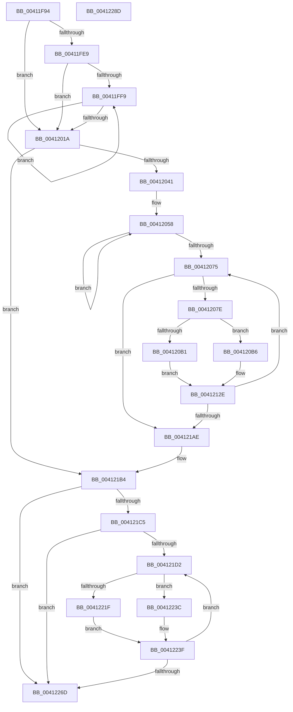

# PpmHeteroComputeMultiClassUnparkCount

- RVA: `0x00411F94`–`0x0041228E` (길이 `762` bytes)
- VA: `0x0000000140411F94`
- 실행 섹션: `.text`
- PDB 이름 있음: `예`; PDB Function 태그: `아니요`
- unwind 정보 RVA: `0x00099754`
- 디코드: `201`개 명령, `762/762` bytes 표시
- 미해석 바이트: `0` (있으면 어셈블리에 `.byte`로 보존)

> 이 문서는 커널 이미지의 기계어와 PDB 기호를 분석해 생성했습니다. 4번과 5번은 함수 원형과 자료형을 바이너리 사용 방식에서 추정한 C 해석이며 원본 소스 복구 결과는 아닙니다.

## 1. Dependencies

- 직접 호출 지점: **5**; 고유 호출 대상: **5**
- 직접 호출자로 확인된 함수: **1**
- RIP 상대 이미지 참조: **1**

### Outgoing calls
- `0x004120D6` → [PpmHeteroComputeCoreParkingUtilities](PpmHeteroComputeCoreParkingUtilities_function_00412AE0.md) (function, `0x00412AE0`)
- `0x00412117` → [PpmHeteroComputeUnparkCount](PpmHeteroComputeUnparkCount_function_00412294.md) (function, `0x00412294`)
- `0x00412180` → [PpmEventTraceMultiClassHeteroResponse](PpmEventTraceMultiClassHeteroResponse_function_004135AC.md) (function, `0x004135AC`)
- `0x00412253` → [PpmEventTraceMultiClassHeteroResponseUpdate](../4D/PpmEventTraceMultiClassHeteroResponseUpdate_function_004D0B1C.md) (function, `0x004D0B1C`)
- `0x00412274` → [_security_check_cookie](../6A/_security_check_cookie_function_006AC640.md) (function, `0x006AC640`)

### Direct callers
- [PpmCheckComputeMultiClassHeteroResponse](PpmCheckComputeMultiClassHeteroResponse_function_00412534.md) at `0x0041293A`

### Static image references
- `0x00411FAD` → RVA `0x00E0A740` (`.data`; read)

## 2. Other-region calls and transfers

- 다른 실행 섹션으로 향하는 call: **0**
- 별도 외부 분기/꼬리 이동을 확인하지 못했습니다.

## 3. Assembly (complete function range)

```asm
00411F94  40 55                           push rbp
00411F96  53                              push rbx
00411F97  56                              push rsi
00411F98  57                              push rdi
00411F99  41 54                           push r12
00411F9B  41 55                           push r13
00411F9D  41 56                           push r14
00411F9F  41 57                           push r15
00411FA1  48 8D 6C 24 F9                  lea rbp, [rsp - 7]
00411FA6  48 81 EC A8 00 00 00            sub rsp, 0xa8
00411FAD  48 8B 05 8C 87 9F 00            mov rax, qword ptr [rip + 0x9f878c]
00411FB4  48 33 C4                        xor rax, rsp
00411FB7  48 89 45 EF                     mov qword ptr [rbp - 0x11], rax
00411FBB  48 8B B1 80 04 00 00            mov rsi, qword ptr [rcx + 0x480]
00411FC2  45 33 D2                        xor r10d, r10d
00411FC5  4D 8B D8                        mov r11, r8
00411FC8  4C 89 4D BF                     mov qword ptr [rbp - 0x41], r9
00411FCC  48 8B D9                        mov rbx, rcx
00411FCF  4C 89 45 C7                     mov qword ptr [rbp - 0x39], r8
00411FD3  48 89 55 D7                     mov qword ptr [rbp - 0x29], rdx
00411FD7  45 8D 6A 01                     lea r13d, [r10 + 1]
00411FDB  44 89 55 AF                     mov dword ptr [rbp - 0x51], r10d
00411FDF  4C 89 55 CF                     mov qword ptr [rbp - 0x31], r10
00411FE3  44 38 55 7F                     cmp byte ptr [rbp + 0x7f], r10b
00411FE7  74 31                           je 0x14041201a
00411FE9  41 8B D5                        mov edx, r13d
00411FEC  4C 89 91 A8 04 00 00            mov qword ptr [rcx + 0x4a8], r10
00411FF3  44 38 69 0C                     cmp byte ptr [rcx + 0xc], r13b
00411FF7  76 21                           jbe 0x14041201a
00411FF9  8B C2                           mov eax, edx
00411FFB  41 03 D5                        add edx, r13d
00411FFE  48 8D 0C 80                     lea rcx, [rax + rax*4]
00412002  48 8B 83 08 05 00 00            mov rax, qword ptr [rbx + 0x508]
00412009  48 C1 E1 07                     shl rcx, 7
0041200D  4C 89 54 01 10                  mov qword ptr [rcx + rax + 0x10], r10
00412012  0F B6 43 0C                     movzx eax, byte ptr [rbx + 0xc]
00412016  3B D0                           cmp edx, eax
00412018  72 DF                           jb 0x140411ff9
0041201A  44 0F B6 43 0C                  movzx r8d, byte ptr [rbx + 0xc]
0041201F  0F 57 C0                        xorps xmm0, xmm0
00412022  0F B7 43 04                     movzx eax, word ptr [rbx + 4]
00412026  45 8B F2                        mov r14d, r10d
00412029  44 8B 65 6F                     mov r12d, dword ptr [rbp + 0x6f]
0041202D  45 8B FA                        mov r15d, r10d
00412030  0F 11 45 DF                     movups xmmword ptr [rbp - 0x21], xmm0
00412034  66 89 45 E7                     mov word ptr [rbp - 0x19], ax
00412038  45 3B C5                        cmp r8d, r13d
0041203B  0F 86 73 01 00 00               jbe 0x1404121b4
00412041  48 8B 8B 08 05 00 00            mov rcx, qword ptr [rbx + 0x508]
00412048  45 8D 48 FF                     lea r9d, [r8 - 1]
0041204C  48 8B 55 DF                     mov rdx, qword ptr [rbp - 0x21]
00412050  BF 80 02 00 00                  mov edi, 0x280
00412055  48 03 CF                        add rcx, rdi
00412058  0F B7 41 08                     movzx eax, word ptr [rcx + 8]
0041205C  48 0B 51 18                     or rdx, qword ptr [rcx + 0x18]
00412060  44 03 F0                        add r14d, eax
00412063  0F B7 01                        movzx eax, word ptr [rcx]
00412066  48 03 CF                        add rcx, rdi
00412069  44 03 F8                        add r15d, eax
0041206C  48 89 55 DF                     mov qword ptr [rbp - 0x21], rdx
00412070  4D 2B CD                        sub r9, r13
00412073  75 E3                           jne 0x140412058
00412075  45 85 E4                        test r12d, r12d
00412078  0F 84 30 01 00 00               je 0x1404121ae
0041207E  48 83 65 B7 00                  and qword ptr [rbp - 0x49], 0
00412083  41 8D 4D 01                     lea ecx, [r13 + 1]
00412087  41 8B C5                        mov eax, r13d
0041208A  89 4D B3                        mov dword ptr [rbp - 0x4d], ecx
0041208D  48 8D 3C 80                     lea rdi, [rax + rax*4]
00412091  48 C1 E7 07                     shl rdi, 7
00412095  48 03 BB 08 05 00 00            add rdi, qword ptr [rbx + 0x508]
0041209C  0F B7 47 08                     movzx eax, word ptr [rdi + 8]
004120A0  44 2B F0                        sub r14d, eax
004120A3  0F B7 07                        movzx eax, word ptr [rdi]
004120A6  44 2B F8                        sub r15d, eax
004120A9  41 0F B6 C0                     movzx eax, r8b
004120AD  3B C8                           cmp ecx, eax
004120AF  75 05                           jne 0x1404120b6
004120B1  45 33 C9                        xor r9d, r9d
004120B4  EB 78                           jmp 0x14041212e
004120B6  4C 8B 4D BF                     mov r9, qword ptr [rbp - 0x41]
004120BA  48 8D 45 B7                     lea rax, [rbp - 0x49]
004120BE  48 89 44 24 28                  mov qword ptr [rsp + 0x28], rax
004120C3  48 8D 55 DF                     lea rdx, [rbp - 0x21]
004120C7  48 8D 45 CF                     lea rax, [rbp - 0x31]
004120CB  4D 8B C3                        mov r8, r11
004120CE  41 8B CD                        mov ecx, r13d
004120D1  48 89 44 24 20                  mov qword ptr [rsp + 0x20], rax
004120D6  E8 05 0A 00 00                  call 0x140412ae0
004120DB  4C 8B 4D C7                     mov r9, qword ptr [rbp - 0x39]
004120DF  48 8D 45 AF                     lea rax, [rbp - 0x51]
004120E3  48 8B 55 D7                     mov rdx, qword ptr [rbp - 0x29]
004120E7  41 B8 01 00 00 00               mov r8d, 1
004120ED  48 89 44 24 48                  mov qword ptr [rsp + 0x48], rax
004120F2  41 8B CD                        mov ecx, r13d
004120F5  48 8B 45 B7                     mov rax, qword ptr [rbp - 0x49]
004120F9  44 89 7C 24 40                  mov dword ptr [rsp + 0x40], r15d
004120FE  44 89 74 24 38                  mov dword ptr [rsp + 0x38], r14d
00412103  48 89 44 24 30                  mov qword ptr [rsp + 0x30], rax
00412108  48 8B 45 BF                     mov rax, qword ptr [rbp - 0x41]
0041210C  48 89 44 24 28                  mov qword ptr [rsp + 0x28], rax
00412111  48 83 64 24 20 00               and qword ptr [rsp + 0x20], 0
00412117  E8 78 01 00 00                  call 0x140412294
0041211C  44 8B 4D AF                     mov r9d, dword ptr [rbp - 0x51]
00412120  44 8B D0                        mov r10d, eax
00412123  4C 8B 5D C7                     mov r11, qword ptr [rbp - 0x39]
00412127  45 3B CC                        cmp r9d, r12d
0041212A  45 0F 43 CC                     cmovae r9d, r12d
0041212E  0F B7 0F                        movzx ecx, word ptr [rdi]
00412131  41 8B D4                        mov edx, r12d
00412134  41 2B D1                        sub edx, r9d
00412137  48 89 74 24 48                  mov qword ptr [rsp + 0x48], rsi
0041213C  44 88 4C 24 40                  mov byte ptr [rsp + 0x40], r9b
00412141  3B D1                           cmp edx, ecx
00412143  44 89 4D AF                     mov dword ptr [rbp - 0x51], r9d
00412147  4C 8B 4D BF                     mov r9, qword ptr [rbp - 0x41]
0041214B  0F 43 D1                        cmovae edx, ecx
0041214E  44 8B C2                        mov r8d, edx
00412151  44 2B E2                        sub r12d, edx
00412154  44 88 44 24 38                  mov byte ptr [rsp + 0x38], r8b
00412159  41 8A CD                        mov cl, r13b
0041215C  8B C2                           mov eax, edx
0041215E  4D 8B C3                        mov r8, r11
00412161  48 0F AF C6                     imul rax, rsi
00412165  44 88 54 24 30                  mov byte ptr [rsp + 0x30], r10b
0041216A  48 8D 55 DF                     lea rdx, [rbp - 0x21]
0041216E  48 01 47 10                     add qword ptr [rdi + 0x10], rax
00412172  48 8B 45 B7                     mov rax, qword ptr [rbp - 0x49]
00412176  44 89 74 24 28                  mov dword ptr [rsp + 0x28], r14d
0041217B  48 89 44 24 20                  mov qword ptr [rsp + 0x20], rax
00412180  E8 27 14 00 00                  call 0x1404135ac
00412185  48 8B 47 18                     mov rax, qword ptr [rdi + 0x18]
00412189  41 BA 00 00 00 00               mov r10d, 0
0041218F  44 8B 6D B3                     mov r13d, dword ptr [rbp - 0x4d]
00412193  48 F7 D0                        not rax
00412196  48 21 45 DF                     and qword ptr [rbp - 0x21], rax
0041219A  0F B6 43 0C                     movzx eax, byte ptr [rbx + 0xc]
0041219E  4C 8B 5D C7                     mov r11, qword ptr [rbp - 0x39]
004121A2  44 8A C0                        mov r8b, al
004121A5  44 3B E8                        cmp r13d, eax
004121A8  0F 82 C7 FE FF FF               jb 0x140412075
004121AE  41 BD 01 00 00 00               mov r13d, 1
004121B4  48 01 B3 A8 04 00 00            add qword ptr [rbx + 0x4a8], rsi
004121BB  44 38 55 77                     cmp byte ptr [rbp + 0x77], r10b
004121BF  0F 84 A8 00 00 00               je 0x14041226d
004121C5  41 8B FD                        mov edi, r13d
004121C8  44 38 6B 0C                     cmp byte ptr [rbx + 0xc], r13b
004121CC  0F 86 9B 00 00 00               jbe 0x14041226d
004121D2  48 8B 8B A8 04 00 00            mov rcx, qword ptr [rbx + 0x4a8]
004121D9  8B C7                           mov eax, edi
004121DB  4C 8D 0C 80                     lea r9, [rax + rax*4]
004121DF  49 C1 E1 07                     shl r9, 7
004121E3  4C 03 8B 08 05 00 00            add r9, qword ptr [rbx + 0x508]
004121EA  49 3B CD                        cmp rcx, r13
004121ED  49 0F 42 CD                     cmovb rcx, r13
004121F1  33 D2                           xor edx, edx
004121F3  48 89 8B A8 04 00 00            mov qword ptr [rbx + 0x4a8], rcx
004121FA  48 8B C1                        mov rax, rcx
004121FD  48 D1 E8                        shr rax, 1
00412200  49 03 41 10                     add rax, qword ptr [r9 + 0x10]
00412204  48 F7 F1                        div rcx
00412207  0F B6 C8                        movzx ecx, al
0041220A  41 0F B7 01                     movzx eax, word ptr [r9]
0041220E  66 3B C8                        cmp cx, ax
00412211  66 0F 43 C8                     cmovae cx, ax
00412215  66 41 89 49 06                  mov word ptr [r9 + 6], cx
0041221A  66 85 C9                        test cx, cx
0041221D  74 1D                           je 0x14041223c
0041221F  49 8B 81 50 02 00 00            mov rax, qword ptr [r9 + 0x250]
00412226  49 3B F5                        cmp rsi, r13
00412229  0F B7 C9                        movzx ecx, cx
0041222C  49 0F 42 F5                     cmovb rsi, r13
00412230  33 D2                           xor edx, edx
00412232  48 6B 04 C8 64                  imul rax, qword ptr [rax + rcx*8], 0x64
00412237  48 F7 F6                        div rsi
0041223A  EB 03                           jmp 0x14041223f
0041223C  41 8A C2                        mov al, r10b
0041223F  41 88 81 7C 02 00 00            mov byte ptr [r9 + 0x27c], al
00412246  49 8B D1                        mov rdx, r9
00412249  4C 8B 83 A8 04 00 00            mov r8, qword ptr [rbx + 0x4a8]
00412250  40 8A CF                        mov cl, dil
00412253  E8 C4 E8 0B 00                  call 0x1404d0b1c
00412258  0F B6 43 0C                     movzx eax, byte ptr [rbx + 0xc]
0041225C  41 03 FD                        add edi, r13d
0041225F  41 BA 00 00 00 00               mov r10d, 0
00412265  3B F8                           cmp edi, eax
00412267  0F 82 65 FF FF FF               jb 0x1404121d2
0041226D  48 8B 4D EF                     mov rcx, qword ptr [rbp - 0x11]
00412271  48 33 CC                        xor rcx, rsp
00412274  E8 C7 A3 29 00                  call 0x1406ac640
00412279  48 81 C4 A8 00 00 00            add rsp, 0xa8
00412280  41 5F                           pop r15
00412282  41 5E                           pop r14
00412284  41 5D                           pop r13
00412286  41 5C                           pop r12
00412288  5F                              pop rdi
00412289  5E                              pop rsi
0041228A  5B                              pop rbx
0041228B  5D                              pop rbp
0041228C  C3                              ret
0041228D  CC                              int3
```

## 4. C-style interpretation (structured pseudocode)

```c
__int64 __fastcall PpmHeteroComputeMultiClassUnparkCount(__int64 a1, __int64 a2, __int64 a3, __int64 a4, unsigned int a5, unsigned __int8 a6, unsigned __int8 a7)
{
    __int64 result;
    __int64 v_r10;
    __int64 v_r12;
    __int64 v_r14;
    __int64 v_r15;
    __int64 v_rdi;
    __int64 v_rsi;
    __int64 v_rsp;
    unsigned __int64 v_stack_m47;
    unsigned __int64 v_stack_m58;
    unsigned __int16 v_stack_m60;
    unsigned __int64 v_stack_m68;
    unsigned __int64 v_stack_m70;
    unsigned __int64 v_stack_m78;
    unsigned __int64 v_stack_m80;
    unsigned __int64 v_stack_m88;
    unsigned __int64 v_stack_m90;
    unsigned int v_stack_m94;
    unsigned int v_stack_m98;
    unsigned __int64 v_stack_mA0;
    unsigned int v_stack_mA8;
    unsigned int v_stack_mB0;
    unsigned __int64 v_stack_mB8;
    unsigned __int64 v_stack_mC0;
    unsigned __int64 v_stack_mC8;

    v_rsp = (v_rsp) - (168);
    result = (*(unsigned __int64 *)(v_rip + 10454924)) ^ (v_rsp);
    v_stack_m58 = result;
    v_r10 = 0;
    v_stack_m88 = a4;
    v_stack_m80 = a3;
    v_stack_m70 = a2;
    v_stack_m98 = 0;
    v_stack_m78 = 0;
    if (a7 == 0) goto loc_0041201A;
    *(unsigned __int64 *)(a1 + 1192) = 0;
    if ((*(unsigned __int8 *)(a1 + 12)) <= ((unsigned __int8)(v_r10 + 1))) goto loc_0041201A;
loc_00411FF9:
    a2 = (unsigned int)(((unsigned int)((unsigned int)(v_r10 + 1))) + ((unsigned int)(v_r10 + 1)));
    a1 = ((unsigned int)((unsigned int)((unsigned int)((unsigned int)(v_r10 + 1)))) + (unsigned int)((unsigned int)((unsigned int)((unsigned int)(v_r10 + 1)))) * 4) << (7);
    *(unsigned __int64 *)(a1 + *(unsigned __int64 *)(a1 + 1288) * 1 + 16) = 0;
    if (((unsigned int)(a2)) < ((unsigned int)(*(unsigned __int8 *)(a1 + 12)))) goto loc_00411FF9;
loc_0041201A:
    v_stack_m68 = v_xmm0;
    v_stack_m60 = (unsigned __int16)(*(unsigned __int16 *)(a1 + 4));
    if (((unsigned int)(*(unsigned __int8 *)(a1 + 12))) <= ((unsigned int)(v_r10 + 1))) goto loc_004121B4;
    a1 = (*(unsigned __int64 *)(a1 + 1288)) + (640);
loc_00412058:
    a2 = (v_stack_m68) | (*(unsigned __int64 *)(a1 + 24));
    v_r14 = (unsigned int)((0) + ((unsigned int)(*(unsigned __int16 *)(a1 + 8))));
    a1 = (a1) + (640);
    v_r15 = (unsigned int)((0) + ((unsigned int)(*(unsigned __int16 *)(a1))));
    v_stack_m68 = a2;
    a4 = (*(unsigned __int8 *)(a1 + 12) - 1) - (v_r10 + 1);
    if (condition_is_not_equal) goto loc_00412058;
loc_00412075:
    if ((unsigned int)((unsigned int)(a5)) == 0) goto loc_004121AE;
    v_stack_m94 = (unsigned int)(v_r10 + 1 + 1);
    v_rdi = ((unsigned int)((unsigned int)(v_r10 + 1)) + (unsigned int)((unsigned int)(v_r10 + 1)) * 4) << (7);
    v_rdi = (v_rdi) + (*(unsigned __int64 *)(a1 + 1288));
    v_r14 = (unsigned int)((v_r14) - ((unsigned int)(*(unsigned __int16 *)(v_rdi + 8))));
    v_r15 = (unsigned int)((v_r15) - ((unsigned int)(*(unsigned __int16 *)(v_rdi))));
    if (((unsigned int)(v_r10 + 1 + 1)) != ((unsigned int)((unsigned __int8)(*(unsigned __int8 *)(a1 + 12))))) goto loc_004120B6;
    a4 = 0;
    goto loc_0041212E;
loc_004120B6:
    v_stack_mC0 = v_stack_m90;
    v_stack_mC8 = v_stack_m78;
    result = PpmHeteroComputeCoreParkingUtilities((unsigned int)((unsigned int)(v_r10 + 1)), v_stack_m68, a3, v_stack_m88);
    v_stack_mA0 = v_stack_m98;
    v_stack_mA8 = (unsigned int)(v_r15);
    v_stack_mB0 = (unsigned int)(v_r14);
    v_stack_mB8 = v_stack_m90;
    v_stack_mC0 = v_stack_m88;
    result = PpmHeteroComputeUnparkCount((unsigned int)((unsigned int)(v_r10 + 1)), v_stack_m70, 1, v_stack_m80);
    a4 = (unsigned int)(v_stack_m98);
    if (((unsigned int)((unsigned int)(v_stack_m98))) >= ((unsigned int)((unsigned int)(a5)))) { a4 = (unsigned int)((unsigned int)(a5)); }
loc_0041212E:
    a2 = (unsigned int)(((unsigned int)((unsigned int)((unsigned int)(a5)))) - ((unsigned int)(a4)));
    v_stack_mA0 = *(unsigned __int64 *)(a1 + 1152);
    v_stack_mA8 = (unsigned __int8)(a4);
    v_stack_m98 = (unsigned int)(a4);
    if (((unsigned int)(a2)) >= ((unsigned int)(*(unsigned __int16 *)(v_rdi)))) { a2 = (unsigned int)(*(unsigned __int16 *)(v_rdi)); }
    v_r12 = (unsigned int)(((unsigned int)(a5)) - ((unsigned int)(a2)));
    v_stack_mB0 = (unsigned __int8)((unsigned int)((unsigned int)(a2)));
    result = ((unsigned int)((unsigned int)(a2))) * (*(unsigned __int64 *)(a1 + 1152));
    v_stack_mB8 = (unsigned __int8)((unsigned int)((unsigned int)(result)));
    v_stack_mC0 = (unsigned int)(v_r14);
    v_stack_mC8 = v_stack_m90;
    result = PpmEventTraceMultiClassHeteroResponse((unsigned __int8)(v_r10 + 1), v_stack_m68, v_stack_m80, v_stack_m88);
    result = ~(*(unsigned __int64 *)(v_rdi + 24));
    if (((unsigned int)((unsigned int)(v_stack_m94))) < ((unsigned int)(*(unsigned __int8 *)(a1 + 12)))) goto loc_00412075;
loc_004121AE:
loc_004121B4:
    if (a6 == 0) goto loc_0041226D;
    if ((*(unsigned __int8 *)(a1 + 12)) <= 1) goto loc_0041226D;
loc_004121D2:
    a4 = (1 + 1 * 4) << (7);
    a4 = (a4) + (*(unsigned __int64 *)(a1 + 1288));
    a1 = *(unsigned __int64 *)(a1 + 1192);
    if ((*(unsigned __int64 *)(a1 + 1192)) < 1) { a1 = 1; }
    a2 = 0;
    *(unsigned __int64 *)(a1 + 1192) = a1;
    result = (a1) >> (1);
    result = (result) + (*(unsigned __int64 *)(a4 + 16));
    a1 = (unsigned __int8)(result);
    if (((unsigned __int16)((unsigned __int8)(result))) >= ((unsigned __int16)(*(unsigned __int16 *)(a4)))) { a1 = (unsigned __int16)(*(unsigned __int16 *)(a4)); }
    *(unsigned __int16 *)(a4 + 6) = (unsigned __int16)(a1);
    if ((unsigned __int16)(a1) == 0) goto loc_0041223C;
    v_rsi = *(unsigned __int64 *)(a1 + 1152);
    if ((*(unsigned __int64 *)(a1 + 1152)) < 1) { v_rsi = 1; }
    a2 = 0;
    result = (*(unsigned __int64 *)(a4 + 592)) * (*(unsigned __int64 *)(*(unsigned __int64 *)(a4 + 592) + (unsigned __int16)(a1) * 8));
    goto loc_0041223F;
loc_0041223C:
loc_0041223F:
    *(unsigned __int8 *)(a4 + 636) = 0;
    result = PpmEventTraceMultiClassHeteroResponseUpdate(1, a4, *(unsigned __int64 *)(a1 + 1192), a4);
    v_rdi = (unsigned int)((1) + (1));
    if (((unsigned int)(v_rdi)) < ((unsigned int)(*(unsigned __int8 *)(a1 + 12)))) goto loc_004121D2;
loc_0041226D:
    a1 = (v_stack_m58) ^ (v_rsp);
    result = _security_check_cookie(a1, a4, *(unsigned __int64 *)(a1 + 1192), a4);
    v_rsp = (v_rsp) + (168);
    return result;
}
```

## 5. (Beta) C Style

```c
int64_t PpmHeteroComputeMultiClassUnparkCount(void *Arg1, int64_t Arg2, int64_t Arg3, int64_t Arg4, uint32_t Arg5, uint8_t Arg6, uint8_t Arg7)
{
    uint8_t *arg1 = (uint8_t *)Arg1;

    int64_t result;
    int64_t local_r10;
    int64_t local_r12;
    int64_t local_r14;
    int64_t local_r15;
    int64_t local_rdi;
    int64_t local_rsi;
    int64_t local_rsp;
    uint64_t v_stack_m47;
    uint64_t v_stack_m58;
    uint16_t v_stack_m60;
    uint64_t v_stack_m68;
    uint64_t v_stack_m70;
    uint64_t v_stack_m78;
    uint64_t v_stack_m80;
    uint64_t v_stack_m88;
    uint64_t v_stack_m90;
    uint32_t v_stack_m94;
    uint32_t v_stack_m98;
    uint64_t v_stack_mA0;
    uint32_t v_stack_mA8;
    uint32_t v_stack_mB0;
    uint64_t v_stack_mB8;
    uint64_t v_stack_mC0;
    uint64_t v_stack_mC8;

    local_rsp = (local_rsp) - (168);
    result = (*(uint64_t *)(v_rip + 0x9F878C)) ^ (local_rsp);
    v_stack_m58 = result;
    local_r10 = 0;
    v_stack_m88 = Arg4;
    v_stack_m80 = Arg3;
    v_stack_m70 = Arg2;
    v_stack_m98 = 0;
    v_stack_m78 = 0;
    if (Arg7 == 0) goto loc_0041201A;
    *(uint64_t *)(arg1 + 0x4A8) = 0;
    if ((*(uint8_t *)(arg1 + 0xC)) <= ((uint8_t)(local_r10 + 1))) goto loc_0041201A;
loc_00411FF9:
    Arg2 = (uint32_t)(((uint32_t)((uint32_t)(local_r10 + 1))) + ((uint32_t)(local_r10 + 1)));
    Arg1 = ((uint32_t)((uint32_t)((uint32_t)((uint32_t)(local_r10 + 1)))) + (uint32_t)((uint32_t)((uint32_t)((uint32_t)(local_r10 + 1)))) * 4) << (7);
    *(uint64_t *)(arg1 + *(uint64_t *)(arg1 + 0x508) * 1 + 0x10) = 0;
    if (((uint32_t)(Arg2)) < ((uint32_t)(*(uint8_t *)(arg1 + 0xC)))) goto loc_00411FF9;
loc_0041201A:
    v_stack_m68 = v_xmm0;
    v_stack_m60 = (uint16_t)(*(uint16_t *)(arg1 + 0x4));
    if (((uint32_t)(*(uint8_t *)(arg1 + 0xC))) <= ((uint32_t)(local_r10 + 1))) goto loc_004121B4;
    Arg1 = (*(uint64_t *)(arg1 + 0x508)) + (640);
loc_00412058:
    Arg2 = (v_stack_m68) | (*(uint64_t *)(arg1 + 0x18));
    local_r14 = (uint32_t)((0) + ((uint32_t)(*(uint16_t *)(arg1 + 0x8))));
    Arg1 = (Arg1) + (640);
    local_r15 = (uint32_t)((0) + ((uint32_t)(*(uint16_t *)(arg1))));
    v_stack_m68 = Arg2;
    Arg4 = (*(uint8_t *)(arg1 + 0xC) - 1) - (local_r10 + 1);
    if (condition_is_not_equal) goto loc_00412058;
loc_00412075:
    if ((uint32_t)((uint32_t)(Arg5)) == 0) goto loc_004121AE;
    v_stack_m94 = (uint32_t)(local_r10 + 1 + 1);
    local_rdi = ((uint32_t)((uint32_t)(local_r10 + 1)) + (uint32_t)((uint32_t)(local_r10 + 1)) * 4) << (7);
    local_rdi = (local_rdi) + (*(uint64_t *)(arg1 + 0x508));
    local_r14 = (uint32_t)((local_r14) - ((uint32_t)(*(uint16_t *)(local_rdi + 0x8))));
    local_r15 = (uint32_t)((local_r15) - ((uint32_t)(*(uint16_t *)(local_rdi))));
    if (((uint32_t)(local_r10 + 1 + 1)) != ((uint32_t)((uint8_t)(*(uint8_t *)(arg1 + 0xC))))) goto loc_004120B6;
    Arg4 = 0;
    goto loc_0041212E;
loc_004120B6:
    v_stack_mC0 = v_stack_m90;
    v_stack_mC8 = v_stack_m78;
    result = PpmHeteroComputeCoreParkingUtilities((uint32_t)((uint32_t)(local_r10 + 1)), v_stack_m68, Arg3, v_stack_m88);
    v_stack_mA0 = v_stack_m98;
    v_stack_mA8 = (uint32_t)(local_r15);
    v_stack_mB0 = (uint32_t)(local_r14);
    v_stack_mB8 = v_stack_m90;
    v_stack_mC0 = v_stack_m88;
    result = PpmHeteroComputeUnparkCount((uint32_t)((uint32_t)(local_r10 + 1)), v_stack_m70, 1, v_stack_m80);
    Arg4 = (uint32_t)(v_stack_m98);
    if (((uint32_t)((uint32_t)(v_stack_m98))) >= ((uint32_t)((uint32_t)(Arg5)))) { Arg4 = (uint32_t)((uint32_t)(Arg5)); }
loc_0041212E:
    Arg2 = (uint32_t)(((uint32_t)((uint32_t)((uint32_t)(Arg5)))) - ((uint32_t)(Arg4)));
    v_stack_mA0 = *(uint64_t *)(arg1 + 0x480);
    v_stack_mA8 = (uint8_t)(Arg4);
    v_stack_m98 = (uint32_t)(Arg4);
    if (((uint32_t)(Arg2)) >= ((uint32_t)(*(uint16_t *)(local_rdi)))) { Arg2 = (uint32_t)(*(uint16_t *)(local_rdi)); }
    local_r12 = (uint32_t)(((uint32_t)(Arg5)) - ((uint32_t)(Arg2)));
    v_stack_mB0 = (uint8_t)((uint32_t)((uint32_t)(Arg2)));
    result = ((uint32_t)((uint32_t)(Arg2))) * (*(uint64_t *)(arg1 + 0x480));
    v_stack_mB8 = (uint8_t)((uint32_t)((uint32_t)(result)));
    v_stack_mC0 = (uint32_t)(local_r14);
    v_stack_mC8 = v_stack_m90;
    result = PpmEventTraceMultiClassHeteroResponse((uint8_t)(local_r10 + 1), v_stack_m68, v_stack_m80, v_stack_m88);
    result = ~(*(uint64_t *)(local_rdi + 0x18));
    if (((uint32_t)((uint32_t)(v_stack_m94))) < ((uint32_t)(*(uint8_t *)(arg1 + 0xC)))) goto loc_00412075;
loc_004121AE:
loc_004121B4:
    if (Arg6 == 0) goto loc_0041226D;
    if ((*(uint8_t *)(arg1 + 0xC)) <= 1) goto loc_0041226D;
loc_004121D2:
    Arg4 = (1 + 1 * 4) << (7);
    Arg4 = (Arg4) + (*(uint64_t *)(arg1 + 0x508));
    Arg1 = *(uint64_t *)(arg1 + 0x4A8);
    if ((*(uint64_t *)(arg1 + 0x4A8)) < 1) { Arg1 = 1; }
    Arg2 = 0;
    *(void **)(arg1 + 0x4A8) = Arg1;
    result = (Arg1) >> (1);
    result = (result) + (*(uint64_t *)(Arg4 + 0x10));
    Arg1 = (uint8_t)(result);
    if (((uint16_t)((uint8_t)(result))) >= ((uint16_t)(*(uint16_t *)(Arg4)))) { Arg1 = (uint16_t)(*(uint16_t *)(Arg4)); }
    *(uint16_t *)(Arg4 + 0x6) = (uint16_t)(Arg1);
    if ((uint16_t)(Arg1) == 0) goto loc_0041223C;
    local_rsi = *(uint64_t *)(arg1 + 0x480);
    if ((*(uint64_t *)(arg1 + 0x480)) < 1) { local_rsi = 1; }
    Arg2 = 0;
    result = (*(uint64_t *)(Arg4 + 0x250)) * (*(uint64_t *)(*(uint64_t *)(Arg4 + 0x250) + (uint16_t)(arg1) * 8));
    goto loc_0041223F;
loc_0041223C:
loc_0041223F:
    *(uint8_t *)(Arg4 + 0x27C) = 0;
    result = PpmEventTraceMultiClassHeteroResponseUpdate(1, Arg4, *(uint64_t *)(arg1 + 0x4A8), Arg4);
    local_rdi = (uint32_t)((1) + (1));
    if (((uint32_t)(local_rdi)) < ((uint32_t)(*(uint8_t *)(arg1 + 0xC)))) goto loc_004121D2;
loc_0041226D:
    Arg1 = (v_stack_m58) ^ (local_rsp);
    result = _security_check_cookie(Arg1, Arg4, *(uint64_t *)(arg1 + 0x4A8), Arg4);
    local_rsp = (local_rsp) + (168);
    return result;
}
```

### 관측된 메모리 오프셋

구조체 형식이 확인되지 않은 접근은 인자 기준의 오프셋으로만 기록했습니다.

| 기준 인자 | 오프셋 표현 | 폭 (bit) | 접근 |
|---|---:|---:|---|
| `Arg1` | `+ 0x4` | `16` | `R` |
| `Arg1` | `+ 0xC` | `8` | `R` |
| `Arg1` | `+ 0x480` | `64` | `R` |
| `Arg1` | `+ 0x4A8` | `64` | `R` |
| `Arg1` | `+ 0x4A8` | `64` | `R/W` |
| `Arg1` | `+ 0x4A8` | `64` | `W` |
| `Arg1` | `+ 0x508` | `64` | `R` |

## 6. Execution-region graph

[열기: 2D/3D 그래프와 함수 탐색 컨트롤 패널](../../../control-panel.html?section=text&rva=0x00411F94&view=graph)

- 2D 그래프는 위에서 아래로 흐르고, 3D 그래프는 빈 공간을 드래그해 회전합니다. Shift+드래그는 이동, 휠은 확대·축소, 함수 노드 선택은 대상 보고서 이동입니다.

### Static fallback


