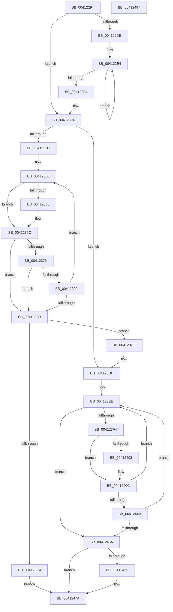

# PpmHeteroComputeUnparkCount

- RVA: `0x00412294`–`0x00412498` (길이 `516` bytes)
- VA: `0x0000000140412294`
- 실행 섹션: `.text`
- PDB 이름 있음: `예`; PDB Function 태그: `아니요`
- unwind 정보 RVA: `0x00094E74`
- 디코드: `137`개 명령, `516/516` bytes 표시
- 미해석 바이트: `0` (있으면 어셈블리에 `.byte`로 보존)

> 이 문서는 커널 이미지의 기계어와 PDB 기호를 분석해 생성했습니다. 4번과 5번은 함수 원형과 자료형을 바이너리 사용 방식에서 추정한 C 해석이며 원본 소스 복구 결과는 아닙니다.

## 1. Dependencies

- 직접 호출 지점: **4**; 고유 호출 대상: **1**
- 직접 호출자로 확인된 함수: **1**
- RIP 상대 이미지 참조: **0**

### Outgoing calls
- `0x0041236D` → [PpmHeteroUtilityGreaterThanOrEqualThreshold](PpmHeteroUtilityGreaterThanOrEqualThreshold_function_004124A0.md) (function, `0x004124A0`)
- `0x00412389` → [PpmHeteroUtilityGreaterThanOrEqualThreshold](PpmHeteroUtilityGreaterThanOrEqualThreshold_function_004124A0.md) (function, `0x004124A0`)
- `0x0041243A` → [PpmHeteroUtilityGreaterThanOrEqualThreshold](PpmHeteroUtilityGreaterThanOrEqualThreshold_function_004124A0.md) (function, `0x004124A0`)
- `0x00412459` → [PpmHeteroUtilityGreaterThanOrEqualThreshold](PpmHeteroUtilityGreaterThanOrEqualThreshold_function_004124A0.md) (function, `0x004124A0`)

### Direct callers
- [PpmHeteroComputeMultiClassUnparkCount](PpmHeteroComputeMultiClassUnparkCount_function_00411F94.md) at `0x00412117`

### Static image references
- 디코드된 RIP-relative 메모리 참조가 없습니다.

## 2. Other-region calls and transfers

- 다른 실행 섹션으로 향하는 call: **0**
- 별도 외부 분기/꼬리 이동을 확인하지 못했습니다.

## 3. Assembly (complete function range)

```asm
00412294  48 8B C4                        mov rax, rsp
00412297  4C 89 48 20                     mov qword ptr [rax + 0x20], r9
0041229B  4C 89 40 18                     mov qword ptr [rax + 0x18], r8
0041229F  48 89 50 10                     mov qword ptr [rax + 0x10], rdx
004122A3  89 48 08                        mov dword ptr [rax + 8], ecx
004122A6  53                              push rbx
004122A7  55                              push rbp
004122A8  56                              push rsi
004122A9  57                              push rdi
004122AA  41 54                           push r12
004122AC  41 55                           push r13
004122AE  41 56                           push r14
004122B0  41 57                           push r15
004122B2  48 83 EC 48                     sub rsp, 0x48
004122B6  44 8B B4 24 C8 00 00 00         mov r14d, dword ptr [rsp + 0xc8]
004122BE  33 FF                           xor edi, edi
004122C0  48 8B B4 24 C0 00 00 00         mov rsi, qword ptr [rsp + 0xc0]
004122C8  44 8B F9                        mov r15d, ecx
004122CB  48 8B 8C 24 B8 00 00 00         mov rcx, qword ptr [rsp + 0xb8]
004122D3  4D 8B D8                        mov r11, r8
004122D6  45 8B D6                        mov r10d, r14d
004122D9  45 85 F6                        test r14d, r14d
004122DC  74 26                           je 0x140412304
004122DE  4C 8B C9                        mov r9, rcx
004122E1  41 8B D6                        mov edx, r14d
004122E4  41 8B 01                        mov eax, dword ptr [r9]
004122E7  4D 8D 49 04                     lea r9, [r9 + 4]
004122EB  48 2B F0                        sub rsi, rax
004122EE  48 83 EA 01                     sub rdx, 1
004122F2  75 F0                           jne 0x1404122e4
004122F4  4C 8B 8C 24 A8 00 00 00         mov r9, qword ptr [rsp + 0xa8]
004122FC  48 8B 94 24 98 00 00 00         mov rdx, qword ptr [rsp + 0x98]
00412304  41 8B DE                        mov ebx, r14d
00412307  4C 8B A4 24 B0 00 00 00         mov r12, qword ptr [rsp + 0xb0]
0041230F  44 3B B4 24 D0 00 00 00         cmp r14d, dword ptr [rsp + 0xd0]
00412317  0F 83 C1 00 00 00               jae 0x1404123de
0041231D  4E 8D 3C B1                     lea r15, [rcx + r14*4]
00412321  44 8B B4 24 90 00 00 00         mov r14d, dword ptr [rsp + 0x90]
00412329  41 8B C6                        mov eax, r14d
0041232C  4F 8D 2C D4                     lea r13, [r12 + r10*8]
00412330  F7 D8                           neg eax
00412332  49 8B C1                        mov rax, r9
00412335  48 1B ED                        sbb rbp, rbp
00412338  83 E5 40                        and ebp, 0x40
0041233B  48 81 C5 33 01 00 00            add rbp, 0x133
00412342  49 03 EA                        add rbp, r10
00412345  48 03 EA                        add rbp, rdx
00412348  48 2B C1                        sub rax, rcx
0041234B  48 89 44 24 30                  mov qword ptr [rsp + 0x30], rax
00412350  4C 8B C7                        mov r8, rdi
00412353  4D 85 E4                        test r12, r12
00412356  74 04                           je 0x14041235c
00412358  4D 8B 45 00                     mov r8, qword ptr [r13]
0041235C  44 0F B6 4D 00                  movzx r9d, byte ptr [rbp]
00412361  49 8B CB                        mov rcx, r11
00412364  42 8B 14 38                     mov edx, dword ptr [rax + r15]
00412368  44 89 74 24 20                  mov dword ptr [rsp + 0x20], r14d
0041236D  E8 2E 01 00 00                  call 0x1404124a0
00412372  85 C0                           test eax, eax
00412374  74 45                           je 0x1404123bb
00412376  48 8B 8C 24 A0 00 00 00         mov rcx, qword ptr [rsp + 0xa0]
0041237E  45 33 C0                        xor r8d, r8d
00412381  48 8B D6                        mov rdx, rsi
00412384  44 89 74 24 20                  mov dword ptr [rsp + 0x20], r14d
00412389  E8 12 01 00 00                  call 0x1404124a0
0041238E  85 C0                           test eax, eax
00412390  74 29                           je 0x1404123bb
00412392  41 8B 07                        mov eax, dword ptr [r15]
00412395  FF C3                           inc ebx
00412397  4C 8B 9C 24 A0 00 00 00         mov r11, qword ptr [rsp + 0xa0]
0041239F  48 2B F0                        sub rsi, rax
004123A2  48 8B 44 24 30                  mov rax, qword ptr [rsp + 0x30]
004123A7  49 83 C5 08                     add r13, 8
004123AB  48 FF C5                        inc rbp
004123AE  49 83 C7 04                     add r15, 4
004123B2  3B 9C 24 D0 00 00 00            cmp ebx, dword ptr [rsp + 0xd0]
004123B9  72 95                           jb 0x140412350
004123BB  3B 9C 24 C8 00 00 00            cmp ebx, dword ptr [rsp + 0xc8]
004123C2  76 0A                           jbe 0x1404123ce
004123C4  BF 02 00 00 00                  mov edi, 2
004123C9  E9 AC 00 00 00                  jmp 0x14041247a
004123CE  44 8B BC 24 90 00 00 00         mov r15d, dword ptr [rsp + 0x90]
004123D6  4C 8B 9C 24 A0 00 00 00         mov r11, qword ptr [rsp + 0xa0]
004123DE  4C 8B AC 24 B8 00 00 00         mov r13, qword ptr [rsp + 0xb8]
004123E6  4C 8B B4 24 A8 00 00 00         mov r14, qword ptr [rsp + 0xa8]
004123EE  8B EB                           mov ebp, ebx
004123F0  85 DB                           test ebx, ebx
004123F2  74 76                           je 0x14041246a
004123F4  FF CB                           dec ebx
004123F6  4C 8B C7                        mov r8, rdi
004123F9  8B D3                           mov edx, ebx
004123FB  41 8B 44 9D 00                  mov eax, dword ptr [r13 + rbx*4]
00412400  48 03 F0                        add rsi, rax
00412403  4D 85 E4                        test r12, r12
00412406  74 04                           je 0x14041240c
00412408  4D 8B 04 DC                     mov r8, qword ptr [r12 + rbx*8]
0041240C  41 8B C7                        mov eax, r15d
0041240F  44 89 7C 24 20                  mov dword ptr [rsp + 0x20], r15d
00412414  F7 D8                           neg eax
00412416  48 8B 84 24 98 00 00 00         mov rax, qword ptr [rsp + 0x98]
0041241E  48 1B C9                        sbb rcx, rcx
00412421  48 81 C2 B3 00 00 00            add rdx, 0xb3
00412428  83 E1 40                        and ecx, 0x40
0041242B  48 03 CA                        add rcx, rdx
0041242E  41 8B 14 9E                     mov edx, dword ptr [r14 + rbx*4]
00412432  44 0F B6 0C 01                  movzx r9d, byte ptr [rcx + rax]
00412437  49 8B CB                        mov rcx, r11
0041243A  E8 61 00 00 00                  call 0x1404124a0
0041243F  4C 8B 9C 24 A0 00 00 00         mov r11, qword ptr [rsp + 0xa0]
00412447  85 C0                           test eax, eax
00412449  74 A3                           je 0x1404123ee
0041244B  45 33 C0                        xor r8d, r8d
0041244E  44 89 7C 24 20                  mov dword ptr [rsp + 0x20], r15d
00412453  48 8B D6                        mov rdx, rsi
00412456  49 8B CB                        mov rcx, r11
00412459  E8 42 00 00 00                  call 0x1404124a0
0041245E  4C 8B 9C 24 A0 00 00 00         mov r11, qword ptr [rsp + 0xa0]
00412466  85 C0                           test eax, eax
00412468  74 84                           je 0x1404123ee
0041246A  8B DD                           mov ebx, ebp
0041246C  3B AC 24 C8 00 00 00            cmp ebp, dword ptr [rsp + 0xc8]
00412473  73 05                           jae 0x14041247a
00412475  BF 01 00 00 00                  mov edi, 1
0041247A  48 8B 8C 24 D8 00 00 00         mov rcx, qword ptr [rsp + 0xd8]
00412482  8B C7                           mov eax, edi
00412484  89 19                           mov dword ptr [rcx], ebx
00412486  48 83 C4 48                     add rsp, 0x48
0041248A  41 5F                           pop r15
0041248C  41 5E                           pop r14
0041248E  41 5D                           pop r13
00412490  41 5C                           pop r12
00412492  5F                              pop rdi
00412493  5E                              pop rsi
00412494  5D                              pop rbp
00412495  5B                              pop rbx
00412496  C3                              ret
00412497  CC                              int3
```

## 4. C-style interpretation (structured pseudocode)

```c
__int64 __fastcall PpmHeteroComputeUnparkCount(int a1, __int64 a2, __int64 a3, __int64 a4, __int64 a5, __int64 a6, __int64 a7, unsigned int a8, unsigned int a9, __int64 a10)
{
    __int64 result;
    __int64 v_r13;
    __int64 v_r15;
    __int64 v_rbp;
    __int64 v_rbx;
    __int64 v_rdi;
    __int64 v_rsi;
    __int64 v_rsp;
    unsigned __int64 v_stack_m58;
    unsigned int v_stack_m68;
    unsigned __int64 v_stack_p10;
    unsigned __int64 v_stack_p18;
    unsigned __int64 v_stack_p20;
    unsigned int v_stack_p8;

    *(unsigned __int64 *)(v_rsp + 32) = a4;
    *(unsigned __int64 *)(v_rsp + 24) = a3;
    *(unsigned __int64 *)(v_rsp + 16) = a2;
    *(unsigned int *)(v_rsp + 8) = a1;
    v_rsp = (v_rsp) - (72);
    v_rdi = 0;
    if ((unsigned int)((unsigned int)(a8)) == 0) goto loc_00412304;
loc_004122E4:
    v_rsi = (a7) - ((unsigned int)(*(unsigned int *)(a6)));
    a2 = ((unsigned int)((unsigned int)((unsigned int)(a8)))) - (1);
    if (condition_is_not_equal) goto loc_004122E4;
loc_00412304:
    if (((unsigned int)((unsigned int)(a8))) >= a9) goto loc_004123DE;
    result = (unsigned int)(-((unsigned int)((unsigned int)((unsigned int)(v_stack_p8)))));
    v_rbp = (unsigned int)((v_rbp) & (64));
    v_rbp = (v_rbp) + (307);
    v_rbp = (v_rbp) + ((unsigned int)((unsigned int)((unsigned int)(a8))));
    v_rbp = (v_rbp) + (v_stack_p10);
    result = (v_stack_p20) - (a6);
    v_stack_m58 = result;
loc_00412350:
    if (a5 != 0) {
        a3 = *(unsigned __int64 *)(a5 + (unsigned int)((unsigned int)((unsigned int)(a8))) * 8);
    }
    v_stack_m68 = (unsigned int)((unsigned int)(v_stack_p8));
    result = PpmHeteroUtilityGreaterThanOrEqualThreshold(a3, (unsigned int)(*(unsigned int *)(result + a6 + (unsigned int)(a8) * 4 * 1)), a3, *(unsigned __int8 *)(v_rbp));
    if ((unsigned int)(result) == 0) goto loc_004123BB;
    a3 = 0;
    v_stack_m68 = (unsigned int)((unsigned int)(v_stack_p8));
    result = PpmHeteroUtilityGreaterThanOrEqualThreshold(v_stack_p18, v_rsi, a3, *(unsigned __int8 *)(v_rbp));
    if ((unsigned int)(result) == 0) goto loc_004123BB;
    v_rbx = (unsigned int)(((unsigned int)((unsigned int)((unsigned int)(a8)))) + 1);
    v_rsi = (v_rsi) - ((unsigned int)(*(unsigned int *)(a6 + (unsigned int)(a8) * 4)));
    v_r13 = (a5 + (unsigned int)((unsigned int)((unsigned int)(a8))) * 8) + (8);
    v_rbp = (v_rbp) + 1;
    v_r15 = (a6 + (unsigned int)(a8) * 4) + (4);
    if (((unsigned int)(v_rbx)) < a9) goto loc_00412350;
loc_004123BB:
    if (((unsigned int)(v_rbx)) <= a8) goto loc_004123CE;
    goto loc_0041247A;
loc_004123CE:
loc_004123DE:
loc_004123EE:
    if ((unsigned int)(v_rbx) == 0) goto loc_0041246A;
    v_rbx = (unsigned int)((v_rbx) - 1);
    v_rsi = (v_rsi) + ((unsigned int)(*(unsigned int *)(a6 + v_rbx * 4)));
    if (a5 != 0) {
        a3 = *(unsigned __int64 *)(a5 + v_rbx * 8);
    }
    v_stack_m68 = (unsigned int)((unsigned int)(v_stack_p8));
    result = (unsigned int)(-((unsigned int)((unsigned int)((unsigned int)(v_stack_p8)))));
    a2 = ((unsigned int)((unsigned int)(v_rbx))) + (179);
    a1 = (unsigned int)((v_stack_p18) & (64));
    a1 = (a1) + (a2);
    result = PpmHeteroUtilityGreaterThanOrEqualThreshold(v_stack_p18, (unsigned int)(*(unsigned int *)(v_stack_p20 + v_rbx * 4)), a3, *(unsigned __int8 *)(a1 + v_stack_p10 * 1));
    if ((unsigned int)(result) == 0) goto loc_004123EE;
    a3 = 0;
    v_stack_m68 = (unsigned int)((unsigned int)(v_stack_p8));
    result = PpmHeteroUtilityGreaterThanOrEqualThreshold(v_stack_p18, v_rsi, a3, *(unsigned __int8 *)(a1 + v_stack_p10 * 1));
    if ((unsigned int)(result) == 0) goto loc_004123EE;
loc_0041246A:
    v_rdi = 2;
    if (((unsigned int)((unsigned int)((unsigned int)(v_rbx)))) < a8) {
        v_rdi = 1;
    }
    *(unsigned int *)(a10) = (unsigned int)((unsigned int)((unsigned int)((unsigned int)((unsigned int)(v_rbx)))));
    v_rsp = (v_rsp) + (72);
    return (unsigned int)((unsigned int)(v_rdi));
}
```

## 5. (Beta) C Style

```c
int64_t PpmHeteroComputeUnparkCount(int32_t Arg1, int64_t Arg2, int64_t Arg3, int64_t Arg4, void *Arg5, void *Arg6, int64_t Arg7, uint32_t Arg8, uint32_t Arg9, void *Arg10)
{
    uint8_t *arg5 = (uint8_t *)Arg5;
    uint8_t *arg6 = (uint8_t *)Arg6;
    uint8_t *arg10 = (uint8_t *)Arg10;

    int64_t result;
    int64_t local_r13;
    int64_t local_r15;
    int64_t local_rbp;
    int64_t local_rbx;
    int64_t local_rdi;
    int64_t local_rsi;
    int64_t local_rsp;
    uint64_t v_stack_m58;
    uint32_t v_stack_m68;
    uint64_t v_stack_p10;
    uint64_t v_stack_p18;
    uint64_t v_stack_p20;
    uint32_t v_stack_p8;

    *(uint64_t *)(local_rsp + 0x20) = Arg4;
    *(uint64_t *)(local_rsp + 0x18) = Arg3;
    *(uint64_t *)(local_rsp + 0x10) = Arg2;
    *(uint32_t *)(local_rsp + 0x8) = Arg1;
    local_rsp = (local_rsp) - (72);
    local_rdi = 0;
    if ((uint32_t)((uint32_t)(Arg8)) == 0) goto loc_00412304;
loc_004122E4:
    local_rsi = (Arg7) - ((uint32_t)(*(uint32_t *)(arg6)));
    Arg2 = ((uint32_t)((uint32_t)((uint32_t)(Arg8)))) - (1);
    if (condition_is_not_equal) goto loc_004122E4;
loc_00412304:
    if (((uint32_t)((uint32_t)(Arg8))) >= Arg9) goto loc_004123DE;
    result = (uint32_t)(-((uint32_t)((uint32_t)((uint32_t)(v_stack_p8)))));
    local_rbp = (uint32_t)((local_rbp) & (64));
    local_rbp = (local_rbp) + (307);
    local_rbp = (local_rbp) + ((uint32_t)((uint32_t)((uint32_t)(Arg8))));
    local_rbp = (local_rbp) + (v_stack_p10);
    result = (v_stack_p20) - (Arg6);
    v_stack_m58 = result;
loc_00412350:
    if (Arg5 != NULL) {
        Arg3 = *(uint64_t *)(arg5 + (uint32_t)((uint32_t)((uint32_t)(Arg8))) * 8);
    }
    v_stack_m68 = (uint32_t)((uint32_t)(v_stack_p8));
    result = PpmHeteroUtilityGreaterThanOrEqualThreshold(Arg3, (uint32_t)(*(uint32_t *)(result + arg6 + (uint32_t)(Arg8) * 4 * 1)), Arg3, *(uint8_t *)(local_rbp));
    if ((uint32_t)(result) == 0) goto loc_004123BB;
    Arg3 = 0;
    v_stack_m68 = (uint32_t)((uint32_t)(v_stack_p8));
    result = PpmHeteroUtilityGreaterThanOrEqualThreshold(v_stack_p18, local_rsi, Arg3, *(uint8_t *)(local_rbp));
    if ((uint32_t)(result) == 0) goto loc_004123BB;
    local_rbx = (uint32_t)(((uint32_t)((uint32_t)((uint32_t)(Arg8)))) + 1);
    local_rsi = (local_rsi) - ((uint32_t)(*(uint32_t *)(arg6 + (uint32_t)(Arg8) * 4)));
    local_r13 = (Arg5 + (uint32_t)((uint32_t)((uint32_t)(Arg8))) * 8) + (8);
    local_rbp = (local_rbp) + 1;
    local_r15 = (Arg6 + (uint32_t)(Arg8) * 4) + (4);
    if (((uint32_t)(local_rbx)) < Arg9) goto loc_00412350;
loc_004123BB:
    if (((uint32_t)(local_rbx)) <= Arg8) goto loc_004123CE;
    goto loc_0041247A;
loc_004123CE:
loc_004123DE:
loc_004123EE:
    if ((uint32_t)(local_rbx) == 0) goto loc_0041246A;
    local_rbx = (uint32_t)((local_rbx) - 1);
    local_rsi = (local_rsi) + ((uint32_t)(*(uint32_t *)(arg6 + local_rbx * 4)));
    if (Arg5 != NULL) {
        Arg3 = *(uint64_t *)(arg5 + local_rbx * 8);
    }
    v_stack_m68 = (uint32_t)((uint32_t)(v_stack_p8));
    result = (uint32_t)(-((uint32_t)((uint32_t)((uint32_t)(v_stack_p8)))));
    Arg2 = ((uint32_t)((uint32_t)(local_rbx))) + (179);
    Arg1 = (uint32_t)((v_stack_p18) & (64));
    Arg1 = (Arg1) + (Arg2);
    result = PpmHeteroUtilityGreaterThanOrEqualThreshold(v_stack_p18, (uint32_t)(*(uint32_t *)(v_stack_p20 + local_rbx * 4)), Arg3, *(uint8_t *)(Arg1 + v_stack_p10 * 1));
    if ((uint32_t)(result) == 0) goto loc_004123EE;
    Arg3 = 0;
    v_stack_m68 = (uint32_t)((uint32_t)(v_stack_p8));
    result = PpmHeteroUtilityGreaterThanOrEqualThreshold(v_stack_p18, local_rsi, Arg3, *(uint8_t *)(Arg1 + v_stack_p10 * 1));
    if ((uint32_t)(result) == 0) goto loc_004123EE;
loc_0041246A:
    local_rdi = 2;
    if (((uint32_t)((uint32_t)((uint32_t)(local_rbx)))) < Arg8) {
        local_rdi = 1;
    }
    *(uint32_t *)(arg10) = (uint32_t)((uint32_t)((uint32_t)((uint32_t)((uint32_t)(local_rbx)))));
    local_rsp = (local_rsp) + (72);
    return (uint32_t)((uint32_t)(local_rdi));
}
```

### 관측된 메모리 오프셋

구조체 형식이 확인되지 않은 접근은 인자 기준의 오프셋으로만 기록했습니다.

| 기준 인자 | 오프셋 표현 | 폭 (bit) | 접근 |
|---|---:|---:|---|
| `Arg5` | `+ 0x0` | `64` | `R` |
| `Arg5` | `+ 0x0 + r10*8` | `64` | `R` |
| `Arg6` | `+ 0x0` | `32` | `R` |
| `Arg6` | `+ 0x0 + r14*4` | `64` | `R` |
| `Arg6` | `+ 0x0 + rbx*4` | `32` | `R` |
| `Arg6` | `+ 0x4` | `64` | `R` |
| `Arg10` | `+ 0x0` | `32` | `W` |

## 6. Execution-region graph

[열기: 2D/3D 그래프와 함수 탐색 컨트롤 패널](../../../control-panel.html?section=text&rva=0x00412294&view=graph)

- 2D 그래프는 위에서 아래로 흐르고, 3D 그래프는 빈 공간을 드래그해 회전합니다. Shift+드래그는 이동, 휠은 확대·축소, 함수 노드 선택은 대상 보고서 이동입니다.

### Static fallback


