# PpmHeteroHgsCalculateContainmentCount

- RVA: `0x004144E4`–`0x00414800` (길이 `796` bytes)
- VA: `0x00000001404144E4`
- 실행 섹션: `.text`
- PDB 이름 있음: `예`; PDB Function 태그: `예`
- unwind 정보 RVA: `0x0009C120`
- 디코드: `172`개 명령, `796/796` bytes 표시
- 미해석 바이트: `0` (있으면 어셈블리에 `.byte`로 보존)

> 이 문서는 커널 이미지의 기계어와 PDB 기호를 분석해 생성했습니다. 4번과 5번은 함수 원형과 자료형을 바이너리 사용 방식에서 추정한 C 해석이며 원본 소스 복구 결과는 아닙니다.

## 1. Dependencies

- 직접 호출 지점: **3**; 고유 호출 대상: **3**
- 직접 호출자로 확인된 함수: **1**
- RIP 상대 이미지 참조: **3**

### Outgoing calls
- `0x00414629` → [Feature_PpmParkEx__private_IsEnabledDeviceUsageNoInline](../4F/Feature_PpmParkEx__private_IsEnabledDeviceUsageNoInline_function_004F135C.md) (function, `0x004F135C`)
- `0x00414662` → [PpmEventHgsContainmentUnparkedCountEx](../4F/PpmEventHgsContainmentUnparkedCountEx_function_004F5010.md) (function, `0x004F5010`)
- `0x00414693` → [PpmEventHgsContainmentUnparkedCount](PpmEventHgsContainmentUnparkedCount_function_00414808.md) (function, `0x00414808`)

### Direct callers
- [PpmParkCalculateUnparkCount](PpmParkCalculateUnparkCount_function_00413750.md) at `0x00413A19`

### Static image references
- `0x004144FE` → RVA `0x00FC501C` (`ALMOSTRO`; read)
- `0x00414539` → RVA `0x00E08380` (`.data`; read)
- `0x00414545` → RVA `0x00F0CE0C` (`.data`; read)

## 2. Other-region calls and transfers

- 다른 실행 섹션으로 향하는 call: **0**
- call이 아닌 외부 분기/꼬리 이동: **14**
  - `0x004146E1` → [sub_006ED29C](../6E/Unknown_function_006ED29C.md) (`tail-transfer`)
  - `0x00414716` → [sub_006ED29C + 0x51](../6E/Unknown_function_006ED29C.md) (`tail-transfer`)
  - `0x0041471F` → [sub_006ED29C + 0x51](../6E/Unknown_function_006ED29C.md) (`tail-transfer`)
  - `0x0041472F` → [sub_006ED29C + 0x3D](../6E/Unknown_function_006ED29C.md) (`tail-transfer`)
  - `0x0041474E` → [sub_006ED29C + 0x64](../6E/Unknown_function_006ED29C.md) (`tail-transfer`)
  - `0x0041475A` → [sub_006ED29C + 0x61](../6E/Unknown_function_006ED29C.md) (`tail-transfer`)
  - `0x0041476B` → [sub_006ED29C + 0x61](../6E/Unknown_function_006ED29C.md) (`tail-transfer`)
  - `0x00414785` → [sub_006ED29C + 0x7B](../6E/Unknown_function_006ED29C.md) (`tail-transfer`)
  - `0x00414792` → [sub_006ED29C + 0x70](../6E/Unknown_function_006ED29C.md) (`tail-transfer`)
  - `0x0041479F` → [sub_006ED29C + 0x70](../6E/Unknown_function_006ED29C.md) (`tail-transfer`)
  - `0x004147A9` → [sub_006ED29C + 0x70](../6E/Unknown_function_006ED29C.md) (`tail-transfer`)
  - `0x004147B6` → [sub_006ED29C + 0x7B](../6E/Unknown_function_006ED29C.md) (`tail-transfer`)
  - `0x004147EB` → [sub_006ED29C + 0x83](../6E/Unknown_function_006ED29C.md) (`tail-transfer`)
  - `0x004147FB` → [sub_006ED29C + 0x83](../6E/Unknown_function_006ED29C.md) (`tail-transfer`)

## 3. Assembly (complete function range)

```asm
004144E4  48 89 5C 24 08                  mov qword ptr [rsp + 8], rbx
004144E9  66 44 89 44 24 18               mov word ptr [rsp + 0x18], r8w
004144EF  55                              push rbp
004144F0  56                              push rsi
004144F1  57                              push rdi
004144F2  41 54                           push r12
004144F4  41 55                           push r13
004144F6  41 56                           push r14
004144F8  41 57                           push r15
004144FA  48 83 EC 50                     sub rsp, 0x50
004144FE  8B 05 18 0B BB 00               mov eax, dword ptr [rip + 0xbb0b18]
00414504  45 33 D2                        xor r10d, r10d
00414507  45 0F B7 C8                     movzx r9d, r8w
0041450B  4C 8B F2                        mov r14, rdx
0041450E  48 8B F9                        mov rdi, rcx
00414511  45 8A E2                        mov r12b, r10b
00414514  A8 08                           test al, 8
00414516  0F 84 4B 01 00 00               je 0x140414667
0041451C  0F B7 81 F2 04 00 00            movzx eax, word ptr [rcx + 0x4f2]
00414523  48 8B 99 00 05 00 00            mov rbx, qword ptr [rcx + 0x500]
0041452A  66 89 84 24 A8 00 00 00         mov word ptr [rsp + 0xa8], ax
00414532  0F B7 81 F0 04 00 00            movzx eax, word ptr [rcx + 0x4f0]
00414539  48 8B 0D 40 3E 9F 00            mov rcx, qword ptr [rip + 0x9f3e40]
00414540  66 89 44 24 40                  mov word ptr [rsp + 0x40], ax
00414545  48 63 05 C0 88 AF 00            movsxd rax, dword ptr [rip + 0xaf88c0]
0041454C  48 69 D0 E8 01 00 00            imul rdx, rax, 0x1e8
00414553  8B 84 0A 00 02 00 00            mov eax, dword ptr [rdx + rcx + 0x200]
0041455A  85 C0                           test eax, eax
0041455C  0F 84 67 01 00 00               je 0x1404146c9
00414562  8B AC 0A 04 02 00 00            mov ebp, dword ptr [rdx + rcx + 0x204]
00414569  85 ED                           test ebp, ebp
0041456B  0F 84 61 01 00 00               je 0x1404146d2
00414571  44 8B 84 0A F8 01 00 00         mov r8d, dword ptr [rdx + rcx + 0x1f8]
00414579  44 8B AC 0A FC 01 00 00         mov r13d, dword ptr [rdx + rcx + 0x1fc]
00414581  8B 4B 04                        mov ecx, dword ptr [rbx + 4]
00414584  89 4C 24 48                     mov dword ptr [rsp + 0x48], ecx
00414588  0F B7 8F F0 04 00 00            movzx ecx, word ptr [rdi + 0x4f0]
0041458F  44 89 44 24 44                  mov dword ptr [rsp + 0x44], r8d
00414594  66 85 C9                        test cx, cx
00414597  0F 84 3E 01 00 00               je 0x1404146db
0041459D  0F B7 87 F2 04 00 00            movzx eax, word ptr [rdi + 0x4f2]
004145A4  03 C8                           add ecx, eax
004145A6  0F B7 C5                        movzx eax, bp
004145A9  3B C1                           cmp eax, ecx
004145AB  1B F6                           sbb esi, esi
004145AD  F7 DE                           neg esi
004145AF  FF C6                           inc esi
004145B1  41 B9 00 01 00 00               mov r9d, 0x100
004145B7  44 38 93 28 03 00 00            cmp byte ptr [rbx + 0x328], r10b
004145BE  74 08                           je 0x1404145c8
004145C0  85 F6                           test esi, esi
004145C2  0F 84 27 01 00 00               je 0x1404146ef
004145C8  44 8B FE                        mov r15d, esi
004145CB  44 38 93 38 03 00 00            cmp byte ptr [rbx + 0x338], r10b
004145D2  0F 84 30 01 00 00               je 0x140414708
004145D8  44 38 93 39 03 00 00            cmp byte ptr [rbx + 0x339], r10b
004145DF  0F 85 5C 01 00 00               jne 0x140414741
004145E5  48 8D 93 3A 03 00 00            lea rdx, [rbx + 0x33a]
004145EC  48 8B CA                        mov rcx, rdx
004145EF  44 38 12                        cmp byte ptr [rdx], r10b
004145F2  0F 85 78 01 00 00               jne 0x140414770
004145F8  40 8A AB 30 03 00 00            mov bpl, byte ptr [rbx + 0x330]
004145FF  40 84 ED                        test bpl, bpl
00414602  0F 85 B3 01 00 00               jne 0x1404147bb
00414608  45 84 E4                        test r12b, r12b
0041460B  0F 85 AD 01 00 00               jne 0x1404147be
00414611  8B 43 04                        mov eax, dword ptr [rbx + 4]
00414614  0F B7 53 0A                     movzx edx, word ptr [rbx + 0xa]
00414618  0F B7 4B 08                     movzx ecx, word ptr [rbx + 8]
0041461C  85 C0                           test eax, eax
0041461E  74 7A                           je 0x14041469a
00414620  83 F8 01                        cmp eax, 1
00414623  0F 84 B8 01 00 00               je 0x1404147e1
00414629  E8 2E CD 0D 00                  call 0x1404f135c
0041462E  4C 89 74 24 38                  mov qword ptr [rsp + 0x38], r14
00414633  85 C0                           test eax, eax
00414635  8B 44 24 48                     mov eax, dword ptr [rsp + 0x48]
00414639  4C 8B CF                        mov r9, rdi
0041463C  40 88 6C 24 30                  mov byte ptr [rsp + 0x30], bpl
00414641  44 89 7C 24 28                  mov dword ptr [rsp + 0x28], r15d
00414646  89 44 24 20                     mov dword ptr [rsp + 0x20], eax
0041464A  74 34                           je 0x140414680
0041464C  44 0F B7 84 24 A0 00 00 00      movzx r8d, word ptr [rsp + 0xa0]
00414655  0F B7 94 24 A8 00 00 00         movzx edx, word ptr [rsp + 0xa8]
0041465D  0F B7 4C 24 40                  movzx ecx, word ptr [rsp + 0x40]
00414662  E8 A9 09 0E 00                  call 0x1404f5010
00414667  48 8B 9C 24 90 00 00 00         mov rbx, qword ptr [rsp + 0x90]
0041466F  48 83 C4 50                     add rsp, 0x50
00414673  41 5F                           pop r15
00414675  41 5E                           pop r14
00414677  41 5D                           pop r13
00414679  41 5C                           pop r12
0041467B  5F                              pop rdi
0041467C  5E                              pop rsi
0041467D  5D                              pop rbp
0041467E  C3                              ret
0041467F  CC                              int3
00414680  44 8A 84 24 A0 00 00 00         mov r8b, byte ptr [rsp + 0xa0]
00414688  8A 94 24 A8 00 00 00            mov dl, byte ptr [rsp + 0xa8]
0041468F  8A 4C 24 40                     mov cl, byte ptr [rsp + 0x40]
00414693  E8 70 01 00 00                  call 0x140414808
00414698  EB CD                           jmp 0x140414667
0041469A  0F B7 87 F0 04 00 00            movzx eax, word ptr [rdi + 0x4f0]
004146A1  66 01 87 F2 04 00 00            add word ptr [rdi + 0x4f2], ax
004146A8  66 44 89 97 F0 04 00 00         mov word ptr [rdi + 0x4f0], r10w
004146B0  66 39 8F F2 04 00 00            cmp word ptr [rdi + 0x4f2], cx
004146B7  0F 82 6C FF FF FF               jb 0x140414629
004146BD  66 89 8F F2 04 00 00            mov word ptr [rdi + 0x4f2], cx
004146C4  E9 60 FF FF FF                  jmp 0x140414629
004146C9  0F B7 43 08                     movzx eax, word ptr [rbx + 8]
004146CD  E9 90 FE FF FF                  jmp 0x140414562
004146D2  0F B7 6B 0A                     movzx ebp, word ptr [rbx + 0xa]
004146D6  E9 96 FE FF FF                  jmp 0x140414571
004146DB  45 8B F9                        mov r15d, r9d
004146DE  44 3B C8                        cmp r9d, eax
004146E1  0F 87 B5 8B 2D 00               ja 0x1406ed29c
004146E7  41 8B F2                        mov esi, r10d
004146EA  E9 C2 FE FF FF                  jmp 0x1404145b1
004146EF  8B 83 2C 03 00 00               mov eax, dword ptr [rbx + 0x32c]
004146F5  83 F8 01                        cmp eax, 1
004146F8  0F 85 CA FE FF FF               jne 0x1404145c8
004146FE  45 09 0E                        or dword ptr [r14], r9d
00414701  8B F0                           mov esi, eax
00414703  E9 C0 FE FF FF                  jmp 0x1404145c8
00414708  8B 43 04                        mov eax, dword ptr [rbx + 4]
0041470B  3B C6                           cmp eax, esi
0041470D  0F 84 C5 FE FF FF               je 0x1404145d8
00414713  83 F8 02                        cmp eax, 2
00414716  0F 84 D1 8B 2D 00               je 0x1406ed2ed
0041471C  83 FE 02                        cmp esi, 2
0041471F  0F 84 C8 8B 2D 00               je 0x1406ed2ed
00414725  C6 83 38 03 00 00 01            mov byte ptr [rbx + 0x338], 1
0041472C  83 FE 01                        cmp esi, 1
0041472F  0F 85 A4 8B 2D 00               jne 0x1406ed2d9
00414735  40 88 B3 39 03 00 00            mov byte ptr [rbx + 0x339], sil
0041473C  E9 97 FE FF FF                  jmp 0x1404145d8
00414741  FF 83 34 03 00 00               inc dword ptr [rbx + 0x334]
00414747  44 39 AB 34 03 00 00            cmp dword ptr [rbx + 0x334], r13d
0041474E  0F 82 AC 8B 2D 00               jb 0x1406ed300
00414754  8D 46 FF                        lea eax, [rsi - 1]
00414757  83 F8 01                        cmp eax, 1
0041475A  0F 87 9D 8B 2D 00               ja 0x1406ed2fd
00414760  C6 83 30 03 00 00 01            mov byte ptr [rbx + 0x330], 1
00414767  41 83 0E 10                     or dword ptr [r14], 0x10
0041476B  E9 8D 8B 2D 00                  jmp 0x1406ed2fd
00414770  FF 83 34 03 00 00               inc dword ptr [rbx + 0x334]
00414776  44 39 83 34 03 00 00            cmp dword ptr [rbx + 0x334], r8d
0041477D  0F 82 75 FE FF FF               jb 0x1404145f8
00414783  85 F6                           test esi, esi
00414785  0F 85 8C 8B 2D 00               jne 0x1406ed317
0041478B  44 38 93 28 03 00 00            cmp byte ptr [rbx + 0x328], r10b
00414792  0F 84 74 8B 2D 00               je 0x1406ed30c
00414798  83 BB 2C 03 00 00 01            cmp dword ptr [rbx + 0x32c], 1
0041479F  0F 85 67 8B 2D 00               jne 0x1406ed30c
004147A5  83 7B 04 01                     cmp dword ptr [rbx + 4], 1
004147A9  0F 85 5D 8B 2D 00               jne 0x1406ed30c
004147AF  45 09 0E                        or dword ptr [r14], r9d
004147B2  44 8D 7E 01                     lea r15d, [rsi + 1]
004147B6  E9 5C 8B 2D 00                  jmp 0x1406ed317
004147BB  89 73 04                        mov dword ptr [rbx + 4], esi
004147BE  41 0F BA 2E 07                  bts dword ptr [r14], 7
004147C3  66 83 A3 38 03 00 00 00         and word ptr [rbx + 0x338], 0
004147CB  44 88 93 30 03 00 00            mov byte ptr [rbx + 0x330], r10b
004147D2  44 89 93 34 03 00 00            mov dword ptr [rbx + 0x334], r10d
004147D9  44 88 11                        mov byte ptr [rcx], r10b
004147DC  E9 30 FE FF FF                  jmp 0x140414611
004147E1  0F B7 87 F2 04 00 00            movzx eax, word ptr [rdi + 0x4f2]
004147E8  66 3B C2                        cmp ax, dx
004147EB  0F 86 2E 8B 2D 00               jbe 0x1406ed31f
004147F1  66 89 97 F2 04 00 00            mov word ptr [rdi + 0x4f2], dx
004147F8  0F B7 C2                        movzx eax, dx
004147FB  E9 1F 8B 2D 00                  jmp 0x1406ed31f
```

## 4. C-style interpretation (structured pseudocode)

```c
__int64 __fastcall PpmHeteroHgsCalculateContainmentCount(__int64 a1, __int64 a2, unsigned __int16 a3)
{
    __int64 result;
    __int64 v_r10;
    __int64 v_rsi;
    __int64 v_rsp;
    unsigned int v_stack_m40;
    unsigned int v_stack_m44;
    unsigned __int16 v_stack_m48;
    unsigned __int64 v_stack_m50;
    unsigned __int8 v_stack_m58;
    unsigned int v_stack_m60;
    unsigned int v_stack_m68;
    unsigned __int16 v_stack_p18;
    unsigned __int16 v_stack_p20;
    unsigned __int8 v_stack_p40;
    unsigned __int64 v_stack_p8;
    unsigned __int8 v_stack_pA0;
    unsigned __int8 v_stack_pA8;

    v_stack_p8 = v_rbx;
    v_stack_p18 = a3;
    v_rsp = (v_rsp) - (80);
    v_r10 = 0;
    if ((((unsigned __int8)((unsigned int)(*(unsigned int *)(v_rip + 12258072)))) & (8)) == 0) goto loc_00414667;
    v_stack_p20 = (unsigned __int16)(*(unsigned __int16 *)(a1 + 1266));
    v_stack_m48 = (unsigned __int16)(*(unsigned __int16 *)(a1 + 1264));
    a2 = (a2) * ((int)(*(unsigned int *)(v_rip + 11503808)));
    if ((unsigned int)((unsigned int)(*(unsigned int *)(a2 + *(unsigned __int64 *)(v_rip + 10436160) * 1 + 512))) == 0) goto loc_004146C9;
loc_00414562:
    if ((unsigned int)((unsigned int)(*(unsigned int *)(a2 + *(unsigned __int64 *)(v_rip + 10436160) * 1 + 516))) == 0) goto loc_004146D2;
loc_00414571:
    v_stack_m40 = (unsigned int)((unsigned int)(*(unsigned int *)(*(unsigned __int64 *)(a1 + 1280) + 4)));
    v_stack_m44 = (unsigned int)((unsigned int)(*(unsigned int *)(a2 + *(unsigned __int64 *)(v_rip + 10436160) * 1 + 504)));
    if ((unsigned __int16)(*(unsigned __int16 *)(a1 + 1264)) == 0) goto loc_004146DB;
    a1 = (unsigned int)((*(unsigned __int16 *)(a1 + 1264)) + ((unsigned int)(*(unsigned __int16 *)(a1 + 1266))));
    v_rsi = (unsigned int)(-(v_rsi));
    v_rsi = (unsigned int)((v_rsi) + 1);
loc_004145B1:
    if ((*(unsigned __int8 *)(*(unsigned __int64 *)(a1 + 1280) + 808)) == 0) goto loc_004145C8;
    if ((unsigned int)(v_rsi) == 0) goto loc_004146EF;
loc_004145C8:
    if ((*(unsigned __int8 *)(*(unsigned __int64 *)(a1 + 1280) + 824)) == 0) goto loc_00414708;
loc_004145D8:
    if ((*(unsigned __int8 *)(*(unsigned __int64 *)(a1 + 1280) + 825)) != 0) goto loc_00414741;
    if ((*(unsigned __int8 *)(*(unsigned __int64 *)(a1 + 1280) + 826)) != 0) goto loc_00414770;
loc_004145F8:
    if ((unsigned __int8)(*(unsigned __int8 *)(*(unsigned __int64 *)(a1 + 1280) + 816)) != 0) goto loc_004147BB;
    if (0 != 0) goto loc_004147BE;
loc_00414611:
    if ((unsigned int)((unsigned int)(*(unsigned int *)(*(unsigned __int64 *)(a1 + 1280) + 4))) == 0) goto loc_0041469A;
    if (((unsigned int)((unsigned int)(*(unsigned int *)(*(unsigned __int64 *)(a1 + 1280) + 4)))) == 1) goto loc_004147E1;
loc_00414629:
    result = Feature_PpmParkEx__private_IsEnabledDeviceUsageNoInline(*(unsigned __int16 *)(*(unsigned __int64 *)(a1 + 1280) + 8), *(unsigned __int16 *)(*(unsigned __int64 *)(a1 + 1280) + 10), (unsigned int)(*(unsigned int *)(a2 + *(unsigned __int64 *)(v_rip + 10436160) * 1 + 504)), 256);
    v_stack_m50 = a2;
    v_stack_m58 = (unsigned __int8)(*(unsigned __int8 *)(*(unsigned __int64 *)(a1 + 1280) + 816));
    v_stack_m60 = (unsigned int)((unsigned int)((unsigned int)(v_rsi)));
    v_stack_m68 = (unsigned int)((unsigned int)(v_stack_m40));
    if ((unsigned int)(result) == 0) goto loc_00414680;
    result = PpmEventHgsContainmentUnparkedCountEx(v_stack_m48, v_stack_p20, v_stack_p18, a1);
loc_00414667:
    v_rsp = (v_rsp) + (80);
    return result;
loc_00414680:
    result = PpmEventHgsContainmentUnparkedCount(v_stack_p40, v_stack_pA8, v_stack_pA0, a1);
    goto loc_00414667;
loc_0041469A:
    *(unsigned __int16 *)(a1 + 1264) = 0;
    if ((*(unsigned __int16 *)(a1 + 1266)) < ((unsigned __int16)(v_stack_p40))) goto loc_00414629;
    *(unsigned __int16 *)(a1 + 1266) = (unsigned __int16)(v_stack_p40);
    goto loc_00414629;
loc_004146C9:
    goto loc_00414562;
loc_004146D2:
    goto loc_00414571;
loc_004146DB:
    goto loc_004145B1;
loc_004146EF:
    if (((unsigned int)((unsigned int)(*(unsigned int *)(v_stack_p8 + 812)))) != 1) goto loc_004145C8;
    goto loc_004145C8;
loc_00414708:
    if (((unsigned int)((unsigned int)(*(unsigned int *)(v_stack_p8 + 4)))) == ((unsigned int)((unsigned int)((unsigned int)((unsigned int)(*(unsigned int *)(v_stack_p8 + 812))))))) goto loc_004145D8;
    *(unsigned __int8 *)(v_stack_p8 + 824) = 1;
    *(unsigned __int8 *)(v_stack_p8 + 825) = (unsigned __int8)((unsigned int)((unsigned int)((unsigned int)(*(unsigned int *)(v_stack_p8 + 812)))));
    goto loc_004145D8;
loc_00414741:
    *(unsigned __int8 *)(v_stack_p8 + 816) = 1;
loc_00414770:
    if ((*(unsigned int *)(v_stack_p8 + 820)) < ((unsigned int)(v_stack_pA0))) goto loc_004145F8;
loc_004147BB:
    *(unsigned int *)(v_stack_p8 + 4) = (unsigned int)((unsigned int)((unsigned int)((unsigned int)(*(unsigned int *)(v_stack_p8 + 812)))));
loc_004147BE:
    *(unsigned __int8 *)(v_stack_p8 + 816) = 0;
    *(unsigned int *)(v_stack_p8 + 820) = 0;
    *(unsigned __int8 *)(v_stack_p40) = 0;
    goto loc_00414611;
loc_004147E1:
    *(unsigned __int16 *)(a1 + 1266) = (unsigned __int16)(v_stack_pA8);
}
```

## 5. (Beta) C Style

```c
int64_t PpmHeteroHgsCalculateContainmentCount(void *Arg1, void *Arg2, uint16_t Arg3)
{
    uint8_t *arg1 = (uint8_t *)Arg1;
    uint8_t *arg2 = (uint8_t *)Arg2;

    int64_t result;
    int64_t local_r10;
    int64_t local_rsi;
    int64_t local_rsp;
    uint32_t v_stack_m40;
    uint32_t v_stack_m44;
    uint16_t v_stack_m48;
    uint64_t v_stack_m50;
    uint8_t v_stack_m58;
    uint32_t v_stack_m60;
    uint32_t v_stack_m68;
    uint16_t v_stack_p18;
    uint16_t v_stack_p20;
    uint8_t v_stack_p40;
    uint64_t v_stack_p8;
    uint8_t v_stack_pA0;
    uint8_t v_stack_pA8;

    v_stack_p8 = local_rbx;
    v_stack_p18 = Arg3;
    local_rsp = (local_rsp) - (80);
    local_r10 = 0;
    if ((((uint8_t)((uint32_t)(*(uint32_t *)(v_rip + 0xBB0B18)))) & (8)) == 0) goto loc_00414667;
    v_stack_p20 = (uint16_t)(*(uint16_t *)(arg1 + 0x4F2));
    v_stack_m48 = (uint16_t)(*(uint16_t *)(arg1 + 0x4F0));
    Arg2 = (Arg2) * ((int32_t)(*(uint32_t *)(v_rip + 0xAF88C0)));
    if ((uint32_t)((uint32_t)(*(uint32_t *)(arg2 + *(uint64_t *)(v_rip + 0x9F3E40) * 1 + 0x200))) == 0) goto loc_004146C9;
loc_00414562:
    if ((uint32_t)((uint32_t)(*(uint32_t *)(arg2 + *(uint64_t *)(v_rip + 0x9F3E40) * 1 + 0x204))) == 0) goto loc_004146D2;
loc_00414571:
    v_stack_m40 = (uint32_t)((uint32_t)(*(uint32_t *)(*(uint64_t *)(arg1 + 0x500) + 0x4)));
    v_stack_m44 = (uint32_t)((uint32_t)(*(uint32_t *)(arg2 + *(uint64_t *)(v_rip + 0x9F3E40) * 1 + 0x1F8)));
    if ((uint16_t)(*(uint16_t *)(arg1 + 0x4F0)) == 0) goto loc_004146DB;
    Arg1 = (uint32_t)((*(uint16_t *)(arg1 + 0x4F0)) + ((uint32_t)(*(uint16_t *)(arg1 + 0x4F2))));
    local_rsi = (uint32_t)(-(local_rsi));
    local_rsi = (uint32_t)((local_rsi) + 1);
loc_004145B1:
    if ((*(uint8_t *)(*(uint64_t *)(arg1 + 0x500) + 0x328)) == 0) goto loc_004145C8;
    if ((uint32_t)(local_rsi) == 0) goto loc_004146EF;
loc_004145C8:
    if ((*(uint8_t *)(*(uint64_t *)(arg1 + 0x500) + 0x338)) == 0) goto loc_00414708;
loc_004145D8:
    if ((*(uint8_t *)(*(uint64_t *)(arg1 + 0x500) + 0x339)) != 0) goto loc_00414741;
    if ((*(uint8_t *)(*(uint64_t *)(arg1 + 0x500) + 0x33A)) != 0) goto loc_00414770;
loc_004145F8:
    if ((uint8_t)(*(uint8_t *)(*(uint64_t *)(arg1 + 0x500) + 0x330)) != 0) goto loc_004147BB;
    if (0 != 0) goto loc_004147BE;
loc_00414611:
    if ((uint32_t)((uint32_t)(*(uint32_t *)(*(uint64_t *)(arg1 + 0x500) + 0x4))) == 0) goto loc_0041469A;
    if (((uint32_t)((uint32_t)(*(uint32_t *)(*(uint64_t *)(arg1 + 0x500) + 0x4)))) == 1) goto loc_004147E1;
loc_00414629:
    result = Feature_PpmParkEx__private_IsEnabledDeviceUsageNoInline(*(uint16_t *)(*(uint64_t *)(arg1 + 0x500) + 0x8), *(uint16_t *)(*(uint64_t *)(arg1 + 0x500) + 0xA), (uint32_t)(*(uint32_t *)(arg2 + *(uint64_t *)(v_rip + 0x9F3E40) * 1 + 0x1F8)), 256);
    v_stack_m50 = Arg2;
    v_stack_m58 = (uint8_t)(*(uint8_t *)(*(uint64_t *)(arg1 + 0x500) + 0x330));
    v_stack_m60 = (uint32_t)((uint32_t)((uint32_t)(local_rsi)));
    v_stack_m68 = (uint32_t)((uint32_t)(v_stack_m40));
    if ((uint32_t)(result) == 0) goto loc_00414680;
    result = PpmEventHgsContainmentUnparkedCountEx(v_stack_m48, v_stack_p20, v_stack_p18, Arg1);
loc_00414667:
    local_rsp = (local_rsp) + (80);
    return result;
loc_00414680:
    result = PpmEventHgsContainmentUnparkedCount(v_stack_p40, v_stack_pA8, v_stack_pA0, Arg1);
    goto loc_00414667;
loc_0041469A:
    *(uint16_t *)(arg1 + 0x4F0) = 0;
    if ((*(uint16_t *)(arg1 + 0x4F2)) < ((uint16_t)(v_stack_p40))) goto loc_00414629;
    *(uint16_t *)(arg1 + 0x4F2) = (uint16_t)(v_stack_p40);
    goto loc_00414629;
loc_004146C9:
    goto loc_00414562;
loc_004146D2:
    goto loc_00414571;
loc_004146DB:
    goto loc_004145B1;
loc_004146EF:
    if (((uint32_t)((uint32_t)(*(uint32_t *)(v_stack_p8 + 0x32C)))) != 1) goto loc_004145C8;
    goto loc_004145C8;
loc_00414708:
    if (((uint32_t)((uint32_t)(*(uint32_t *)(v_stack_p8 + 0x4)))) == ((uint32_t)((uint32_t)((uint32_t)((uint32_t)(*(uint32_t *)(v_stack_p8 + 0x32C))))))) goto loc_004145D8;
    *(uint8_t *)(v_stack_p8 + 0x338) = 1;
    *(uint8_t *)(v_stack_p8 + 0x339) = (uint8_t)((uint32_t)((uint32_t)((uint32_t)(*(uint32_t *)(v_stack_p8 + 0x32C)))));
    goto loc_004145D8;
loc_00414741:
    *(uint8_t *)(v_stack_p8 + 0x330) = 1;
loc_00414770:
    if ((*(uint32_t *)(v_stack_p8 + 0x334)) < ((uint32_t)(v_stack_pA0))) goto loc_004145F8;
loc_004147BB:
    *(uint32_t *)(v_stack_p8 + 0x4) = (uint32_t)((uint32_t)((uint32_t)((uint32_t)(*(uint32_t *)(v_stack_p8 + 0x32C)))));
loc_004147BE:
    *(uint8_t *)(v_stack_p8 + 0x330) = 0;
    *(uint32_t *)(v_stack_p8 + 0x334) = 0;
    *(uint8_t *)(v_stack_p40) = 0;
    goto loc_00414611;
loc_004147E1:
    *(uint16_t *)(arg1 + 0x4F2) = (uint16_t)(v_stack_pA8);
}
```

### 관측된 메모리 오프셋

구조체 형식이 확인되지 않은 접근은 인자 기준의 오프셋으로만 기록했습니다.

| 기준 인자 | 오프셋 표현 | 폭 (bit) | 접근 |
|---|---:|---:|---|
| `Arg1` | `+ 0x4F0` | `16` | `R` |
| `Arg1` | `+ 0x4F0` | `16` | `W` |
| `Arg1` | `+ 0x4F2` | `16` | `R` |
| `Arg1` | `+ 0x4F2` | `16` | `R/W` |
| `Arg1` | `+ 0x4F2` | `16` | `W` |
| `Arg1` | `+ 0x500` | `64` | `R` |
| `Arg2` | `+ 0x0` | `32` | `R/W` |
| `Arg2` | `+ 0x1F8 + rcx*1` | `32` | `R` |
| `Arg2` | `+ 0x1FC + rcx*1` | `32` | `R` |
| `Arg2` | `+ 0x200 + rcx*1` | `32` | `R` |
| `Arg2` | `+ 0x204 + rcx*1` | `32` | `R` |

## 6. Execution-region graph

[열기: 2D/3D 그래프와 함수 탐색 컨트롤 패널](../../../control-panel.html?section=text&rva=0x004144E4&view=graph)

- 2D 그래프는 위에서 아래로 흐르고, 3D 그래프는 빈 공간을 드래그해 회전합니다. Shift+드래그는 이동, 휠은 확대·축소, 함수 노드 선택은 대상 보고서 이동입니다.

### Static fallback

```mermaid
flowchart TD
  bb_004144E4[BB_004144E4]
  bb_0041451C[BB_0041451C]
  bb_00414562[BB_00414562]
  bb_00414571[BB_00414571]
  bb_0041459D[BB_0041459D]
  bb_004145B1[BB_004145B1]
  bb_004145C0[BB_004145C0]
  bb_004145C8[BB_004145C8]
  bb_004145D8[BB_004145D8]
  bb_004145E5[BB_004145E5]
  bb_004145F8[BB_004145F8]
  bb_00414608[BB_00414608]
  bb_00414611[BB_00414611]
  bb_00414620[BB_00414620]
  bb_00414629[BB_00414629]
  bb_0041464C[BB_0041464C]
  bb_00414667[BB_00414667]
  bb_0041467F[BB_0041467F]
  bb_00414680[BB_00414680]
  bb_0041469A[BB_0041469A]
  bb_004146BD[BB_004146BD]
  bb_004146C9[BB_004146C9]
  bb_004146D2[BB_004146D2]
  bb_004146DB[BB_004146DB]
  bb_004146E7[BB_004146E7]
  bb_004146EF[BB_004146EF]
  bb_004146FE[BB_004146FE]
  bb_00414708[BB_00414708]
  bb_00414713[BB_00414713]
  bb_0041471C[BB_0041471C]
  bb_00414725[BB_00414725]
  bb_00414735[BB_00414735]
  bb_00414741[BB_00414741]
  bb_00414754[BB_00414754]
  bb_00414760[BB_00414760]
  bb_00414770[BB_00414770]
  bb_00414783[BB_00414783]
  bb_0041478B[BB_0041478B]
  bb_00414798[BB_00414798]
  bb_004147A5[BB_004147A5]
  bb_004147AF[BB_004147AF]
  bb_004147BB[BB_004147BB]
  bb_004147BE[BB_004147BE]
  bb_004147E1[BB_004147E1]
  bb_004147F1[BB_004147F1]
  bb_004144E4 -->|branch| bb_00414667
  bb_004144E4 -->|fallthrough| bb_0041451C
  bb_0041451C -->|branch| bb_004146C9
  bb_0041451C -->|fallthrough| bb_00414562
  bb_00414562 -->|branch| bb_004146D2
  bb_00414562 -->|fallthrough| bb_00414571
  bb_00414571 -->|branch| bb_004146DB
  bb_00414571 -->|fallthrough| bb_0041459D
  bb_0041459D -->|flow| bb_004145B1
  bb_004145B1 -->|branch| bb_004145C8
  bb_004145B1 -->|fallthrough| bb_004145C0
  bb_004145C0 -->|branch| bb_004146EF
  bb_004145C0 -->|fallthrough| bb_004145C8
  bb_004145C8 -->|branch| bb_00414708
  bb_004145C8 -->|fallthrough| bb_004145D8
  bb_004145D8 -->|branch| bb_00414741
  bb_004145D8 -->|fallthrough| bb_004145E5
  bb_004145E5 -->|branch| bb_00414770
  bb_004145E5 -->|fallthrough| bb_004145F8
  bb_004145F8 -->|branch| bb_004147BB
  bb_004145F8 -->|fallthrough| bb_00414608
  bb_00414608 -->|branch| bb_004147BE
  bb_00414608 -->|fallthrough| bb_00414611
  bb_00414611 -->|branch| bb_0041469A
  bb_00414611 -->|fallthrough| bb_00414620
  bb_00414620 -->|branch| bb_004147E1
  bb_00414620 -->|fallthrough| bb_00414629
  bb_00414629 -->|branch| bb_00414680
  bb_00414629 -->|fallthrough| bb_0041464C
  bb_0041464C -->|flow| bb_00414667
  bb_0041467F -->|flow| bb_00414680
  bb_00414680 -->|branch| bb_00414667
  bb_0041469A -->|branch| bb_00414629
  bb_0041469A -->|fallthrough| bb_004146BD
  bb_004146BD -->|branch| bb_00414629
  bb_004146C9 -->|branch| bb_00414562
  bb_004146D2 -->|branch| bb_00414571
  bb_004146DB -->|fallthrough| bb_004146E7
  bb_004146E7 -->|branch| bb_004145B1
  bb_004146EF -->|branch| bb_004145C8
  bb_004146EF -->|fallthrough| bb_004146FE
  bb_004146FE -->|branch| bb_004145C8
  bb_00414708 -->|branch| bb_004145D8
  bb_00414708 -->|fallthrough| bb_00414713
  bb_00414713 -->|fallthrough| bb_0041471C
  bb_0041471C -->|fallthrough| bb_00414725
  bb_00414725 -->|fallthrough| bb_00414735
  bb_00414735 -->|branch| bb_004145D8
  bb_00414741 -->|fallthrough| bb_00414754
  bb_00414754 -->|fallthrough| bb_00414760
  bb_00414770 -->|branch| bb_004145F8
  bb_00414770 -->|fallthrough| bb_00414783
  bb_00414783 -->|fallthrough| bb_0041478B
  bb_0041478B -->|fallthrough| bb_00414798
  bb_00414798 -->|fallthrough| bb_004147A5
  bb_004147A5 -->|fallthrough| bb_004147AF
  bb_004147BB -->|flow| bb_004147BE
  bb_004147BE -->|branch| bb_00414611
  bb_004147E1 -->|fallthrough| bb_004147F1
```


