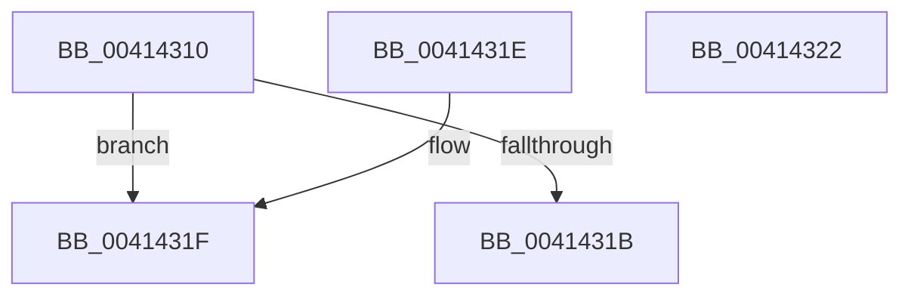

# PpmHeteroIsMultiClassParkingEnabled

- RVA: `0x00414310`–`0x00414323` (길이 `19` bytes)
- VA: `0x0000000140414310`
- 실행 섹션: `.text`
- PDB 이름 있음: `예`; PDB Function 태그: `아니요`
- unwind 정보 RVA: `0x000DB714`
- 디코드: `9`개 명령, `19/19` bytes 표시
- 미해석 바이트: `0` (있으면 어셈블리에 `.byte`로 보존)

> 이 문서는 커널 이미지의 기계어와 PDB 기호를 분석해 생성했습니다. 4번과 5번은 함수 원형과 자료형을 바이너리 사용 방식에서 추정한 C 해석이며 원본 소스 복구 결과는 아닙니다.

## 1. Dependencies

- 직접 호출 지점: **0**; 고유 호출 대상: **0**
- 직접 호출자로 확인된 함수: **6**
- RIP 상대 이미지 참조: **1**

### Outgoing calls
- 직접 디코드된 call 명령이 없습니다.

### Direct callers
- [PpmParkCalculateUnparkCount](PpmParkCalculateUnparkCount_function_00413750.md) at `0x004138B3`
- [PpmParkCalculateUnparkCount](PpmParkCalculateUnparkCount_function_00413750.md) at `0x004138DB`
- [PpmParkCalculateUnparkCount](PpmParkCalculateUnparkCount_function_00413750.md) at `0x00413B43`
- [sub_00413D79](Unknown_function_00413D79.md) at `0x00413F25`
- [PpmCheckComputeHeteroResponse](../4A/PpmCheckComputeHeteroResponse_function_004AACD0.md) at `0x004AAD86`
- [PpmParkRegisterParking](../5D/PpmParkRegisterParking_function_005DB508.md) at `0x005DB86F`
- [PpmCheckComputeHeteroResponseEx](../5D/PpmCheckComputeHeteroResponseEx_function_005DECA0.md) at `0x005DED1C`
- [PpmParkInitParkNode](../5E/PpmParkInitParkNode_function_005E1444.md) at `0x005E1576`

### Static image references
- `0x00414312` → RVA `0x00FC6C88` (`ALMOSTRO`; read)

## 2. Other-region calls and transfers

- 다른 실행 섹션으로 향하는 call: **0**
- 별도 외부 분기/꼬리 이동을 확인하지 못했습니다.

## 3. Assembly (complete function range)

```asm
00414310  66 90                           nop
00414312  83 3D 6F 29 BB 00 00            cmp dword ptr [rip + 0xbb296f], 0
00414319  74 04                           je 0x14041431f
0041431B  B0 01                           mov al, 1
0041431D  C3                              ret
0041431E  CC                              int3
0041431F  32 C0                           xor al, al
00414321  C3                              ret
00414322  CC                              int3
```

## 4. C-style interpretation (structured pseudocode)

```c
__int64 __fastcall PpmHeteroIsMultiClassParkingEnabled(void)
{
    __int64 result;

    if ((*(unsigned int *)(v_rip + 12265839)) == 0) goto loc_0041431F;
    return 1;
loc_0041431F:
    result = 0;
    return result;
}
```

## 5. (Beta) C Style

```c
void PpmHeteroIsMultiClassParkingEnabled(void)
{
    int64_t result;

    if ((*(uint32_t *)(v_rip + 0xBB296F)) == 0) goto loc_0041431F;
    return 1;
loc_0041431F:
    result = 0;
    return result;
}
```

## 6. Execution-region graph

[열기: 2D/3D 그래프와 함수 탐색 컨트롤 패널](../../../control-panel.html?section=text&rva=0x00414310&view=graph)

- 2D 그래프는 위에서 아래로 흐르고, 3D 그래프는 빈 공간을 드래그해 회전합니다. Shift+드래그는 이동, 휠은 확대·축소, 함수 노드 선택은 대상 보고서 이동입니다.

### Static fallback


