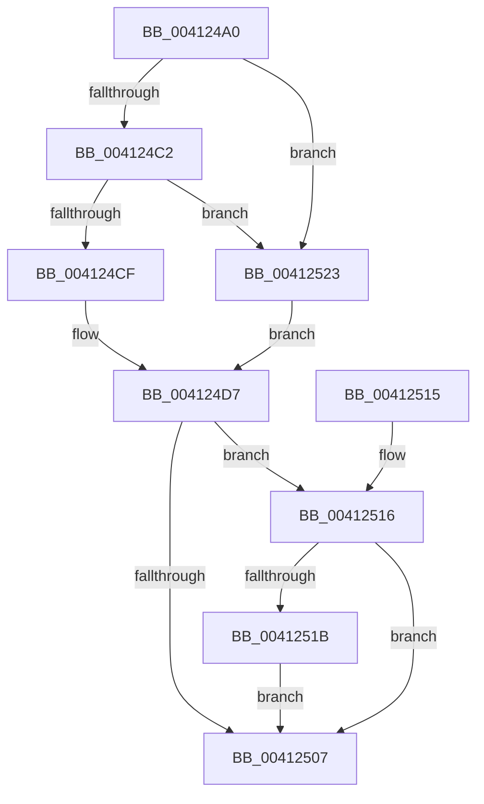

# PpmHeteroUtilityGreaterThanOrEqualThreshold

- RVA: `0x004124A0`–`0x0041252B` (길이 `139` bytes)
- VA: `0x00000001404124A0`
- 실행 섹션: `.text`
- PDB 이름 있음: `예`; PDB Function 태그: `아니요`
- unwind 정보 RVA: `0x0009BEF4`
- 디코드: `38`개 명령, `139/139` bytes 표시
- 미해석 바이트: `0` (있으면 어셈블리에 `.byte`로 보존)

> 이 문서는 커널 이미지의 기계어와 PDB 기호를 분석해 생성했습니다. 4번과 5번은 함수 원형과 자료형을 바이너리 사용 방식에서 추정한 C 해석이며 원본 소스 복구 결과는 아닙니다.

## 1. Dependencies

- 직접 호출 지점: **0**; 고유 호출 대상: **0**
- 직접 호출자로 확인된 함수: **5**
- RIP 상대 이미지 참조: **2**

### Outgoing calls
- 직접 디코드된 call 명령이 없습니다.

### Direct callers
- [PpmHeteroComputeUnparkCount](PpmHeteroComputeUnparkCount_function_00412294.md) at `0x0041236D`
- [PpmHeteroComputeUnparkCount](PpmHeteroComputeUnparkCount_function_00412294.md) at `0x00412389`
- [PpmHeteroComputeUnparkCount](PpmHeteroComputeUnparkCount_function_00412294.md) at `0x0041243A`
- [PpmHeteroComputeUnparkCount](PpmHeteroComputeUnparkCount_function_00412294.md) at `0x00412459`
- [PpmCheckComputeMultiClassHeteroResponse](PpmCheckComputeMultiClassHeteroResponse_function_00412534.md) at `0x00412730`
- [PpmCheckComputeMultiClassHeteroResponse](PpmCheckComputeMultiClassHeteroResponse_function_00412534.md) at `0x00412748`
- [PpmCheckComputeMultiClassHeteroResponse](PpmCheckComputeMultiClassHeteroResponse_function_00412534.md) at `0x004127B4`
- [PpmCheckComputeMultiClassHeteroResponse](PpmCheckComputeMultiClassHeteroResponse_function_00412534.md) at `0x004127CF`
- [PpmHeteroComputeUnparkCountEx](../4F/PpmHeteroComputeUnparkCountEx_function_004F1950.md) at `0x004F1A29`
- [PpmHeteroComputeUnparkCountEx](../4F/PpmHeteroComputeUnparkCountEx_function_004F1950.md) at `0x004F1A44`
- [PpmHeteroComputeUnparkCountEx](../4F/PpmHeteroComputeUnparkCountEx_function_004F1950.md) at `0x004F1AFF`
- [PpmHeteroComputeUnparkCountEx](../4F/PpmHeteroComputeUnparkCountEx_function_004F1950.md) at `0x004F1B1E`
- [PpmCheckComputeHeteroResponseEx](../5D/PpmCheckComputeHeteroResponseEx_function_005DECA0.md) at `0x005DF060`
- [PpmCheckComputeHeteroResponseEx](../5D/PpmCheckComputeHeteroResponseEx_function_005DECA0.md) at `0x005DF079`
- [PpmCheckComputeHeteroResponseEx](../5D/PpmCheckComputeHeteroResponseEx_function_005DECA0.md) at `0x005DF19A`
- [PpmCheckComputeHeteroResponseEx](../5D/PpmCheckComputeHeteroResponseEx_function_005DECA0.md) at `0x005DF1B4`
- [PpmCheckComputeHeteroResponseEx](../5D/PpmCheckComputeHeteroResponseEx_function_005DECA0.md) at `0x005DF29F`
- [PpmCheckComputeHeteroResponseEx](../5D/PpmCheckComputeHeteroResponseEx_function_005DECA0.md) at `0x005DF2B9`
- [PpmCheckComputeHeteroResponseEx](../5D/PpmCheckComputeHeteroResponseEx_function_005DECA0.md) at `0x005DF301`
- [PpmCheckComputeHeteroResponseEx](../5D/PpmCheckComputeHeteroResponseEx_function_005DECA0.md) at `0x005DF318`
- [sub_006FA0AE](../6F/Unknown_function_006FA0AE.md) at `0x006FA27A`
- [sub_006FA0AE](../6F/Unknown_function_006FA0AE.md) at `0x006FA293`
- [sub_006FA0AE](../6F/Unknown_function_006FA0AE.md) at `0x006FA300`
- [sub_006FA0AE](../6F/Unknown_function_006FA0AE.md) at `0x006FA31C`

### Static image references
- `0x004124B0` → RVA `0x00FC6D80` (`ALMOSTRO`; read)
- `0x004124C2` → RVA `0x00E0B800` (`.data`; read)

## 2. Other-region calls and transfers

- 다른 실행 섹션으로 향하는 call: **0**
- 별도 외부 분기/꼬리 이동을 확인하지 못했습니다.

## 3. Assembly (complete function range)

```asm
004124A0  48 89 5C 24 08                  mov qword ptr [rsp + 8], rbx
004124A5  48 89 7C 24 10                  mov qword ptr [rsp + 0x10], rdi
004124AA  4C 8B D9                        mov r11, rcx
004124AD  45 33 D2                        xor r10d, r10d
004124B0  48 8B 0D C9 48 BB 00            mov rcx, qword ptr [rip + 0xbb48c9]
004124B7  49 8B D8                        mov rbx, r8
004124BA  48 8B FA                        mov rdi, rdx
004124BD  48 85 C9                        test rcx, rcx
004124C0  74 61                           je 0x140412523
004124C2  0F B6 05 37 93 9F 00            movzx eax, byte ptr [rip + 0x9f9337]
004124C9  39 44 24 28                     cmp dword ptr [rsp + 0x28], eax
004124CD  73 54                           jae 0x140412523
004124CF  8B 44 24 28                     mov eax, dword ptr [rsp + 0x28]
004124D3  44 8B 04 81                     mov r8d, dword ptr [rcx + rax*4]
004124D7  41 8B C1                        mov eax, r9d
004124DA  41 8B C8                        mov ecx, r8d
004124DD  48 0F AF C8                     imul rcx, rax
004124E1  49 8B C3                        mov rax, r11
004124E4  48 0F AF C7                     imul rax, rdi
004124E8  48 69 D1 10 27 00 00            imul rdx, rcx, 0x2710
004124EF  48 C1 EA 10                     shr rdx, 0x10
004124F3  48 3B C3                        cmp rax, rbx
004124F6  48 0F 47 D8                     cmova rbx, rax
004124FA  48 6B C3 64                     imul rax, rbx, 0x64
004124FE  49 0F AF D3                     imul rdx, r11
00412502  48 3B C2                        cmp rax, rdx
00412505  73 0F                           jae 0x140412516
00412507  48 8B 5C 24 08                  mov rbx, qword ptr [rsp + 8]
0041250C  41 8B C2                        mov eax, r10d
0041250F  48 8B 7C 24 10                  mov rdi, qword ptr [rsp + 0x10]
00412514  C3                              ret
00412515  CC                              int3
00412516  4D 85 DB                        test r11, r11
00412519  74 EC                           je 0x140412507
0041251B  41 BA 01 00 00 00               mov r10d, 1
00412521  EB E4                           jmp 0x140412507
00412523  41 B8 00 00 01 00               mov r8d, 0x10000
00412529  EB AC                           jmp 0x1404124d7
```

## 4. C-style interpretation (structured pseudocode)

```c
__int64 __fastcall PpmHeteroUtilityGreaterThanOrEqualThreshold(__int64 a1, __int64 a2, __int64 a3, int a4, unsigned int a5)
{
    __int64 result;
    __int64 v_r10;
    unsigned __int64 v_stack_p10;
    unsigned __int64 v_stack_p8;

    v_stack_p8 = v_rbx;
    v_stack_p10 = v_rdi;
    v_r10 = 0;
    if (*(unsigned __int64 *)(v_rip + 12273865) == 0) goto loc_00412523;
    if (a5 >= ((unsigned int)(*(unsigned __int8 *)(v_rip + 10457911)))) goto loc_00412523;
loc_004124D7:
    a1 = ((unsigned int)((unsigned int)((unsigned int)(*(unsigned int *)(*(unsigned __int64 *)(v_rip + 12273865) + (unsigned int)(a5) * 4))))) * ((unsigned int)(a4));
    result = (a1) * (a2);
    a2 = (a2) * (a1);
    a2 = (a2) >> (16);
    if (result > a3) { a3 = result; }
    result = (result) * (a3);
    a2 = (a2) * (a1);
    if (result >= a2) goto loc_00412516;
loc_00412507:
    return 0;
loc_00412516:
    if (a1 == 0) goto loc_00412507;
    goto loc_00412507;
loc_00412523:
    goto loc_004124D7;
}
```

## 5. (Beta) C Style

```c
int64_t PpmHeteroUtilityGreaterThanOrEqualThreshold(int64_t Arg1, int64_t Arg2, int64_t Arg3, int32_t Arg4, uint32_t Arg5)
{
    int64_t result;
    int64_t local_r10;
    uint64_t v_stack_p10;
    uint64_t v_stack_p8;

    v_stack_p8 = local_rbx;
    v_stack_p10 = local_rdi;
    local_r10 = 0;
    if (*(uint64_t *)(v_rip + 0xBB48C9) == 0) goto loc_00412523;
    if (Arg5 >= ((uint32_t)(*(uint8_t *)(v_rip + 0x9F9337)))) goto loc_00412523;
loc_004124D7:
    Arg1 = ((uint32_t)((uint32_t)((uint32_t)(*(uint32_t *)(*(uint64_t *)(v_rip + 0xBB48C9) + (uint32_t)(Arg5) * 4))))) * ((uint32_t)(Arg4));
    result = (Arg1) * (Arg2);
    Arg2 = (Arg2) * (Arg1);
    Arg2 = (Arg2) >> (16);
    if (result > Arg3) { Arg3 = result; }
    result = (result) * (Arg3);
    Arg2 = (Arg2) * (Arg1);
    if (result >= Arg2) goto loc_00412516;
loc_00412507:
    return 0;
loc_00412516:
    if (Arg1 == 0) goto loc_00412507;
    goto loc_00412507;
loc_00412523:
    goto loc_004124D7;
}
```

## 6. Execution-region graph

[열기: 2D/3D 그래프와 함수 탐색 컨트롤 패널](../../../control-panel.html?section=text&rva=0x004124A0&view=graph)

- 2D 그래프는 위에서 아래로 흐르고, 3D 그래프는 빈 공간을 드래그해 회전합니다. Shift+드래그는 이동, 휠은 확대·축소, 함수 노드 선택은 대상 보고서 이동입니다.

### Static fallback


