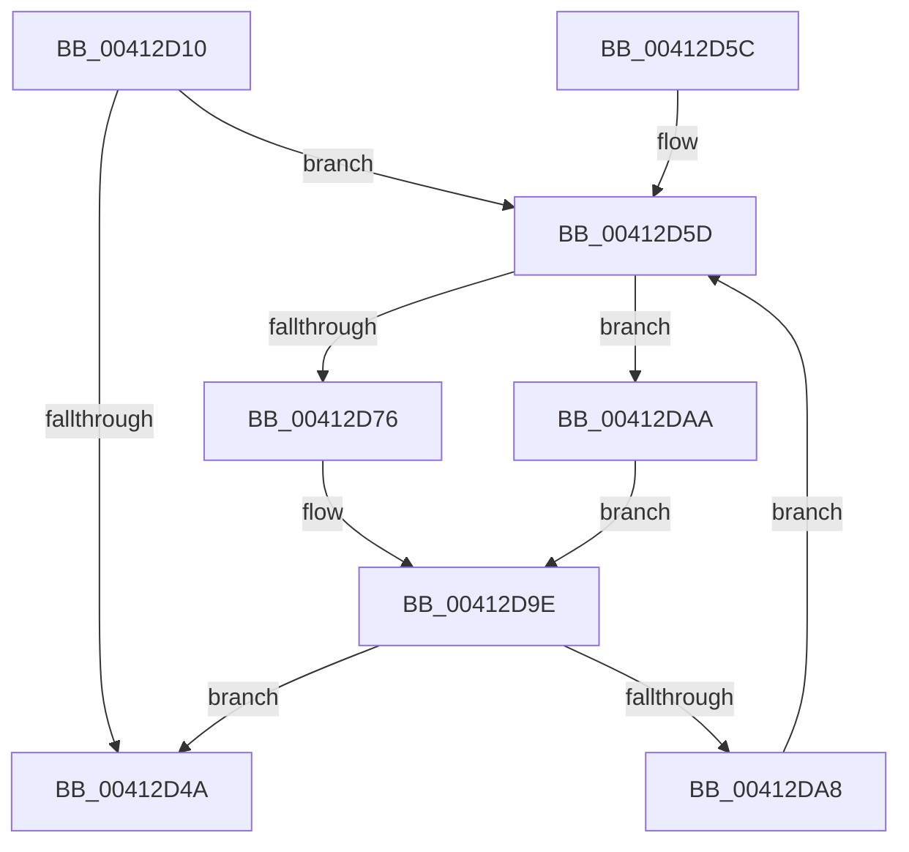

# PpmParkDistributeAllUtility

- RVA: `0x00412D10`–`0x00412DD2` (길이 `194` bytes)
- VA: `0x0000000140412D10`
- 실행 섹션: `.text`
- PDB 이름 있음: `예`; PDB Function 태그: `아니요`
- unwind 정보 RVA: `0x0009BF4C`
- 디코드: `45`개 명령, `194/194` bytes 표시
- 미해석 바이트: `0` (있으면 어셈블리에 `.byte`로 보존)

> 이 문서는 커널 이미지의 기계어와 PDB 기호를 분석해 생성했습니다. 4번과 5번은 함수 원형과 자료형을 바이너리 사용 방식에서 추정한 C 해석이며 원본 소스 복구 결과는 아닙니다.

## 1. Dependencies

- 직접 호출 지점: **3**; 고유 호출 대상: **3**
- 직접 호출자로 확인된 함수: **0**
- RIP 상대 이미지 참조: **4**

### Outgoing calls
- `0x00412D6D` → [Feature_PpmParkEx__private_IsEnabledDeviceUsageNoInline](../4F/Feature_PpmParkEx__private_IsEnabledDeviceUsageNoInline_function_004F135C.md) (function, `0x004F135C`)
- `0x00412D99` → [PpmParkDistributeUtility](PpmParkDistributeUtility_function_00412DE0.md) (function, `0x00412DE0`)
- `0x00412DCB` → [PpmParkDistributeUtilityEx](../4F/PpmParkDistributeUtilityEx_function_004F020C.md) (function, `0x004F020C`)

### Direct callers
- 이 함수 시작 RVA로 연결되는 직접 call은 확인되지 않았습니다. 간접 호출은 완전히 역산할 수 없습니다.

### Static image references
- `0x00412D1F` → RVA `0x00E08380` (`.data`; read)
- `0x00412D26` → RVA `0x00F0CE0C` (`.data`; read)
- `0x00412D42` → RVA `0x00F083E0` (`.data`; read)
- `0x00412D66` → RVA `0x00F083D8` (`.data`; read)

## 2. Other-region calls and transfers

- 다른 실행 섹션으로 향하는 call: **0**
- 별도 외부 분기/꼬리 이동을 확인하지 못했습니다.

## 3. Assembly (complete function range)

```asm
00412D10  48 89 5C 24 08                  mov qword ptr [rsp + 8], rbx
00412D15  48 89 74 24 10                  mov qword ptr [rsp + 0x10], rsi
00412D1A  57                              push rdi
00412D1B  48 83 EC 40                     sub rsp, 0x40
00412D1F  48 8B 15 5A 56 9F 00            mov rdx, qword ptr [rip + 0x9f565a]
00412D26  48 63 05 DF A0 AF 00            movsxd rax, dword ptr [rip + 0xafa0df]
00412D2D  48 69 C8 E8 01 00 00            imul rcx, rax, 0x1e8
00412D34  80 BC 11 B3 00 00 00 00         cmp byte ptr [rcx + rdx + 0xb3], 0
00412D3C  40 0F 95 C6                     setne sil
00412D40  33 FF                           xor edi, edi
00412D42  39 3D 98 56 AF 00               cmp dword ptr [rip + 0xaf5698], edi
00412D48  77 13                           ja 0x140412d5d
00412D4A  48 8B 5C 24 50                  mov rbx, qword ptr [rsp + 0x50]
00412D4F  B0 01                           mov al, 1
00412D51  48 8B 74 24 58                  mov rsi, qword ptr [rsp + 0x58]
00412D56  48 83 C4 40                     add rsp, 0x40
00412D5A  5F                              pop rdi
00412D5B  C3                              ret
00412D5C  CC                              int3
00412D5D  8B C7                           mov eax, edi
00412D5F  48 69 D8 10 05 00 00            imul rbx, rax, 0x510
00412D66  48 03 1D 6B 56 AF 00            add rbx, qword ptr [rip + 0xaf566b]
00412D6D  E8 EA E5 0D 00                  call 0x1404f135c
00412D72  85 C0                           test eax, eax
00412D74  75 34                           jne 0x140412daa
00412D76  48 83 64 24 30 00               and qword ptr [rsp + 0x30], 0
00412D7C  21 44 24 28                     and dword ptr [rsp + 0x28], eax
00412D80  44 8A 8B 9C 04 00 00            mov r9b, byte ptr [rbx + 0x49c]
00412D87  44 0F B7 43 04                  movzx r8d, word ptr [rbx + 4]
00412D8C  48 8B 53 18                     mov rdx, qword ptr [rbx + 0x18]
00412D90  48 8B 4B 10                     mov rcx, qword ptr [rbx + 0x10]
00412D94  40 88 74 24 20                  mov byte ptr [rsp + 0x20], sil
00412D99  E8 42 00 00 00                  call 0x140412de0
00412D9E  FF C7                           inc edi
00412DA0  3B 3D 3A 56 AF 00               cmp edi, dword ptr [rip + 0xaf563a]
00412DA6  73 A2                           jae 0x140412d4a
00412DA8  EB B3                           jmp 0x140412d5d
00412DAA  48 83 64 24 28 00               and qword ptr [rsp + 0x28], 0
00412DB0  48 8D 93 38 01 00 00            lea rdx, [rbx + 0x138]
00412DB7  83 64 24 20 00                  and dword ptr [rsp + 0x20], 0
00412DBC  48 8D 4B 30                     lea rcx, [rbx + 0x30]
00412DC0  44 0F B7 83 9C 04 00 00         movzx r8d, word ptr [rbx + 0x49c]
00412DC8  44 8A CE                        mov r9b, sil
00412DCB  E8 3C D4 0D 00                  call 0x1404f020c
00412DD0  EB CC                           jmp 0x140412d9e
```

## 4. C-style interpretation (structured pseudocode)

```c
__int64 __fastcall PpmParkDistributeAllUtility(void)
{
    __int64 result;
    __int64 v_rbx;
    __int64 v_rdi;
    __int64 v_rsi;
    __int64 v_rsp;
    unsigned __int64 v_stack_p10;
    unsigned __int8 v_stack_p20;
    unsigned int v_stack_p28;
    unsigned __int64 v_stack_p30;
    unsigned __int64 v_stack_p8;

    v_stack_p8 = v_rbx;
    v_stack_p10 = v_rsi;
    v_rsp = (v_rsp) - (64);
    a1 = (a1) * ((int)(*(unsigned int *)(v_rip + 11509983)));
    v_rsi = ((*(unsigned __int8 *)(a1 + *(unsigned __int64 *)(v_rip + 10442330) * 1 + 179)) != 0) ? 1 : 0;
    v_rdi = 0;
    if ((*(unsigned int *)(v_rip + 11490968)) > 0) goto loc_00412D5D;
loc_00412D4A:
    v_rsp = (v_rsp) + (64);
    return 1;
loc_00412D5D:
    v_rbx = (v_stack_p8) * (0);
    v_rbx = (v_rbx) + (*(unsigned __int64 *)(v_rip + 11490923));
    result = Feature_PpmParkEx__private_IsEnabledDeviceUsageNoInline(a1, *(unsigned __int64 *)(v_rip + 10442330), a3, a4);
    if ((unsigned int)(result) != 0) goto loc_00412DAA;
    v_stack_p20 = (unsigned __int8)(v_stack_p10);
    result = PpmParkDistributeUtility(*(unsigned __int64 *)(v_rbx + 16), *(unsigned __int64 *)(v_rbx + 24), *(unsigned __int16 *)(v_rbx + 4), *(unsigned __int8 *)(v_rbx + 1180));
loc_00412D9E:
    v_rdi = (unsigned int)((v_rdi) + 1);
    if (((unsigned int)(v_rdi)) >= (*(unsigned int *)(v_rip + 11490874))) goto loc_00412D4A;
    goto loc_00412D5D;
loc_00412DAA:
    result = PpmParkDistributeUtilityEx(v_rbx + 48, v_rbx + 312, *(unsigned __int16 *)(v_rbx + 1180), (unsigned __int8)(v_stack_p10));
    goto loc_00412D9E;
}
```

## 5. (Beta) C Style

```c
void PpmParkDistributeAllUtility(void)
{
    int64_t result;
    int64_t local_rbx;
    int64_t local_rdi;
    int64_t local_rsi;
    int64_t local_rsp;
    uint64_t v_stack_p10;
    uint8_t v_stack_p20;
    uint32_t v_stack_p28;
    uint64_t v_stack_p30;
    uint64_t v_stack_p8;

    v_stack_p8 = local_rbx;
    v_stack_p10 = local_rsi;
    local_rsp = (local_rsp) - (64);
    a1 = (a1) * ((int32_t)(*(uint32_t *)(v_rip + 0xAFA0DF)));
    local_rsi = ((*(uint8_t *)(a1 + *(uint64_t *)(v_rip + 0x9F565A) * 1 + 0xB3)) != 0) ? 1 : 0;
    local_rdi = 0;
    if ((*(uint32_t *)(v_rip + 0xAF5698)) > 0) goto loc_00412D5D;
loc_00412D4A:
    local_rsp = (local_rsp) + (64);
    return 1;
loc_00412D5D:
    local_rbx = (v_stack_p8) * (0);
    local_rbx = (local_rbx) + (*(uint64_t *)(v_rip + 0xAF566B));
    result = Feature_PpmParkEx__private_IsEnabledDeviceUsageNoInline(a1, *(uint64_t *)(v_rip + 0x9F565A), a3, a4);
    if ((uint32_t)(result) != 0) goto loc_00412DAA;
    v_stack_p20 = (uint8_t)(v_stack_p10);
    result = PpmParkDistributeUtility(*(uint64_t *)(local_rbx + 0x10), *(uint64_t *)(local_rbx + 0x18), *(uint16_t *)(local_rbx + 0x4), *(uint8_t *)(local_rbx + 0x49C));
loc_00412D9E:
    local_rdi = (uint32_t)((local_rdi) + 1);
    if (((uint32_t)(local_rdi)) >= (*(uint32_t *)(v_rip + 0xAF563A))) goto loc_00412D4A;
    goto loc_00412D5D;
loc_00412DAA:
    result = PpmParkDistributeUtilityEx(local_rbx + 48, local_rbx + 312, *(uint16_t *)(local_rbx + 0x49C), (uint8_t)(v_stack_p10));
    goto loc_00412D9E;
}
```

## 6. Execution-region graph

[열기: 2D/3D 그래프와 함수 탐색 컨트롤 패널](../../../control-panel.html?section=text&rva=0x00412D10&view=graph)

- 2D 그래프는 위에서 아래로 흐르고, 3D 그래프는 빈 공간을 드래그해 회전합니다. Shift+드래그는 이동, 휠은 확대·축소, 함수 노드 선택은 대상 보고서 이동입니다.

### Static fallback


