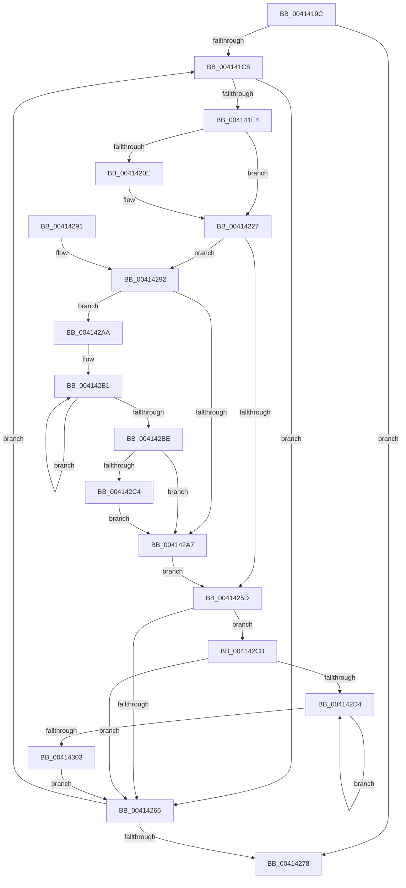

# PpmParkSnapNodeStatistics

- RVA: `0x0041419C`–`0x00414308` (길이 `364` bytes)
- VA: `0x000000014041419C`
- 실행 섹션: `.text`
- PDB 이름 있음: `예`; PDB Function 태그: `아니요`
- unwind 정보 RVA: `0x0009C0C0`
- 디코드: `89`개 명령, `364/364` bytes 표시
- 미해석 바이트: `0` (있으면 어셈블리에 `.byte`로 보존)

> 이 문서는 커널 이미지의 기계어와 PDB 기호를 분석해 생성했습니다. 4번과 5번은 함수 원형과 자료형을 바이너리 사용 방식에서 추정한 C 해석이며 원본 소스 복구 결과는 아닙니다.

## 1. Dependencies

- 직접 호출 지점: **7**; 고유 호출 대상: **7**
- 직접 호출자로 확인된 함수: **1**
- RIP 상대 이미지 참조: **2**

### Outgoing calls
- `0x004141ED` → [KeQueryPerformanceCounter](../37/KeQueryPerformanceCounter_function_0037E7E0.md) (function, `0x0037E7E0`)
- `0x004141F5` → [KeDisableInterrupts](../21/KeDisableInterrupts_function_00217BE0.md) (function, `0x00217BE0`)
- `0x00414200` → [KeAcquireSpinLockAtDpcLevel](../20/KeAcquireSpinLockAtDpcLevel_function_00208430.md) (function, `0x00208430`)
- `0x0041424B` → [memcpy](../6C/memcpy_function_006C6840.md) (function, `0x006C6840`)
- `0x00414253` → [KxReleaseSpinLock](../20/KxReleaseSpinLock_function_00206670.md) (function, `0x00206670`)
- `0x004142C4` → [KiRemoveSystemWorkPriorityKick](../26/KiRemoveSystemWorkPriorityKick_function_002631D0.md) (function, `0x002631D0`)
- `0x004142F5` → [PpmIdleSnapConcurrency](../20/PpmIdleSnapConcurrency_function_00204694.md) (function, `0x00204694`)

### Direct callers
- [PpmCheckSnapAllUtility](PpmCheckSnapAllUtility_function_00413C00.md) at `0x00413C12`

### Static image references
- `0x004141B7` → RVA `0x00F083E0` (`.data`; read)
- `0x004141D2` → RVA `0x00F083D8` (`.data`; read)

## 2. Other-region calls and transfers

- 다른 실행 섹션으로 향하는 call: **0**
- 별도 외부 분기/꼬리 이동을 확인하지 못했습니다.

## 3. Assembly (complete function range)

```asm
0041419C  48 89 5C 24 08                  mov qword ptr [rsp + 8], rbx
004141A1  48 89 6C 24 10                  mov qword ptr [rsp + 0x10], rbp
004141A6  48 89 74 24 18                  mov qword ptr [rsp + 0x18], rsi
004141AB  57                              push rdi
004141AC  41 56                           push r14
004141AE  41 57                           push r15
004141B0  48 83 EC 20                     sub rsp, 0x20
004141B4  45 33 FF                        xor r15d, r15d
004141B7  44 39 3D 22 42 AF 00            cmp dword ptr [rip + 0xaf4222], r15d
004141BE  41 0F B7 FF                     movzx edi, r15w
004141C2  0F 84 B0 00 00 00               je 0x140414278
004141C8  0F B7 C7                        movzx eax, di
004141CB  48 69 D8 10 05 00 00            imul rbx, rax, 0x510
004141D2  48 03 1D FF 41 AF 00            add rbx, qword ptr [rip + 0xaf41ff]
004141D9  66 44 39 7B 0A                  cmp word ptr [rbx + 0xa], r15w
004141DE  0F 84 82 00 00 00               je 0x140414266
004141E4  48 8B B3 50 04 00 00            mov rsi, qword ptr [rbx + 0x450]
004141EB  33 C9                           xor ecx, ecx
004141ED  E8 EE A5 F6 FF                  call 0x14037e7e0
004141F2  48 8B E8                        mov rbp, rax
004141F5  E8 E6 39 E0 FF                  call 0x140217be0
004141FA  48 8B CE                        mov rcx, rsi
004141FD  44 8A F0                        mov r14b, al
00414200  E8 2B 42 DF FF                  call 0x140208430
00414205  48 8B 4E 10                     mov rcx, qword ptr [rsi + 0x10]
00414209  48 3B E9                        cmp rbp, rcx
0041420C  76 19                           jbe 0x140414227
0041420E  8B 46 0C                        mov eax, dword ptr [rsi + 0xc]
00414211  48 8B D5                        mov rdx, rbp
00414214  48 2B D1                        sub rdx, rcx
00414217  48 89 6E 10                     mov qword ptr [rsi + 0x10], rbp
0041421B  48 01 56 18                     add qword ptr [rsi + 0x18], rdx
0041421F  48 01 94 C6 48 01 00 00         add qword ptr [rsi + rax*8 + 0x148], rdx
00414227  44 8B 83 88 04 00 00            mov r8d, dword ptr [rbx + 0x488]
0041422E  48 8D 96 48 01 00 00            lea rdx, [rsi + 0x148]
00414235  48 8B 46 18                     mov rax, qword ptr [rsi + 0x18]
00414239  48 8B 8B 58 04 00 00            mov rcx, qword ptr [rbx + 0x458]
00414240  49 C1 E0 03                     shl r8, 3
00414244  48 89 83 70 04 00 00            mov qword ptr [rbx + 0x470], rax
0041424B  E8 F0 25 2B 00                  call 0x1406c6840
00414250  48 8B CE                        mov rcx, rsi
00414253  E8 18 24 DF FF                  call 0x140206670
00414258  45 84 F6                        test r14b, r14b
0041425B  75 35                           jne 0x140414292
0041425D  44 38 BB A1 04 00 00            cmp byte ptr [rbx + 0x4a1], r15b
00414264  75 65                           jne 0x1404142cb
00414266  66 FF C7                        inc di
00414269  0F B7 C7                        movzx eax, di
0041426C  3B 05 6E 41 AF 00               cmp eax, dword ptr [rip + 0xaf416e]
00414272  0F 82 50 FF FF FF               jb 0x1404141c8
00414278  48 8B 5C 24 40                  mov rbx, qword ptr [rsp + 0x40]
0041427D  48 8B 6C 24 48                  mov rbp, qword ptr [rsp + 0x48]
00414282  48 8B 74 24 50                  mov rsi, qword ptr [rsp + 0x50]
00414287  48 83 C4 20                     add rsp, 0x20
0041428B  41 5F                           pop r15
0041428D  41 5E                           pop r14
0041428F  5F                              pop rdi
00414290  C3                              ret
00414291  CC                              int3
00414292  65 48 8B 0C 25 20 00 00 00      mov rcx, qword ptr gs:[0x20]
0041429B  4C 8B 81 B8 8E 00 00            mov r8, qword ptr [rcx + 0x8eb8]
004142A2  4D 85 C0                        test r8, r8
004142A5  75 03                           jne 0x1404142aa
004142A7  FB                              sti
004142A8  EB B3                           jmp 0x14041425d
004142AA  41 0F 0D 08                     prefetchw byte ptr [r8]
004142AE  41 8B 00                        mov eax, dword ptr [r8]
004142B1  8B D0                           mov edx, eax
004142B3  0F BA F2 15                     btr edx, 0x15
004142B7  F0 41 0F B1 10                  lock cmpxchg dword ptr [r8], edx
004142BC  75 F3                           jne 0x1404142b1
004142BE  0F BA E0 15                     bt eax, 0x15
004142C2  73 E3                           jae 0x1404142a7
004142C4  E8 07 EF E4 FF                  call 0x1402631d0
004142C9  EB DC                           jmp 0x1404142a7
004142CB  41 8A F7                        mov sil, r15b
004142CE  44 38 7B 0C                     cmp byte ptr [rbx + 0xc], r15b
004142D2  76 92                           jbe 0x140414266
004142D4  40 0F B6 C6                     movzx eax, sil
004142D8  48 8D 0C 80                     lea rcx, [rax + rax*4]
004142DC  48 C1 E1 07                     shl rcx, 7
004142E0  48 03 8B 08 05 00 00            add rcx, qword ptr [rbx + 0x508]
004142E7  48 8D 91 40 02 00 00            lea rdx, [rcx + 0x240]
004142EE  48 8B 89 38 02 00 00            mov rcx, qword ptr [rcx + 0x238]
004142F5  E8 9A 03 DF FF                  call 0x140204694
004142FA  40 FE C6                        inc sil
004142FD  40 3A 73 0C                     cmp sil, byte ptr [rbx + 0xc]
00414301  72 D1                           jb 0x1404142d4
00414303  E9 5E FF FF FF                  jmp 0x140414266
```

## 4. C-style interpretation (structured pseudocode)

```c
__int64 __fastcall PpmParkSnapNodeStatistics(int a1)
{
    __int64 result;
    __int64 v_r15;
    __int64 v_rbx;
    __int64 v_rdi;
    __int64 v_rsi;
    __int64 v_rsp;
    unsigned __int64 v_stack_p10;
    unsigned __int64 v_stack_p18;
    unsigned __int64 v_stack_p8;

    v_stack_p8 = v_rbx;
    v_stack_p10 = v_rbp;
    v_stack_p18 = v_rsi;
    v_rsp = (v_rsp) - (32);
    v_r15 = 0;
    if ((*(unsigned int *)(v_rip + 11485730)) == 0) goto loc_00414278;
loc_004141C8:
    v_rbx = (v_rbx) * (0);
    v_rbx = (v_rbx) + (*(unsigned __int64 *)(v_rip + 11485695));
    if ((*(unsigned __int16 *)(v_rbx + 10)) == 0) goto loc_00414266;
    a1 = 0;
    result = KeQueryPerformanceCounter(a1, a2, a3, a4);
    result = KeDisableInterrupts(a1, a2, a3, a4);
    result = KeAcquireSpinLockAtDpcLevel(*(unsigned __int64 *)(v_rbx + 1104), a2, a3, a4);
    if (result >= = (*(unsigned __int64 *)(*(unsigned __int64 *)(v_rbx + 1104) + 16))) {
        result = *(unsigned int *)(*(unsigned __int64 *)(v_rbx + 1104) + 12);
        a2 = result;
        a2 = (a2) - (*(unsigned __int64 *)(*(unsigned __int64 *)(v_rbx + 1104) + 16));
        *(unsigned __int64 *)(*(unsigned __int64 *)(v_rbx + 1104) + 16) = result;
    }
    a3 = ((unsigned int)(*(unsigned int *)(v_rbx + 1160))) << (3);
    *(unsigned __int64 *)(v_rbx + 1136) = *(unsigned __int64 *)(*(unsigned __int64 *)(v_rbx + 1104) + 24);
    result = memcpy(*(unsigned __int64 *)(v_rbx + 1112), *(unsigned __int64 *)(v_rbx + 1104) + 328, a3, a4);
    result = KxReleaseSpinLock(*(unsigned __int64 *)(v_rbx + 1104), *(unsigned __int64 *)(v_rbx + 1104) + 328, a3, a4);
    if ((unsigned __int8)((unsigned __int8)(result)) != 0) goto loc_00414292;
loc_0041425D:
    if ((*(unsigned __int8 *)(v_rbx + 1185)) != 0) goto loc_004142CB;
loc_00414266:
    v_rdi = (unsigned __int16)((0) + 1);
    if (((unsigned int)((unsigned __int16)(v_rdi))) < (*(unsigned int *)(v_rip + 11485550))) goto loc_004141C8;
loc_00414278:
    v_rsp = (v_rsp) + (32);
    return (unsigned __int16)(v_rdi);
loc_00414292:
    if (*(unsigned __int64 *)(*(unsigned __int64 *)(gs_base + (0 + 32)) + 36536) != 0) goto loc_004142AA;
loc_004142A7:
    goto loc_0041425D;
loc_004142AA:
loc_004142B1:
    if (*(unsigned __int64 *)(*(unsigned __int64 *)(gs_base + (0 + 32)) + 36536) != 0) goto loc_004142B1;
    if (condition_is_above_or_equal) goto loc_004142A7;
    result = KiRemoveSystemWorkPriorityKick(*(unsigned __int64 *)(gs_base + (0 + 32)), (unsigned int)((unsigned int)((unsigned int)(*(unsigned int *)(*(unsigned __int64 *)(*(unsigned __int64 *)(gs_base + (0 + 32)) + 36536))))), *(unsigned __int64 *)(*(unsigned __int64 *)(gs_base + (0 + 32)) + 36536), a4);
    goto loc_004142A7;
loc_004142CB:
    if ((*(unsigned __int8 *)(v_stack_p8 + 12)) <= 0) goto loc_00414266;
loc_004142D4:
    a1 = (0 + 0 * 4) << (7);
    a1 = (a1) + (*(unsigned __int64 *)(v_stack_p8 + 1288));
    result = PpmIdleSnapConcurrency(*(unsigned __int64 *)(a1 + 568), a1 + 576, *(unsigned __int64 *)(*(unsigned __int64 *)(gs_base + (0 + 32)) + 36536), a4);
    v_rsi = (unsigned __int8)((0) + 1);
    if (((unsigned __int8)(v_rsi)) < (*(unsigned __int8 *)(v_stack_p8 + 12))) goto loc_004142D4;
    goto loc_00414266;
}
```

## 5. (Beta) C Style

```c
int64_t PpmParkSnapNodeStatistics(int32_t Arg1)
{
    int64_t result;
    int64_t local_r15;
    int64_t local_rbx;
    int64_t local_rdi;
    int64_t local_rsi;
    int64_t local_rsp;
    uint64_t v_stack_p10;
    uint64_t v_stack_p18;
    uint64_t v_stack_p8;

    v_stack_p8 = local_rbx;
    v_stack_p10 = local_rbp;
    v_stack_p18 = local_rsi;
    local_rsp = (local_rsp) - (32);
    local_r15 = 0;
    if ((*(uint32_t *)(v_rip + 0xAF4222)) == 0) goto loc_00414278;
loc_004141C8:
    local_rbx = (local_rbx) * (0);
    local_rbx = (local_rbx) + (*(uint64_t *)(v_rip + 0xAF41FF));
    if ((*(uint16_t *)(local_rbx + 0xA)) == 0) goto loc_00414266;
    Arg1 = 0;
    result = KeQueryPerformanceCounter(Arg1, a2, a3, a4);
    result = KeDisableInterrupts(Arg1, a2, a3, a4);
    result = KeAcquireSpinLockAtDpcLevel(*(uint64_t *)(local_rbx + 0x450), a2, a3, a4);
    if (result >= = (*(uint64_t *)(*(uint64_t *)(local_rbx + 0x450) + 0x10))) {
        result = *(uint32_t *)(*(uint64_t *)(local_rbx + 0x450) + 0xC);
        a2 = result;
        a2 = (a2) - (*(uint64_t *)(*(uint64_t *)(local_rbx + 0x450) + 0x10));
        *(uint64_t *)(*(uint64_t *)(local_rbx + 0x450) + 0x10) = result;
    }
    a3 = ((uint32_t)(*(uint32_t *)(local_rbx + 0x488))) << (3);
    *(uint64_t *)(local_rbx + 0x470) = *(uint64_t *)(*(uint64_t *)(local_rbx + 0x450) + 0x18);
    result = memcpy(*(uint64_t *)(local_rbx + 0x458), *(uint64_t *)(local_rbx + 0x450) + 328, a3, a4);
    result = KxReleaseSpinLock(*(uint64_t *)(local_rbx + 0x450), *(uint64_t *)(local_rbx + 0x450) + 328, a3, a4);
    if ((uint8_t)((uint8_t)(result)) != 0) goto loc_00414292;
loc_0041425D:
    if ((*(uint8_t *)(local_rbx + 0x4A1)) != 0) goto loc_004142CB;
loc_00414266:
    local_rdi = (uint16_t)((0) + 1);
    if (((uint32_t)((uint16_t)(local_rdi))) < (*(uint32_t *)(v_rip + 0xAF416E))) goto loc_004141C8;
loc_00414278:
    local_rsp = (local_rsp) + (32);
    return (uint16_t)(local_rdi);
loc_00414292:
    if (*(uint64_t *)(*(uint64_t *)(gs_base + (0 + 0x20)) + 0x8EB8) != 0) goto loc_004142AA;
loc_004142A7:
    goto loc_0041425D;
loc_004142AA:
loc_004142B1:
    if (*(uint64_t *)(*(uint64_t *)(gs_base + (0 + 0x20)) + 0x8EB8) != 0) goto loc_004142B1;
    if (condition_is_above_or_equal) goto loc_004142A7;
    result = KiRemoveSystemWorkPriorityKick(*(uint64_t *)(gs_base + (0 + 0x20)), (uint32_t)((uint32_t)((uint32_t)(*(uint32_t *)(*(uint64_t *)(*(uint64_t *)(gs_base + (0 + 0x20)) + 0x8EB8))))), *(uint64_t *)(*(uint64_t *)(gs_base + (0 + 0x20)) + 0x8EB8), a4);
    goto loc_004142A7;
loc_004142CB:
    if ((*(uint8_t *)(v_stack_p8 + 0xC)) <= 0) goto loc_00414266;
loc_004142D4:
    Arg1 = (0 + 0 * 4) << (7);
    Arg1 = (Arg1) + (*(uint64_t *)(v_stack_p8 + 0x508));
    result = PpmIdleSnapConcurrency(*(uint64_t *)(Arg1 + 0x238), Arg1 + 576, *(uint64_t *)(*(uint64_t *)(gs_base + (0 + 0x20)) + 0x8EB8), a4);
    local_rsi = (uint8_t)((0) + 1);
    if (((uint8_t)(local_rsi)) < (*(uint8_t *)(v_stack_p8 + 0xC))) goto loc_004142D4;
    goto loc_00414266;
}
```

## 6. Execution-region graph

[열기: 2D/3D 그래프와 함수 탐색 컨트롤 패널](../../../control-panel.html?section=text&rva=0x0041419C&view=graph)

- 2D 그래프는 위에서 아래로 흐르고, 3D 그래프는 빈 공간을 드래그해 회전합니다. Shift+드래그는 이동, 휠은 확대·축소, 함수 노드 선택은 대상 보고서 이동입니다.

### Static fallback


