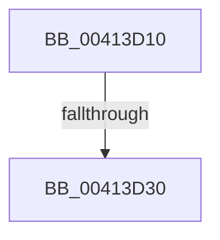

# PpmPerfSnapUtility

- RVA: `0x00413D10`–`0x00413D47` (길이 `55` bytes)
- VA: `0x0000000140413D10`
- 실행 섹션: `.text`
- PDB 이름 있음: `예`; PDB Function 태그: `아니요`
- unwind 정보 RVA: `0x0009BFF0`
- 디코드: `12`개 명령, `55/55` bytes 표시
- 미해석 바이트: `0` (있으면 어셈블리에 `.byte`로 보존)

> 이 문서는 커널 이미지의 기계어와 PDB 기호를 분석해 생성했습니다. 4번과 5번은 함수 원형과 자료형을 바이너리 사용 방식에서 추정한 C 해석이며 원본 소스 복구 결과는 아닙니다.

## 1. Dependencies

- 직접 호출 지점: **0**; 고유 호출 대상: **0**
- 직접 호출자로 확인된 함수: **1**
- RIP 상대 이미지 참조: **0**

### Outgoing calls
- 직접 디코드된 call 명령이 없습니다.

### Direct callers
- [PpmCheckSnapAllUtility](PpmCheckSnapAllUtility_function_00413C00.md) at `0x00413C79`
- [PpmCheckSnapAllUtility](PpmCheckSnapAllUtility_function_00413C00.md) at `0x00413D03`

### Static image references
- 디코드된 RIP-relative 메모리 참조가 없습니다.

## 2. Other-region calls and transfers

- 다른 실행 섹션으로 향하는 call: **0**
- call이 아닌 외부 분기/꼬리 이동: **1**
  - `0x00413D2A` → [sub_00414080](Unknown_function_00414080.md) (`tail-transfer`)

## 3. Assembly (complete function range)

```asm
00413D10  40 55                           push rbp
00413D12  41 57                           push r15
00413D14  48 83 EC 78                     sub rsp, 0x78
00413D18  48 8B 69 10                     mov rbp, qword ptr [rcx + 0x10]
00413D1C  4C 8B F9                        mov r15, rcx
00413D1F  48 89 AC 24 A8 00 00 00         mov qword ptr [rsp + 0xa8], rbp
00413D27  48 85 ED                        test rbp, rbp
00413D2A  0F 84 50 03 00 00               je 0x140414080
00413D30  48 8B 85 80 00 00 00            mov rax, qword ptr [rbp + 0x80]
00413D37  41 BB 01 00 00 00               mov r11d, 1
00413D3D  48 2B 45 40                     sub rax, qword ptr [rbp + 0x40]
00413D41  41 B8 64 00 00 00               mov r8d, 0x64
```

## 4. C-style interpretation (structured pseudocode)

```c
__int64 __fastcall PpmPerfSnapUtility(__int64 a1)
{
    __int64 result;
    __int64 v_rsp;
    unsigned __int64 v_stack_p20;

    v_rsp = (v_rsp) - (120);
    v_stack_p20 = *(unsigned __int64 *)(a1 + 16);
    result = (*(unsigned __int64 *)(*(unsigned __int64 *)(a1 + 16) + 128)) - (*(unsigned __int64 *)(*(unsigned __int64 *)(a1 + 16) + 64));
    return result;
}
```

## 5. (Beta) C Style

```c
int64_t PpmPerfSnapUtility(void *Arg1)
{
    uint8_t *arg1 = (uint8_t *)Arg1;

    int64_t result;
    int64_t local_rsp;
    uint64_t v_stack_p20;

    local_rsp = (local_rsp) - (120);
    v_stack_p20 = *(uint64_t *)(arg1 + 0x10);
    result = (*(uint64_t *)(*(uint64_t *)(arg1 + 0x10) + 0x80)) - (*(uint64_t *)(*(uint64_t *)(arg1 + 0x10) + 0x40));
    return result;
}
```

### 관측된 메모리 오프셋

구조체 형식이 확인되지 않은 접근은 인자 기준의 오프셋으로만 기록했습니다.

| 기준 인자 | 오프셋 표현 | 폭 (bit) | 접근 |
|---|---:|---:|---|
| `Arg1` | `+ 0x10` | `64` | `R` |

## 6. Execution-region graph

[열기: 2D/3D 그래프와 함수 탐색 컨트롤 패널](../../../control-panel.html?section=text&rva=0x00413D10&view=graph)

- 2D 그래프는 위에서 아래로 흐르고, 3D 그래프는 빈 공간을 드래그해 회전합니다. Shift+드래그는 이동, 휠은 확대·축소, 함수 노드 선택은 대상 보고서 이동입니다.

### Static fallback


