# PsAddProcessEnergyValues

- RVA: `0x00416F58`–`0x004171A3` (길이 `587` bytes)
- VA: `0x0000000140416F58`
- 실행 섹션: `.text`
- PDB 이름 있음: `예`; PDB Function 태그: `아니요`
- unwind 정보 RVA: `0x0009CC80`
- 디코드: `152`개 명령, `587/587` bytes 표시
- 미해석 바이트: `0` (있으면 어셈블리에 `.byte`로 보존)

> 이 문서는 커널 이미지의 기계어와 PDB 기호를 분석해 생성했습니다. 4번과 5번은 함수 원형과 자료형을 바이너리 사용 방식에서 추정한 C 해석이며 원본 소스 복구 결과는 아닙니다.

## 1. Dependencies

- 직접 호출 지점: **1**; 고유 호출 대상: **1**
- 직접 호출자로 확인된 함수: **4**
- RIP 상대 이미지 참조: **0**

### Outgoing calls
- `0x004170E0` → [RtlTimelineBitmapMerge](RtlTimelineBitmapMerge_function_004172E0.md) (function, `0x004172E0`)

### Direct callers
- [PspQueryJobHierarchyAccountingInformation](../../page/91/PspQueryJobHierarchyAccountingInformation_function_0091864C.md) at `0x009188BA`
- [PspQueryProcessAccountingInformationCallback](../../page/91/PspQueryProcessAccountingInformationCallback_function_00919E50.md) at `0x00919F68`
- [PopEtEnergyTrackerUpdateAggregate](../../page/98/PopEtEnergyTrackerUpdateAggregate_function_0098D724.md) at `0x0098D7AD`
- [PspFoldProcessAccountingIntoJob](../../page/9F/PspFoldProcessAccountingIntoJob_function_009F59F8.md) at `0x009F5B88`

### Static image references
- 디코드된 RIP-relative 메모리 참조가 없습니다.

## 2. Other-region calls and transfers

- 다른 실행 섹션으로 향하는 call: **0**
- 별도 외부 분기/꼬리 이동을 확인하지 못했습니다.

## 3. Assembly (complete function range)

```asm
00416F58  48 89 5C 24 08                  mov qword ptr [rsp + 8], rbx
00416F5D  48 89 74 24 10                  mov qword ptr [rsp + 0x10], rsi
00416F62  57                              push rdi
00416F63  48 83 EC 20                     sub rsp, 0x20
00416F67  48 8B 42 40                     mov rax, qword ptr [rdx + 0x40]
00416F6B  4C 8B DA                        mov r11, rdx
00416F6E  48 01 41 40                     add qword ptr [rcx + 0x40], rax
00416F72  4D 8B C3                        mov r8, r11
00416F75  48 8B 42 48                     mov rax, qword ptr [rdx + 0x48]
00416F79  4C 8B D1                        mov r10, rcx
00416F7C  48 01 41 48                     add qword ptr [rcx + 0x48], rax
00416F80  BB FF FF FF 7F                  mov ebx, 0x7fffffff
00416F85  48 8B 42 50                     mov rax, qword ptr [rdx + 0x50]
00416F89  41 B9 03 00 00 00               mov r9d, 3
00416F8F  48 01 41 50                     add qword ptr [rcx + 0x50], rax
00416F93  48 8B 42 58                     mov rax, qword ptr [rdx + 0x58]
00416F97  48 01 41 58                     add qword ptr [rcx + 0x58], rax
00416F9B  48 8B 42 60                     mov rax, qword ptr [rdx + 0x60]
00416F9F  48 01 41 60                     add qword ptr [rcx + 0x60], rax
00416FA3  48 8B 82 B0 01 00 00            mov rax, qword ptr [rdx + 0x1b0]
00416FAA  48 8D 51 6C                     lea rdx, [rcx + 0x6c]
00416FAE  48 01 81 B0 01 00 00            add qword ptr [rcx + 0x1b0], rax
00416FB5  4C 2B C1                        sub r8, rcx
00416FB8  8B 02                           mov eax, dword ptr [rdx]
00416FBA  41 8B 0C 10                     mov ecx, dword ptr [r8 + rdx]
00416FBE  03 C8                           add ecx, eax
00416FC0  33 C8                           xor ecx, eax
00416FC2  23 CB                           and ecx, ebx
00416FC4  33 C8                           xor ecx, eax
00416FC6  89 0A                           mov dword ptr [rdx], ecx
00416FC8  8B 4A FC                        mov ecx, dword ptr [rdx - 4]
00416FCB  41 8B 44 10 FC                  mov eax, dword ptr [r8 + rdx - 4]
00416FD0  48 8D 52 08                     lea rdx, [rdx + 8]
00416FD4  3B C8                           cmp ecx, eax
00416FD6  0F 46 C8                        cmovbe ecx, eax
00416FD9  89 4A F4                        mov dword ptr [rdx - 0xc], ecx
00416FDC  49 83 E9 01                     sub r9, 1
00416FE0  75 D6                           jne 0x140416fb8
00416FE2  49 8D 92 84 01 00 00            lea rdx, [r10 + 0x184]
00416FE9  41 B9 05 00 00 00               mov r9d, 5
00416FEF  8B 02                           mov eax, dword ptr [rdx]
00416FF1  41 8B 0C 10                     mov ecx, dword ptr [r8 + rdx]
00416FF5  03 C8                           add ecx, eax
00416FF7  33 C8                           xor ecx, eax
00416FF9  23 CB                           and ecx, ebx
00416FFB  33 C8                           xor ecx, eax
00416FFD  89 0A                           mov dword ptr [rdx], ecx
00416FFF  8B 4A FC                        mov ecx, dword ptr [rdx - 4]
00417002  41 8B 44 10 FC                  mov eax, dword ptr [r8 + rdx - 4]
00417007  48 8D 52 08                     lea rdx, [rdx + 8]
0041700B  3B C8                           cmp ecx, eax
0041700D  0F 46 C8                        cmovbe ecx, eax
00417010  89 4A F4                        mov dword ptr [rdx - 0xc], ecx
00417013  49 83 E9 01                     sub r9, 1
00417017  75 D6                           jne 0x140416fef
00417019  45 8B 83 80 00 00 00            mov r8d, dword ptr [r11 + 0x80]
00417020  49 8D 92 80 00 00 00            lea rdx, [r10 + 0x80]
00417027  83 C9 FF                        or ecx, 0xffffffff
0041702A  44 3B C1                        cmp r8d, ecx
0041702D  0F 82 4F 01 00 00               jb 0x140417182
00417033  8B C1                           mov eax, ecx
00417035  89 02                           mov dword ptr [rdx], eax
00417037  49 8D 92 84 00 00 00            lea rdx, [r10 + 0x84]
0041703E  45 8B 83 84 00 00 00            mov r8d, dword ptr [r11 + 0x84]
00417045  44 3B C1                        cmp r8d, ecx
00417048  0F 83 F9 00 00 00               jae 0x140417147
0041704E  44 8B 0A                        mov r9d, dword ptr [rdx]
00417051  41 8B C0                        mov eax, r8d
00417054  F7 D0                           not eax
00417056  41 3B C1                        cmp eax, r9d
00417059  43 8D 04 01                     lea eax, [r9 + r8]
0041705D  0F 82 E4 00 00 00               jb 0x140417147
00417063  89 02                           mov dword ptr [rdx], eax
00417065  49 8D 92 88 00 00 00            lea rdx, [r10 + 0x88]
0041706C  45 8B 83 88 00 00 00            mov r8d, dword ptr [r11 + 0x88]
00417073  44 3B C1                        cmp r8d, ecx
00417076  0F 82 D2 00 00 00               jb 0x14041714e
0041707C  8B C1                           mov eax, ecx
0041707E  89 02                           mov dword ptr [rdx], eax
00417080  49 8D 92 A8 01 00 00            lea rdx, [r10 + 0x1a8]
00417087  45 8B 83 A8 01 00 00            mov r8d, dword ptr [r11 + 0x1a8]
0041708E  44 3B C1                        cmp r8d, ecx
00417091  0F 83 05 01 00 00               jae 0x14041719c
00417097  44 8B 0A                        mov r9d, dword ptr [rdx]
0041709A  41 8B C0                        mov eax, r8d
0041709D  F7 D0                           not eax
0041709F  41 3B C1                        cmp eax, r9d
004170A2  43 8D 04 01                     lea eax, [r9 + r8]
004170A6  0F 82 F0 00 00 00               jb 0x14041719c
004170AC  89 02                           mov dword ptr [rdx], eax
004170AE  49 8D 92 AC 01 00 00            lea rdx, [r10 + 0x1ac]
004170B5  45 8B 83 AC 01 00 00            mov r8d, dword ptr [r11 + 0x1ac]
004170BC  44 3B C1                        cmp r8d, ecx
004170BF  0F 82 A3 00 00 00               jb 0x140417168
004170C5  49 8B FB                        mov rdi, r11
004170C8  89 0A                           mov dword ptr [rdx], ecx
004170CA  49 2B FA                        sub rdi, r10
004170CD  49 8D 9A 10 01 00 00            lea rbx, [r10 + 0x110]
004170D4  BE 0E 00 00 00                  mov esi, 0xe
004170D9  48 8D 14 3B                     lea rdx, [rbx + rdi]
004170DD  48 8B CB                        mov rcx, rbx
004170E0  E8 FB 01 00 00                  call 0x1404172e0
004170E5  48 83 C3 08                     add rbx, 8
004170E9  48 83 EE 01                     sub rsi, 1
004170ED  75 EA                           jne 0x1404170d9
004170EF  49 8B CB                        mov rcx, r11
004170F2  8D 56 04                        lea edx, [rsi + 4]
004170F5  49 2B CA                        sub rcx, r10
004170F8  4D 2B DA                        sub r11, r10
004170FB  41 B8 02 00 00 00               mov r8d, 2
00417101  4B 8B 04 1A                     mov rax, qword ptr [r10 + r11]
00417105  49 01 02                        add qword ptr [r10], rax
00417108  4A 8B 84 11 90 00 00 00         mov rax, qword ptr [rcx + r10 + 0x90]
00417110  49 01 82 90 00 00 00            add qword ptr [r10 + 0x90], rax
00417117  4B 8B 84 13 D0 00 00 00         mov rax, qword ptr [r11 + r10 + 0xd0]
0041711F  49 01 82 D0 00 00 00            add qword ptr [r10 + 0xd0], rax
00417126  49 83 C2 08                     add r10, 8
0041712A  49 83 E8 01                     sub r8, 1
0041712E  75 D1                           jne 0x140417101
00417130  48 83 EA 01                     sub rdx, 1
00417134  75 C5                           jne 0x1404170fb
00417136  48 8B 5C 24 30                  mov rbx, qword ptr [rsp + 0x30]
0041713B  48 8B 74 24 38                  mov rsi, qword ptr [rsp + 0x38]
00417140  48 83 C4 20                     add rsp, 0x20
00417144  5F                              pop rdi
00417145  C3                              ret
00417146  CC                              int3
00417147  8B C1                           mov eax, ecx
00417149  E9 15 FF FF FF                  jmp 0x140417063
0041714E  44 8B 0A                        mov r9d, dword ptr [rdx]
00417151  41 8B C0                        mov eax, r8d
00417154  F7 D0                           not eax
00417156  41 3B C1                        cmp eax, r9d
00417159  43 8D 04 01                     lea eax, [r9 + r8]
0041715D  0F 83 1B FF FF FF               jae 0x14041707e
00417163  E9 14 FF FF FF                  jmp 0x14041707c
00417168  44 8B 0A                        mov r9d, dword ptr [rdx]
0041716B  41 8B C0                        mov eax, r8d
0041716E  F7 D0                           not eax
00417170  41 3B C1                        cmp eax, r9d
00417173  0F 82 4C FF FF FF               jb 0x1404170c5
00417179  43 8D 0C 01                     lea ecx, [r9 + r8]
0041717D  E9 43 FF FF FF                  jmp 0x1404170c5
00417182  44 8B 0A                        mov r9d, dword ptr [rdx]
00417185  41 8B C0                        mov eax, r8d
00417188  F7 D0                           not eax
0041718A  41 3B C1                        cmp eax, r9d
0041718D  43 8D 04 01                     lea eax, [r9 + r8]
00417191  0F 83 9E FE FF FF               jae 0x140417035
00417197  E9 97 FE FF FF                  jmp 0x140417033
0041719C  8B C1                           mov eax, ecx
0041719E  E9 09 FF FF FF                  jmp 0x1404170ac
```

## 4. C-style interpretation (structured pseudocode)

```c
__int64 __fastcall PsAddProcessEnergyValues(__int64 a1, __int64 a2)
{
    __int64 result;
    __int64 v_r10;
    __int64 v_r11;
    __int64 v_rbx;
    __int64 v_rdi;
    __int64 v_rsi;
    __int64 v_rsp;
    unsigned __int64 v_stack_p10;
    unsigned __int64 v_stack_p8;

    v_stack_p8 = v_rbx;
    v_stack_p10 = v_rsi;
    v_rsp = (v_rsp) - (32);
    a3 = (a2) - (a1);
loc_00416FB8:
    a1 = (unsigned int)(((unsigned int)(*(unsigned int *)(a3 + a1 + 108 * 1))) + ((unsigned int)((unsigned int)(*(unsigned int *)(a1 + 108)))));
    a1 = (unsigned int)((a1) ^ ((unsigned int)((unsigned int)(*(unsigned int *)(a1 + 108)))));
    a1 = (unsigned int)((a1) & ((unsigned int)((unsigned int)(0x7FFFFFFFULL))));
    a1 = (unsigned int)((a1) ^ ((unsigned int)((unsigned int)(*(unsigned int *)(a1 + 108)))));
    *(unsigned int *)(a1 + 108) = (unsigned int)(a1);
    a1 = (unsigned int)(*(unsigned int *)(a1 + 108 - 4));
    if (((unsigned int)((unsigned int)(*(unsigned int *)(a1 + 108 - 4)))) <= ((unsigned int)((unsigned int)(*(unsigned int *)(a3 + a1 + 108 * 1 - 4))))) { a1 = (unsigned int)((unsigned int)(*(unsigned int *)(a3 + a1 + 108 * 1 - 4))); }
    *(unsigned int *)(a1 + 108 + 8 - 12) = (unsigned int)(a1);
    a4 = (3) - (1);
    if (condition_is_not_equal) goto loc_00416FB8;
loc_00416FEF:
    a1 = (unsigned int)(((unsigned int)(*(unsigned int *)(a3 + a1 + 388 * 1))) + ((unsigned int)((unsigned int)(*(unsigned int *)(a1 + 388)))));
    a1 = (unsigned int)((a1) ^ ((unsigned int)((unsigned int)(*(unsigned int *)(a1 + 388)))));
    a1 = (unsigned int)((a1) & ((unsigned int)((unsigned int)(0x7FFFFFFFULL))));
    a1 = (unsigned int)((a1) ^ ((unsigned int)((unsigned int)(*(unsigned int *)(a1 + 388)))));
    *(unsigned int *)(a1 + 388) = (unsigned int)(a1);
    a1 = (unsigned int)(*(unsigned int *)(a1 + 388 - 4));
    if (((unsigned int)((unsigned int)(*(unsigned int *)(a1 + 388 - 4)))) <= ((unsigned int)((unsigned int)(*(unsigned int *)(a3 + a1 + 388 * 1 - 4))))) { a1 = (unsigned int)((unsigned int)(*(unsigned int *)(a3 + a1 + 388 * 1 - 4))); }
    *(unsigned int *)(a1 + 388 + 8 - 12) = (unsigned int)(a1);
    a4 = (5) - (1);
    if (condition_is_not_equal) goto loc_00416FEF;
    a1 = (unsigned int)((a1) | (0xFFFFFFFFULL));
    if (((unsigned int)((unsigned int)(*(unsigned int *)(a2 + 128)))) < ((unsigned int)(a1))) goto loc_00417182;
loc_00417033:
loc_00417035:
    *(unsigned int *)(a1 + 128) = (unsigned int)((unsigned int)((unsigned int)(a1)));
    if (((unsigned int)((unsigned int)(*(unsigned int *)(a2 + 132)))) >= ((unsigned int)(a1))) goto loc_00417147;
    result = (unsigned int)(~((unsigned int)((unsigned int)((unsigned int)(*(unsigned int *)(a2 + 132))))));
    if (((unsigned int)(result)) < ((unsigned int)((unsigned int)(*(unsigned int *)(a1 + 132))))) goto loc_00417147;
loc_00417063:
    *(unsigned int *)(a1 + 132) = (unsigned int)((unsigned int)(*(unsigned int *)(a1 + 132)) + (unsigned int)(*(unsigned int *)(a2 + 132)) * 1);
    if (((unsigned int)((unsigned int)(*(unsigned int *)(a2 + 136)))) < ((unsigned int)(a1))) goto loc_0041714E;
loc_0041707C:
loc_0041707E:
    *(unsigned int *)(a1 + 136) = (unsigned int)((unsigned int)((unsigned int)(a1)));
    if (((unsigned int)((unsigned int)(*(unsigned int *)(a2 + 424)))) >= ((unsigned int)(a1))) goto loc_0041719C;
    result = (unsigned int)(~((unsigned int)((unsigned int)((unsigned int)(*(unsigned int *)(a2 + 424))))));
    if (((unsigned int)(result)) < ((unsigned int)((unsigned int)(*(unsigned int *)(a1 + 424))))) goto loc_0041719C;
loc_004170AC:
    *(unsigned int *)(a1 + 424) = (unsigned int)((unsigned int)(*(unsigned int *)(a1 + 424)) + (unsigned int)(*(unsigned int *)(a2 + 424)) * 1);
    if (((unsigned int)((unsigned int)(*(unsigned int *)(a2 + 428)))) < ((unsigned int)(a1))) goto loc_00417168;
loc_004170C5:
    *(unsigned int *)(a1 + 428) = (unsigned int)(a1);
    v_rdi = (a2) - (a1);
loc_004170D9:
    result = RtlTimelineBitmapMerge(a1 + 272, a1 + 272 + v_rdi * 1, (unsigned int)(*(unsigned int *)(a2 + 428)), (unsigned int)(*(unsigned int *)(a1 + 424)));
    v_rbx = (a1 + 272) + (8);
    v_rsi = (14) - (1);
    if (condition_is_not_equal) goto loc_004170D9;
    a1 = (a2) - (a1);
    v_r11 = (a2) - (a1);
loc_004170FB:
loc_00417101:
    v_r10 = (a1) + (8);
    a3 = (2) - (1);
    if (condition_is_not_equal) goto loc_00417101;
    a2 = (v_rsi + 4) - (1);
    if (condition_is_not_equal) goto loc_004170FB;
    v_rsp = (v_rsp) + (32);
    return *(unsigned __int64 *)(v_r11 + a1 * 1 + 208);
loc_00417147:
    goto loc_00417063;
loc_0041714E:
    result = (unsigned int)(~((unsigned int)((unsigned int)(a3))));
    if (((unsigned int)(result)) >= ((unsigned int)((unsigned int)(*(unsigned int *)(a2))))) goto loc_0041707E;
    goto loc_0041707C;
loc_00417168:
    result = (unsigned int)(~((unsigned int)((unsigned int)(a3))));
    if (((unsigned int)(result)) < ((unsigned int)((unsigned int)(*(unsigned int *)(a2))))) goto loc_004170C5;
    goto loc_004170C5;
loc_00417182:
    result = (unsigned int)(~((unsigned int)((unsigned int)(a3))));
    if (((unsigned int)(result)) >= ((unsigned int)((unsigned int)(*(unsigned int *)(a2))))) goto loc_00417035;
    goto loc_00417033;
loc_0041719C:
    goto loc_004170AC;
}
```

## 5. (Beta) C Style

```c
int64_t PsAddProcessEnergyValues(void *Arg1, void *Arg2)
{
    uint8_t *arg1 = (uint8_t *)Arg1;
    uint8_t *arg2 = (uint8_t *)Arg2;

    int64_t result;
    int64_t local_r10;
    int64_t local_r11;
    int64_t local_rbx;
    int64_t local_rdi;
    int64_t local_rsi;
    int64_t local_rsp;
    uint64_t v_stack_p10;
    uint64_t v_stack_p8;

    v_stack_p8 = local_rbx;
    v_stack_p10 = local_rsi;
    local_rsp = (local_rsp) - (32);
    a3 = (Arg2) - (Arg1);
loc_00416FB8:
    Arg1 = (uint32_t)(((uint32_t)(*(uint32_t *)(a3 + arg1 + 0x6C * 1))) + ((uint32_t)((uint32_t)(*(uint32_t *)(arg1 + 0x6C)))));
    Arg1 = (uint32_t)((Arg1) ^ ((uint32_t)((uint32_t)(*(uint32_t *)(arg1 + 0x6C)))));
    Arg1 = (uint32_t)((Arg1) & ((uint32_t)((uint32_t)(0x7FFFFFFFULL))));
    Arg1 = (uint32_t)((Arg1) ^ ((uint32_t)((uint32_t)(*(uint32_t *)(arg1 + 0x6C)))));
    *(uint32_t *)(arg1 + 0x6C) = (uint32_t)(Arg1);
    Arg1 = (uint32_t)(*(uint32_t *)(arg1 + 0x6C - 0x4));
    if (((uint32_t)((uint32_t)(*(uint32_t *)(arg1 + 0x6C - 0x4)))) <= ((uint32_t)((uint32_t)(*(uint32_t *)(a3 + arg1 + 0x6C * 1 - 0x4))))) { Arg1 = (uint32_t)((uint32_t)(*(uint32_t *)(a3 + arg1 + 0x6C * 1 - 0x4))); }
    *(uint32_t *)(arg1 + 0x6C + 0x8 - 0xC) = (uint32_t)(Arg1);
    a4 = (3) - (1);
    if (condition_is_not_equal) goto loc_00416FB8;
loc_00416FEF:
    Arg1 = (uint32_t)(((uint32_t)(*(uint32_t *)(a3 + arg1 + 0x184 * 1))) + ((uint32_t)((uint32_t)(*(uint32_t *)(arg1 + 0x184)))));
    Arg1 = (uint32_t)((Arg1) ^ ((uint32_t)((uint32_t)(*(uint32_t *)(arg1 + 0x184)))));
    Arg1 = (uint32_t)((Arg1) & ((uint32_t)((uint32_t)(0x7FFFFFFFULL))));
    Arg1 = (uint32_t)((Arg1) ^ ((uint32_t)((uint32_t)(*(uint32_t *)(arg1 + 0x184)))));
    *(uint32_t *)(arg1 + 0x184) = (uint32_t)(Arg1);
    Arg1 = (uint32_t)(*(uint32_t *)(arg1 + 0x184 - 0x4));
    if (((uint32_t)((uint32_t)(*(uint32_t *)(arg1 + 0x184 - 0x4)))) <= ((uint32_t)((uint32_t)(*(uint32_t *)(a3 + arg1 + 0x184 * 1 - 0x4))))) { Arg1 = (uint32_t)((uint32_t)(*(uint32_t *)(a3 + arg1 + 0x184 * 1 - 0x4))); }
    *(uint32_t *)(arg1 + 0x184 + 0x8 - 0xC) = (uint32_t)(Arg1);
    a4 = (5) - (1);
    if (condition_is_not_equal) goto loc_00416FEF;
    Arg1 = (uint32_t)((Arg1) | (0xFFFFFFFFULL));
    if (((uint32_t)((uint32_t)(*(uint32_t *)(arg2 + 0x80)))) < ((uint32_t)(Arg1))) goto loc_00417182;
loc_00417033:
loc_00417035:
    *(uint32_t *)(arg1 + 0x80) = (uint32_t)((uint32_t)((uint32_t)(Arg1)));
    if (((uint32_t)((uint32_t)(*(uint32_t *)(arg2 + 0x84)))) >= ((uint32_t)(Arg1))) goto loc_00417147;
    result = (uint32_t)(~((uint32_t)((uint32_t)((uint32_t)(*(uint32_t *)(arg2 + 0x84))))));
    if (((uint32_t)(result)) < ((uint32_t)((uint32_t)(*(uint32_t *)(arg1 + 0x84))))) goto loc_00417147;
loc_00417063:
    *(uint32_t *)(arg1 + 0x84) = (uint32_t)((uint32_t)(*(uint32_t *)(arg1 + 0x84)) + (uint32_t)(*(uint32_t *)(arg2 + 0x84)) * 1);
    if (((uint32_t)((uint32_t)(*(uint32_t *)(arg2 + 0x88)))) < ((uint32_t)(Arg1))) goto loc_0041714E;
loc_0041707C:
loc_0041707E:
    *(uint32_t *)(arg1 + 0x88) = (uint32_t)((uint32_t)((uint32_t)(Arg1)));
    if (((uint32_t)((uint32_t)(*(uint32_t *)(arg2 + 0x1A8)))) >= ((uint32_t)(Arg1))) goto loc_0041719C;
    result = (uint32_t)(~((uint32_t)((uint32_t)((uint32_t)(*(uint32_t *)(arg2 + 0x1A8))))));
    if (((uint32_t)(result)) < ((uint32_t)((uint32_t)(*(uint32_t *)(arg1 + 0x1A8))))) goto loc_0041719C;
loc_004170AC:
    *(uint32_t *)(arg1 + 0x1A8) = (uint32_t)((uint32_t)(*(uint32_t *)(arg1 + 0x1A8)) + (uint32_t)(*(uint32_t *)(arg2 + 0x1A8)) * 1);
    if (((uint32_t)((uint32_t)(*(uint32_t *)(arg2 + 0x1AC)))) < ((uint32_t)(Arg1))) goto loc_00417168;
loc_004170C5:
    *(uint32_t *)(arg1 + 0x1AC) = (uint32_t)(Arg1);
    local_rdi = (Arg2) - (Arg1);
loc_004170D9:
    result = RtlTimelineBitmapMerge(Arg1 + 272, Arg1 + 272 + local_rdi * 1, (uint32_t)(*(uint32_t *)(arg2 + 0x1AC)), (uint32_t)(*(uint32_t *)(arg1 + 0x1A8)));
    local_rbx = (Arg1 + 272) + (8);
    local_rsi = (14) - (1);
    if (condition_is_not_equal) goto loc_004170D9;
    Arg1 = (Arg2) - (Arg1);
    local_r11 = (Arg2) - (Arg1);
loc_004170FB:
loc_00417101:
    local_r10 = (Arg1) + (8);
    a3 = (2) - (1);
    if (condition_is_not_equal) goto loc_00417101;
    Arg2 = (local_rsi + 4) - (1);
    if (condition_is_not_equal) goto loc_004170FB;
    local_rsp = (local_rsp) + (32);
    return *(uint64_t *)(local_r11 + arg1 * 1 + 0xD0);
loc_00417147:
    goto loc_00417063;
loc_0041714E:
    result = (uint32_t)(~((uint32_t)((uint32_t)(a3))));
    if (((uint32_t)(result)) >= ((uint32_t)((uint32_t)(*(uint32_t *)(arg2))))) goto loc_0041707E;
    goto loc_0041707C;
loc_00417168:
    result = (uint32_t)(~((uint32_t)((uint32_t)(a3))));
    if (((uint32_t)(result)) < ((uint32_t)((uint32_t)(*(uint32_t *)(arg2))))) goto loc_004170C5;
    goto loc_004170C5;
loc_00417182:
    result = (uint32_t)(~((uint32_t)((uint32_t)(a3))));
    if (((uint32_t)(result)) >= ((uint32_t)((uint32_t)(*(uint32_t *)(arg2))))) goto loc_00417035;
    goto loc_00417033;
loc_0041719C:
    goto loc_004170AC;
}
```

### 관측된 메모리 오프셋

구조체 형식이 확인되지 않은 접근은 인자 기준의 오프셋으로만 기록했습니다.

| 기준 인자 | 오프셋 표현 | 폭 (bit) | 접근 |
|---|---:|---:|---|
| `Arg1` | `- 0xC` | `32` | `W` |
| `Arg1` | `- 0x4` | `32` | `R` |
| `Arg1` | `+ 0x0` | `32` | `R` |
| `Arg1` | `+ 0x0` | `32` | `W` |
| `Arg1` | `+ 0x0 + rdi*1` | `64` | `R` |
| `Arg1` | `+ 0x8` | `64` | `R` |
| `Arg1` | `+ 0x40` | `64` | `R/W` |
| `Arg1` | `+ 0x48` | `64` | `R/W` |
| `Arg1` | `+ 0x50` | `64` | `R/W` |
| `Arg1` | `+ 0x58` | `64` | `R/W` |
| `Arg1` | `+ 0x60` | `64` | `R/W` |
| `Arg1` | `+ 0x6C` | `64` | `R` |
| `Arg1` | `+ 0x80` | `64` | `R` |
| `Arg1` | `+ 0x84` | `64` | `R` |
| `Arg1` | `+ 0x88` | `64` | `R` |
| `Arg1` | `+ 0x110` | `64` | `R` |
| `Arg1` | `+ 0x184` | `64` | `R` |
| `Arg1` | `+ 0x1A8` | `64` | `R` |
| `Arg1` | `+ 0x1AC` | `64` | `R` |
| `Arg1` | `+ 0x1B0` | `64` | `R/W` |
| `Arg2` | `- 0x4 + rdx*1` | `32` | `R` |
| `Arg2` | `+ 0x0 + rdx*1` | `32` | `R` |
| `Arg2` | `+ 0x40` | `64` | `R` |
| `Arg2` | `+ 0x48` | `64` | `R` |
| `Arg2` | `+ 0x50` | `64` | `R` |
| `Arg2` | `+ 0x58` | `64` | `R` |
| `Arg2` | `+ 0x60` | `64` | `R` |
| `Arg2` | `+ 0x80` | `32` | `R` |
| `Arg2` | `+ 0x84` | `32` | `R` |
| `Arg2` | `+ 0x88` | `32` | `R` |
| `Arg2` | `+ 0x1A8` | `32` | `R` |
| `Arg2` | `+ 0x1AC` | `32` | `R` |

추가 오프셋 1개는 표에서 생략했습니다.

## 6. Execution-region graph

[열기: 2D/3D 그래프와 함수 탐색 컨트롤 패널](../../../control-panel.html?section=text&rva=0x00416F58&view=graph)

- 2D 그래프는 위에서 아래로 흐르고, 3D 그래프는 빈 공간을 드래그해 회전합니다. Shift+드래그는 이동, 휠은 확대·축소, 함수 노드 선택은 대상 보고서 이동입니다.

### Static fallback

```mermaid
flowchart TD
  bb_00416F58[BB_00416F58]
  bb_00416FB8[BB_00416FB8]
  bb_00416FE2[BB_00416FE2]
  bb_00416FEF[BB_00416FEF]
  bb_00417019[BB_00417019]
  bb_00417033[BB_00417033]
  bb_00417035[BB_00417035]
  bb_0041704E[BB_0041704E]
  bb_00417063[BB_00417063]
  bb_0041707C[BB_0041707C]
  bb_0041707E[BB_0041707E]
  bb_00417097[BB_00417097]
  bb_004170AC[BB_004170AC]
  bb_004170C5[BB_004170C5]
  bb_004170D9[BB_004170D9]
  bb_004170EF[BB_004170EF]
  bb_004170FB[BB_004170FB]
  bb_00417101[BB_00417101]
  bb_00417130[BB_00417130]
  bb_00417136[BB_00417136]
  bb_00417146[BB_00417146]
  bb_00417147[BB_00417147]
  bb_0041714E[BB_0041714E]
  bb_00417163[BB_00417163]
  bb_00417168[BB_00417168]
  bb_00417179[BB_00417179]
  bb_00417182[BB_00417182]
  bb_00417197[BB_00417197]
  bb_0041719C[BB_0041719C]
  bb_00416F58 -->|flow| bb_00416FB8
  bb_00416FB8 -->|branch| bb_00416FB8
  bb_00416FB8 -->|fallthrough| bb_00416FE2
  bb_00416FE2 -->|flow| bb_00416FEF
  bb_00416FEF -->|branch| bb_00416FEF
  bb_00416FEF -->|fallthrough| bb_00417019
  bb_00417019 -->|branch| bb_00417182
  bb_00417019 -->|fallthrough| bb_00417033
  bb_00417033 -->|flow| bb_00417035
  bb_00417035 -->|branch| bb_00417147
  bb_00417035 -->|fallthrough| bb_0041704E
  bb_0041704E -->|branch| bb_00417147
  bb_0041704E -->|fallthrough| bb_00417063
  bb_00417063 -->|branch| bb_0041714E
  bb_00417063 -->|fallthrough| bb_0041707C
  bb_0041707C -->|flow| bb_0041707E
  bb_0041707E -->|branch| bb_0041719C
  bb_0041707E -->|fallthrough| bb_00417097
  bb_00417097 -->|branch| bb_0041719C
  bb_00417097 -->|fallthrough| bb_004170AC
  bb_004170AC -->|branch| bb_00417168
  bb_004170AC -->|fallthrough| bb_004170C5
  bb_004170C5 -->|flow| bb_004170D9
  bb_004170D9 -->|branch| bb_004170D9
  bb_004170D9 -->|fallthrough| bb_004170EF
  bb_004170EF -->|flow| bb_004170FB
  bb_004170FB -->|flow| bb_00417101
  bb_00417101 -->|branch| bb_00417101
  bb_00417101 -->|fallthrough| bb_00417130
  bb_00417130 -->|branch| bb_004170FB
  bb_00417130 -->|fallthrough| bb_00417136
  bb_00417146 -->|flow| bb_00417147
  bb_00417147 -->|branch| bb_00417063
  bb_0041714E -->|branch| bb_0041707E
  bb_0041714E -->|fallthrough| bb_00417163
  bb_00417163 -->|branch| bb_0041707C
  bb_00417168 -->|branch| bb_004170C5
  bb_00417168 -->|fallthrough| bb_00417179
  bb_00417179 -->|branch| bb_004170C5
  bb_00417182 -->|branch| bb_00417035
  bb_00417182 -->|fallthrough| bb_00417197
  bb_00417197 -->|branch| bb_00417033
  bb_0041719C -->|branch| bb_004170AC
```


