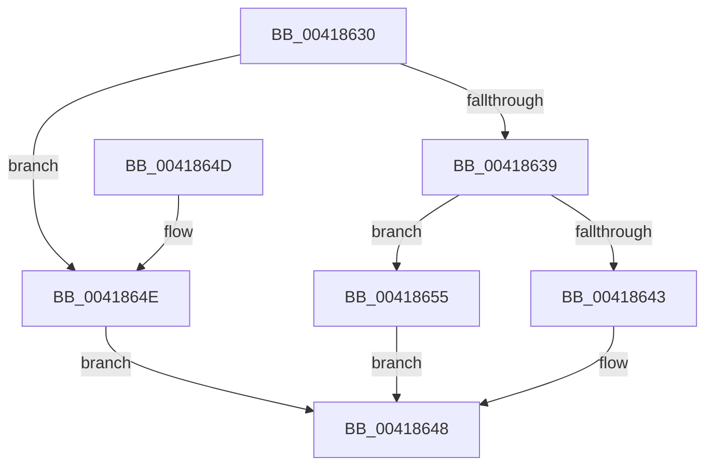

# PsGetJobSilo

- RVA: `0x00418630`–`0x0041865C` (길이 `44` bytes)
- VA: `0x0000000140418630`
- 실행 섹션: `.text`
- PDB 이름 있음: `예`; PDB Function 태그: `아니요`
- unwind 정보 RVA: `0x00064C74`
- 디코드: `15`개 명령, `44/44` bytes 표시
- 미해석 바이트: `0` (있으면 어셈블리에 `.byte`로 보존)

> 이 문서는 커널 이미지의 기계어와 PDB 기호를 분석해 생성했습니다. 4번과 5번은 함수 원형과 자료형을 바이너리 사용 방식에서 추정한 C 해석이며 원본 소스 복구 결과는 아닙니다.

## 1. Dependencies

- 직접 호출 지점: **1**; 고유 호출 대상: **1**
- 직접 호출자로 확인된 함수: **7**
- RIP 상대 이미지 참조: **0**

### Outgoing calls
- `0x00418639` → [PspGetJobSilo](PspGetJobSilo_function_00418670.md) (function, `0x00418670`)

### Direct callers
- [VrpHandleIoctlCreateMultipleNamespaceNodes](../../page/83/VrpHandleIoctlCreateMultipleNamespaceNodes_function_0083B17C.md) at `0x0083B207`
- [VrpHandleIoctlModifyFlags](../../page/83/VrpHandleIoctlModifyFlags_function_0083B69C.md) at `0x0083B725`
- [VrpHandleIoctlCreateNamespaceNode](../../page/93/VrpHandleIoctlCreateNamespaceNode_function_0093511C.md) at `0x0093524D`
- [VrpHandleIoctlGetVirtualRootKey](../../page/93/VrpHandleIoctlGetVirtualRootKey_function_00935374.md) at `0x0093540B`
- [VrpHandleIoctlLoadDifferencingHive](../../page/93/VrpHandleIoctlLoadDifferencingHive_function_00935C5C.md) at `0x00935DD1`
- [VrpHandleIoctlInitializeJobForVreg](../../page/93/VrpHandleIoctlInitializeJobForVreg_function_00937254.md) at `0x009373E5`
- [VrpHandleIoctlUnloadDynamicallyLoadedHives](../../page/93/VrpHandleIoctlUnloadDynamicallyLoadedHives_function_0093778C.md) at `0x0093782E`

### Static image references
- 디코드된 RIP-relative 메모리 참조가 없습니다.

## 2. Other-region calls and transfers

- 다른 실행 섹션으로 향하는 call: **0**
- 별도 외부 분기/꼬리 이동을 확인하지 못했습니다.

## 3. Assembly (complete function range)

```asm
00418630  48 83 EC 28                     sub rsp, 0x28
00418634  48 85 C9                        test rcx, rcx
00418637  74 15                           je 0x14041864e
00418639  E8 32 00 00 00                  call 0x140418670
0041863E  48 85 C0                        test rax, rax
00418641  74 12                           je 0x140418655
00418643  48 89 02                        mov qword ptr [rdx], rax
00418646  33 C0                           xor eax, eax
00418648  48 83 C4 28                     add rsp, 0x28
0041864C  C3                              ret
0041864D  CC                              int3
0041864E  B8 0D 00 00 C0                  mov eax, 0xc000000d
00418653  EB F3                           jmp 0x140418648
00418655  B8 09 05 00 C0                  mov eax, 0xc0000509
0041865A  EB EC                           jmp 0x140418648
```

## 4. C-style interpretation (structured pseudocode)

```c
__int64 __fastcall PsGetJobSilo(__int64 a1, __int64 a2)
{
    __int64 result;
    __int64 v_rsp;

    v_rsp = (v_rsp) - (40);
    if (a1 == 0) goto loc_0041864E;
    result = PspGetJobSilo(a1, a2, a3, a4);
    if (result == 0) goto loc_00418655;
    *(unsigned __int64 *)(a2) = result;
    result = 0;
loc_00418648:
    v_rsp = (v_rsp) + (40);
    return result;
loc_0041864E:
    goto loc_00418648;
loc_00418655:
    goto loc_00418648;
}
```

## 5. (Beta) C Style

```c
int64_t PsGetJobSilo(int64_t Arg1, int64_t Arg2)
{
    int64_t result;
    int64_t local_rsp;

    local_rsp = (local_rsp) - (40);
    if (Arg1 == 0) goto loc_0041864E;
    result = PspGetJobSilo(Arg1, Arg2, a3, a4);
    if (result == 0) goto loc_00418655;
    *(uint64_t *)(Arg2) = result;
    result = 0;
loc_00418648:
    local_rsp = (local_rsp) + (40);
    return result;
loc_0041864E:
    goto loc_00418648;
loc_00418655:
    goto loc_00418648;
}
```

## 6. Execution-region graph

[열기: 2D/3D 그래프와 함수 탐색 컨트롤 패널](../../../control-panel.html?section=text&rva=0x00418630&view=graph)

- 2D 그래프는 위에서 아래로 흐르고, 3D 그래프는 빈 공간을 드래그해 회전합니다. Shift+드래그는 이동, 휠은 확대·축소, 함수 노드 선택은 대상 보고서 이동입니다.

### Static fallback


