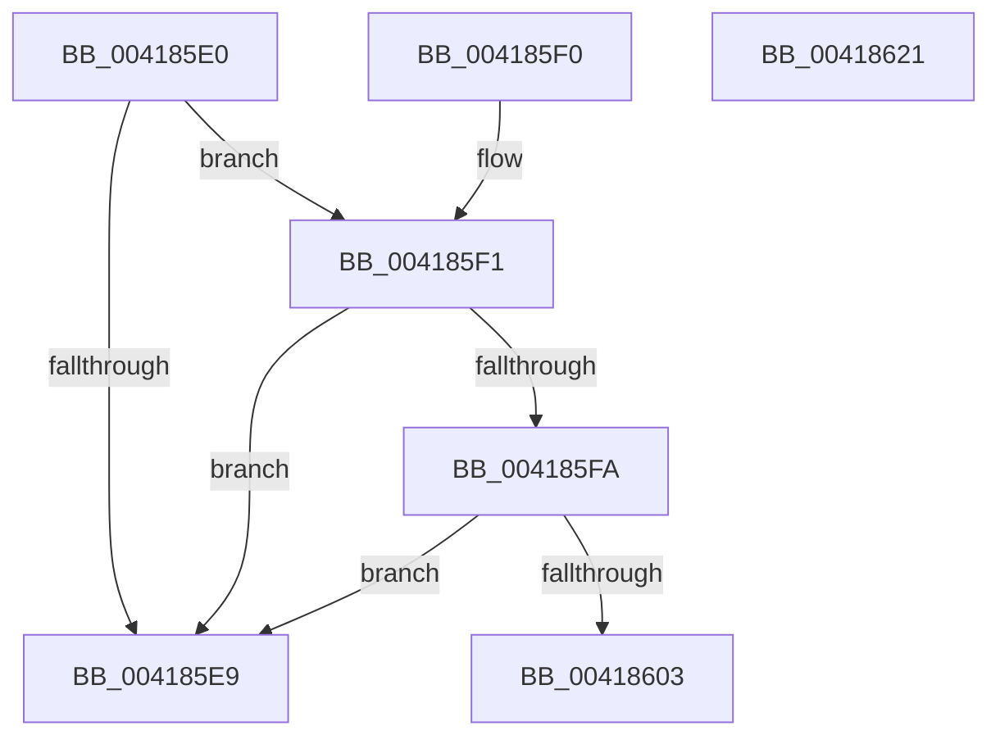

# PsIsProcessInSilo

- RVA: `0x004185E0`–`0x00418622` (길이 `66` bytes)
- VA: `0x00000001404185E0`
- 실행 섹션: `.text`
- PDB 이름 있음: `예`; PDB Function 태그: `아니요`
- unwind 정보 RVA: `0x0009CEEC`
- 디코드: `20`개 명령, `66/66` bytes 표시
- 미해석 바이트: `0` (있으면 어셈블리에 `.byte`로 보존)

> 이 문서는 커널 이미지의 기계어와 PDB 기호를 분석해 생성했습니다. 4번과 5번은 함수 원형과 자료형을 바이너리 사용 방식에서 추정한 C 해석이며 원본 소스 복구 결과는 아닙니다.

## 1. Dependencies

- 직접 호출 지점: **2**; 고유 호출 대상: **2**
- 직접 호출자로 확인된 함수: **9**
- RIP 상대 이미지 참조: **2**

### Outgoing calls
- `0x0041860A` → [PspGetJobSilo](PspGetJobSilo_function_00418670.md) (function, `0x00418670`)
- `0x00418612` → [PspIsSiloInSilo](../../page/A6/PspIsSiloInSilo_function_00A6EC8C.md) (function, `0x00A6EC8C`)

### Direct callers
- [PsIsThreadInSilo](PsIsThreadInSilo_function_0041859C.md) at `0x004185B9`
- [sub_00868310](../../page/86/Unknown_function_00868310.md) at `0x0086843C`
- [sub_008A2AAB](../../page/8A/Unknown_function_008A2AAB.md) at `0x008A2BD0`
- [sub_008CB9B9](../../page/8C/Unknown_function_008CB9B9.md) at `0x008CBAF5`
- [ExpGetProcessInformation](../../page/91/ExpGetProcessInformation_function_0091A878.md) at `0x0091B1D8`
- [ExProcessCounterSetCallback](../../page/91/ExProcessCounterSetCallback_function_0091CDF0.md) at `0x0091CEE1`
- [NtGetNextProcess](../../page/91/NtGetNextProcess_function_0091DF50.md) at `0x0091E0C5`
- [sub_009A7748](../../page/9A/Unknown_function_009A7748.md) at `0x009A7877`
- [sub_00B19CD4](../../page/B1/Unknown_function_00B19CD4.md) at `0x00B19CEA`

### Static image references
- `0x004185F1` → RVA `0x00FC6AB0` (`ALMOSTRO`; read)
- `0x004185FA` → RVA `0x00FC6B70` (`ALMOSTRO`; read)

## 2. Other-region calls and transfers

- 다른 실행 섹션으로 향하는 call: **1**
  - `0x00418612` → [PspIsSiloInSilo](../../page/A6/PspIsSiloInSilo_function_00A6EC8C.md) (`.text` → `PAGE`)
- 별도 외부 분기/꼬리 이동을 확인하지 못했습니다.

## 3. Assembly (complete function range)

```asm
004185E0  48 83 EC 28                     sub rsp, 0x28
004185E4  48 85 D2                        test rdx, rdx
004185E7  75 08                           jne 0x1404185f1
004185E9  B0 01                           mov al, 1
004185EB  48 83 C4 28                     add rsp, 0x28
004185EF  C3                              ret
004185F0  CC                              int3
004185F1  48 3B 0D B8 E4 BA 00            cmp rcx, qword ptr [rip + 0xbae4b8]
004185F8  74 EF                           je 0x1404185e9
004185FA  48 3B 0D 6F E5 BA 00            cmp rcx, qword ptr [rip + 0xbae56f]
00418601  74 E6                           je 0x1404185e9
00418603  48 8B 89 A0 02 00 00            mov rcx, qword ptr [rcx + 0x2a0]
0041860A  E8 61 00 00 00                  call 0x140418670
0041860F  48 8B C8                        mov rcx, rax
00418612  E8 75 66 65 00                  call 0x140a6ec8c
00418617  84 C0                           test al, al
00418619  0F 95 C0                        setne al
0041861C  48 83 C4 28                     add rsp, 0x28
00418620  C3                              ret
00418621  CC                              int3
```

## 4. C-style interpretation (structured pseudocode)

```c
__int64 __fastcall PsIsProcessInSilo(__int64 a1, __int64 a2)
{
    __int64 result;
    __int64 v_rsp;

    v_rsp = (v_rsp) - (40);
    if (a2 != 0) goto loc_004185F1;
loc_004185E9:
    v_rsp = (v_rsp) + (40);
    return 1;
loc_004185F1:
    if (a1 == (*(unsigned __int64 *)(v_rip + 12248248))) goto loc_004185E9;
    if (a1 == (*(unsigned __int64 *)(v_rip + 12248431))) goto loc_004185E9;
    result = PspGetJobSilo(*(unsigned __int64 *)(a1 + 672), a2, a3, a4);
    result = PspIsSiloInSilo(result, a2, a3, a4);
    result = ((unsigned __int8)(result) != 0) ? 1 : 0;
    v_rsp = (v_rsp) + (40);
    return result;
}
```

## 5. (Beta) C Style

```c
int64_t PsIsProcessInSilo(int64_t Arg1, int64_t Arg2)
{
    int64_t result;
    int64_t local_rsp;

    local_rsp = (local_rsp) - (40);
    if (Arg2 != 0) goto loc_004185F1;
loc_004185E9:
    local_rsp = (local_rsp) + (40);
    return 1;
loc_004185F1:
    if (Arg1 == (*(uint64_t *)(v_rip + 0xBAE4B8))) goto loc_004185E9;
    if (Arg1 == (*(uint64_t *)(v_rip + 0xBAE56F))) goto loc_004185E9;
    result = PspGetJobSilo(*(uint64_t *)(Arg1 + 0x2A0), Arg2, a3, a4);
    result = PspIsSiloInSilo(result, Arg2, a3, a4);
    result = ((uint8_t)(result) != 0) ? 1 : 0;
    local_rsp = (local_rsp) + (40);
    return result;
}
```

## 6. Execution-region graph

[열기: 2D/3D 그래프와 함수 탐색 컨트롤 패널](../../../control-panel.html?section=text&rva=0x004185E0&view=graph)

- 2D 그래프는 위에서 아래로 흐르고, 3D 그래프는 빈 공간을 드래그해 회전합니다. Shift+드래그는 이동, 휠은 확대·축소, 함수 노드 선택은 대상 보고서 이동입니다.

### Static fallback


