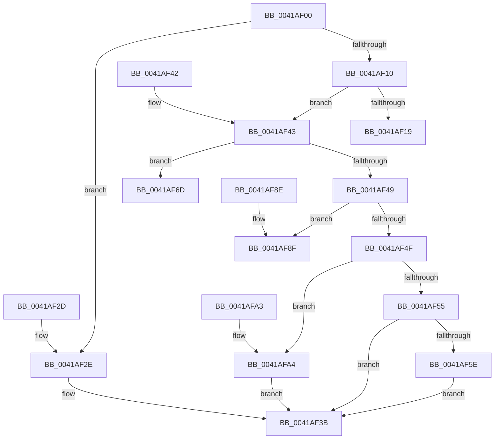

# PsIsProcessLoggingEnabled

- RVA: `0x0041AF00`–`0x0041AFB3` (길이 `179` bytes)
- VA: `0x000000014041AF00`
- 실행 섹션: `.text`
- PDB 이름 있음: `예`; PDB Function 태그: `아니요`
- unwind 정보 RVA: `0x000DB714`
- 디코드: `49`개 명령, `179/179` bytes 표시
- 미해석 바이트: `0` (있으면 어셈블리에 `.byte`로 보존)

> 이 문서는 커널 이미지의 기계어와 PDB 기호를 분석해 생성했습니다. 4번과 5번은 함수 원형과 자료형을 바이너리 사용 방식에서 추정한 C 해석이며 원본 소스 복구 결과는 아닙니다.

## 1. Dependencies

- 직접 호출 지점: **0**; 고유 호출 대상: **0**
- 직접 호출자로 확인된 함수: **3**
- RIP 상대 이미지 참조: **0**

### Outgoing calls
- 직접 디코드된 call 명령이 없습니다.

### Direct callers
- [NtProtectVirtualMemory](../../page/88/NtProtectVirtualMemory_function_00880CA0.md) at `0x00880F30`
- [PsImpersonateClient](../../page/8C/PsImpersonateClient_function_008CBE10.md) at `0x008CBF80`
- [PsImpersonateClient](../../page/8C/PsImpersonateClient_function_008CBE10.md) at `0x008CC045`
- [MiReadWriteVirtualMemory](../../page/9B/MiReadWriteVirtualMemory_function_009BB4E0.md) at `0x009BB6C7`

### Static image references
- 디코드된 RIP-relative 메모리 참조가 없습니다.

## 2. Other-region calls and transfers

- 다른 실행 섹션으로 향하는 call: **0**
- 별도 외부 분기/꼬리 이동을 확인하지 못했습니다.

## 3. Assembly (complete function range)

```asm
0041AF00  33 C0                           xor eax, eax
0041AF02  4C 8B D1                        mov r10, rcx
0041AF05  44 8B C8                        mov r9d, eax
0041AF08  8B C8                           mov ecx, eax
0041AF0A  41 83 F8 10                     cmp r8d, 0x10
0041AF0E  74 1E                           je 0x14041af2e
0041AF10  41 81 F8 00 01 00 00            cmp r8d, 0x100
0041AF17  75 2A                           jne 0x14041af43
0041AF19  41 B9 00 00 00 80               mov r9d, 0x80000000
0041AF1F  48 8D 8A FC 05 00 00            lea rcx, [rdx + 0x5fc]
0041AF26  44 85 09                        test dword ptr [rcx], r9d
0041AF29  0F 95 C0                        setne al
0041AF2C  C3                              ret
0041AF2D  CC                              int3
0041AF2E  41 B9 00 00 00 01               mov r9d, 0x1000000
0041AF34  48 8D 8A F0 01 00 00            lea rcx, [rdx + 0x1f0]
0041AF3B  44 85 09                        test dword ptr [rcx], r9d
0041AF3E  0F 95 C0                        setne al
0041AF41  C3                              ret
0041AF42  CC                              int3
0041AF43  41 83 F8 08                     cmp r8d, 8
0041AF47  74 24                           je 0x14041af6d
0041AF49  41 83 F8 20                     cmp r8d, 0x20
0041AF4D  74 40                           je 0x14041af8f
0041AF4F  41 83 F8 02                     cmp r8d, 2
0041AF53  74 4F                           je 0x14041afa4
0041AF55  41 81 F8 00 08 00 00            cmp r8d, 0x800
0041AF5C  75 DD                           jne 0x14041af3b
0041AF5E  41 B9 00 00 08 00               mov r9d, 0x80000
0041AF64  48 8D 8A FC 05 00 00            lea rcx, [rdx + 0x5fc]
0041AF6B  EB CE                           jmp 0x14041af3b
0041AF6D  4C 3B D2                        cmp r10, rdx
0041AF70  48 8D 8A FC 05 00 00            lea rcx, [rdx + 0x5fc]
0041AF77  41 B9 00 00 00 20               mov r9d, 0x20000000
0041AF7D  41 B8 00 00 00 10               mov r8d, 0x10000000
0041AF83  45 0F 45 C8                     cmovne r9d, r8d
0041AF87  44 85 09                        test dword ptr [rcx], r9d
0041AF8A  0F 95 C0                        setne al
0041AF8D  C3                              ret
0041AF8E  CC                              int3
0041AF8F  41 B9 00 00 00 02               mov r9d, 0x2000000
0041AF95  48 8D 8A F0 01 00 00            lea rcx, [rdx + 0x1f0]
0041AF9C  44 85 09                        test dword ptr [rcx], r9d
0041AF9F  0F 95 C0                        setne al
0041AFA2  C3                              ret
0041AFA3  CC                              int3
0041AFA4  41 B9 00 00 10 00               mov r9d, 0x100000
0041AFAA  48 8D 8A FC 05 00 00            lea rcx, [rdx + 0x5fc]
0041AFB1  EB 88                           jmp 0x14041af3b
```

## 4. C-style interpretation (structured pseudocode)

```c
__int64 __fastcall PsIsProcessLoggingEnabled(__int64 a1, __int64 a2, int a3)
{
    __int64 result;

    result = 0;
    if (a3 == 16) goto loc_0041AF2E;
    if (a3 != 256) goto loc_0041AF43;
    result = (((*(unsigned int *)(a2 + 1532)) & ((unsigned int)((unsigned int)(0x80000000ULL)))) != 0) ? 1 : 0;
    return result;
loc_0041AF2E:
loc_0041AF3B:
    result = (((*(unsigned int *)(a2 + 496)) & ((unsigned int)((unsigned int)(0x1000000ULL)))) != 0) ? 1 : 0;
    return result;
loc_0041AF43:
    if (a3 == 8) goto loc_0041AF6D;
    if (a3 == 32) goto loc_0041AF8F;
    if (a3 == 2) goto loc_0041AFA4;
    if (a3 != 0x800ULL) goto loc_0041AF3B;
    goto loc_0041AF3B;
loc_0041AF6D:
    a4 = (unsigned int)(0x20000000ULL);
    if (a1 != a2) { a4 = (unsigned int)((unsigned int)(0x10000000ULL)); }
    result = (((*(unsigned int *)(a2 + 1532)) & ((unsigned int)(a4))) != 0) ? 1 : 0;
    return result;
loc_0041AF8F:
    result = (((*(unsigned int *)(a2 + 496)) & ((unsigned int)((unsigned int)(0x2000000ULL)))) != 0) ? 1 : 0;
    return result;
loc_0041AFA4:
    goto loc_0041AF3B;
}
```

## 5. (Beta) C Style

```c
int64_t PsIsProcessLoggingEnabled(int64_t Arg1, void *Arg2, int32_t Arg3)
{
    uint8_t *arg2 = (uint8_t *)Arg2;

    int64_t result;

    result = 0;
    if (Arg3 == 16) goto loc_0041AF2E;
    if (Arg3 != 256) goto loc_0041AF43;
    result = (((*(uint32_t *)(arg2 + 0x5FC)) & ((uint32_t)((uint32_t)(0x80000000ULL)))) != 0) ? 1 : 0;
    return result;
loc_0041AF2E:
loc_0041AF3B:
    result = (((*(uint32_t *)(arg2 + 0x1F0)) & ((uint32_t)((uint32_t)(0x1000000ULL)))) != 0) ? 1 : 0;
    return result;
loc_0041AF43:
    if (Arg3 == 8) goto loc_0041AF6D;
    if (Arg3 == 32) goto loc_0041AF8F;
    if (Arg3 == 2) goto loc_0041AFA4;
    if (Arg3 != 0x800ULL) goto loc_0041AF3B;
    goto loc_0041AF3B;
loc_0041AF6D:
    a4 = (uint32_t)(0x20000000ULL);
    if (Arg1 != Arg2) { a4 = (uint32_t)((uint32_t)(0x10000000ULL)); }
    result = (((*(uint32_t *)(arg2 + 0x5FC)) & ((uint32_t)(a4))) != 0) ? 1 : 0;
    return result;
loc_0041AF8F:
    result = (((*(uint32_t *)(arg2 + 0x1F0)) & ((uint32_t)((uint32_t)(0x2000000ULL)))) != 0) ? 1 : 0;
    return result;
loc_0041AFA4:
    goto loc_0041AF3B;
}
```

### 관측된 메모리 오프셋

구조체 형식이 확인되지 않은 접근은 인자 기준의 오프셋으로만 기록했습니다.

| 기준 인자 | 오프셋 표현 | 폭 (bit) | 접근 |
|---|---:|---:|---|
| `Arg2` | `+ 0x0` | `32` | `R` |
| `Arg2` | `+ 0x1F0` | `64` | `R` |
| `Arg2` | `+ 0x5FC` | `64` | `R` |

## 6. Execution-region graph

[열기: 2D/3D 그래프와 함수 탐색 컨트롤 패널](../../../control-panel.html?section=text&rva=0x0041AF00&view=graph)

- 2D 그래프는 위에서 아래로 흐르고, 3D 그래프는 빈 공간을 드래그해 회전합니다. Shift+드래그는 이동, 휠은 확대·축소, 함수 노드 선택은 대상 보고서 이동입니다.

### Static fallback


