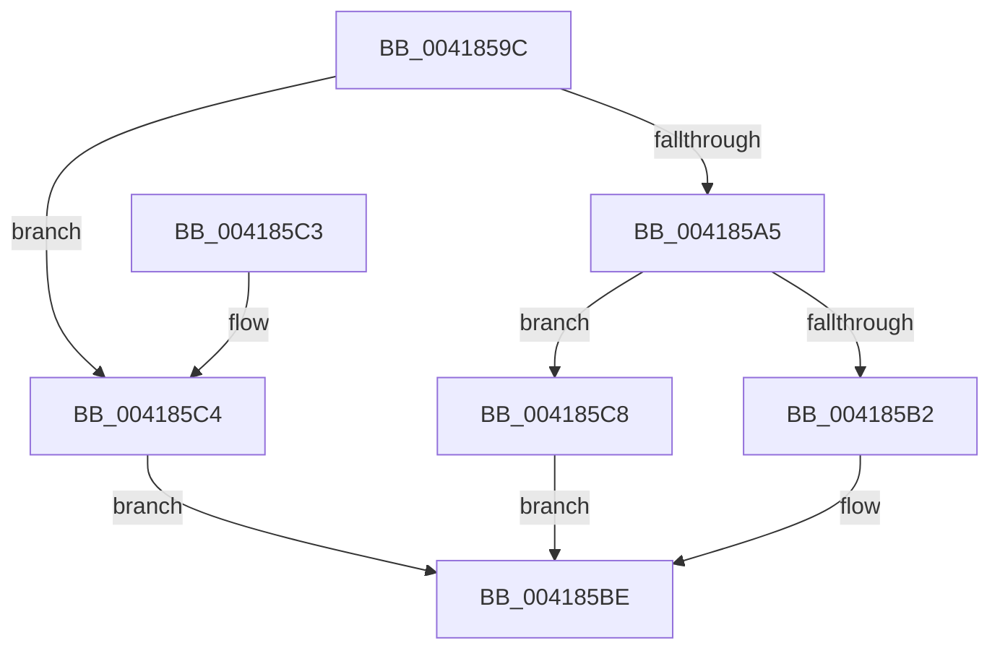

# PsIsThreadInSilo

- RVA: `0x0041859C`–`0x004185D7` (길이 `59` bytes)
- VA: `0x000000014041859C`
- 실행 섹션: `.text`
- PDB 이름 있음: `예`; PDB Function 태그: `아니요`
- unwind 정보 RVA: `0x00068D6C`
- 디코드: `18`개 명령, `59/59` bytes 표시
- 미해석 바이트: `0` (있으면 어셈블리에 `.byte`로 보존)

> 이 문서는 커널 이미지의 기계어와 PDB 기호를 분석해 생성했습니다. 4번과 5번은 함수 원형과 자료형을 바이너리 사용 방식에서 추정한 C 해석이며 원본 소스 복구 결과는 아닙니다.

## 1. Dependencies

- 직접 호출 지점: **2**; 고유 호출 대상: **2**
- 직접 호출자로 확인된 함수: **6**
- RIP 상대 이미지 참조: **0**

### Outgoing calls
- `0x004185B9` → [PsIsProcessInSilo](PsIsProcessInSilo_function_004185E0.md) (function, `0x004185E0`)
- `0x004185CB` → [PspIsSiloInSilo](../../page/A6/PspIsSiloInSilo_function_00A6EC8C.md) (function, `0x00A6EC8C`)

### Direct callers
- [VrpHandleIoctlCreateMultipleNamespaceNodes](../../page/83/VrpHandleIoctlCreateMultipleNamespaceNodes_function_0083B17C.md) at `0x0083B223`
- [VrpHandleIoctlCreateNamespaceNode](../../page/93/VrpHandleIoctlCreateNamespaceNode_function_0093511C.md) at `0x00935269`
- [VrpHandleIoctlGetVirtualRootKey](../../page/93/VrpHandleIoctlGetVirtualRootKey_function_00935374.md) at `0x00935427`
- [VrpHandleIoctlLoadDifferencingHive](../../page/93/VrpHandleIoctlLoadDifferencingHive_function_00935C5C.md) at `0x00935DED`
- [VrpHandleIoctlInitializeJobForVreg](../../page/93/VrpHandleIoctlInitializeJobForVreg_function_00937254.md) at `0x00937407`
- [VrpHandleIoctlUnloadDynamicallyLoadedHives](../../page/93/VrpHandleIoctlUnloadDynamicallyLoadedHives_function_0093778C.md) at `0x00937846`

### Static image references
- 디코드된 RIP-relative 메모리 참조가 없습니다.

## 2. Other-region calls and transfers

- 다른 실행 섹션으로 향하는 call: **1**
  - `0x004185CB` → [PspIsSiloInSilo](../../page/A6/PspIsSiloInSilo_function_00A6EC8C.md) (`.text` → `PAGE`)
- 별도 외부 분기/꼬리 이동을 확인하지 못했습니다.

## 3. Assembly (complete function range)

```asm
0041859C  48 83 EC 28                     sub rsp, 0x28
004185A0  48 85 D2                        test rdx, rdx
004185A3  74 1F                           je 0x1404185c4
004185A5  48 8B 81 98 06 00 00            mov rax, qword ptr [rcx + 0x698]
004185AC  48 83 F8 FD                     cmp rax, -3
004185B0  75 16                           jne 0x1404185c8
004185B2  48 8B 89 20 02 00 00            mov rcx, qword ptr [rcx + 0x220]
004185B9  E8 22 00 00 00                  call 0x1404185e0
004185BE  48 83 C4 28                     add rsp, 0x28
004185C2  C3                              ret
004185C3  CC                              int3
004185C4  B0 01                           mov al, 1
004185C6  EB F6                           jmp 0x1404185be
004185C8  48 8B C8                        mov rcx, rax
004185CB  E8 BC 66 65 00                  call 0x140a6ec8c
004185D0  84 C0                           test al, al
004185D2  0F 95 C0                        setne al
004185D5  EB E7                           jmp 0x1404185be
```

## 4. C-style interpretation (structured pseudocode)

```c
__int64 __fastcall PsIsThreadInSilo(__int64 a1, __int64 a2)
{
    __int64 result;
    __int64 v_rsp;

    v_rsp = (v_rsp) - (40);
    if (a2 == 0) goto loc_004185C4;
    if ((*(unsigned __int64 *)(a1 + 1688)) != -3) goto loc_004185C8;
    result = PsIsProcessInSilo(*(unsigned __int64 *)(a1 + 544), a2, a3, a4);
loc_004185BE:
    v_rsp = (v_rsp) + (40);
    return result;
loc_004185C4:
    goto loc_004185BE;
loc_004185C8:
    result = PspIsSiloInSilo(1, a2, a3, a4);
    result = ((unsigned __int8)(result) != 0) ? 1 : 0;
    goto loc_004185BE;
}
```

## 5. (Beta) C Style

```c
int64_t PsIsThreadInSilo(void *Arg1, int64_t Arg2)
{
    uint8_t *arg1 = (uint8_t *)Arg1;

    int64_t result;
    int64_t local_rsp;

    local_rsp = (local_rsp) - (40);
    if (Arg2 == 0) goto loc_004185C4;
    if ((*(uint64_t *)(arg1 + 0x698)) != -3) goto loc_004185C8;
    result = PsIsProcessInSilo(*(uint64_t *)(arg1 + 0x220), Arg2, a3, a4);
loc_004185BE:
    local_rsp = (local_rsp) + (40);
    return result;
loc_004185C4:
    goto loc_004185BE;
loc_004185C8:
    result = PspIsSiloInSilo(1, Arg2, a3, a4);
    result = ((uint8_t)(result) != 0) ? 1 : 0;
    goto loc_004185BE;
}
```

### 관측된 메모리 오프셋

구조체 형식이 확인되지 않은 접근은 인자 기준의 오프셋으로만 기록했습니다.

| 기준 인자 | 오프셋 표현 | 폭 (bit) | 접근 |
|---|---:|---:|---|
| `Arg1` | `+ 0x220` | `64` | `R` |
| `Arg1` | `+ 0x698` | `64` | `R` |

## 6. Execution-region graph

[열기: 2D/3D 그래프와 함수 탐색 컨트롤 패널](../../../control-panel.html?section=text&rva=0x0041859C&view=graph)

- 2D 그래프는 위에서 아래로 흐르고, 3D 그래프는 빈 공간을 드래그해 회전합니다. Shift+드래그는 이동, 휠은 확대·축소, 함수 노드 선택은 대상 보고서 이동입니다.

### Static fallback


