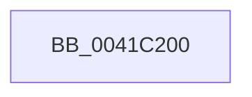

# PsReturnProcessNonPagedPoolQuota

- RVA: `0x0041C200`–`0x0041C21A` (길이 `26` bytes)
- VA: `0x000000014041C200`
- 실행 섹션: `.text`
- PDB 이름 있음: `예`; PDB Function 태그: `아니요`
- unwind 정보 RVA: `0x0009D76C`
- 디코드: `7`개 명령, `26/26` bytes 표시
- 미해석 바이트: `0` (있으면 어셈블리에 `.byte`로 보존)

> 이 문서는 커널 이미지의 기계어와 PDB 기호를 분석해 생성했습니다. 4번과 5번은 함수 원형과 자료형을 바이너리 사용 방식에서 추정한 C 해석이며 원본 소스 복구 결과는 아닙니다.

## 1. Dependencies

- 직접 호출 지점: **0**; 고유 호출 대상: **0**
- 직접 호출자로 확인된 함수: **20**
- RIP 상대 이미지 참조: **1**

### Outgoing calls
- 직접 디코드된 call 명령이 없습니다.

### Direct callers
- [MiCloneVads](../22/MiCloneVads_function_0022DC1C.md) at `0x0022E240`
- [MiCloneVads](../22/MiCloneVads_function_0022DC1C.md) at `0x0022E2D9`
- [MiCloneVads](../22/MiCloneVads_function_0022DC1C.md) at `0x0022E303`
- [MiFreeVadRange](../2A/MiFreeVadRange_function_002A77AC.md) at `0x002A793D`
- [MiFreeVadRange](../2A/MiFreeVadRange_function_002A77AC.md) at `0x002A79F5`
- [MiDeleteCloneDescriptor](../4F/MiDeleteCloneDescriptor_function_004F9E28.md) at `0x004F9EBA`
- [MiFreeVadEventBitmapCharges](../../page/70/MiFreeVadEventBitmapCharges_function_00704944.md) at `0x00704982`
- [MiDeleteAweBitMap](../../page/80/MiDeleteAweBitMap_function_0080A9A8.md) at `0x0080A9D8`
- [MiReturnVadCharges](../../page/88/MiReturnVadCharges_function_008875B8.md) at `0x008875E1`
- [MiCreatePlaceholderStorage](../../page/8C/MiCreatePlaceholderStorage_function_008CF330.md) at `0x008CF3DF`
- [PspProcessDelete](../../page/90/PspProcessDelete_function_00907B90.md) at `0x00908140`
- [sub_009BB189](../../page/9B/Unknown_function_009BB189.md) at `0x009BB1C8`
- [sub_009BB189](../../page/9B/Unknown_function_009BB189.md) at `0x009BB1FB`
- [sub_009BB189](../../page/9B/Unknown_function_009BB189.md) at `0x009BB226`
- [MiFreePlaceholderVadEvent](../../page/9B/MiFreePlaceholderVadEvent_function_009BB2B4.md) at `0x009BB2E7`
- [ExDereferenceHandleDebugInfo](../../page/A1/ExDereferenceHandleDebugInfo_function_00A17430.md) at `0x00A1747E`
- [MiReturnVadQuota](../../page/A1/MiReturnVadQuota_function_00A1E314.md) at `0x00A1E366`
- [MiReturnVadQuota](../../page/A1/MiReturnVadQuota_function_00A1E314.md) at `0x00A1E375`
- [MiBuildNewCloneDescriptor](../../page/A6/MiBuildNewCloneDescriptor_function_00A6C744.md) at `0x00A6C7F6`
- [MiBuildNewCloneDescriptor](../../page/A6/MiBuildNewCloneDescriptor_function_00A6C744.md) at `0x00A6C89C`
- [MiFreeCloneDescriptor](../../page/A8/MiFreeCloneDescriptor_function_00A89F0C.md) at `0x00A89F58`
- [MiFreeRotateVadEvent](../../page/A9/MiFreeRotateVadEvent_function_00A95140.md) at `0x00A95162`
- [ExEnableHandleTracing](../../page/AD/ExEnableHandleTracing_function_00AD2C8C.md) at `0x00AD2D9B`
- [MiCloneProcessAddressSpace](../../page/AD/MiCloneProcessAddressSpace_function_00AD6F7C.md) at `0x00AD7094`
- [NtSetInformationProcess](../../page/AE/NtSetInformationProcess_function_00AE5370.md) at `0x00AE5797`
- [ViIrpAllocateLockedPacket](../../pagevrfy/B9/ViIrpAllocateLockedPacket_function_00B9E0AC.md) at `0x00B9E1B6`
- [sub_00BBC0C8](../../pagevrfy/BB/Unknown_function_00BBC0C8.md) at `0x00BBC17F`

### Static image references
- `0x0041C207` → RVA `0x00FC6AB0` (`ALMOSTRO`; read)

## 2. Other-region calls and transfers

- 다른 실행 섹션으로 향하는 call: **0**
- call이 아닌 외부 분기/꼬리 이동: **1**
  - `0x0041C214` → [sub_0041C2CB](Unknown_function_0041C2CB.md) (`tail-transfer`)

## 3. Assembly (complete function range)

```asm
0041C200  40 53                           push rbx
0041C202  57                              push rdi
0041C203  48 83 EC 38                     sub rsp, 0x38
0041C207  48 3B 0D A2 A8 BA 00            cmp rcx, qword ptr [rip + 0xbaa8a2]
0041C20E  48 8B FA                        mov rdi, rdx
0041C211  48 8B D9                        mov rbx, rcx
0041C214  0F 84 B1 00 00 00               je 0x14041c2cb
```

## 4. C-style interpretation (structured pseudocode)

```c
void __fastcall PsReturnProcessNonPagedPoolQuota(__int64 a1, __int64 a2)
{
    __int64 v_rsp;

    v_rsp = (v_rsp) - (56);
}
```

## 5. (Beta) C Style

```c
void PsReturnProcessNonPagedPoolQuota(int64_t Arg1, int64_t Arg2)
{
    int64_t local_rsp;

    local_rsp = (local_rsp) - (56);
}
```

## 6. Execution-region graph

[열기: 2D/3D 그래프와 함수 탐색 컨트롤 패널](../../../control-panel.html?section=text&rva=0x0041C200&view=graph)

- 2D 그래프는 위에서 아래로 흐르고, 3D 그래프는 빈 공간을 드래그해 회전합니다. Shift+드래그는 이동, 휠은 확대·축소, 함수 노드 선택은 대상 보고서 이동입니다.

### Static fallback


