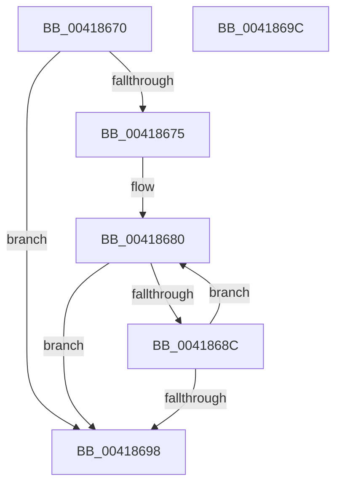

# PspGetJobSilo

- RVA: `0x00418670`–`0x0041869D` (길이 `45` bytes)
- VA: `0x0000000140418670`
- 실행 섹션: `.text`
- PDB 이름 있음: `예`; PDB Function 태그: `아니요`
- unwind 정보 RVA: `0x000DB714`
- 디코드: `11`개 명령, `45/45` bytes 표시
- 미해석 바이트: `0` (있으면 어셈블리에 `.byte`로 보존)

> 이 문서는 커널 이미지의 기계어와 PDB 기호를 분석해 생성했습니다. 4번과 5번은 함수 원형과 자료형을 바이너리 사용 방식에서 추정한 C 해석이며 원본 소스 복구 결과는 아닙니다.

## 1. Dependencies

- 직접 호출 지점: **0**; 고유 호출 대상: **0**
- 직접 호출자로 확인된 함수: **6**
- RIP 상대 이미지 참조: **0**

### Outgoing calls
- 직접 디코드된 call 명령이 없습니다.

### Direct callers
- [PsGetProcessSilo](PsGetProcessSilo_function_00418580.md) at `0x0041858B`
- [PsIsProcessInSilo](PsIsProcessInSilo_function_004185E0.md) at `0x0041860A`
- [PsGetJobSilo](PsGetJobSilo_function_00418630.md) at `0x00418639`
- [CmpGetRegistryNamespaceRootForSilo](../../page/9D/CmpGetRegistryNamespaceRootForSilo_function_009D0470.md) at `0x009D04B7`
- [PsGetParentSilo](../../page/A7/PsGetParentSilo_function_00A70760.md) at `0x00A70770`
- [sub_00B316B4](../../page/B3/Unknown_function_00B316B4.md) at `0x00B31FDE`

### Static image references
- 디코드된 RIP-relative 메모리 참조가 없습니다.

## 2. Other-region calls and transfers

- 다른 실행 섹션으로 향하는 call: **0**
- 별도 외부 분기/꼬리 이동을 확인하지 못했습니다.

## 3. Assembly (complete function range)

```asm
00418670  48 85 C9                        test rcx, rcx
00418673  74 23                           je 0x140418698
00418675  66 66 66 0F 1F 84 00 00 00 00 00  nop word ptr [rax + rax]
00418680  F7 81 10 06 00 00 00 00 00 40   test dword ptr [rcx + 0x610], 0x40000000
0041868A  75 0C                           jne 0x140418698
0041868C  48 8B 89 18 05 00 00            mov rcx, qword ptr [rcx + 0x518]
00418693  48 85 C9                        test rcx, rcx
00418696  75 E8                           jne 0x140418680
00418698  48 8B C1                        mov rax, rcx
0041869B  C3                              ret
0041869C  CC                              int3
```

## 4. C-style interpretation (structured pseudocode)

```c
__int64 __fastcall PspGetJobSilo(__int64 a1)
{
    if (a1 == 0) goto loc_00418698;
loc_00418680:
    if (((*(unsigned int *)(a1 + 1552)) & (0x40000000ULL)) != 0) goto loc_00418698;
    if (*(unsigned __int64 *)(a1 + 1304) != 0) goto loc_00418680;
loc_00418698:
    return *(unsigned __int64 *)(a1 + 1304);
}
```

## 5. (Beta) C Style

```c
int64_t PspGetJobSilo(int64_t Arg1)
{
    if (Arg1 == 0) goto loc_00418698;
loc_00418680:
    if (((*(uint32_t *)(Arg1 + 0x610)) & (0x40000000ULL)) != 0) goto loc_00418698;
    if (*(uint64_t *)(Arg1 + 0x518) != 0) goto loc_00418680;
loc_00418698:
    return *(uint64_t *)(Arg1 + 0x518);
}
```

## 6. Execution-region graph

[열기: 2D/3D 그래프와 함수 탐색 컨트롤 패널](../../../control-panel.html?section=text&rva=0x00418670&view=graph)

- 2D 그래프는 위에서 아래로 흐르고, 3D 그래프는 빈 공간을 드래그해 회전합니다. Shift+드래그는 이동, 휠은 확대·축소, 함수 노드 선택은 대상 보고서 이동입니다.

### Static fallback


