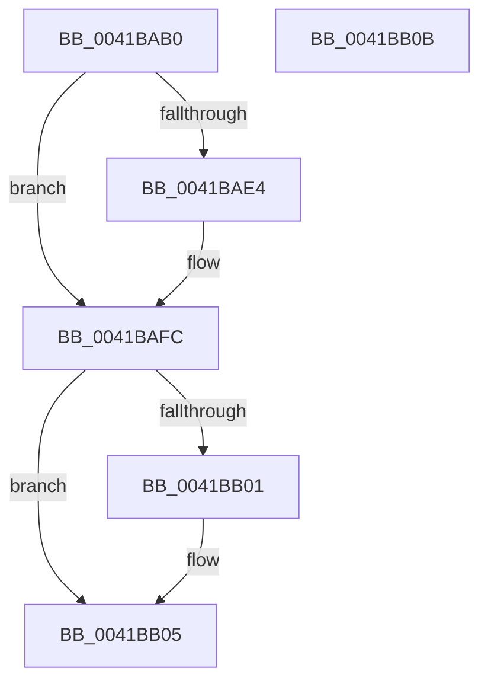

# PspLockProcessListShared

- RVA: `0x0041BAB0`–`0x0041BB0C` (길이 `92` bytes)
- VA: `0x000000014041BAB0`
- 실행 섹션: `.text`
- PDB 이름 있음: `예`; PDB Function 태그: `아니요`
- unwind 정보 RVA: `0x0005CF00`
- 디코드: `25`개 명령, `92/92` bytes 표시
- 미해석 바이트: `0` (있으면 어셈블리에 `.byte`로 보존)

> 이 문서는 커널 이미지의 기계어와 PDB 기호를 분석해 생성했습니다. 4번과 5번은 함수 원형과 자료형을 바이너리 사용 방식에서 추정한 C 해석이며 원본 소스 복구 결과는 아닙니다.

## 1. Dependencies

- 직접 호출 지점: **2**; 고유 호출 대상: **2**
- 직접 호출자로 확인된 함수: **3**
- RIP 상대 이미지 참조: **1**

### Outgoing calls
- `0x0041BACA` → [KeAbPreAcquire](../21/KeAbPreAcquire_function_00210230.md) (function, `0x00210230`)
- `0x0041BAF7` → [ExfAcquirePushLockSharedEx](../21/ExfAcquirePushLockSharedEx_function_0021044C.md) (function, `0x0021044C`)

### Direct callers
- [PsGetPreviousProcess](../../page/91/PsGetPreviousProcess_function_0091E24C.md) at `0x0091E278`
- [PsChangeQuantumTable](../../page/A3/PsChangeQuantumTable_function_00A3BE70.md) at `0x00A3BF2C`
- [PsGetNextProcessEx](../../page/A4/PsGetNextProcessEx_function_00A48CC0.md) at `0x00A48CEC`

### Static image references
- `0x0041BAC0` → RVA `0x00FD9AF8` (`PAGEDATA`; read)

## 2. Other-region calls and transfers

- 다른 실행 섹션으로 향하는 call: **0**
- 별도 외부 분기/꼬리 이동을 확인하지 못했습니다.

## 3. Assembly (complete function range)

```asm
0041BAB0  40 53                           push rbx
0041BAB2  48 83 EC 20                     sub rsp, 0x20
0041BAB6  66 FF 89 E6 01 00 00            dec word ptr [rcx + 0x1e6]
0041BABD  45 33 C0                        xor r8d, r8d
0041BAC0  48 8D 0D 31 E0 BB 00            lea rcx, [rip + 0xbbe031]
0041BAC7  33 D2                           xor edx, edx
0041BAC9  90                              nop
0041BACA  E8 61 47 DF FF                  call 0x140210230
0041BACF  48 8B D8                        mov rbx, rax
0041BAD2  BA 11 00 00 00                  mov edx, 0x11
0041BAD7  33 C0                           xor eax, eax
0041BAD9  F0 48 0F B1 15 16 E0 BB 00      lock cmpxchg qword ptr [rip + 0xbbe016], rdx
0041BAE2  74 18                           je 0x14041bafc
0041BAE4  4C 8D 0D 0D E0 BB 00            lea r9, [rip + 0xbbe00d]
0041BAEB  4C 8B C3                        mov r8, rbx
0041BAEE  33 D2                           xor edx, edx
0041BAF0  48 8D 0D 01 E0 BB 00            lea rcx, [rip + 0xbbe001]
0041BAF7  E8 50 49 DF FF                  call 0x14021044c
0041BAFC  48 85 DB                        test rbx, rbx
0041BAFF  74 04                           je 0x14041bb05
0041BB01  C6 43 0A 01                     mov byte ptr [rbx + 0xa], 1
0041BB05  48 83 C4 20                     add rsp, 0x20
0041BB09  5B                              pop rbx
0041BB0A  C3                              ret
0041BB0B  CC                              int3
```

## 4. C-style interpretation (structured pseudocode)

```c
__int64 __fastcall PspLockProcessListShared(__int64 a1, int a2, int a3)
{
    __int64 result;
    __int64 v_rsp;

    v_rsp = (v_rsp) - (32);
    a3 = 0;
    a2 = 0;
    result = KeAbPreAcquire(v_rip + 12312625, a2, a3, a4);
    result = 0;
    if (!(condition_is_equal)) {
        a4 = v_rip + 12312589;
        a3 = 0;
        a2 = 0;
        a1 = v_rip + 12312577;
        result = ExfAcquirePushLockSharedEx(a1, a2, a3, a4);
    }
    if (result != 0) {
        *(unsigned __int8 *)(result + 10) = 1;
    }
    v_rsp = (v_rsp) + (32);
    return result;
}
```

## 5. (Beta) C Style

```c
int64_t PspLockProcessListShared(void *Arg1, int32_t Arg2, int32_t Arg3)
{
    uint8_t *arg1 = (uint8_t *)Arg1;

    int64_t result;
    int64_t local_rsp;

    local_rsp = (local_rsp) - (32);
    Arg3 = 0;
    Arg2 = 0;
    result = KeAbPreAcquire(v_rip + 12312625, Arg2, Arg3, a4);
    result = 0;
    if (!(condition_is_equal)) {
        a4 = v_rip + 12312589;
        Arg3 = 0;
        Arg2 = 0;
        Arg1 = v_rip + 12312577;
        result = ExfAcquirePushLockSharedEx(Arg1, Arg2, Arg3, a4);
    }
    if (result != 0) {
        *(uint8_t *)(result + 0xA) = 1;
    }
    local_rsp = (local_rsp) + (32);
    return result;
}
```

### 관측된 메모리 오프셋

구조체 형식이 확인되지 않은 접근은 인자 기준의 오프셋으로만 기록했습니다.

| 기준 인자 | 오프셋 표현 | 폭 (bit) | 접근 |
|---|---:|---:|---|
| `Arg1` | `+ 0x1E6` | `16` | `R/W` |

## 6. Execution-region graph

[열기: 2D/3D 그래프와 함수 탐색 컨트롤 패널](../../../control-panel.html?section=text&rva=0x0041BAB0&view=graph)

- 2D 그래프는 위에서 아래로 흐르고, 3D 그래프는 빈 공간을 드래그해 회전합니다. Shift+드래그는 이동, 휠은 확대·축소, 함수 노드 선택은 대상 보고서 이동입니다.

### Static fallback


