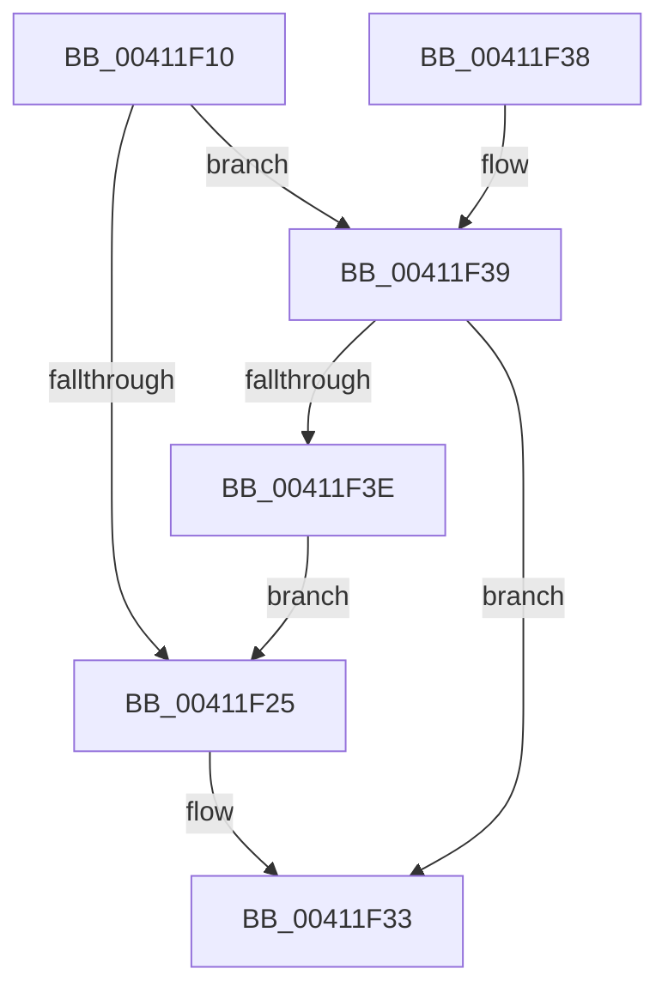

# RawBeginOperation

- RVA: `0x00411F10`–`0x00411F40` (길이 `48` bytes)
- VA: `0x0000000140411F10`
- 실행 섹션: `.text`
- PDB 이름 있음: `예`; PDB Function 태그: `아니요`
- unwind 정보 RVA: `0x0005CEE8`
- 디코드: `14`개 명령, `48/48` bytes 표시
- 미해석 바이트: `0` (있으면 어셈블리에 `.byte`로 보존)

> 이 문서는 커널 이미지의 기계어와 PDB 기호를 분석해 생성했습니다. 4번과 5번은 함수 원형과 자료형을 바이너리 사용 방식에서 추정한 C 해석이며 원본 소스 복구 결과는 아닙니다.

## 1. Dependencies

- 직접 호출 지점: **1**; 고유 호출 대상: **1**
- 직접 호출자로 확인된 함수: **7**
- RIP 상대 이미지 참조: **0**

### Outgoing calls
- `0x00411F2E` → [ExAcquireRundownProtectionCacheAwareEx](ExAcquireRundownProtectionCacheAwareEx_function_00411F50.md) (function, `0x00411F50`)

### Direct callers
- [RawQueryFsDeviceInfo](../../page/78/RawQueryFsDeviceInfo_function_0078A224.md) at `0x0078A251`
- [RawSetInformation](../../page/78/RawSetInformation_function_0078A2A8.md) at `0x0078A2CD`
- [RawQueryInformation](../../page/9A/RawQueryInformation_function_009A361C.md) at `0x009A363D`
- [RawReadWriteDeviceControl](../../page/9A/RawReadWriteDeviceControl_function_009A3D50.md) at `0x009A3D71`
- [RawQueryFsVolumeInfo](../../page/9A/RawQueryFsVolumeInfo_function_009A4510.md) at `0x009A4530`
- [RawUserFsCtrl](../../page/9A/RawUserFsCtrl_function_009A45F4.md) at `0x009A46A3`
- [RawUserFsCtrl](../../page/9A/RawUserFsCtrl_function_009A45F4.md) at `0x009A4703`
- [RawUserFsCtrl](../../page/9A/RawUserFsCtrl_function_009A45F4.md) at `0x009A479C`
- [RawQueryFsSizeInfo](../../page/AA/RawQueryFsSizeInfo_function_00AA1DC8.md) at `0x00AA1E2C`

### Static image references
- 디코드된 RIP-relative 메모리 참조가 없습니다.

## 2. Other-region calls and transfers

- 다른 실행 섹션으로 향하는 call: **0**
- 별도 외부 분기/꼬리 이동을 확인하지 못했습니다.

## 3. Assembly (complete function range)

```asm
00411F10  48 83 EC 28                     sub rsp, 0x28
00411F14  4C 8B 81 D8 00 00 00            mov r8, qword ptr [rcx + 0xd8]
00411F1B  B8 01 00 00 00                  mov eax, 1
00411F20  4D 85 C0                        test r8, r8
00411F23  75 14                           jne 0x140411f39
00411F25  48 8B 89 E8 00 00 00            mov rcx, qword ptr [rcx + 0xe8]
00411F2C  8B D0                           mov edx, eax
00411F2E  E8 1D 00 00 00                  call 0x140411f50
00411F33  48 83 C4 28                     add rsp, 0x28
00411F37  C3                              ret
00411F38  CC                              int3
00411F39  49 3B D0                        cmp rdx, r8
00411F3C  74 F5                           je 0x140411f33
00411F3E  EB E5                           jmp 0x140411f25
```

## 4. C-style interpretation (structured pseudocode)

```c
__int64 __fastcall RawBeginOperation(__int64 a1)
{
    __int64 result;
    __int64 v_rsp;

    v_rsp = (v_rsp) - (40);
    if (*(unsigned __int64 *)(a1 + 216) != 0) goto loc_00411F39;
loc_00411F25:
    result = ExAcquireRundownProtectionCacheAwareEx(*(unsigned __int64 *)(a1 + 232), 1, *(unsigned __int64 *)(a1 + 216), a4);
loc_00411F33:
    v_rsp = (v_rsp) + (40);
    return result;
loc_00411F39:
    if (1 == (*(unsigned __int64 *)(a1 + 216))) goto loc_00411F33;
    goto loc_00411F25;
}
```

## 5. (Beta) C Style

```c
int64_t RawBeginOperation(void *Arg1)
{
    uint8_t *arg1 = (uint8_t *)Arg1;

    int64_t result;
    int64_t local_rsp;

    local_rsp = (local_rsp) - (40);
    if (*(uint64_t *)(arg1 + 0xD8) != 0) goto loc_00411F39;
loc_00411F25:
    result = ExAcquireRundownProtectionCacheAwareEx(*(uint64_t *)(arg1 + 0xE8), 1, *(uint64_t *)(arg1 + 0xD8), a4);
loc_00411F33:
    local_rsp = (local_rsp) + (40);
    return result;
loc_00411F39:
    if (1 == (*(uint64_t *)(arg1 + 0xD8))) goto loc_00411F33;
    goto loc_00411F25;
}
```

### 관측된 메모리 오프셋

구조체 형식이 확인되지 않은 접근은 인자 기준의 오프셋으로만 기록했습니다.

| 기준 인자 | 오프셋 표현 | 폭 (bit) | 접근 |
|---|---:|---:|---|
| `Arg1` | `+ 0xD8` | `64` | `R` |
| `Arg1` | `+ 0xE8` | `64` | `R` |

## 6. Execution-region graph

[열기: 2D/3D 그래프와 함수 탐색 컨트롤 패널](../../../control-panel.html?section=text&rva=0x00411F10&view=graph)

- 2D 그래프는 위에서 아래로 흐르고, 3D 그래프는 빈 공간을 드래그해 회전합니다. Shift+드래그는 이동, 휠은 확대·축소, 함수 노드 선택은 대상 보고서 이동입니다.

### Static fallback


