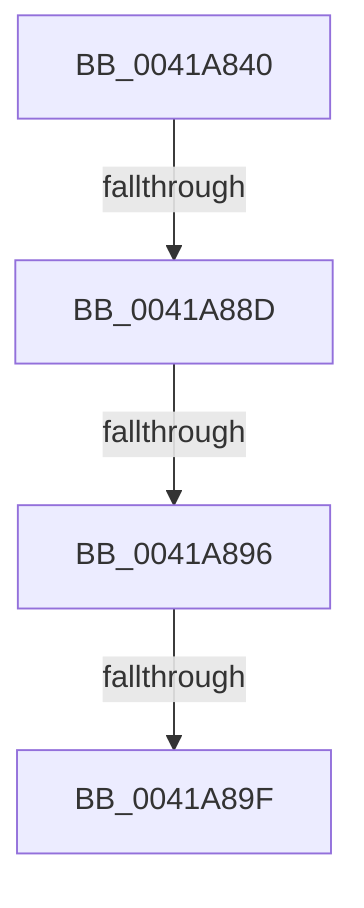

# RtlCompressBufferXpressLzMax

- RVA: `0x0041A840`–`0x0041A8A9` (길이 `105` bytes)
- VA: `0x000000014041A840`
- 실행 섹션: `.text`
- PDB 이름 있음: `예`; PDB Function 태그: `아니요`
- unwind 정보 RVA: `0x0009D3EC`
- 디코드: `30`개 명령, `105/105` bytes 표시
- 미해석 바이트: `0` (있으면 어셈블리에 `.byte`로 보존)

> 이 문서는 커널 이미지의 기계어와 PDB 기호를 분석해 생성했습니다. 4번과 5번은 함수 원형과 자료형을 바이너리 사용 방식에서 추정한 C 해석이며 원본 소스 복구 결과는 아닙니다.

## 1. Dependencies

- 직접 호출 지점: **0**; 고유 호출 대상: **0**
- 직접 호출자로 확인된 함수: **2**
- RIP 상대 이미지 참조: **0**

### Outgoing calls
- 직접 디코드된 call 명령이 없습니다.

### Direct callers
- [RtlCompressBufferXpressLz](RtlCompressBufferXpressLz_function_00419FA0.md) at `0x0041A042`
- [RtlCompressBufferProgress](../5E/RtlCompressBufferProgress_function_005EF3C0.md) at `0x005EF4A9`

### Static image references
- 디코드된 RIP-relative 메모리 참조가 없습니다.

## 2. Other-region calls and transfers

- 다른 실행 섹션으로 향하는 call: **0**
- call이 아닌 외부 분기/꼬리 이동: **4**
  - `0x0041A887` → [sub_0041AE2A + 0x80](Unknown_function_0041AE2A.md) (`tail-transfer`)
  - `0x0041A890` → [sub_0041AE2A + 0x80](Unknown_function_0041AE2A.md) (`tail-transfer`)
  - `0x0041A89D` → [sub_0041A8A9](Unknown_function_0041A8A9.md) (`tail-transfer`)
  - `0x0041A8A4` → [sub_0041AE2A + 0x85](Unknown_function_0041AE2A.md) (`tail-transfer`)

## 3. Assembly (complete function range)

```asm
0041A840  4C 89 44 24 18                  mov qword ptr [rsp + 0x18], r8
0041A845  48 89 4C 24 08                  mov qword ptr [rsp + 8], rcx
0041A84A  53                              push rbx
0041A84B  55                              push rbp
0041A84C  56                              push rsi
0041A84D  57                              push rdi
0041A84E  41 54                           push r12
0041A850  41 56                           push r14
0041A852  41 57                           push r15
0041A854  48 81 EC 80 00 00 00            sub rsp, 0x80
0041A85B  45 33 FF                        xor r15d, r15d
0041A85E  8B FA                           mov edi, edx
0041A860  48 03 F9                        add rdi, rcx
0041A863  41 8B F1                        mov esi, r9d
0041A866  49 03 F0                        add rsi, r8
0041A869  8B DA                           mov ebx, edx
0041A86B  44 89 7C 24 7C                  mov dword ptr [rsp + 0x7c], r15d
0041A870  4D 8B F0                        mov r14, r8
0041A873  48 89 7C 24 50                  mov qword ptr [rsp + 0x50], rdi
0041A878  48 8B E9                        mov rbp, rcx
0041A87B  48 89 74 24 58                  mov qword ptr [rsp + 0x58], rsi
0041A880  45 8B E7                        mov r12d, r15d
0041A883  41 83 F9 40                     cmp r9d, 0x40
0041A887  0F 82 1D 06 00 00               jb 0x14041aeaa
0041A88D  83 FB 08                        cmp ebx, 8
0041A890  0F 82 14 06 00 00               jb 0x14041aeaa
0041A896  48 81 F9 01 20 00 00            cmp rcx, 0x2001
0041A89D  77 0A                           ja 0x14041a8a9
0041A89F  B8 BB 00 00 C0                  mov eax, 0xc00000bb
0041A8A4  E9 06 06 00 00                  jmp 0x14041aeaf
```

## 4. C-style interpretation (structured pseudocode)

```c
__int64 __fastcall RtlCompressBufferXpressLzMax(__int64 a1, int a2, __int64 a3, int a4)
{
    __int64 v_r15;
    __int64 v_rdi;
    __int64 v_rsi;
    __int64 v_rsp;
    unsigned int v_stack_m3C;
    unsigned __int64 v_stack_m60;
    unsigned __int64 v_stack_m68;
    unsigned __int64 v_stack_p18;
    unsigned __int64 v_stack_p8;

    v_stack_p18 = a3;
    v_stack_p8 = a1;
    v_rsp = (v_rsp) - (128);
    v_r15 = 0;
    v_rdi = ((unsigned int)(a2)) + (a1);
    v_rsi = ((unsigned int)(a4)) + (a3);
    v_stack_m3C = 0;
    v_stack_m68 = v_rdi;
    v_stack_m60 = v_rsi;
}
```

## 5. (Beta) C Style

```c
int64_t RtlCompressBufferXpressLzMax(int64_t Arg1, int32_t Arg2, int64_t Arg3, int32_t Arg4)
{
    int64_t local_r15;
    int64_t local_rdi;
    int64_t local_rsi;
    int64_t local_rsp;
    uint32_t v_stack_m3C;
    uint64_t v_stack_m60;
    uint64_t v_stack_m68;
    uint64_t v_stack_p18;
    uint64_t v_stack_p8;

    v_stack_p18 = Arg3;
    v_stack_p8 = Arg1;
    local_rsp = (local_rsp) - (128);
    local_r15 = 0;
    local_rdi = ((uint32_t)(Arg2)) + (Arg1);
    local_rsi = ((uint32_t)(Arg4)) + (Arg3);
    v_stack_m3C = 0;
    v_stack_m68 = local_rdi;
    v_stack_m60 = local_rsi;
}
```

## 6. Execution-region graph

[열기: 2D/3D 그래프와 함수 탐색 컨트롤 패널](../../../control-panel.html?section=text&rva=0x0041A840&view=graph)

- 2D 그래프는 위에서 아래로 흐르고, 3D 그래프는 빈 공간을 드래그해 회전합니다. Shift+드래그는 이동, 휠은 확대·축소, 함수 노드 선택은 대상 보고서 이동입니다.

### Static fallback


