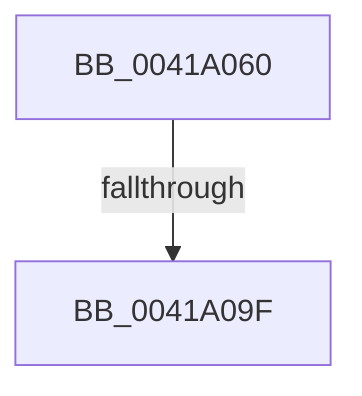

# RtlCompressBufferXpressLzStandard

- RVA: `0x0041A060`–`0x0041A0A8` (길이 `72` bytes)
- VA: `0x000000014041A060`
- 실행 섹션: `.text`
- PDB 이름 있음: `예`; PDB Function 태그: `아니요`
- unwind 정보 RVA: `0x0009D338`
- 디코드: `21`개 명령, `72/72` bytes 표시
- 미해석 바이트: `0` (있으면 어셈블리에 `.byte`로 보존)

> 이 문서는 커널 이미지의 기계어와 PDB 기호를 분석해 생성했습니다. 4번과 5번은 함수 원형과 자료형을 바이너리 사용 방식에서 추정한 C 해석이며 원본 소스 복구 결과는 아닙니다.

## 1. Dependencies

- 직접 호출 지점: **0**; 고유 호출 대상: **0**
- 직접 호출자로 확인된 함수: **2**
- RIP 상대 이미지 참조: **0**

### Outgoing calls
- 직접 디코드된 call 명령이 없습니다.

### Direct callers
- [RtlCompressBufferXpressLz](RtlCompressBufferXpressLz_function_00419FA0.md) at `0x00419FF8`
- [RtlCompressBufferProgress](../5E/RtlCompressBufferProgress_function_005EF3C0.md) at `0x005EF44F`

### Static image references
- 디코드된 RIP-relative 메모리 참조가 없습니다.

## 2. Other-region calls and transfers

- 다른 실행 섹션으로 향하는 call: **0**
- call이 아닌 외부 분기/꼬리 이동: **2**
  - `0x0041A099` → [sub_0041A754](Unknown_function_0041A754.md) (`tail-transfer`)
  - `0x0041A0A2` → [sub_0041A754](Unknown_function_0041A754.md) (`tail-transfer`)

## 3. Assembly (complete function range)

```asm
0041A060  4C 89 44 24 18                  mov qword ptr [rsp + 0x18], r8
0041A065  53                              push rbx
0041A066  55                              push rbp
0041A067  56                              push rsi
0041A068  41 56                           push r14
0041A06A  41 57                           push r15
0041A06C  48 81 EC 80 00 00 00            sub rsp, 0x80
0041A073  4D 8B F8                        mov r15, r8
0041A076  45 8B D9                        mov r11d, r9d
0041A079  33 C0                           xor eax, eax
0041A07B  44 8B C2                        mov r8d, edx
0041A07E  4C 03 C1                        add r8, rcx
0041A081  89 44 24 64                     mov dword ptr [rsp + 0x64], eax
0041A085  4D 03 DF                        add r11, r15
0041A088  4C 89 44 24 40                  mov qword ptr [rsp + 0x40], r8
0041A08D  4C 89 5C 24 48                  mov qword ptr [rsp + 0x48], r11
0041A092  4C 8B D1                        mov r10, rcx
0041A095  41 83 F9 40                     cmp r9d, 0x40
0041A099  0F 82 B5 06 00 00               jb 0x14041a754
0041A09F  83 FA 08                        cmp edx, 8
0041A0A2  0F 82 AC 06 00 00               jb 0x14041a754
```

## 4. C-style interpretation (structured pseudocode)

```c
__int64 __fastcall RtlCompressBufferXpressLzStandard(__int64 a1, int a2, __int64 a3, int a4)
{
    __int64 result;
    __int64 v_r11;
    __int64 v_rsp;
    unsigned int v_stack_m44;
    unsigned __int64 v_stack_m60;
    unsigned __int64 v_stack_m68;
    unsigned __int64 v_stack_p18;

    v_stack_p18 = a3;
    v_rsp = (v_rsp) - (128);
    result = 0;
    a3 = ((unsigned int)(a2)) + (a1);
    v_stack_m44 = 0;
    v_r11 = ((unsigned int)(a4)) + (a3);
    v_stack_m68 = a3;
    v_stack_m60 = v_r11;
}
```

## 5. (Beta) C Style

```c
int64_t RtlCompressBufferXpressLzStandard(int64_t Arg1, int32_t Arg2, int64_t Arg3, int32_t Arg4)
{
    int64_t result;
    int64_t local_r11;
    int64_t local_rsp;
    uint32_t v_stack_m44;
    uint64_t v_stack_m60;
    uint64_t v_stack_m68;
    uint64_t v_stack_p18;

    v_stack_p18 = Arg3;
    local_rsp = (local_rsp) - (128);
    result = 0;
    Arg3 = ((uint32_t)(Arg2)) + (Arg1);
    v_stack_m44 = 0;
    local_r11 = ((uint32_t)(Arg4)) + (Arg3);
    v_stack_m68 = Arg3;
    v_stack_m60 = local_r11;
}
```

## 6. Execution-region graph

[열기: 2D/3D 그래프와 함수 탐색 컨트롤 패널](../../../control-panel.html?section=text&rva=0x0041A060&view=graph)

- 2D 그래프는 위에서 아래로 흐르고, 3D 그래프는 빈 공간을 드래그해 회전합니다. Shift+드래그는 이동, 휠은 확대·축소, 함수 노드 선택은 대상 보고서 이동입니다.

### Static fallback


