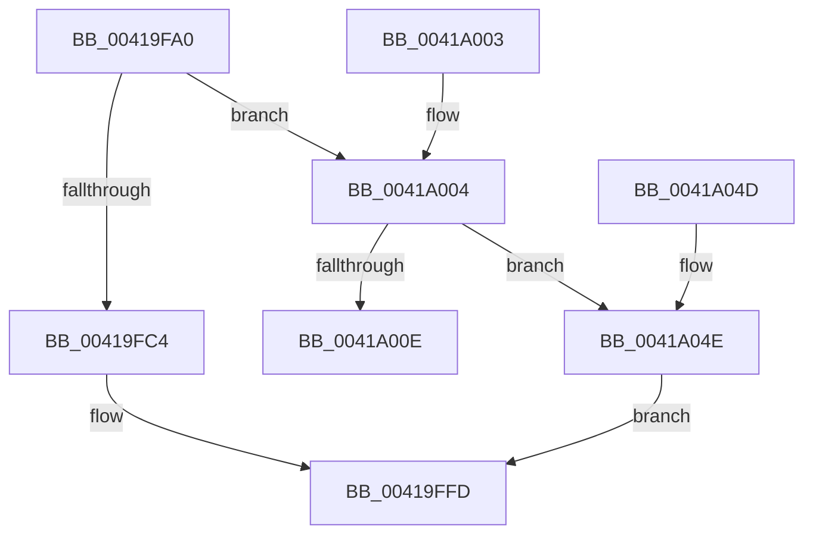

# RtlCompressBufferXpressLz

- RVA: `0x00419FA0`–`0x0041A055` (길이 `181` bytes)
- VA: `0x0000000140419FA0`
- 실행 섹션: `.text`
- PDB 이름 있음: `예`; PDB Function 태그: `아니요`
- unwind 정보 RVA: `0x00065538`
- 디코드: `47`개 명령, `181/181` bytes 표시
- 미해석 바이트: `0` (있으면 어셈블리에 `.byte`로 보존)

> 이 문서는 커널 이미지의 기계어와 PDB 기호를 분석해 생성했습니다. 4번과 5번은 함수 원형과 자료형을 바이너리 사용 방식에서 추정한 C 해석이며 원본 소스 복구 결과는 아닙니다.

## 1. Dependencies

- 직접 호출 지점: **2**; 고유 호출 대상: **2**
- 직접 호출자로 확인된 함수: **0**
- RIP 상대 이미지 참조: **0**

### Outgoing calls
- `0x00419FF8` → [RtlCompressBufferXpressLzStandard](RtlCompressBufferXpressLzStandard_function_0041A060.md) (function, `0x0041A060`)
- `0x0041A042` → [RtlCompressBufferXpressLzMax](RtlCompressBufferXpressLzMax_function_0041A840.md) (function, `0x0041A840`)

### Direct callers
- 이 함수 시작 RVA로 연결되는 직접 call은 확인되지 않았습니다. 간접 호출은 완전히 역산할 수 없습니다.

### Static image references
- 디코드된 RIP-relative 메모리 참조가 없습니다.

## 2. Other-region calls and transfers

- 다른 실행 섹션으로 향하는 call: **0**
- 별도 외부 분기/꼬리 이동을 확인하지 못했습니다.

## 3. Assembly (complete function range)

```asm
00419FA0  40 53                           push rbx
00419FA2  48 83 EC 50                     sub rsp, 0x50
00419FA6  48 8B 84 24 98 00 00 00         mov rax, qword ptr [rsp + 0x98]
00419FAE  4D 8B D9                        mov r11, r9
00419FB1  48 83 C0 07                     add rax, 7
00419FB5  45 8B D0                        mov r10d, r8d
00419FB8  48 83 E0 F8                     and rax, 0xfffffffffffffff8
00419FBC  48 8B DA                        mov rbx, rdx
00419FBF  66 85 C9                        test cx, cx
00419FC2  75 40                           jne 0x14041a004
00419FC4  44 8B 8C 24 80 00 00 00         mov r9d, dword ptr [rsp + 0x80]
00419FCC  33 C9                           xor ecx, ecx
00419FCE  44 89 44 24 40                  mov dword ptr [rsp + 0x40], r8d
00419FD3  41 8B D2                        mov edx, r10d
00419FD6  48 89 4C 24 38                  mov qword ptr [rsp + 0x38], rcx
00419FDB  4D 8B C3                        mov r8, r11
00419FDE  48 89 4C 24 30                  mov qword ptr [rsp + 0x30], rcx
00419FE3  48 8B CB                        mov rcx, rbx
00419FE6  48 89 44 24 28                  mov qword ptr [rsp + 0x28], rax
00419FEB  48 8B 84 24 90 00 00 00         mov rax, qword ptr [rsp + 0x90]
00419FF3  48 89 44 24 20                  mov qword ptr [rsp + 0x20], rax
00419FF8  E8 63 00 00 00                  call 0x14041a060
00419FFD  48 83 C4 50                     add rsp, 0x50
0041A001  5B                              pop rbx
0041A002  C3                              ret
0041A003  CC                              int3
0041A004  BA 00 01 00 00                  mov edx, 0x100
0041A009  66 3B CA                        cmp cx, dx
0041A00C  75 40                           jne 0x14041a04e
0041A00E  44 8B 8C 24 80 00 00 00         mov r9d, dword ptr [rsp + 0x80]
0041A016  33 C9                           xor ecx, ecx
0041A018  44 89 54 24 40                  mov dword ptr [rsp + 0x40], r10d
0041A01D  4D 8B C3                        mov r8, r11
0041A020  48 89 4C 24 38                  mov qword ptr [rsp + 0x38], rcx
0041A025  41 8B D2                        mov edx, r10d
0041A028  48 89 4C 24 30                  mov qword ptr [rsp + 0x30], rcx
0041A02D  48 8B CB                        mov rcx, rbx
0041A030  48 89 44 24 28                  mov qword ptr [rsp + 0x28], rax
0041A035  48 8B 84 24 90 00 00 00         mov rax, qword ptr [rsp + 0x90]
0041A03D  48 89 44 24 20                  mov qword ptr [rsp + 0x20], rax
0041A042  E8 F9 07 00 00                  call 0x14041a840
0041A047  48 83 C4 50                     add rsp, 0x50
0041A04B  5B                              pop rbx
0041A04C  C3                              ret
0041A04D  CC                              int3
0041A04E  B8 BB 00 00 C0                  mov eax, 0xc00000bb
0041A053  EB A8                           jmp 0x140419ffd
```

## 4. C-style interpretation (structured pseudocode)

```c
__int64 __fastcall RtlCompressBufferXpressLz(int a1, __int64 a2, int a3, __int64 a4, unsigned int a5, __int64 a6, __int64 a7, __int64 a8)
{
    __int64 result;
    __int64 v_rsp;
    unsigned int v_stack_m18;
    unsigned __int64 v_stack_m20;
    unsigned __int64 v_stack_m28;
    unsigned __int64 v_stack_m30;
    unsigned __int64 v_stack_m38;
    unsigned __int64 v_stack_p20;
    unsigned __int64 v_stack_p28;
    unsigned __int64 v_stack_p30;
    unsigned __int64 v_stack_p38;
    unsigned int v_stack_p40;

    v_rsp = (v_rsp) - (80);
    result = (a8) + (7);
    result = (result) & (-8);
    if ((unsigned __int16)(a1) != 0) goto loc_0041A004;
    a1 = 0;
    v_stack_m18 = a3;
    v_stack_m20 = 0;
    v_stack_m28 = 0;
    v_stack_m30 = result;
    v_stack_m38 = a7;
    result = RtlCompressBufferXpressLzStandard(a2, (unsigned int)((unsigned int)((unsigned int)(a3))), a4, (unsigned int)(a5));
loc_00419FFD:
    v_rsp = (v_rsp) + (80);
    return result;
loc_0041A004:
    if (((unsigned __int16)(a2)) != 256) goto loc_0041A04E;
    a1 = 0;
    v_stack_p40 = (unsigned int)((unsigned int)(a3));
    v_stack_p38 = 0;
    v_stack_p30 = 0;
    v_stack_p28 = result;
    v_stack_p20 = a7;
    result = RtlCompressBufferXpressLzMax(a2, (unsigned int)((unsigned int)((unsigned int)(a3))), a4, (unsigned int)(a5));
    v_rsp = (v_rsp) + (80);
    return result;
loc_0041A04E:
    goto loc_00419FFD;
}
```

## 5. (Beta) C Style

```c
int64_t RtlCompressBufferXpressLz(int32_t Arg1, int64_t Arg2, int32_t Arg3, int64_t Arg4, uint32_t Arg5, uint64_t Arg6, int64_t Arg7, int64_t Arg8)
{
    int64_t result;
    int64_t local_rsp;
    uint32_t v_stack_m18;
    uint64_t v_stack_m20;
    uint64_t v_stack_m28;
    uint64_t v_stack_m30;
    uint64_t v_stack_m38;
    uint64_t v_stack_p20;
    uint64_t v_stack_p28;
    uint64_t v_stack_p30;
    uint64_t v_stack_p38;
    uint32_t v_stack_p40;

    local_rsp = (local_rsp) - (80);
    result = (Arg8) + (7);
    result = (result) & (-8);
    if ((uint16_t)(Arg1) != 0) goto loc_0041A004;
    Arg1 = 0;
    v_stack_m18 = Arg3;
    v_stack_m20 = 0;
    v_stack_m28 = 0;
    v_stack_m30 = result;
    v_stack_m38 = Arg7;
    result = RtlCompressBufferXpressLzStandard(Arg2, (uint32_t)((uint32_t)((uint32_t)(Arg3))), Arg4, (uint32_t)(Arg5));
loc_00419FFD:
    local_rsp = (local_rsp) + (80);
    return result;
loc_0041A004:
    if (((uint16_t)(Arg2)) != 256) goto loc_0041A04E;
    Arg1 = 0;
    v_stack_p40 = (uint32_t)((uint32_t)(Arg3));
    v_stack_p38 = 0;
    v_stack_p30 = 0;
    v_stack_p28 = result;
    v_stack_p20 = Arg7;
    result = RtlCompressBufferXpressLzMax(Arg2, (uint32_t)((uint32_t)((uint32_t)(Arg3))), Arg4, (uint32_t)(Arg5));
    local_rsp = (local_rsp) + (80);
    return result;
loc_0041A04E:
    goto loc_00419FFD;
}
```

## 6. Execution-region graph

[열기: 2D/3D 그래프와 함수 탐색 컨트롤 패널](../../../control-panel.html?section=text&rva=0x00419FA0&view=graph)

- 2D 그래프는 위에서 아래로 흐르고, 3D 그래프는 빈 공간을 드래그해 회전합니다. Shift+드래그는 이동, 휠은 확대·축소, 함수 노드 선택은 대상 보고서 이동입니다.

### Static fallback


