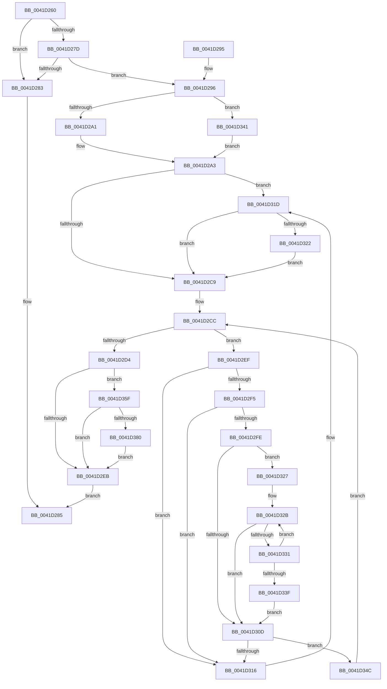

# RtlContractHashTable

- RVA: `0x0041D260`–`0x0041D396` (길이 `310` bytes)
- VA: `0x000000014041D260`
- 실행 섹션: `.text`
- PDB 이름 있음: `예`; PDB Function 태그: `아니요`
- unwind 정보 RVA: `0x0009EEB0`
- 디코드: `96`개 명령, `310/310` bytes 표시
- 미해석 바이트: `0` (있으면 어셈블리에 `.byte`로 보존)

> 이 문서는 커널 이미지의 기계어와 PDB 기호를 분석해 생성했습니다. 4번과 5번은 함수 원형과 자료형을 바이너리 사용 방식에서 추정한 C 해석이며 원본 소스 복구 결과는 아닙니다.

## 1. Dependencies

- 직접 호출 지점: **4**; 고유 호출 대상: **2**
- 직접 호출자로 확인된 함수: **0**
- RIP 상대 이미지 참조: **0**

### Outgoing calls
- `0x0041D2A8` → [RtlpGetChainHead](RtlpGetChainHead_function_0041D5D0.md) (function, `0x0041D5D0`)
- `0x0041D2B6` → [RtlpGetChainHead](RtlpGetChainHead_function_0041D5D0.md) (function, `0x0041D5D0`)
- `0x0041D369` → [ExFreePoolWithTag](../../poolcode/B8/ExFreePoolWithTag_function_00B82870.md) (function, `0x00B82870`)
- `0x0041D38C` → [ExFreePoolWithTag](../../poolcode/B8/ExFreePoolWithTag_function_00B82870.md) (function, `0x00B82870`)

### Direct callers
- 이 함수 시작 RVA로 연결되는 직접 call은 확인되지 않았습니다. 간접 호출은 완전히 역산할 수 없습니다.

### Static image references
- 디코드된 RIP-relative 메모리 참조가 없습니다.

## 2. Other-region calls and transfers

- 다른 실행 섹션으로 향하는 call: **2**
  - `0x0041D369` → [ExFreePoolWithTag](../../poolcode/B8/ExFreePoolWithTag_function_00B82870.md) (`.text` → `POOLCODE`)
  - `0x0041D38C` → [ExFreePoolWithTag](../../poolcode/B8/ExFreePoolWithTag_function_00B82870.md) (`.text` → `POOLCODE`)
- 별도 외부 분기/꼬리 이동을 확인하지 못했습니다.

## 3. Assembly (complete function range)

```asm
0041D260  48 89 5C 24 10                  mov qword ptr [rsp + 0x10], rbx
0041D265  48 89 74 24 18                  mov qword ptr [rsp + 0x18], rsi
0041D26A  57                              push rdi
0041D26B  48 83 EC 20                     sub rsp, 0x20
0041D26F  8B 51 08                        mov edx, dword ptr [rcx + 8]
0041D272  48 8B D9                        mov rbx, rcx
0041D275  81 FA 80 00 00 00               cmp edx, 0x80
0041D27B  74 06                           je 0x14041d283
0041D27D  83 79 1C 00                     cmp dword ptr [rcx + 0x1c], 0
0041D281  76 13                           jbe 0x14041d296
0041D283  32 C0                           xor al, al
0041D285  48 8B 5C 24 38                  mov rbx, qword ptr [rsp + 0x38]
0041D28A  48 8B 74 24 40                  mov rsi, qword ptr [rsp + 0x40]
0041D28F  48 83 C4 20                     add rsp, 0x20
0041D293  5F                              pop rdi
0041D294  C3                              ret
0041D295  CC                              int3
0041D296  8B 41 0C                        mov eax, dword ptr [rcx + 0xc]
0041D299  85 C0                           test eax, eax
0041D29B  0F 84 A0 00 00 00               je 0x14041d341
0041D2A1  FF C8                           dec eax
0041D2A3  FF CA                           dec edx
0041D2A5  89 41 0C                        mov dword ptr [rcx + 0xc], eax
0041D2A8  E8 23 03 00 00                  call 0x14041d5d0
0041D2AD  8B 53 0C                        mov edx, dword ptr [rbx + 0xc]
0041D2B0  48 8B CB                        mov rcx, rbx
0041D2B3  4C 8B C8                        mov r9, rax
0041D2B6  E8 15 03 00 00                  call 0x14041d5d0
0041D2BB  4C 8B D0                        mov r10, rax
0041D2BE  83 C8 FF                        or eax, 0xffffffff
0041D2C1  01 43 08                        add dword ptr [rbx + 8], eax
0041D2C4  4D 39 09                        cmp qword ptr [r9], r9
0041D2C7  75 54                           jne 0x14041d31d
0041D2C9  49 8B D2                        mov rdx, r10
0041D2CC  49 8B 09                        mov rcx, qword ptr [r9]
0041D2CF  49 3B C9                        cmp rcx, r9
0041D2D2  75 1B                           jne 0x14041d2ef
0041D2D4  8B 53 08                        mov edx, dword ptr [rbx + 8]
0041D2D7  B8 01 00 00 00                  mov eax, 1
0041D2DC  83 EA 80                        sub edx, -0x80
0041D2DF  0F BD CA                        bsr ecx, edx
0041D2E2  D3 E0                           shl eax, cl
0041D2E4  8D 71 F9                        lea esi, [rcx - 7]
0041D2E7  3B C2                           cmp eax, edx
0041D2E9  74 74                           je 0x14041d35f
0041D2EB  B0 01                           mov al, 1
0041D2ED  EB 96                           jmp 0x14041d285
0041D2EF  4C 39 49 08                     cmp qword ptr [rcx + 8], r9
0041D2F3  75 21                           jne 0x14041d316
0041D2F5  48 8B 01                        mov rax, qword ptr [rcx]
0041D2F8  48 39 48 08                     cmp qword ptr [rax + 8], rcx
0041D2FC  75 18                           jne 0x14041d316
0041D2FE  49 89 01                        mov qword ptr [r9], rax
0041D301  4C 89 48 08                     mov qword ptr [rax + 8], r9
0041D305  4C 8B 02                        mov r8, qword ptr [rdx]
0041D308  4D 3B C2                        cmp r8, r10
0041D30B  75 1A                           jne 0x14041d327
0041D30D  48 8B 02                        mov rax, qword ptr [rdx]
0041D310  48 39 50 08                     cmp qword ptr [rax + 8], rdx
0041D314  74 36                           je 0x14041d34c
0041D316  B9 03 00 00 00                  mov ecx, 3
0041D31B  CD 29                           int 0x29
0041D31D  4D 39 12                        cmp qword ptr [r10], r10
0041D320  74 A7                           je 0x14041d2c9
0041D322  01 43 18                        add dword ptr [rbx + 0x18], eax
0041D325  EB A2                           jmp 0x14041d2c9
0041D327  4C 8B 59 10                     mov r11, qword ptr [rcx + 0x10]
0041D32B  4D 39 58 10                     cmp qword ptr [r8 + 0x10], r11
0041D32F  73 DC                           jae 0x14041d30d
0041D331  49 8B 00                        mov rax, qword ptr [r8]
0041D334  49 8B D0                        mov rdx, r8
0041D337  4C 8B C0                        mov r8, rax
0041D33A  49 3B C2                        cmp rax, r10
0041D33D  75 EC                           jne 0x14041d32b
0041D33F  EB CC                           jmp 0x14041d30d
0041D341  D1 69 10                        shr dword ptr [rcx + 0x10], 1
0041D344  8B 41 10                        mov eax, dword ptr [rcx + 0x10]
0041D347  E9 57 FF FF FF                  jmp 0x14041d2a3
0041D34C  48 89 01                        mov qword ptr [rcx], rax
0041D34F  48 89 51 08                     mov qword ptr [rcx + 8], rdx
0041D353  48 89 48 08                     mov qword ptr [rax + 8], rcx
0041D357  48 89 0A                        mov qword ptr [rdx], rcx
0041D35A  E9 6D FF FF FF                  jmp 0x14041d2cc
0041D35F  48 8B 7B 20                     mov rdi, qword ptr [rbx + 0x20]
0041D363  33 D2                           xor edx, edx
0041D365  48 8B 0C F7                     mov rcx, qword ptr [rdi + rsi*8]
0041D369  E8 02 55 76 00                  call 0x140b82870
0041D36E  48 83 24 F7 00                  and qword ptr [rdi + rsi*8], 0
0041D373  81 7B 08 80 00 00 00            cmp dword ptr [rbx + 8], 0x80
0041D37A  0F 85 6B FF FF FF               jne 0x14041d2eb
0041D380  48 8B 17                        mov rdx, qword ptr [rdi]
0041D383  48 8B CF                        mov rcx, rdi
0041D386  48 89 53 20                     mov qword ptr [rbx + 0x20], rdx
0041D38A  33 D2                           xor edx, edx
0041D38C  E8 DF 54 76 00                  call 0x140b82870
0041D391  E9 55 FF FF FF                  jmp 0x14041d2eb
```

## 4. C-style interpretation (structured pseudocode)

```c
__int64 __fastcall RtlContractHashTable(__int64 a1)
{
    __int64 result;
    __int64 v_rsp;
    unsigned __int64 v_stack_p10;
    unsigned __int64 v_stack_p18;

    v_stack_p10 = v_rbx;
    v_stack_p18 = v_rsi;
    v_rsp = (v_rsp) - (32);
    if (((unsigned int)((unsigned int)(*(unsigned int *)(a1 + 8)))) == 128) goto loc_0041D283;
    if ((*(unsigned int *)(a1 + 28)) <= 0) goto loc_0041D296;
loc_0041D283:
    result = 0;
loc_0041D285:
    v_rsp = (v_rsp) + (32);
    return result;
loc_0041D296:
    if ((unsigned int)((unsigned int)(*(unsigned int *)(a1 + 12))) == 0) goto loc_0041D341;
    result = (unsigned int)(((unsigned int)(*(unsigned int *)(a1 + 12))) - 1);
loc_0041D2A3:
    a2 = (unsigned int)(((unsigned int)(*(unsigned int *)(a1 + 8))) - 1);
    *(unsigned int *)(a1 + 12) = (unsigned int)(result);
    result = RtlpGetChainHead(a1, a2, a3, a4);
    result = RtlpGetChainHead(v_stack_p10, (unsigned int)(*(unsigned int *)(v_stack_p10 + 12)), a3, result);
    result = (unsigned int)((result) | (0xFFFFFFFFULL));
    if ((*(unsigned __int64 *)(result)) != result) goto loc_0041D31D;
loc_0041D2C9:
loc_0041D2CC:
    if ((*(unsigned __int64 *)(result)) != result) goto loc_0041D2EF;
    a2 = (unsigned int)(((unsigned int)(*(unsigned int *)(v_stack_p10 + 8))) - (-128));
    result = (unsigned int)((1) << ((unsigned __int8)(*(unsigned __int64 *)(result))));
    if (((unsigned int)(result)) == ((unsigned int)(a2))) goto loc_0041D35F;
loc_0041D2EB:
    goto loc_0041D285;
loc_0041D2EF:
    if ((*(unsigned __int64 *)(*(unsigned __int64 *)(result) + 8)) != result) goto loc_0041D316;
    if ((*(unsigned __int64 *)(*(unsigned __int64 *)(*(unsigned __int64 *)(result)) + 8)) != (*(unsigned __int64 *)(result))) goto loc_0041D316;
    *(unsigned __int64 *)(result) = *(unsigned __int64 *)(*(unsigned __int64 *)(result));
    *(unsigned __int64 *)(*(unsigned __int64 *)(*(unsigned __int64 *)(result)) + 8) = result;
    if ((*(unsigned __int64 *)(a2)) != result) goto loc_0041D327;
loc_0041D30D:
    if ((*(unsigned __int64 *)(*(unsigned __int64 *)(a2) + 8)) == a2) goto loc_0041D34C;
loc_0041D316:
loc_0041D31D:
    if ((*(unsigned __int64 *)(result)) == result) goto loc_0041D2C9;
    goto loc_0041D2C9;
loc_0041D327:
loc_0041D32B:
    if ((*(unsigned __int64 *)(*(unsigned __int64 *)(a2) + 16)) >= (*(unsigned __int64 *)(3 + 16))) goto loc_0041D30D;
    if ((*(unsigned __int64 *)(*(unsigned __int64 *)(a2))) != result) goto loc_0041D32B;
    goto loc_0041D30D;
loc_0041D341:
    goto loc_0041D2A3;
loc_0041D34C:
    *(unsigned __int64 *)(3) = (unsigned int)(*(unsigned int *)(3 + 16));
    *(unsigned __int64 *)(3 + 8) = *(unsigned __int64 *)(a2);
    *(unsigned __int64 *)((unsigned int)(*(unsigned int *)(3 + 16)) + 8) = 3;
    *(unsigned __int64 *)(*(unsigned __int64 *)(a2)) = 3;
    goto loc_0041D2CC;
loc_0041D35F:
    a2 = 0;
    result = ExFreePoolWithTag(*(unsigned __int64 *)(*(unsigned __int64 *)(v_stack_p10 + 32) + *(unsigned __int64 *)(result) - 7 * 8), a2, *(unsigned __int64 *)(*(unsigned __int64 *)(a2)), result);
    if ((*(unsigned int *)(v_stack_p10 + 8)) != 128) goto loc_0041D2EB;
    *(unsigned __int64 *)(v_stack_p10 + 32) = *(unsigned __int64 *)(*(unsigned __int64 *)(v_stack_p10 + 32));
    a2 = 0;
    result = ExFreePoolWithTag(*(unsigned __int64 *)(v_stack_p10 + 32), a2, *(unsigned __int64 *)(*(unsigned __int64 *)(a2)), result);
    goto loc_0041D2EB;
}
```

## 5. (Beta) C Style

```c
int64_t RtlContractHashTable(void *Arg1)
{
    uint8_t *arg1 = (uint8_t *)Arg1;

    int64_t result;
    int64_t local_rsp;
    uint64_t v_stack_p10;
    uint64_t v_stack_p18;

    v_stack_p10 = local_rbx;
    v_stack_p18 = local_rsi;
    local_rsp = (local_rsp) - (32);
    if (((uint32_t)((uint32_t)(*(uint32_t *)(arg1 + 0x8)))) == 128) goto loc_0041D283;
    if ((*(uint32_t *)(arg1 + 0x1C)) <= 0) goto loc_0041D296;
loc_0041D283:
    result = 0;
loc_0041D285:
    local_rsp = (local_rsp) + (32);
    return result;
loc_0041D296:
    if ((uint32_t)((uint32_t)(*(uint32_t *)(arg1 + 0xC))) == 0) goto loc_0041D341;
    result = (uint32_t)(((uint32_t)(*(uint32_t *)(arg1 + 0xC))) - 1);
loc_0041D2A3:
    a2 = (uint32_t)(((uint32_t)(*(uint32_t *)(arg1 + 0x8))) - 1);
    *(uint32_t *)(arg1 + 0xC) = (uint32_t)(result);
    result = RtlpGetChainHead(Arg1, a2, a3, a4);
    result = RtlpGetChainHead(v_stack_p10, (uint32_t)(*(uint32_t *)(v_stack_p10 + 0xC)), a3, result);
    result = (uint32_t)((result) | (0xFFFFFFFFULL));
    if ((*(uint64_t *)(result)) != result) goto loc_0041D31D;
loc_0041D2C9:
loc_0041D2CC:
    if ((*(uint64_t *)(result)) != result) goto loc_0041D2EF;
    a2 = (uint32_t)(((uint32_t)(*(uint32_t *)(v_stack_p10 + 0x8))) - (-128));
    result = (uint32_t)((1) << ((uint8_t)(*(uint64_t *)(result))));
    if (((uint32_t)(result)) == ((uint32_t)(a2))) goto loc_0041D35F;
loc_0041D2EB:
    goto loc_0041D285;
loc_0041D2EF:
    if ((*(uint64_t *)(*(uint64_t *)(result) + 0x8)) != result) goto loc_0041D316;
    if ((*(uint64_t *)(*(uint64_t *)(*(uint64_t *)(result)) + 0x8)) != (*(uint64_t *)(result))) goto loc_0041D316;
    *(uint64_t *)(result) = *(uint64_t *)(*(uint64_t *)(result));
    *(uint64_t *)(*(uint64_t *)(*(uint64_t *)(result)) + 0x8) = result;
    if ((*(uint64_t *)(a2)) != result) goto loc_0041D327;
loc_0041D30D:
    if ((*(uint64_t *)(*(uint64_t *)(a2) + 0x8)) == a2) goto loc_0041D34C;
loc_0041D316:
loc_0041D31D:
    if ((*(uint64_t *)(result)) == result) goto loc_0041D2C9;
    goto loc_0041D2C9;
loc_0041D327:
loc_0041D32B:
    if ((*(uint64_t *)(*(uint64_t *)(a2) + 0x10)) >= (*(uint64_t *)(3 + 0x10))) goto loc_0041D30D;
    if ((*(uint64_t *)(*(uint64_t *)(a2))) != result) goto loc_0041D32B;
    goto loc_0041D30D;
loc_0041D341:
    goto loc_0041D2A3;
loc_0041D34C:
    *(uint64_t *)(3) = (uint32_t)(*(uint32_t *)(3 + 0x10));
    *(uint64_t *)(3 + 0x8) = *(uint64_t *)(a2);
    *(uint64_t *)((uint32_t)(*(uint32_t *)(3 + 0x10)) + 0x8) = 3;
    *(uint64_t *)(*(uint64_t *)(a2)) = 3;
    goto loc_0041D2CC;
loc_0041D35F:
    a2 = 0;
    result = ExFreePoolWithTag(*(uint64_t *)(*(uint64_t *)(v_stack_p10 + 0x20) + *(uint64_t *)(result) - 0x7 * 8), a2, *(uint64_t *)(*(uint64_t *)(a2)), result);
    if ((*(uint32_t *)(v_stack_p10 + 0x8)) != 128) goto loc_0041D2EB;
    *(uint64_t *)(v_stack_p10 + 0x20) = *(uint64_t *)(*(uint64_t *)(v_stack_p10 + 0x20));
    a2 = 0;
    result = ExFreePoolWithTag(*(uint64_t *)(v_stack_p10 + 0x20), a2, *(uint64_t *)(*(uint64_t *)(a2)), result);
    goto loc_0041D2EB;
}
```

### 관측된 메모리 오프셋

구조체 형식이 확인되지 않은 접근은 인자 기준의 오프셋으로만 기록했습니다.

| 기준 인자 | 오프셋 표현 | 폭 (bit) | 접근 |
|---|---:|---:|---|
| `Arg1` | `+ 0x8` | `32` | `R` |
| `Arg1` | `+ 0x8` | `32` | `R/W` |
| `Arg1` | `+ 0xC` | `32` | `R` |
| `Arg1` | `+ 0xC` | `32` | `W` |
| `Arg1` | `+ 0x10` | `32` | `R` |
| `Arg1` | `+ 0x10` | `32` | `R/W` |
| `Arg1` | `+ 0x18` | `32` | `R/W` |
| `Arg1` | `+ 0x1C` | `32` | `R` |
| `Arg1` | `+ 0x20` | `64` | `R` |
| `Arg1` | `+ 0x20` | `64` | `W` |

## 6. Execution-region graph

[열기: 2D/3D 그래프와 함수 탐색 컨트롤 패널](../../../control-panel.html?section=text&rva=0x0041D260&view=graph)

- 2D 그래프는 위에서 아래로 흐르고, 3D 그래프는 빈 공간을 드래그해 회전합니다. Shift+드래그는 이동, 휠은 확대·축소, 함수 노드 선택은 대상 보고서 이동입니다.

### Static fallback


