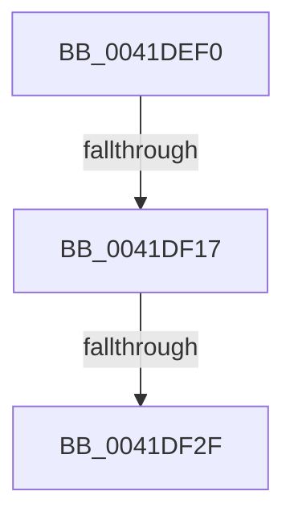

# RtlCopyBitMapEx

- RVA: `0x0041DEF0`–`0x0041DF44` (길이 `84` bytes)
- VA: `0x000000014041DEF0`
- 실행 섹션: `.text`
- PDB 이름 있음: `예`; PDB Function 태그: `예`
- unwind 정보 RVA: `0x0009FA10`
- 디코드: `25`개 명령, `84/84` bytes 표시
- 미해석 바이트: `0` (있으면 어셈블리에 `.byte`로 보존)

> 이 문서는 커널 이미지의 기계어와 PDB 기호를 분석해 생성했습니다. 4번과 5번은 함수 원형과 자료형을 바이너리 사용 방식에서 추정한 C 해석이며 원본 소스 복구 결과는 아닙니다.

## 1. Dependencies

- 직접 호출 지점: **0**; 고유 호출 대상: **0**
- 직접 호출자로 확인된 함수: **3**
- RIP 상대 이미지 참조: **0**

### Outgoing calls
- 직접 디코드된 call 명령이 없습니다.

### Direct callers
- [MiResizeAweBitMap](../../page/80/MiResizeAweBitMap_function_0080AD00.md) at `0x0080AE1C`
- [sub_00B2B51A](../../page/B2/Unknown_function_00B2B51A.md) at `0x00B2B5E7`
- [sub_00B3ADEC](../../page/B3/Unknown_function_00B3ADEC.md) at `0x00B3AE4D`

### Static image references
- 디코드된 RIP-relative 메모리 참조가 없습니다.

## 2. Other-region calls and transfers

- 다른 실행 섹션으로 향하는 call: **0**
- call이 아닌 외부 분기/꼬리 이동: **3**
  - `0x0041DF11` → [sub_0041DFBD](Unknown_function_0041DFBD.md) (`tail-transfer`)
  - `0x0041DF2D` → [sub_0041DF44](Unknown_function_0041DF44.md) (`tail-transfer`)
  - `0x0041DF3E` → [sub_0041DFBD + 0x9](Unknown_function_0041DFBD.md) (`tail-transfer`)

## 3. Assembly (complete function range)

```asm
0041DEF0  40 53                           push rbx
0041DEF2  56                              push rsi
0041DEF3  57                              push rdi
0041DEF4  48 83 EC 30                     sub rsp, 0x30
0041DEF8  48 8B 01                        mov rax, qword ptr [rcx]
0041DEFB  48 8B FA                        mov rdi, rdx
0041DEFE  48 8B 1A                        mov rbx, qword ptr [rdx]
0041DF01  48 8B F1                        mov rsi, rcx
0041DF04  49 2B D8                        sub rbx, r8
0041DF07  48 3B C3                        cmp rax, rbx
0041DF0A  48 0F 46 D8                     cmovbe rbx, rax
0041DF0E  48 85 DB                        test rbx, rbx
0041DF11  0F 84 A6 00 00 00               je 0x14041dfbd
0041DF17  48 8B 52 08                     mov rdx, qword ptr [rdx + 8]
0041DF1B  49 8B C0                        mov rax, r8
0041DF1E  4C 8B 4E 08                     mov r9, qword ptr [rsi + 8]
0041DF22  48 C1 E8 06                     shr rax, 6
0041DF26  48 8D 0C C2                     lea rcx, [rdx + rax*8]
0041DF2A  4C 3B C9                        cmp r9, rcx
0041DF2D  77 15                           ja 0x14041df44
0041DF2F  48 8D 43 FF                     lea rax, [rbx - 1]
0041DF33  48 C1 E8 06                     shr rax, 6
0041DF37  49 8D 04 C1                     lea rax, [r9 + rax*8]
0041DF3B  48 3B C8                        cmp rcx, rax
0041DF3E  0F 86 82 00 00 00               jbe 0x14041dfc6
```

## 4. C-style interpretation (structured pseudocode)

```c
__int64 __fastcall RtlCopyBitMapEx(__int64 a1, __int64 a2, __int64 a3)
{
    __int64 result;
    __int64 v_rbx;
    __int64 v_rsp;

    v_rsp = (v_rsp) - (48);
    v_rbx = (*(unsigned __int64 *)(a2)) - (a3);
    if ((*(unsigned __int64 *)(a1)) <= v_rbx) { v_rbx = *(unsigned __int64 *)(a1); }
    result = (a3) >> (6);
    result = (v_rbx - 1) >> (6);
}
```

## 5. (Beta) C Style

```c
int64_t RtlCopyBitMapEx(void *Arg1, void *Arg2, int64_t Arg3)
{
    uint8_t *arg1 = (uint8_t *)Arg1;
    uint8_t *arg2 = (uint8_t *)Arg2;

    int64_t result;
    int64_t local_rbx;
    int64_t local_rsp;

    local_rsp = (local_rsp) - (48);
    local_rbx = (*(uint64_t *)(arg2)) - (Arg3);
    if ((*(uint64_t *)(arg1)) <= local_rbx) { local_rbx = *(uint64_t *)(arg1); }
    result = (Arg3) >> (6);
    result = (local_rbx - 1) >> (6);
}
```

### 관측된 메모리 오프셋

구조체 형식이 확인되지 않은 접근은 인자 기준의 오프셋으로만 기록했습니다.

| 기준 인자 | 오프셋 표현 | 폭 (bit) | 접근 |
|---|---:|---:|---|
| `Arg1` | `+ 0x0` | `64` | `R` |
| `Arg1` | `+ 0x8` | `64` | `R` |
| `Arg2` | `+ 0x0` | `64` | `R` |
| `Arg2` | `+ 0x8` | `64` | `R` |

## 6. Execution-region graph

[열기: 2D/3D 그래프와 함수 탐색 컨트롤 패널](../../../control-panel.html?section=text&rva=0x0041DEF0&view=graph)

- 2D 그래프는 위에서 아래로 흐르고, 3D 그래프는 빈 공간을 드래그해 회전합니다. Shift+드래그는 이동, 휠은 확대·축소, 함수 노드 선택은 대상 보고서 이동입니다.

### Static fallback


