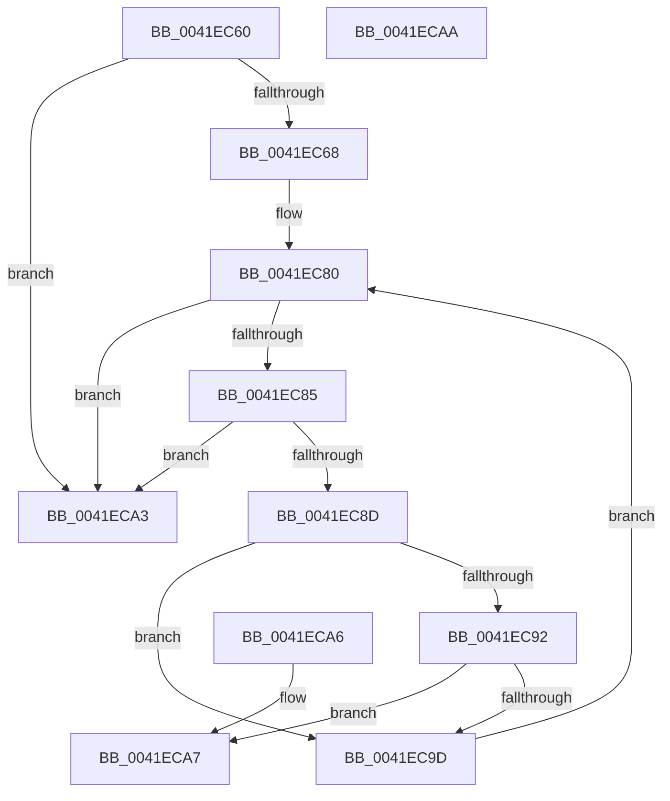

# RtlDoesNameContainWildCards

- RVA: `0x0041EC60`–`0x0041ECAB` (길이 `75` bytes)
- VA: `0x000000014041EC60`
- 실행 섹션: `.text`
- PDB 이름 있음: `예`; PDB Function 태그: `아니요`
- unwind 정보 RVA: `0x000DB714`
- 디코드: `27`개 명령, `75/75` bytes 표시
- 미해석 바이트: `0` (있으면 어셈블리에 `.byte`로 보존)

> 이 문서는 커널 이미지의 기계어와 PDB 기호를 분석해 생성했습니다. 4번과 5번은 함수 원형과 자료형을 바이너리 사용 방식에서 추정한 C 해석이며 원본 소스 복구 결과는 아닙니다.

## 1. Dependencies

- 직접 호출 지점: **0**; 고유 호출 대상: **0**
- 직접 호출자로 확인된 함수: **1**
- RIP 상대 이미지 참조: **1**

### Outgoing calls
- 직접 디코드된 call 명령이 없습니다.

### Direct callers
- [RtlpIsNameInExpressionPrivate](../2F/RtlpIsNameInExpressionPrivate_function_002FDBAC.md) at `0x002FDF5A`

### Static image references
- `0x0041EC6C` → RVA `0x00013E90` (`.rdata`; read)

## 2. Other-region calls and transfers

- 다른 실행 섹션으로 향하는 call: **0**
- 별도 외부 분기/꼬리 이동을 확인하지 못했습니다.

## 3. Assembly (complete function range)

```asm
0041EC60  0F B7 01                        movzx eax, word ptr [rcx]
0041EC63  66 85 C0                        test ax, ax
0041EC66  74 3B                           je 0x14041eca3
0041EC68  4C 8B 41 08                     mov r8, qword ptr [rcx + 8]
0041EC6C  4C 8D 0D 1D 52 BF FF            lea r9, [rip - 0x40ade3]
0041EC73  48 D1 E8                        shr rax, 1
0041EC76  48 FF C8                        dec rax
0041EC79  49 8D 04 40                     lea rax, [r8 + rax*2]
0041EC7D  0F 1F 00                        nop dword ptr [rax]
0041EC80  49 3B C0                        cmp rax, r8
0041EC83  72 1E                           jb 0x14041eca3
0041EC85  0F B7 08                        movzx ecx, word ptr [rax]
0041EC88  83 F9 5C                        cmp ecx, 0x5c
0041EC8B  74 16                           je 0x14041eca3
0041EC8D  83 F9 40                        cmp ecx, 0x40
0041EC90  73 0B                           jae 0x14041ec9d
0041EC92  42 0F B6 14 09                  movzx edx, byte ptr [rcx + r9]
0041EC97  0F BA E2 03                     bt edx, 3
0041EC9B  72 0A                           jb 0x14041eca7
0041EC9D  48 83 E8 02                     sub rax, 2
0041ECA1  EB DD                           jmp 0x14041ec80
0041ECA3  32 C0                           xor al, al
0041ECA5  C3                              ret
0041ECA6  CC                              int3
0041ECA7  B0 01                           mov al, 1
0041ECA9  C3                              ret
0041ECAA  CC                              int3
```

## 4. C-style interpretation (structured pseudocode)

```c
__int64 __fastcall RtlDoesNameContainWildCards(__int64 a1)
{
    __int64 result;

    if ((unsigned __int16)(*(unsigned __int16 *)(a1)) == 0) goto loc_0041ECA3;
    result = (*(unsigned __int16 *)(a1)) >> (1);
    result = (result) - 1;
loc_0041EC80:
    if ((*(unsigned __int64 *)(a1 + 8) + result * 2) < (*(unsigned __int64 *)(a1 + 8))) goto loc_0041ECA3;
    if (((unsigned int)(*(unsigned __int16 *)(*(unsigned __int64 *)(a1 + 8) + result * 2))) == 92) goto loc_0041ECA3;
    if (((unsigned int)(*(unsigned __int16 *)(*(unsigned __int64 *)(a1 + 8) + result * 2))) >= 64) goto loc_0041EC9D;
    if (((unsigned int)(*(unsigned __int16 *)(*(unsigned __int64 *)(a1 + 8) + result * 2))) < 64) goto loc_0041ECA7;
loc_0041EC9D:
    result = (*(unsigned __int64 *)(a1 + 8) + result * 2) - (2);
    goto loc_0041EC80;
loc_0041ECA3:
    result = 0;
    return result;
loc_0041ECA7:
    return 1;
}
```

## 5. (Beta) C Style

```c
int64_t RtlDoesNameContainWildCards(void *Arg1)
{
    uint8_t *arg1 = (uint8_t *)Arg1;

    int64_t result;

    if ((uint16_t)(*(uint16_t *)(arg1)) == 0) goto loc_0041ECA3;
    result = (*(uint16_t *)(arg1)) >> (1);
    result = (result) - 1;
loc_0041EC80:
    if ((*(uint64_t *)(arg1 + 0x8) + result * 2) < (*(uint64_t *)(arg1 + 0x8))) goto loc_0041ECA3;
    if (((uint32_t)(*(uint16_t *)(*(uint64_t *)(arg1 + 0x8) + result * 2))) == 92) goto loc_0041ECA3;
    if (((uint32_t)(*(uint16_t *)(*(uint64_t *)(arg1 + 0x8) + result * 2))) >= 64) goto loc_0041EC9D;
    if (((uint32_t)(*(uint16_t *)(*(uint64_t *)(arg1 + 0x8) + result * 2))) < 64) goto loc_0041ECA7;
loc_0041EC9D:
    result = (*(uint64_t *)(arg1 + 0x8) + result * 2) - (2);
    goto loc_0041EC80;
loc_0041ECA3:
    result = 0;
    return result;
loc_0041ECA7:
    return 1;
}
```

### 관측된 메모리 오프셋

구조체 형식이 확인되지 않은 접근은 인자 기준의 오프셋으로만 기록했습니다.

| 기준 인자 | 오프셋 표현 | 폭 (bit) | 접근 |
|---|---:|---:|---|
| `Arg1` | `+ 0x0` | `16` | `R` |
| `Arg1` | `+ 0x8` | `64` | `R` |

## 6. Execution-region graph

[열기: 2D/3D 그래프와 함수 탐색 컨트롤 패널](../../../control-panel.html?section=text&rva=0x0041EC60&view=graph)

- 2D 그래프는 위에서 아래로 흐르고, 3D 그래프는 빈 공간을 드래그해 회전합니다. Shift+드래그는 이동, 휠은 확대·축소, 함수 노드 선택은 대상 보고서 이동입니다.

### Static fallback


