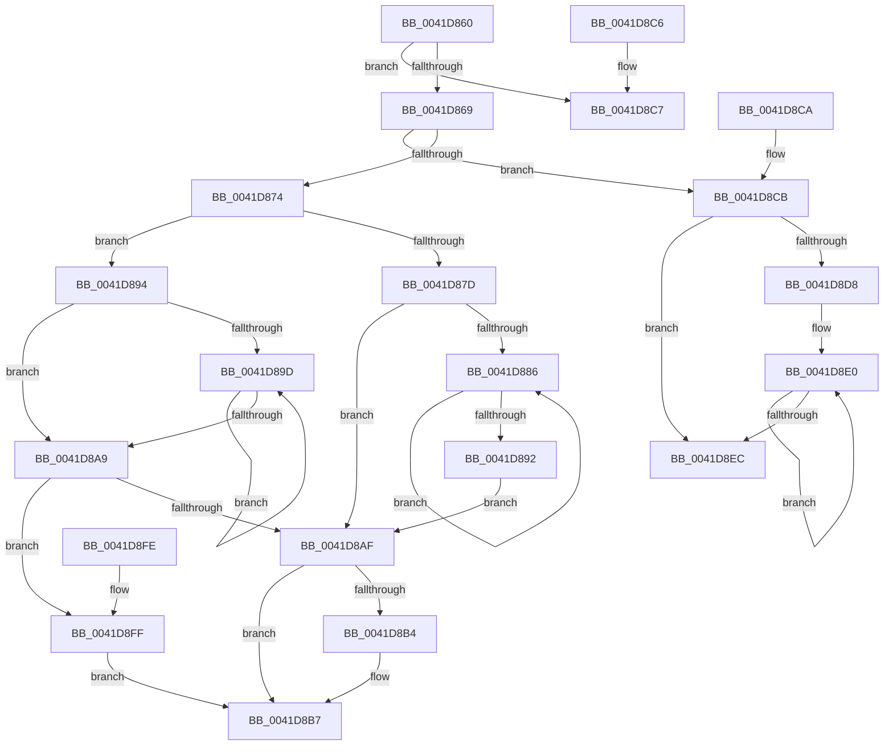

# RtlEnumerateGenericTableWithoutSplayingAvl

- RVA: `0x0041D860`–`0x0041D904` (길이 `164` bytes)
- VA: `0x000000014041D860`
- 실행 섹션: `.text`
- PDB 이름 있음: `예`; PDB Function 태그: `아니요`
- unwind 정보 RVA: `0x000DB714`
- 디코드: `57`개 명령, `164/164` bytes 표시
- 미해석 바이트: `0` (있으면 어셈블리에 `.byte`로 보존)

> 이 문서는 커널 이미지의 기계어와 PDB 기호를 분석해 생성했습니다. 4번과 5번은 함수 원형과 자료형을 바이너리 사용 방식에서 추정한 C 해석이며 원본 소스 복구 결과는 아닙니다.

## 1. Dependencies

- 직접 호출 지점: **0**; 고유 호출 대상: **0**
- 직접 호출자로 확인된 함수: **0**
- RIP 상대 이미지 참조: **0**

### Outgoing calls
- 직접 디코드된 call 명령이 없습니다.

### Direct callers
- 이 함수 시작 RVA로 연결되는 직접 call은 확인되지 않았습니다. 간접 호출은 완전히 역산할 수 없습니다.

### Static image references
- 디코드된 RIP-relative 메모리 참조가 없습니다.

## 2. Other-region calls and transfers

- 다른 실행 섹션으로 향하는 call: **0**
- 별도 외부 분기/꼬리 이동을 확인하지 못했습니다.

## 3. Assembly (complete function range)

```asm
0041D860  83 79 2C 00                     cmp dword ptr [rcx + 0x2c], 0
0041D864  4C 8B C2                        mov r8, rdx
0041D867  74 5E                           je 0x14041d8c7
0041D869  48 8B 12                        mov rdx, qword ptr [rdx]
0041D86C  45 33 C9                        xor r9d, r9d
0041D86F  48 85 D2                        test rdx, rdx
0041D872  74 57                           je 0x14041d8cb
0041D874  48 8B 42 10                     mov rax, qword ptr [rdx + 0x10]
0041D878  48 85 C0                        test rax, rax
0041D87B  74 17                           je 0x14041d894
0041D87D  48 8B 48 08                     mov rcx, qword ptr [rax + 8]
0041D881  48 85 C9                        test rcx, rcx
0041D884  74 29                           je 0x14041d8af
0041D886  48 8B C1                        mov rax, rcx
0041D889  48 8B 49 08                     mov rcx, qword ptr [rcx + 8]
0041D88D  48 85 C9                        test rcx, rcx
0041D890  75 F4                           jne 0x14041d886
0041D892  EB 1B                           jmp 0x14041d8af
0041D894  48 8B 02                        mov rax, qword ptr [rdx]
0041D897  48 39 50 10                     cmp qword ptr [rax + 0x10], rdx
0041D89B  75 0C                           jne 0x14041d8a9
0041D89D  48 8B D0                        mov rdx, rax
0041D8A0  48 8B 00                        mov rax, qword ptr [rax]
0041D8A3  48 39 50 10                     cmp qword ptr [rax + 0x10], rdx
0041D8A7  74 F4                           je 0x14041d89d
0041D8A9  48 39 50 08                     cmp qword ptr [rax + 8], rdx
0041D8AD  75 50                           jne 0x14041d8ff
0041D8AF  48 85 C0                        test rax, rax
0041D8B2  74 03                           je 0x14041d8b7
0041D8B4  49 89 00                        mov qword ptr [r8], rax
0041D8B7  48 85 C0                        test rax, rax
0041D8BA  48 8D 48 20                     lea rcx, [rax + 0x20]
0041D8BE  49 0F 44 C9                     cmove rcx, r9
0041D8C2  48 8B C1                        mov rax, rcx
0041D8C5  C3                              ret
0041D8C6  CC                              int3
0041D8C7  33 C0                           xor eax, eax
0041D8C9  C3                              ret
0041D8CA  CC                              int3
0041D8CB  48 8B 41 10                     mov rax, qword ptr [rcx + 0x10]
0041D8CF  48 8B 48 08                     mov rcx, qword ptr [rax + 8]
0041D8D3  48 85 C9                        test rcx, rcx
0041D8D6  74 14                           je 0x14041d8ec
0041D8D8  0F 1F 84 00 00 00 00 00         nop dword ptr [rax + rax]
0041D8E0  48 8B C1                        mov rax, rcx
0041D8E3  48 8B 49 08                     mov rcx, qword ptr [rcx + 8]
0041D8E7  48 85 C9                        test rcx, rcx
0041D8EA  75 F4                           jne 0x14041d8e0
0041D8EC  48 85 C0                        test rax, rax
0041D8EF  49 89 00                        mov qword ptr [r8], rax
0041D8F2  48 8D 48 20                     lea rcx, [rax + 0x20]
0041D8F6  49 0F 44 C9                     cmove rcx, r9
0041D8FA  48 8B C1                        mov rax, rcx
0041D8FD  C3                              ret
0041D8FE  CC                              int3
0041D8FF  49 8B C1                        mov rax, r9
0041D902  EB B3                           jmp 0x14041d8b7
```

## 4. C-style interpretation (structured pseudocode)

```c
__int64 __fastcall RtlEnumerateGenericTableWithoutSplayingAvl(__int64 a1, __int64 a2, __int64 a3, int a4)
{
    __int64 result;

    if ((*(unsigned int *)(a1 + 44)) == 0) goto loc_0041D8C7;
    a4 = 0;
    if (*(unsigned __int64 *)(a2) == 0) goto loc_0041D8CB;
    if (*(unsigned __int64 *)(*(unsigned __int64 *)(a2) + 16) == 0) goto loc_0041D894;
    if (*(unsigned __int64 *)(*(unsigned __int64 *)(*(unsigned __int64 *)(a2) + 16) + 8) == 0) goto loc_0041D8AF;
loc_0041D886:
    if (*(unsigned __int64 *)(*(unsigned __int64 *)(*(unsigned __int64 *)(*(unsigned __int64 *)(a2) + 16) + 8) + 8) != 0) goto loc_0041D886;
    goto loc_0041D8AF;
loc_0041D894:
    if ((*(unsigned __int64 *)(*(unsigned __int64 *)(*(unsigned __int64 *)(a2)) + 16)) != (*(unsigned __int64 *)(a2))) goto loc_0041D8A9;
loc_0041D89D:
    if ((*(unsigned __int64 *)(*(unsigned __int64 *)(*(unsigned __int64 *)(*(unsigned __int64 *)(a2))) + 16)) == (*(unsigned __int64 *)(*(unsigned __int64 *)(a2)))) goto loc_0041D89D;
loc_0041D8A9:
    if ((*(unsigned __int64 *)(*(unsigned __int64 *)(*(unsigned __int64 *)(*(unsigned __int64 *)(a2))) + 8)) != (*(unsigned __int64 *)(*(unsigned __int64 *)(a2)))) goto loc_0041D8FF;
loc_0041D8AF:
    if (*(unsigned __int64 *)(*(unsigned __int64 *)(*(unsigned __int64 *)(a2))) != 0) {
        *(unsigned __int64 *)(a2) = *(unsigned __int64 *)(*(unsigned __int64 *)(*(unsigned __int64 *)(a2)));
    }
    a1 = *(unsigned __int64 *)(*(unsigned __int64 *)(*(unsigned __int64 *)(a2))) + 32;
    if (*(unsigned __int64 *)(*(unsigned __int64 *)(*(unsigned __int64 *)(a2))) == 0) { a1 = 0; }
    return a1;
loc_0041D8C7:
    result = 0;
    return result;
loc_0041D8CB:
    if (*(unsigned __int64 *)(*(unsigned __int64 *)(a1 + 16) + 8) == 0) goto loc_0041D8EC;
loc_0041D8E0:
    if (*(unsigned __int64 *)(*(unsigned __int64 *)(*(unsigned __int64 *)(a1 + 16) + 8) + 8) != 0) goto loc_0041D8E0;
loc_0041D8EC:
    *(unsigned __int64 *)(a2) = *(unsigned __int64 *)(*(unsigned __int64 *)(a1 + 16) + 8);
    a1 = *(unsigned __int64 *)(*(unsigned __int64 *)(a1 + 16) + 8) + 32;
    if (*(unsigned __int64 *)(*(unsigned __int64 *)(a1 + 16) + 8) == 0) { a1 = 0; }
    return a1;
loc_0041D8FF:
    goto loc_0041D8B7;
}
```

## 5. (Beta) C Style

```c
void *RtlEnumerateGenericTableWithoutSplayingAvl(void *Arg1, void *Arg2, int64_t Arg3, int32_t Arg4)
{
    uint8_t *arg1 = (uint8_t *)Arg1;
    uint8_t *arg2 = (uint8_t *)Arg2;

    int64_t result;

    if ((*(uint32_t *)(arg1 + 0x2C)) == 0) goto loc_0041D8C7;
    Arg4 = 0;
    if (*(uint64_t *)(arg2) == 0) goto loc_0041D8CB;
    if (*(uint64_t *)(*(uint64_t *)(arg2) + 0x10) == 0) goto loc_0041D894;
    if (*(uint64_t *)(*(uint64_t *)(*(uint64_t *)(arg2) + 0x10) + 0x8) == 0) goto loc_0041D8AF;
loc_0041D886:
    if (*(uint64_t *)(*(uint64_t *)(*(uint64_t *)(*(uint64_t *)(arg2) + 0x10) + 0x8) + 0x8) != 0) goto loc_0041D886;
    goto loc_0041D8AF;
loc_0041D894:
    if ((*(uint64_t *)(*(uint64_t *)(*(uint64_t *)(arg2)) + 0x10)) != (*(uint64_t *)(arg2))) goto loc_0041D8A9;
loc_0041D89D:
    if ((*(uint64_t *)(*(uint64_t *)(*(uint64_t *)(*(uint64_t *)(arg2))) + 0x10)) == (*(uint64_t *)(*(uint64_t *)(arg2)))) goto loc_0041D89D;
loc_0041D8A9:
    if ((*(uint64_t *)(*(uint64_t *)(*(uint64_t *)(*(uint64_t *)(arg2))) + 0x8)) != (*(uint64_t *)(*(uint64_t *)(arg2)))) goto loc_0041D8FF;
loc_0041D8AF:
    if (*(uint64_t *)(*(uint64_t *)(*(uint64_t *)(arg2))) != 0) {
        *(uint64_t *)(arg2) = *(uint64_t *)(*(uint64_t *)(*(uint64_t *)(arg2)));
    }
    Arg1 = *(uint64_t *)(*(uint64_t *)(*(uint64_t *)(arg2))) + 32;
    if (*(uint64_t *)(*(uint64_t *)(*(uint64_t *)(arg2))) == 0) { Arg1 = 0; }
    return Arg1;
loc_0041D8C7:
    result = 0;
    return result;
loc_0041D8CB:
    if (*(uint64_t *)(*(uint64_t *)(arg1 + 0x10) + 0x8) == 0) goto loc_0041D8EC;
loc_0041D8E0:
    if (*(uint64_t *)(*(uint64_t *)(*(uint64_t *)(arg1 + 0x10) + 0x8) + 0x8) != 0) goto loc_0041D8E0;
loc_0041D8EC:
    *(uint64_t *)(arg2) = *(uint64_t *)(*(uint64_t *)(arg1 + 0x10) + 0x8);
    Arg1 = *(uint64_t *)(*(uint64_t *)(arg1 + 0x10) + 0x8) + 32;
    if (*(uint64_t *)(*(uint64_t *)(arg1 + 0x10) + 0x8) == 0) { Arg1 = 0; }
    return Arg1;
loc_0041D8FF:
    goto loc_0041D8B7;
}
```

### 관측된 메모리 오프셋

구조체 형식이 확인되지 않은 접근은 인자 기준의 오프셋으로만 기록했습니다.

| 기준 인자 | 오프셋 표현 | 폭 (bit) | 접근 |
|---|---:|---:|---|
| `Arg1` | `+ 0x10` | `64` | `R` |
| `Arg1` | `+ 0x2C` | `32` | `R` |
| `Arg2` | `+ 0x0` | `64` | `R` |
| `Arg2` | `+ 0x0` | `64` | `W` |

## 6. Execution-region graph

[열기: 2D/3D 그래프와 함수 탐색 컨트롤 패널](../../../control-panel.html?section=text&rva=0x0041D860&view=graph)

- 2D 그래프는 위에서 아래로 흐르고, 3D 그래프는 빈 공간을 드래그해 회전합니다. Shift+드래그는 이동, 휠은 확대·축소, 함수 노드 선택은 대상 보고서 이동입니다.

### Static fallback


