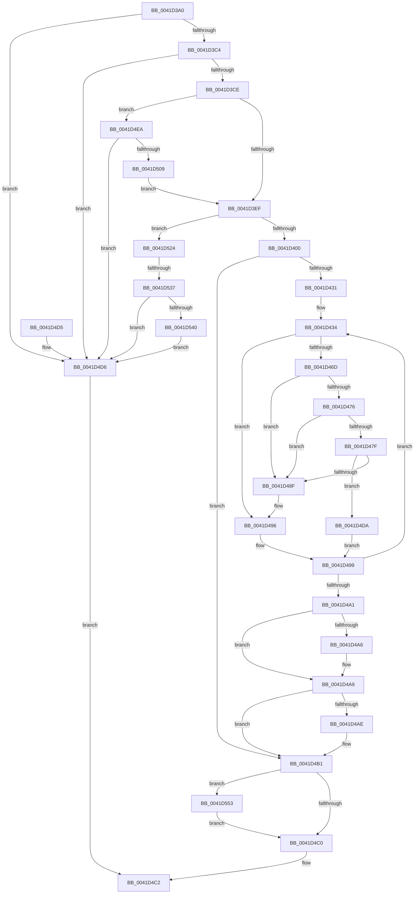

# RtlExpandHashTable

- RVA: `0x0041D3A0`–`0x0041D565` (길이 `453` bytes)
- VA: `0x000000014041D3A0`
- 실행 섹션: `.text`
- PDB 이름 있음: `예`; PDB Function 태그: `예`
- unwind 정보 RVA: `0x0009EEC4`
- 디코드: `133`개 명령, `453/453` bytes 표시
- 미해석 바이트: `0` (있으면 어셈블리에 `.byte`로 보존)

> 이 문서는 커널 이미지의 기계어와 PDB 기호를 분석해 생성했습니다. 4번과 5번은 함수 원형과 자료형을 바이너리 사용 방식에서 추정한 C 해석이며 원본 소스 복구 결과는 아닙니다.

## 1. Dependencies

- 직접 호출 지점: **5**; 고유 호출 대상: **5**
- 직접 호출자로 확인된 함수: **0**
- RIP 상대 이미지 참조: **0**

### Outgoing calls
- `0x0041D409` → [RtlpGetChainHead](RtlpGetChainHead_function_0041D5D0.md) (function, `0x0041D5D0`)
- `0x0041D4FC` → [ExAllocatePool2](../../poolcode/B8/ExAllocatePool2_function_00B820F0.md) (function, `0x00B820F0`)
- `0x0041D513` → [memset](../6C/memset_function_006C6C40.md) (function, `0x006C6C40`)
- `0x0041D526` → [RtlpAllocateSecondLevelDir](../48/RtlpAllocateSecondLevelDir_function_0048C520.md) (function, `0x0048C520`)
- `0x0041D54C` → [ExFreePoolWithTag](../../poolcode/B8/ExFreePoolWithTag_function_00B82870.md) (function, `0x00B82870`)

### Direct callers
- 이 함수 시작 RVA로 연결되는 직접 call은 확인되지 않았습니다. 간접 호출은 완전히 역산할 수 없습니다.

### Static image references
- 디코드된 RIP-relative 메모리 참조가 없습니다.

## 2. Other-region calls and transfers

- 다른 실행 섹션으로 향하는 call: **2**
  - `0x0041D4FC` → [ExAllocatePool2](../../poolcode/B8/ExAllocatePool2_function_00B820F0.md) (`.text` → `POOLCODE`)
  - `0x0041D54C` → [ExFreePoolWithTag](../../poolcode/B8/ExFreePoolWithTag_function_00B82870.md) (`.text` → `POOLCODE`)
- call이 아닌 외부 분기/꼬리 이동: **1**
  - `0x0041D531` → [sub_006ED794](../6E/Unknown_function_006ED794.md) (`tail-transfer`)

## 3. Assembly (complete function range)

```asm
0041D3A0  48 89 5C 24 10                  mov qword ptr [rsp + 0x10], rbx
0041D3A5  48 89 6C 24 18                  mov qword ptr [rsp + 0x18], rbp
0041D3AA  56                              push rsi
0041D3AB  57                              push rdi
0041D3AC  41 56                           push r14
0041D3AE  48 83 EC 20                     sub rsp, 0x20
0041D3B2  8B 51 08                        mov edx, dword ptr [rcx + 8]
0041D3B5  48 8B D9                        mov rbx, rcx
0041D3B8  81 FA 80 FF 7F 00               cmp edx, 0x7fff80
0041D3BE  0F 84 12 01 00 00               je 0x14041d4d6
0041D3C4  83 79 1C 00                     cmp dword ptr [rcx + 0x1c], 0
0041D3C8  0F 87 08 01 00 00               ja 0x14041d4d6
0041D3CE  8D 82 80 00 00 00               lea eax, [rdx + 0x80]
0041D3D4  BE 01 00 00 00                  mov esi, 1
0041D3D9  0F BD C8                        bsr ecx, eax
0041D3DC  D3 E6                           shl esi, cl
0041D3DE  33 F0                           xor esi, eax
0041D3E0  8D 69 F9                        lea ebp, [rcx - 7]
0041D3E3  81 FA 80 00 00 00               cmp edx, 0x80
0041D3E9  0F 84 FB 00 00 00               je 0x14041d4ea
0041D3EF  48 8B 7B 20                     mov rdi, qword ptr [rbx + 0x20]
0041D3F3  4C 8B 14 EF                     mov r10, qword ptr [rdi + rbp*8]
0041D3F7  4D 85 D2                        test r10, r10
0041D3FA  0F 84 24 01 00 00               je 0x14041d524
0041D400  8B 53 0C                        mov edx, dword ptr [rbx + 0xc]
0041D403  48 8B CB                        mov rcx, rbx
0041D406  FF 43 08                        inc dword ptr [rbx + 8]
0041D409  E8 C2 01 00 00                  call 0x14041d5d0
0041D40E  FF 43 0C                        inc dword ptr [rbx + 0xc]
0041D411  4C 8B C8                        mov r9, rax
0041D414  44 8B C6                        mov r8d, esi
0041D417  49 C1 E0 04                     shl r8, 4
0041D41B  4D 03 C2                        add r8, r10
0041D41E  4D 89 40 08                     mov qword ptr [r8 + 8], r8
0041D422  4D 89 00                        mov qword ptr [r8], r8
0041D425  48 8B 10                        mov rdx, qword ptr [rax]
0041D428  48 3B D0                        cmp rdx, rax
0041D42B  0F 84 80 00 00 00               je 0x14041d4b1
0041D431  4C 8B D0                        mov r10, rax
0041D434  8B 4B 04                        mov ecx, dword ptr [rbx + 4]
0041D437  8B 42 10                        mov eax, dword ptr [rdx + 0x10]
0041D43A  D3 E8                           shr eax, cl
0041D43C  69 C8 6D 4E C6 41               imul ecx, eax, 0x41c64e6d
0041D442  69 C0 CD 0D 01 00               imul eax, eax, 0x10dcd
0041D448  81 C1 39 30 00 00               add ecx, 0x3039
0041D44E  FF C0                           inc eax
0041D450  C1 E9 10                        shr ecx, 0x10
0041D453  25 00 00 FF FF                  and eax, 0xffff0000
0041D458  0B C8                           or ecx, eax
0041D45A  8B 43 10                        mov eax, dword ptr [rbx + 0x10]
0041D45D  03 C0                           add eax, eax
0041D45F  83 C8 01                        or eax, 1
0041D462  23 C8                           and ecx, eax
0041D464  8B 43 08                        mov eax, dword ptr [rbx + 8]
0041D467  FF C8                           dec eax
0041D469  3B C8                           cmp ecx, eax
0041D46B  75 29                           jne 0x14041d496
0041D46D  48 8B 02                        mov rax, qword ptr [rdx]
0041D470  48 39 50 08                     cmp qword ptr [rax + 8], rdx
0041D474  75 19                           jne 0x14041d48f
0041D476  48 8B 4A 08                     mov rcx, qword ptr [rdx + 8]
0041D47A  48 39 11                        cmp qword ptr [rcx], rdx
0041D47D  75 10                           jne 0x14041d48f
0041D47F  48 89 01                        mov qword ptr [rcx], rax
0041D482  48 89 48 08                     mov qword ptr [rax + 8], rcx
0041D486  49 8B 40 08                     mov rax, qword ptr [r8 + 8]
0041D48A  4C 39 00                        cmp qword ptr [rax], r8
0041D48D  74 4B                           je 0x14041d4da
0041D48F  B9 03 00 00 00                  mov ecx, 3
0041D494  CD 29                           int 0x29
0041D496  4C 8B D2                        mov r10, rdx
0041D499  49 8B 12                        mov rdx, qword ptr [r10]
0041D49C  49 3B D1                        cmp rdx, r9
0041D49F  75 93                           jne 0x14041d434
0041D4A1  4D 39 00                        cmp qword ptr [r8], r8
0041D4A4  74 03                           je 0x14041d4a9
0041D4A6  FF 43 18                        inc dword ptr [rbx + 0x18]
0041D4A9  4D 39 09                        cmp qword ptr [r9], r9
0041D4AC  75 03                           jne 0x14041d4b1
0041D4AE  FF 4B 18                        dec dword ptr [rbx + 0x18]
0041D4B1  8B 53 10                        mov edx, dword ptr [rbx + 0x10]
0041D4B4  8D 4A 01                        lea ecx, [rdx + 1]
0041D4B7  39 4B 0C                        cmp dword ptr [rbx + 0xc], ecx
0041D4BA  0F 84 93 00 00 00               je 0x14041d553
0041D4C0  B0 01                           mov al, 1
0041D4C2  48 8B 5C 24 48                  mov rbx, qword ptr [rsp + 0x48]
0041D4C7  48 8B 6C 24 50                  mov rbp, qword ptr [rsp + 0x50]
0041D4CC  48 83 C4 20                     add rsp, 0x20
0041D4D0  41 5E                           pop r14
0041D4D2  5F                              pop rdi
0041D4D3  5E                              pop rsi
0041D4D4  C3                              ret
0041D4D5  CC                              int3
0041D4D6  32 C0                           xor al, al
0041D4D8  EB E8                           jmp 0x14041d4c2
0041D4DA  4C 89 02                        mov qword ptr [rdx], r8
0041D4DD  48 89 42 08                     mov qword ptr [rdx + 8], rax
0041D4E1  48 89 10                        mov qword ptr [rax], rdx
0041D4E4  49 89 50 08                     mov qword ptr [r8 + 8], rdx
0041D4E8  EB AF                           jmp 0x14041d499
0041D4EA  4C 8B 73 20                     mov r14, qword ptr [rbx + 0x20]
0041D4EE  BA 80 00 00 00                  mov edx, 0x80
0041D4F3  41 B8 48 54 61 62               mov r8d, 0x62615448
0041D4F9  8D 4A C0                        lea ecx, [rdx - 0x40]
0041D4FC  E8 EF 4B 76 00                  call 0x140b820f0
0041D501  48 8B F8                        mov rdi, rax
0041D504  48 85 C0                        test rax, rax
0041D507  74 CD                           je 0x14041d4d6
0041D509  33 D2                           xor edx, edx
0041D50B  48 8D 48 08                     lea rcx, [rax + 8]
0041D50F  44 8D 42 78                     lea r8d, [rdx + 0x78]
0041D513  E8 28 97 2A 00                  call 0x1406c6c40
0041D518  4C 89 37                        mov qword ptr [rdi], r14
0041D51B  48 89 7B 20                     mov qword ptr [rbx + 0x20], rdi
0041D51F  E9 CB FE FF FF                  jmp 0x14041d3ef
0041D524  8B CD                           mov ecx, ebp
0041D526  E8 F5 EF 06 00                  call 0x14048c520
0041D52B  4C 8B D0                        mov r10, rax
0041D52E  48 85 C0                        test rax, rax
0041D531  0F 85 5D 02 2D 00               jne 0x1406ed794
0041D537  81 7B 08 80 00 00 00            cmp dword ptr [rbx + 8], 0x80
0041D53E  75 96                           jne 0x14041d4d6
0041D540  48 8B 07                        mov rax, qword ptr [rdi]
0041D543  33 D2                           xor edx, edx
0041D545  48 8B CF                        mov rcx, rdi
0041D548  48 89 43 20                     mov qword ptr [rbx + 0x20], rax
0041D54C  E8 1F 53 76 00                  call 0x140b82870
0041D551  EB 83                           jmp 0x14041d4d6
0041D553  8D 0C 12                        lea ecx, [rdx + rdx]
0041D556  83 C9 01                        or ecx, 1
0041D559  83 63 0C 00                     and dword ptr [rbx + 0xc], 0
0041D55D  89 4B 10                        mov dword ptr [rbx + 0x10], ecx
0041D560  E9 5B FF FF FF                  jmp 0x14041d4c0
```

## 4. C-style interpretation (structured pseudocode)

```c
__int64 __fastcall RtlExpandHashTable(__int64 a1)
{
    __int64 result;
    __int64 v_rsi;
    __int64 v_rsp;
    unsigned __int64 v_stack_p10;
    unsigned __int64 v_stack_p18;

    v_stack_p10 = v_rbx;
    v_stack_p18 = v_rbp;
    v_rsp = (v_rsp) - (32);
    if (((unsigned int)((unsigned int)(*(unsigned int *)(a1 + 8)))) == 0x7FFF80ULL) goto loc_0041D4D6;
    if ((*(unsigned int *)(a1 + 28)) > 0) goto loc_0041D4D6;
    v_rsi = (unsigned int)((1) << ((unsigned __int8)(a1)));
    v_rsi = (unsigned int)((v_rsi) ^ ((unsigned int)((unsigned int)(*(unsigned int *)(a1 + 8)) + 128)));
    if (((unsigned int)((unsigned int)(*(unsigned int *)(a1 + 8)))) == 128) goto loc_0041D4EA;
loc_0041D3EF:
    if (*(unsigned __int64 *)(*(unsigned __int64 *)(a1 + 32) + a1 - 7 * 8) == 0) goto loc_0041D524;
    result = RtlpGetChainHead(a1, (unsigned int)(*(unsigned int *)(a1 + 12)), a3, a4);
    a3 = ((unsigned int)((unsigned int)(v_rsi))) << (4);
    a3 = (a3) + (*(unsigned __int64 *)(*(unsigned __int64 *)(a1 + 32) + a1 - 7 * 8));
    *(unsigned __int64 *)(a3 + 8) = a3;
    *(unsigned __int64 *)(a3) = a3;
    if ((*(unsigned __int64 *)(result)) == result) goto loc_0041D4B1;
loc_0041D434:
    result = (unsigned int)(((unsigned int)(*(unsigned int *)(*(unsigned __int64 *)(result) + 16))) >> ((unsigned __int8)((unsigned int)(*(unsigned int *)(a1 + 4)))));
    a1 = (unsigned int)(((unsigned int)(*(unsigned int *)(a1 + 4))) * ((unsigned int)(result)));
    result = (unsigned int)((result) * ((unsigned int)(result)));
    a1 = (unsigned int)((a1) + (0x3039ULL));
    result = (unsigned int)((result) + 1);
    a1 = (unsigned int)((a1) >> (16));
    result = (unsigned int)((result) & (0xFFFF0000ULL));
    a1 = (unsigned int)((a1) | ((unsigned int)(result)));
    result = (unsigned int)(((unsigned int)(*(unsigned int *)(a1 + 16))) + ((unsigned int)((unsigned int)(*(unsigned int *)(a1 + 16)))));
    result = (unsigned int)((result) | (1));
    a1 = (unsigned int)((a1) & ((unsigned int)(result)));
    result = (unsigned int)(((unsigned int)(*(unsigned int *)(a1 + 8))) - 1);
    if (((unsigned int)(a1)) != ((unsigned int)(result))) goto loc_0041D496;
    if ((*(unsigned __int64 *)(*(unsigned __int64 *)(*(unsigned __int64 *)(result)) + 8)) != (*(unsigned __int64 *)(result))) goto loc_0041D48F;
    if ((*(unsigned __int64 *)(*(unsigned __int64 *)(*(unsigned __int64 *)(result) + 8))) != (*(unsigned __int64 *)(result))) goto loc_0041D48F;
    *(unsigned __int64 *)(*(unsigned __int64 *)(*(unsigned __int64 *)(result) + 8)) = *(unsigned __int64 *)(*(unsigned __int64 *)(result));
    *(unsigned __int64 *)(*(unsigned __int64 *)(*(unsigned __int64 *)(result)) + 8) = *(unsigned __int64 *)(*(unsigned __int64 *)(result) + 8);
    if ((*(unsigned __int64 *)(*(unsigned __int64 *)(a3 + 8))) == a3) goto loc_0041D4DA;
loc_0041D48F:
loc_0041D496:
loc_0041D499:
    if ((*(unsigned __int64 *)(*(unsigned __int64 *)(result))) != result) goto loc_0041D434;
    if ((*(unsigned __int64 *)(a3)) != a3) {
    }
    if ((*(unsigned __int64 *)(result)) == result) {
    }
    if ((*(unsigned int *)(a1 + 12)) == ((unsigned int)((unsigned int)(*(unsigned int *)(a1 + 16)) + 1))) goto loc_0041D553;
loc_0041D4C0:
loc_0041D4C2:
    v_rsp = (v_rsp) + (32);
    return 1;
loc_0041D4D6:
    result = 0;
    goto loc_0041D4C2;
loc_0041D4DA:
    *(unsigned __int64 *)((unsigned int)(*(unsigned int *)(a1 + 16))) = a3;
    *(unsigned __int64 *)((unsigned int)(*(unsigned int *)(a1 + 16)) + 8) = 0;
    *(unsigned __int64 *)(result) = (unsigned int)(*(unsigned int *)(a1 + 16));
    *(unsigned __int64 *)(a3 + 8) = (unsigned int)(*(unsigned int *)(a1 + 16));
    goto loc_0041D499;
loc_0041D4EA:
    result = ExAllocatePool2(128 - 64, 128, (unsigned int)(0x62615448ULL), result);
    if (result == 0) goto loc_0041D4D6;
    a2 = 0;
    result = memset(result + 8, a2, a2 + 120, result);
    *(unsigned __int64 *)(result) = *(unsigned __int64 *)(v_stack_p10 + 32);
    *(unsigned __int64 *)(v_stack_p10 + 32) = result;
    goto loc_0041D3EF;
loc_0041D524:
    result = RtlpAllocateSecondLevelDir((unsigned int)((unsigned int)(v_stack_p18)), a2, a2 + 120, result);
    if ((*(unsigned int *)(v_stack_p10 + 8)) != 128) goto loc_0041D4D6;
    a2 = 0;
    *(unsigned __int64 *)(v_stack_p10 + 32) = *(unsigned __int64 *)(result);
    result = ExFreePoolWithTag(result, a2, a2 + 120, result);
    goto loc_0041D4D6;
loc_0041D553:
    a1 = (unsigned int)((a2 + a2 * 1) | (1));
    *(unsigned int *)(v_stack_p10 + 16) = (unsigned int)(a1);
    goto loc_0041D4C0;
}
```

## 5. (Beta) C Style

```c
int64_t RtlExpandHashTable(void *Arg1)
{
    uint8_t *arg1 = (uint8_t *)Arg1;

    int64_t result;
    int64_t local_rsi;
    int64_t local_rsp;
    uint64_t v_stack_p10;
    uint64_t v_stack_p18;

    v_stack_p10 = local_rbx;
    v_stack_p18 = local_rbp;
    local_rsp = (local_rsp) - (32);
    if (((uint32_t)((uint32_t)(*(uint32_t *)(arg1 + 0x8)))) == 0x7FFF80ULL) goto loc_0041D4D6;
    if ((*(uint32_t *)(arg1 + 0x1C)) > 0) goto loc_0041D4D6;
    local_rsi = (uint32_t)((1) << ((uint8_t)(Arg1)));
    local_rsi = (uint32_t)((local_rsi) ^ ((uint32_t)((uint32_t)(*(uint32_t *)(arg1 + 0x8)) + 128)));
    if (((uint32_t)((uint32_t)(*(uint32_t *)(arg1 + 0x8)))) == 128) goto loc_0041D4EA;
loc_0041D3EF:
    if (*(uint64_t *)(*(uint64_t *)(arg1 + 0x20) + arg1 - 0x7 * 8) == 0) goto loc_0041D524;
    result = RtlpGetChainHead(Arg1, (uint32_t)(*(uint32_t *)(arg1 + 0xC)), a3, a4);
    a3 = ((uint32_t)((uint32_t)(local_rsi))) << (4);
    a3 = (a3) + (*(uint64_t *)(*(uint64_t *)(arg1 + 0x20) + arg1 - 0x7 * 8));
    *(uint64_t *)(a3 + 0x8) = a3;
    *(uint64_t *)(a3) = a3;
    if ((*(uint64_t *)(result)) == result) goto loc_0041D4B1;
loc_0041D434:
    result = (uint32_t)(((uint32_t)(*(uint32_t *)(*(uint64_t *)(result) + 0x10))) >> ((uint8_t)((uint32_t)(*(uint32_t *)(arg1 + 0x4)))));
    Arg1 = (uint32_t)(((uint32_t)(*(uint32_t *)(arg1 + 0x4))) * ((uint32_t)(result)));
    result = (uint32_t)((result) * ((uint32_t)(result)));
    Arg1 = (uint32_t)((Arg1) + (0x3039ULL));
    result = (uint32_t)((result) + 1);
    Arg1 = (uint32_t)((Arg1) >> (16));
    result = (uint32_t)((result) & (0xFFFF0000ULL));
    Arg1 = (uint32_t)((Arg1) | ((uint32_t)(result)));
    result = (uint32_t)(((uint32_t)(*(uint32_t *)(arg1 + 0x10))) + ((uint32_t)((uint32_t)(*(uint32_t *)(arg1 + 0x10)))));
    result = (uint32_t)((result) | (1));
    Arg1 = (uint32_t)((Arg1) & ((uint32_t)(result)));
    result = (uint32_t)(((uint32_t)(*(uint32_t *)(arg1 + 0x8))) - 1);
    if (((uint32_t)(Arg1)) != ((uint32_t)(result))) goto loc_0041D496;
    if ((*(uint64_t *)(*(uint64_t *)(*(uint64_t *)(result)) + 0x8)) != (*(uint64_t *)(result))) goto loc_0041D48F;
    if ((*(uint64_t *)(*(uint64_t *)(*(uint64_t *)(result) + 0x8))) != (*(uint64_t *)(result))) goto loc_0041D48F;
    *(uint64_t *)(*(uint64_t *)(*(uint64_t *)(result) + 0x8)) = *(uint64_t *)(*(uint64_t *)(result));
    *(uint64_t *)(*(uint64_t *)(*(uint64_t *)(result)) + 0x8) = *(uint64_t *)(*(uint64_t *)(result) + 0x8);
    if ((*(uint64_t *)(*(uint64_t *)(a3 + 0x8))) == a3) goto loc_0041D4DA;
loc_0041D48F:
loc_0041D496:
loc_0041D499:
    if ((*(uint64_t *)(*(uint64_t *)(result))) != result) goto loc_0041D434;
    if ((*(uint64_t *)(a3)) != a3) {
    }
    if ((*(uint64_t *)(result)) == result) {
    }
    if ((*(uint32_t *)(arg1 + 0xC)) == ((uint32_t)((uint32_t)(*(uint32_t *)(arg1 + 0x10)) + 1))) goto loc_0041D553;
loc_0041D4C0:
loc_0041D4C2:
    local_rsp = (local_rsp) + (32);
    return 1;
loc_0041D4D6:
    result = 0;
    goto loc_0041D4C2;
loc_0041D4DA:
    *(uint64_t *)((uint32_t)(*(uint32_t *)(arg1 + 0x10))) = a3;
    *(uint64_t *)((uint32_t)(*(uint32_t *)(arg1 + 0x10)) + 0x8) = 0;
    *(uint64_t *)(result) = (uint32_t)(*(uint32_t *)(arg1 + 0x10));
    *(uint64_t *)(a3 + 0x8) = (uint32_t)(*(uint32_t *)(arg1 + 0x10));
    goto loc_0041D499;
loc_0041D4EA:
    result = ExAllocatePool2(128 - 64, 128, (uint32_t)(0x62615448ULL), result);
    if (result == 0) goto loc_0041D4D6;
    a2 = 0;
    result = memset(result + 8, a2, a2 + 120, result);
    *(uint64_t *)(result) = *(uint64_t *)(v_stack_p10 + 0x20);
    *(uint64_t *)(v_stack_p10 + 0x20) = result;
    goto loc_0041D3EF;
loc_0041D524:
    result = RtlpAllocateSecondLevelDir((uint32_t)((uint32_t)(v_stack_p18)), a2, a2 + 120, result);
    if ((*(uint32_t *)(v_stack_p10 + 0x8)) != 128) goto loc_0041D4D6;
    a2 = 0;
    *(uint64_t *)(v_stack_p10 + 0x20) = *(uint64_t *)(result);
    result = ExFreePoolWithTag(result, a2, a2 + 120, result);
    goto loc_0041D4D6;
loc_0041D553:
    Arg1 = (uint32_t)((a2 + a2 * 1) | (1));
    *(uint32_t *)(v_stack_p10 + 0x10) = (uint32_t)(Arg1);
    goto loc_0041D4C0;
}
```

### 관측된 메모리 오프셋

구조체 형식이 확인되지 않은 접근은 인자 기준의 오프셋으로만 기록했습니다.

| 기준 인자 | 오프셋 표현 | 폭 (bit) | 접근 |
|---|---:|---:|---|
| `Arg1` | `+ 0x4` | `32` | `R` |
| `Arg1` | `+ 0x8` | `32` | `R` |
| `Arg1` | `+ 0x8` | `32` | `R/W` |
| `Arg1` | `+ 0xC` | `32` | `R` |
| `Arg1` | `+ 0xC` | `32` | `R/W` |
| `Arg1` | `+ 0x10` | `32` | `R` |
| `Arg1` | `+ 0x10` | `32` | `W` |
| `Arg1` | `+ 0x18` | `32` | `R/W` |
| `Arg1` | `+ 0x1C` | `32` | `R` |
| `Arg1` | `+ 0x20` | `64` | `R` |
| `Arg1` | `+ 0x20` | `64` | `W` |

## 6. Execution-region graph

[열기: 2D/3D 그래프와 함수 탐색 컨트롤 패널](../../../control-panel.html?section=text&rva=0x0041D3A0&view=graph)

- 2D 그래프는 위에서 아래로 흐르고, 3D 그래프는 빈 공간을 드래그해 회전합니다. Shift+드래그는 이동, 휠은 확대·축소, 함수 노드 선택은 대상 보고서 이동입니다.

### Static fallback


