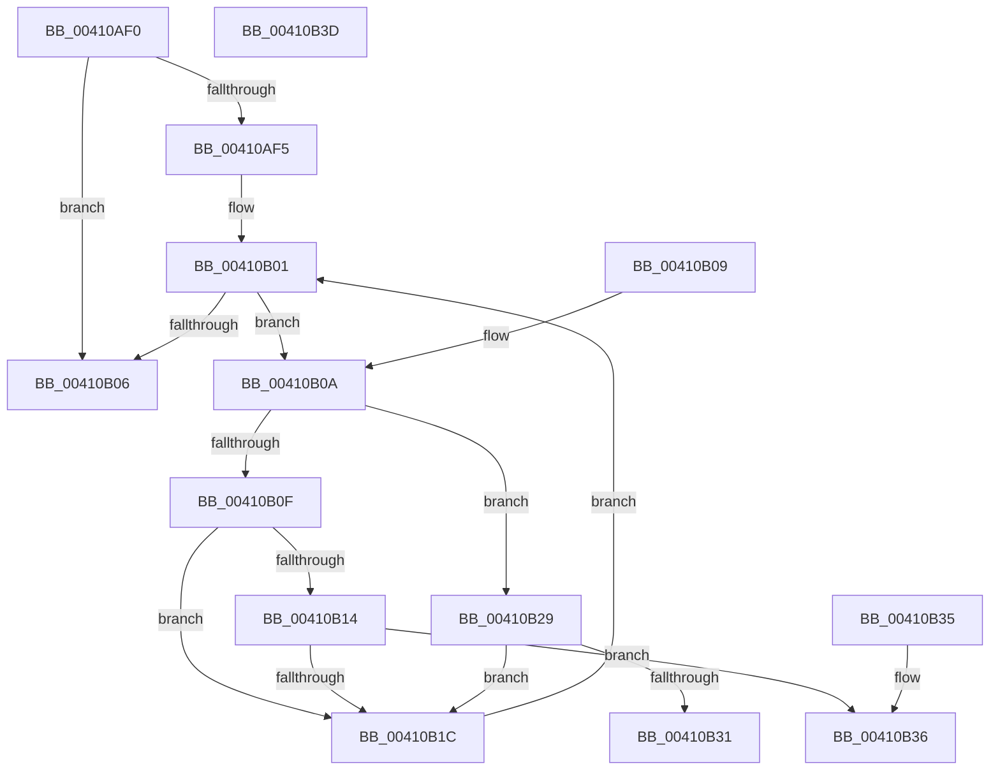

# RtlFindAceByType

- RVA: `0x00410AF0`–`0x00410B3E` (길이 `78` bytes)
- VA: `0x0000000140410AF0`
- 실행 섹션: `.text`
- PDB 이름 있음: `예`; PDB Function 태그: `아니요`
- unwind 정보 RVA: `0x000DB714`
- 디코드: `31`개 명령, `78/78` bytes 표시
- 미해석 바이트: `0` (있으면 어셈블리에 `.byte`로 보존)

> 이 문서는 커널 이미지의 기계어와 PDB 기호를 분석해 생성했습니다. 4번과 5번은 함수 원형과 자료형을 바이너리 사용 방식에서 추정한 C 해석이며 원본 소스 복구 결과는 아닙니다.

## 1. Dependencies

- 직접 호출 지점: **0**; 고유 호출 대상: **0**
- 직접 호출자로 확인된 함수: **10**
- RIP 상대 이미지 참조: **0**

### Outgoing calls
- 직접 디코드된 call 명령이 없습니다.

### Direct callers
- [SepMandatorySubProcessToken](../4C/SepMandatorySubProcessToken_function_004C0B88.md) at `0x004C0CF4`
- [AdtpBuildContextFromSecurityDescriptor](../69/AdtpBuildContextFromSecurityDescriptor_function_0069D99C.md) at `0x0069D9E7`
- [sub_006EEA5C](../6E/Unknown_function_006EEA5C.md) at `0x006EEA8C`
- [SepSDContainsAttributeACE](../../page/7A/SepSDContainsAttributeACE_function_007A3794.md) at `0x007A37D0`
- [sub_008BBC01](../../page/8B/Unknown_function_008BBC01.md) at `0x008BBCBA`
- [sub_008BBC01](../../page/8B/Unknown_function_008BBC01.md) at `0x008BBDFA`
- [sub_008BBC01](../../page/8B/Unknown_function_008BBC01.md) at `0x008BBE40`
- [RtlpValidFilterAclSubjectContext](../../page/8B/RtlpValidFilterAclSubjectContext_function_008BCE60.md) at `0x008BCEA1`
- [SeQueryMandatoryLabel](../../page/8C/SeQueryMandatoryLabel_function_008C8D38.md) at `0x008C8D7E`
- [RtlpNewSecurityObject](../../page/92/RtlpNewSecurityObject_function_0092AB50.md) at `0x0092B21D`
- [RtlpNewSecurityObject](../../page/92/RtlpNewSecurityObject_function_0092AB50.md) at `0x0092B296`
- [RtlpNewSecurityObject](../../page/92/RtlpNewSecurityObject_function_0092AB50.md) at `0x0092B740`
- [RtlpNewSecurityObject](../../page/92/RtlpNewSecurityObject_function_0092AB50.md) at `0x0092BB5B`
- [RtlpNewSecurityObject](../../page/92/RtlpNewSecurityObject_function_0092AB50.md) at `0x0092C860`
- [RtlpInheritAcl2](../../page/92/RtlpInheritAcl2_function_0092D4D0.md) at `0x0092DA7B`
- [sub_0092E268](../../page/92/Unknown_function_0092E268.md) at `0x0092E382`

### Static image references
- 디코드된 RIP-relative 메모리 참조가 없습니다.

## 2. Other-region calls and transfers

- 다른 실행 섹션으로 향하는 call: **0**
- 별도 외부 분기/꼬리 이동을 확인하지 못했습니다.

## 3. Assembly (complete function range)

```asm
00410AF0  48 85 C9                        test rcx, rcx
00410AF3  74 11                           je 0x140410b06
00410AF5  44 0F B7 51 04                  movzx r10d, word ptr [rcx + 4]
00410AFA  4C 8D 59 08                     lea r11, [rcx + 8]
00410AFE  45 33 C9                        xor r9d, r9d
00410B01  45 3B CA                        cmp r9d, r10d
00410B04  72 04                           jb 0x140410b0a
00410B06  33 C0                           xor eax, eax
00410B08  C3                              ret
00410B09  CC                              int3
00410B0A  4D 85 C0                        test r8, r8
00410B0D  74 1A                           je 0x140410b29
00410B0F  45 3B 08                        cmp r9d, dword ptr [r8]
00410B12  72 08                           jb 0x140410b1c
00410B14  41 0F B6 03                     movzx eax, byte ptr [r11]
00410B18  3B C2                           cmp eax, edx
00410B1A  74 1A                           je 0x140410b36
00410B1C  41 0F B7 43 02                  movzx eax, word ptr [r11 + 2]
00410B21  41 FF C1                        inc r9d
00410B24  4C 03 D8                        add r11, rax
00410B27  EB D8                           jmp 0x140410b01
00410B29  41 0F B6 03                     movzx eax, byte ptr [r11]
00410B2D  3B C2                           cmp eax, edx
00410B2F  75 EB                           jne 0x140410b1c
00410B31  49 8B C3                        mov rax, r11
00410B34  C3                              ret
00410B35  CC                              int3
00410B36  45 89 08                        mov dword ptr [r8], r9d
00410B39  49 8B C3                        mov rax, r11
00410B3C  C3                              ret
00410B3D  CC                              int3
```

## 4. C-style interpretation (structured pseudocode)

```c
__int64 __fastcall RtlFindAceByType(__int64 a1, int a2, __int64 a3, int a4)
{
    __int64 result;
    __int64 v_r11;

    if (a1 == 0) goto loc_00410B06;
    a4 = 0;
loc_00410B01:
    if (0 < ((unsigned int)(*(unsigned __int16 *)(a1 + 4)))) goto loc_00410B0A;
loc_00410B06:
    result = 0;
    return result;
loc_00410B0A:
    if (a3 == 0) goto loc_00410B29;
    if (0 < (*(unsigned int *)(a3))) goto loc_00410B1C;
    if (((unsigned int)(*(unsigned __int8 *)(a1 + 8))) == a2) goto loc_00410B36;
loc_00410B1C:
    a4 = (unsigned int)((a4) + 1);
    v_r11 = (a1 + 8) + (*(unsigned __int16 *)(a1 + 8 + 2));
    goto loc_00410B01;
loc_00410B29:
    if (((unsigned int)(*(unsigned __int8 *)(v_r11))) != a2) goto loc_00410B1C;
    return v_r11;
loc_00410B36:
    *(unsigned int *)(a3) = a4;
    return v_r11;
}
```

## 5. (Beta) C Style

```c
int64_t RtlFindAceByType(int64_t Arg1, int32_t Arg2, int64_t Arg3, int32_t Arg4)
{
    int64_t result;
    int64_t local_r11;

    if (Arg1 == 0) goto loc_00410B06;
    Arg4 = 0;
loc_00410B01:
    if (0 < ((uint32_t)(*(uint16_t *)(Arg1 + 0x4)))) goto loc_00410B0A;
loc_00410B06:
    result = 0;
    return result;
loc_00410B0A:
    if (Arg3 == 0) goto loc_00410B29;
    if (0 < (*(uint32_t *)(Arg3))) goto loc_00410B1C;
    if (((uint32_t)(*(uint8_t *)(Arg1 + 0x8))) == Arg2) goto loc_00410B36;
loc_00410B1C:
    Arg4 = (uint32_t)((Arg4) + 1);
    local_r11 = (Arg1 + 8) + (*(uint16_t *)(Arg1 + 0x8 + 0x2));
    goto loc_00410B01;
loc_00410B29:
    if (((uint32_t)(*(uint8_t *)(local_r11))) != Arg2) goto loc_00410B1C;
    return local_r11;
loc_00410B36:
    *(uint32_t *)(Arg3) = Arg4;
    return local_r11;
}
```

## 6. Execution-region graph

[열기: 2D/3D 그래프와 함수 탐색 컨트롤 패널](../../../control-panel.html?section=text&rva=0x00410AF0&view=graph)

- 2D 그래프는 위에서 아래로 흐르고, 3D 그래프는 빈 공간을 드래그해 회전합니다. Shift+드래그는 이동, 휠은 확대·축소, 함수 노드 선택은 대상 보고서 이동입니다.

### Static fallback


