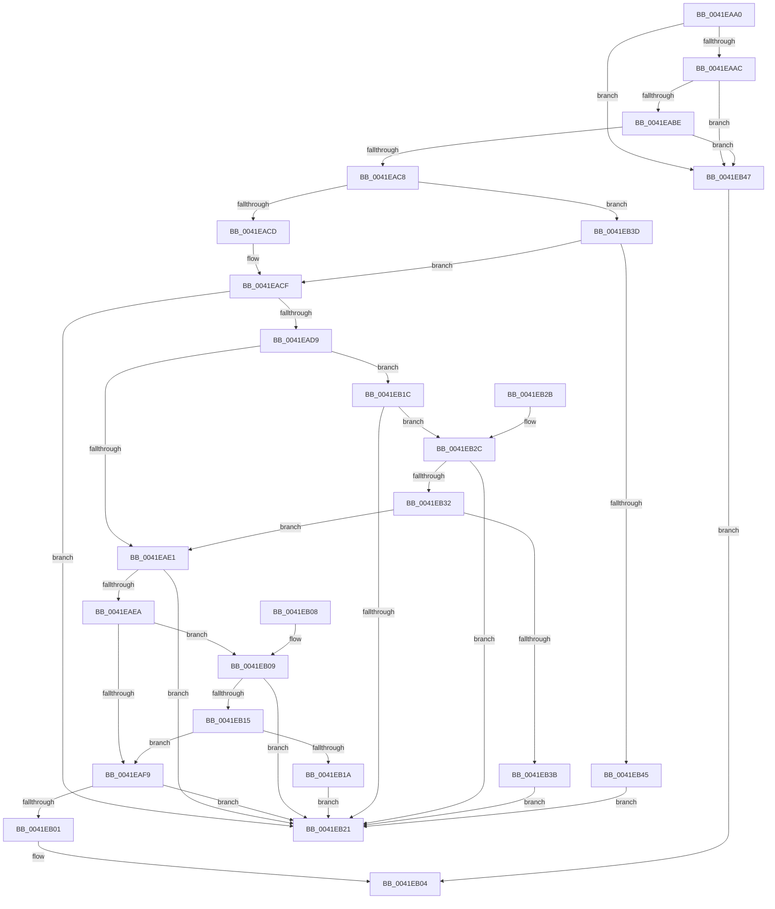

# RtlImageNtHeaderEx

- RVA: `0x0041EAA0`–`0x0041EB4F` (길이 `175` bytes)
- VA: `0x000000014041EAA0`
- 실행 섹션: `.text`
- PDB 이름 있음: `예`; PDB Function 태그: `아니요`
- unwind 정보 RVA: `0x000DB714`
- 디코드: `55`개 명령, `175/175` bytes 표시
- 미해석 바이트: `0` (있으면 어셈블리에 `.byte`로 보존)

> 이 문서는 커널 이미지의 기계어와 PDB 기호를 분석해 생성했습니다. 4번과 5번은 함수 원형과 자료형을 바이너리 사용 방식에서 추정한 C 해석이며 원본 소스 복구 결과는 아닙니다.

## 1. Dependencies

- 직접 호출 지점: **0**; 고유 호출 대상: **0**
- 직접 호출자로 확인된 함수: **35**
- RIP 상대 이미지 참조: **0**

### Outgoing calls
- 직접 디코드된 call 명령이 없습니다.

### Direct callers
- [PnpTraceStartDevice](../26/PnpTraceStartDevice_function_0026E3F8.md) at `0x0026E45E`
- [LdrpGetAlternateResourceModuleHandleEx](../45/LdrpGetAlternateResourceModuleHandleEx_function_00455334.md) at `0x00455465`
- [LdrpGetMappingFromCacheEntry](../45/LdrpGetMappingFromCacheEntry_function_00455DE0.md) at `0x00455E86`
- [IopLoadCrashdumpDriver](../4E/IopLoadCrashdumpDriver_function_004E2F70.md) at `0x004E3007`
- [IoGetDumpHiberRanges](../59/IoGetDumpHiberRanges_function_005928AC.md) at `0x0059299D`
- [IopAddCodeRegion](../59/IopAddCodeRegion_function_005941B4.md) at `0x00594275`
- [KiDumpParameterImages](../5B/KiDumpParameterImages_function_005B4CE0.md) at `0x005B4DA4`
- [KiDumpParameterImages](../5B/KiDumpParameterImages_function_005B4CE0.md) at `0x005B4E9F`
- [KiShadowKernelSectionByAddress](../5C/KiShadowKernelSectionByAddress_function_005C5040.md) at `0x005C5066`
- [KiUnshadowKernelSectionByAddress](../5C/KiUnshadowKernelSectionByAddress_function_005C50B4.md) at `0x005C50DA`
- [LdrpMapResourceFile](../5E/LdrpMapResourceFile_function_005E5CBC.md) at `0x005E5D45`
- [LdrpMapResourceFile](../5E/LdrpMapResourceFile_function_005E5CBC.md) at `0x005E5E8E`
- [RtlpCaptureDynamicRelocationTableRva](../5E/RtlpCaptureDynamicRelocationTableRva_function_005EC760.md) at `0x005EC7C9`
- [PrExtExtractDataRecordTable](../66/PrExtExtractDataRecordTable_function_00666C4C.md) at `0x00666C88`
- [RtlApplyFunctionOverrideFixupsToImage](../../page/79/RtlApplyFunctionOverrideFixupsToImage_function_007954E0.md) at `0x0079551A`
- [MiCaptureBootDriverRetpolineInfo](../../page/80/MiCaptureBootDriverRetpolineInfo_function_0080137C.md) at `0x008013C3`
- [RtlFindHotPatchInformation](../../page/84/RtlFindHotPatchInformation_function_00840F24.md) at `0x00840F61`
- [EtwpLocateDbgIdForRegEntry](../../page/8D/EtwpLocateDbgIdForRegEntry_function_008D99A4.md) at `0x008D9A34`
- [LdrCaptureDynamicRelocationTableHeader](../../page/94/LdrCaptureDynamicRelocationTableHeader_function_009421E4.md) at `0x00942317`
- [LdrpResGetMappingSize](../../page/99/LdrpResGetMappingSize_function_00991614.md) at `0x009916A3`
- [LdrpResGetResourceDirectory](../../page/9F/LdrpResGetResourceDirectory_function_009F3004.md) at `0x009F308E`
- [LdrInitSecurityCookie](../../page/A7/LdrInitSecurityCookie_function_00A7FD44.md) at `0x00A7FD6A`
- [MiOpenHotPatchFile](../../page/AB/MiOpenHotPatchFile_function_00AB5684.md) at `0x00AB5972`
- [VfDriverEnableVerifierForAll](../../pagevrfy/B9/VfDriverEnableVerifierForAll_function_00B9A3A4.md) at `0x00B9A3FB`
- [PspLocateNtdllAddressesForScpCfg](../../init/C4/PspLocateNtdllAddressesForScpCfg_function_00C46CB0.md) at `0x00C46D19`
- [MiProtectKernelCfgData](../../init/C5/MiProtectKernelCfgData_function_00C5F5E0.md) at `0x00C5F607`
- [MiApplyDynamicFixupsToKernelAndHal](../../init/C6/MiApplyDynamicFixupsToKernelAndHal_function_00C65EBC.md) at `0x00C65FA4`
- [MiApplyRetpolineToBootDriver](../../init/C6/MiApplyRetpolineToBootDriver_function_00C66264.md) at `0x00C662A5`
- [MiPrepareScpFixupsForNtAndHal](../../init/C6/MiPrepareScpFixupsForNtAndHal_function_00C66734.md) at `0x00C66778`
- [MiCheckLargePageOk](../../init/C6/MiCheckLargePageOk_function_00C667E4.md) at `0x00C66887`
- [MiVerifyLargeSectionLayout](../../init/C6/MiVerifyLargeSectionLayout_function_00C66F9C.md) at `0x00C66FE4`
- [MiInitializeKernelCfgImages](../../init/C6/MiInitializeKernelCfgImages_function_00C6A430.md) at `0x00C6A4A8`
- [MiFreeKernelPadSections](../../init/C6/MiFreeKernelPadSections_function_00C6B5CC.md) at `0x00C6B60D`
- [MiHandleBootImage](../../init/C6/MiHandleBootImage_function_00C6B854.md) at `0x00C6B8C0`
- [MiLocateKernelSections](../../init/C6/MiLocateKernelSections_function_00C6C2A0.md) at `0x00C6C2BF`
- [MiLockPagableSections](../../init/C6/MiLockPagableSections_function_00C6C35C.md) at `0x00C6C39B`
- [IopInitializeBuiltinDriver](../../init/C7/IopInitializeBuiltinDriver_function_00C7625C.md) at `0x00C7641D`

### Static image references
- 디코드된 RIP-relative 메모리 참조가 없습니다.

## 2. Other-region calls and transfers

- 다른 실행 섹션으로 향하는 call: **0**
- 별도 외부 분기/꼬리 이동을 확인하지 못했습니다.

## 3. Assembly (complete function range)

```asm
0041EAA0  4D 8B D8                        mov r11, r8
0041EAA3  4D 85 C9                        test r9, r9
0041EAA6  0F 84 9B 00 00 00               je 0x14041eb47
0041EAAC  45 33 D2                        xor r10d, r10d
0041EAAF  4D 89 11                        mov qword ptr [r9], r10
0041EAB2  F7 C1 FE FF FF FF               test ecx, 0xfffffffe
0041EAB8  0F 85 89 00 00 00               jne 0x14041eb47
0041EABE  48 8D 42 FF                     lea rax, [rdx - 1]
0041EAC2  48 83 F8 FD                     cmp rax, -3
0041EAC6  77 7F                           ja 0x14041eb47
0041EAC8  F6 C1 01                        test cl, 1
0041EACB  74 70                           je 0x14041eb3d
0041EACD  32 C0                           xor al, al
0041EACF  B9 4D 5A 00 00                  mov ecx, 0x5a4d
0041EAD4  66 39 0A                        cmp word ptr [rdx], cx
0041EAD7  75 48                           jne 0x14041eb21
0041EAD9  44 8B 42 3C                     mov r8d, dword ptr [rdx + 0x3c]
0041EADD  84 C0                           test al, al
0041EADF  75 3B                           jne 0x14041eb1c
0041EAE1  49 8D 04 10                     lea rax, [r8 + rdx]
0041EAE5  48 3B C2                        cmp rax, rdx
0041EAE8  72 37                           jb 0x14041eb21
0041EAEA  49 B8 FF FF FE FF FF 7F 00 00   movabs r8, 0x7ffffffeffff
0041EAF4  49 3B D0                        cmp rdx, r8
0041EAF7  76 10                           jbe 0x14041eb09
0041EAF9  81 38 50 45 00 00               cmp dword ptr [rax], 0x4550
0041EAFF  75 20                           jne 0x14041eb21
0041EB01  49 89 01                        mov qword ptr [r9], rax
0041EB04  41 8B C2                        mov eax, r10d
0041EB07  C3                              ret
0041EB08  CC                              int3
0041EB09  48 8D 88 07 01 00 00            lea rcx, [rax + 0x107]
0041EB10  48 3B C8                        cmp rcx, rax
0041EB13  72 0C                           jb 0x14041eb21
0041EB15  49 3B C8                        cmp rcx, r8
0041EB18  76 DF                           jbe 0x14041eaf9
0041EB1A  EB 05                           jmp 0x14041eb21
0041EB1C  4D 3B C3                        cmp r8, r11
0041EB1F  72 0B                           jb 0x14041eb2c
0041EB21  41 BA 7B 00 00 C0               mov r10d, 0xc000007b
0041EB27  41 8B C2                        mov eax, r10d
0041EB2A  C3                              ret
0041EB2B  CC                              int3
0041EB2C  41 83 F8 E7                     cmp r8d, -0x19
0041EB30  73 EF                           jae 0x14041eb21
0041EB32  49 8D 40 18                     lea rax, [r8 + 0x18]
0041EB36  49 3B C3                        cmp rax, r11
0041EB39  72 A6                           jb 0x14041eae1
0041EB3B  EB E4                           jmp 0x14041eb21
0041EB3D  B0 01                           mov al, 1
0041EB3F  49 83 FB 40                     cmp r11, 0x40
0041EB43  73 8A                           jae 0x14041eacf
0041EB45  EB DA                           jmp 0x14041eb21
0041EB47  41 BA 0D 00 00 C0               mov r10d, 0xc000000d
0041EB4D  EB B5                           jmp 0x14041eb04
```

## 4. C-style interpretation (structured pseudocode)

```c
__int64 __fastcall RtlImageNtHeaderEx(int a1, __int64 a2, __int64 a3, __int64 a4)
{
    __int64 result;
    __int64 v_r10;

    if (a4 == 0) goto loc_0041EB47;
    v_r10 = 0;
    *(unsigned __int64 *)(a4) = 0;
    if (((a1) & (0xFFFFFFFEULL)) != 0) goto loc_0041EB47;
    if ((a2 - 1) > -3) goto loc_0041EB47;
    if ((((unsigned __int8)(a1)) & (1)) == 0) goto loc_0041EB3D;
    result = 0;
loc_0041EACF:
    if ((*(unsigned __int16 *)(a2)) != ((unsigned __int16)((unsigned int)(0x5A4DULL)))) goto loc_0041EB21;
    if (0 != 0) goto loc_0041EB1C;
loc_0041EAE1:
    if (((unsigned int)(*(unsigned int *)(a2 + 60)) + a2 * 1) < a2) goto loc_0041EB21;
    if (a2 <= ((unsigned int)(*(unsigned int *)(a2 + 60)))) goto loc_0041EB09;
loc_0041EAF9:
    if ((*(unsigned int *)((unsigned int)(*(unsigned int *)(a2 + 60)) + a2 * 1)) != 0x4550ULL) goto loc_0041EB21;
    *(unsigned __int64 *)(a4) = (unsigned int)(*(unsigned int *)(a2 + 60)) + a2 * 1;
loc_0041EB04:
    return 0;
loc_0041EB09:
    if ((0 + 263) < 0) goto loc_0041EB21;
    if ((0 + 263) <= ((unsigned int)(*(unsigned int *)(a2 + 60)))) goto loc_0041EAF9;
    goto loc_0041EB21;
loc_0041EB1C:
    if (((unsigned int)(*(unsigned int *)(a2 + 60))) < a3) goto loc_0041EB2C;
loc_0041EB21:
    return (unsigned int)((unsigned int)((unsigned int)(0xC000007BULL)));
loc_0041EB2C:
    if (((unsigned int)((unsigned int)(*(unsigned int *)(a2 + 60)))) >= -25) goto loc_0041EB21;
    if (((unsigned int)(*(unsigned int *)(a2 + 60)) + 24) < a3) goto loc_0041EAE1;
    goto loc_0041EB21;
loc_0041EB3D:
    if (a3 >= 64) goto loc_0041EACF;
    goto loc_0041EB21;
loc_0041EB47:
    goto loc_0041EB04;
}
```

## 5. (Beta) C Style

```c
int64_t RtlImageNtHeaderEx(int32_t Arg1, void *Arg2, int64_t Arg3, int64_t Arg4)
{
    uint8_t *arg2 = (uint8_t *)Arg2;

    int64_t result;
    int64_t local_r10;

    if (Arg4 == 0) goto loc_0041EB47;
    local_r10 = 0;
    *(uint64_t *)(Arg4) = 0;
    if (((Arg1) & (0xFFFFFFFEULL)) != 0) goto loc_0041EB47;
    if ((Arg2 - 1) > -3) goto loc_0041EB47;
    if ((((uint8_t)(Arg1)) & (1)) == 0) goto loc_0041EB3D;
    result = 0;
loc_0041EACF:
    if ((*(uint16_t *)(arg2)) != ((uint16_t)((uint32_t)(0x5A4DULL)))) goto loc_0041EB21;
    if (0 != 0) goto loc_0041EB1C;
loc_0041EAE1:
    if (((uint32_t)(*(uint32_t *)(arg2 + 0x3C)) + Arg2 * 1) < Arg2) goto loc_0041EB21;
    if (Arg2 <= ((uint32_t)(*(uint32_t *)(arg2 + 0x3C)))) goto loc_0041EB09;
loc_0041EAF9:
    if ((*(uint32_t *)((uint32_t)(*(uint32_t *)(arg2 + 0x3C)) + arg2 * 1)) != 0x4550ULL) goto loc_0041EB21;
    *(uint64_t *)(Arg4) = (uint32_t)(*(uint32_t *)(arg2 + 0x3C)) + Arg2 * 1;
loc_0041EB04:
    return 0;
loc_0041EB09:
    if ((0 + 263) < 0) goto loc_0041EB21;
    if ((0 + 263) <= ((uint32_t)(*(uint32_t *)(arg2 + 0x3C)))) goto loc_0041EAF9;
    goto loc_0041EB21;
loc_0041EB1C:
    if (((uint32_t)(*(uint32_t *)(arg2 + 0x3C))) < Arg3) goto loc_0041EB2C;
loc_0041EB21:
    return (uint32_t)((uint32_t)((uint32_t)(0xC000007BULL)));
loc_0041EB2C:
    if (((uint32_t)((uint32_t)(*(uint32_t *)(arg2 + 0x3C)))) >= -25) goto loc_0041EB21;
    if (((uint32_t)(*(uint32_t *)(arg2 + 0x3C)) + 24) < Arg3) goto loc_0041EAE1;
    goto loc_0041EB21;
loc_0041EB3D:
    if (Arg3 >= 64) goto loc_0041EACF;
    goto loc_0041EB21;
loc_0041EB47:
    goto loc_0041EB04;
}
```

### 관측된 메모리 오프셋

구조체 형식이 확인되지 않은 접근은 인자 기준의 오프셋으로만 기록했습니다.

| 기준 인자 | 오프셋 표현 | 폭 (bit) | 접근 |
|---|---:|---:|---|
| `Arg2` | `- 0x1` | `64` | `R` |
| `Arg2` | `+ 0x0` | `16` | `R` |
| `Arg2` | `+ 0x3C` | `32` | `R` |

## 6. Execution-region graph

[열기: 2D/3D 그래프와 함수 탐색 컨트롤 패널](../../../control-panel.html?section=text&rva=0x0041EAA0&view=graph)

- 2D 그래프는 위에서 아래로 흐르고, 3D 그래프는 빈 공간을 드래그해 회전합니다. Shift+드래그는 이동, 휠은 확대·축소, 함수 노드 선택은 대상 보고서 이동입니다.

### Static fallback


