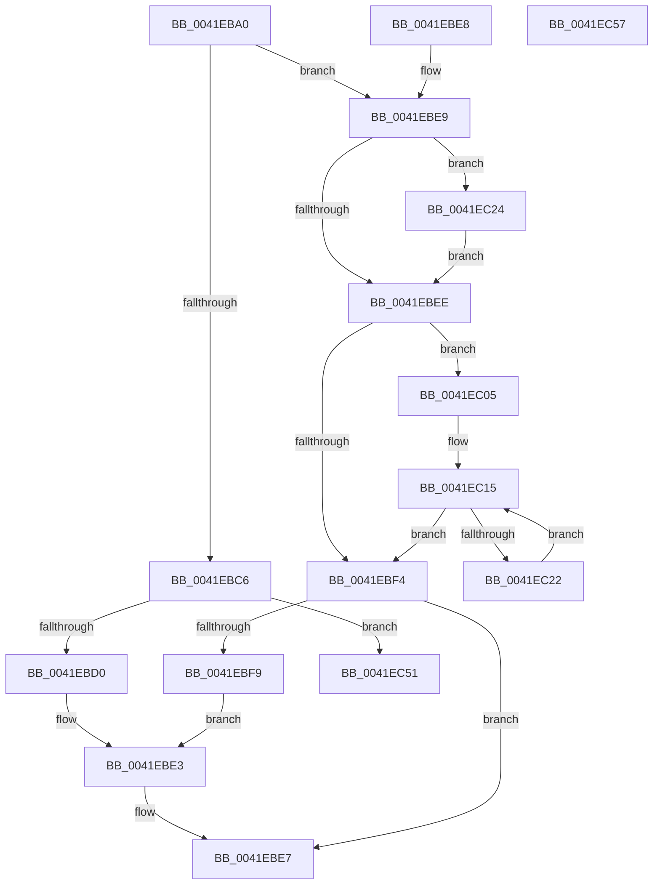

# RtlInterlockedClearBitRunEx

- RVA: `0x0041EBA0`–`0x0041EC58` (길이 `184` bytes)
- VA: `0x000000014041EBA0`
- 실행 섹션: `.text`
- PDB 이름 있음: `예`; PDB Function 태그: `아니요`
- unwind 정보 RVA: `0x000DB714`
- 디코드: `62`개 명령, `184/184` bytes 표시
- 미해석 바이트: `0` (있으면 어셈블리에 `.byte`로 보존)

> 이 문서는 커널 이미지의 기계어와 PDB 기호를 분석해 생성했습니다. 4번과 5번은 함수 원형과 자료형을 바이너리 사용 방식에서 추정한 C 해석이며 원본 소스 복구 결과는 아닙니다.

## 1. Dependencies

- 직접 호출 지점: **0**; 고유 호출 대상: **0**
- 직접 호출자로 확인된 함수: **0**
- RIP 상대 이미지 참조: **0**

### Outgoing calls
- 직접 디코드된 call 명령이 없습니다.

### Direct callers
- 이 함수 시작 RVA로 연결되는 직접 call은 확인되지 않았습니다. 간접 호출은 완전히 역산할 수 없습니다.

### Static image references
- 디코드된 RIP-relative 메모리 참조가 없습니다.

## 2. Other-region calls and transfers

- 다른 실행 섹션으로 향하는 call: **0**
- 별도 외부 분기/꼬리 이동을 확인하지 못했습니다.

## 3. Assembly (complete function range)

```asm
0041EBA0  48 8B 41 08                     mov rax, qword ptr [rcx + 8]
0041EBA4  4D 8B C8                        mov r9, r8
0041EBA7  4C 8B C2                        mov r8, rdx
0041EBAA  4C 8B DA                        mov r11, rdx
0041EBAD  49 C1 E8 05                     shr r8, 5
0041EBB1  4E 8D 14 80                     lea r10, [rax + r8*4]
0041EBB5  4C 8B C2                        mov r8, rdx
0041EBB8  41 83 E0 1F                     and r8d, 0x1f
0041EBBC  4B 8D 04 08                     lea rax, [r8 + r9]
0041EBC0  48 83 F8 20                     cmp rax, 0x20
0041EBC4  77 23                           ja 0x14041ebe9
0041EBC6  49 83 F9 20                     cmp r9, 0x20
0041EBCA  0F 84 81 00 00 00               je 0x14041ec51
0041EBD0  49 8B C9                        mov rcx, r9
0041EBD3  B8 01 00 00 00                  mov eax, 1
0041EBD8  D3 E0                           shl eax, cl
0041EBDA  41 8B C8                        mov ecx, r8d
0041EBDD  FF C8                           dec eax
0041EBDF  D3 E0                           shl eax, cl
0041EBE1  F7 D0                           not eax
0041EBE3  F0 41 21 02                     lock and dword ptr [r10], eax
0041EBE7  C3                              ret
0041EBE8  CC                              int3
0041EBE9  4D 85 C0                        test r8, r8
0041EBEC  75 36                           jne 0x14041ec24
0041EBEE  49 83 F9 20                     cmp r9, 0x20
0041EBF2  73 11                           jae 0x14041ec05
0041EBF4  4D 85 C9                        test r9, r9
0041EBF7  74 EE                           je 0x14041ebe7
0041EBF9  49 8B C9                        mov rcx, r9
0041EBFC  B8 FF FF FF FF                  mov eax, 0xffffffff
0041EC01  D3 E0                           shl eax, cl
0041EC03  EB DE                           jmp 0x14041ebe3
0041EC05  49 8B C9                        mov rcx, r9
0041EC08  48 C1 E9 05                     shr rcx, 5
0041EC0C  48 6B C1 E0                     imul rax, rcx, -0x20
0041EC10  4C 03 C8                        add r9, rax
0041EC13  33 C0                           xor eax, eax
0041EC15  41 89 02                        mov dword ptr [r10], eax
0041EC18  49 83 C2 04                     add r10, 4
0041EC1C  48 83 E9 01                     sub rcx, 1
0041EC20  74 D2                           je 0x14041ebf4
0041EC22  EB F1                           jmp 0x14041ec15
0041EC24  41 83 E3 1F                     and r11d, 0x1f
0041EC28  BA 20 00 00 00                  mov edx, 0x20
0041EC2D  41 2B D3                        sub edx, r11d
0041EC30  B8 01 00 00 00                  mov eax, 1
0041EC35  8B CA                           mov ecx, edx
0041EC37  D3 E0                           shl eax, cl
0041EC39  49 8B C8                        mov rcx, r8
0041EC3C  FF C8                           dec eax
0041EC3E  D3 E0                           shl eax, cl
0041EC40  F7 D0                           not eax
0041EC42  F0 41 21 02                     lock and dword ptr [r10], eax
0041EC46  8B C2                           mov eax, edx
0041EC48  4C 2B C8                        sub r9, rax
0041EC4B  49 83 C2 04                     add r10, 4
0041EC4F  EB 9D                           jmp 0x14041ebee
0041EC51  33 C0                           xor eax, eax
0041EC53  41 89 02                        mov dword ptr [r10], eax
0041EC56  C3                              ret
0041EC57  CC                              int3
```

## 4. C-style interpretation (structured pseudocode)

```c
__int64 __fastcall RtlInterlockedClearBitRunEx(__int64 a1, __int64 a2, __int64 a3)
{
    __int64 result;
    __int64 v_r10;
    __int64 v_r11;

    a3 = (a2) >> (5);
    a3 = (unsigned int)((a2) & (31));
    if ((a3 + a3 * 1) > 32) goto loc_0041EBE9;
    if (a3 == 32) goto loc_0041EC51;
    result = (unsigned int)((1) << ((unsigned __int8)(a3)));
    result = (unsigned int)((result) - 1);
    result = (unsigned int)((result) << ((unsigned __int8)((unsigned int)((unsigned int)(a3)))));
    result = (unsigned int)(~(result));
loc_0041EBE3:
loc_0041EBE7:
    return result;
loc_0041EBE9:
    if (a3 != 0) goto loc_0041EC24;
loc_0041EBEE:
    if (a3 >= 32) goto loc_0041EC05;
loc_0041EBF4:
    if (a3 == 0) goto loc_0041EBE7;
    result = (unsigned int)(((unsigned int)(0xFFFFFFFFULL)) << ((unsigned __int8)(a3)));
    goto loc_0041EBE3;
loc_0041EC05:
    a1 = (a3) >> (5);
    result = (result) * (a1);
    a4 = (a3) + (result);
    result = 0;
loc_0041EC15:
    *(unsigned int *)(*(unsigned __int64 *)(a1 + 8) + a3 * 4) = 0;
    v_r10 = (*(unsigned __int64 *)(a1 + 8) + a3 * 4) + (4);
    a1 = (a1) - (1);
    if (condition_is_equal) goto loc_0041EBF4;
    goto loc_0041EC15;
loc_0041EC24:
    v_r11 = (unsigned int)((a2) & (31));
    a2 = (unsigned int)((32) - ((unsigned int)(v_r11)));
    result = (unsigned int)((1) << ((unsigned __int8)((unsigned int)((unsigned int)(a2)))));
    result = (unsigned int)((result) - 1);
    result = (unsigned int)((result) << ((unsigned __int8)(a3)));
    result = (unsigned int)(~(result));
    a4 = (a4) - ((unsigned int)((unsigned int)(a2)));
    v_r10 = (v_r10) + (4);
    goto loc_0041EBEE;
loc_0041EC51:
    result = 0;
    *(unsigned int *)(v_r10) = 0;
    return result;
}
```

## 5. (Beta) C Style

```c
int64_t RtlInterlockedClearBitRunEx(void *Arg1, void *Arg2, int64_t Arg3)
{
    uint8_t *arg1 = (uint8_t *)Arg1;
    uint8_t *arg2 = (uint8_t *)Arg2;

    int64_t result;
    int64_t local_r10;
    int64_t local_r11;

    Arg3 = (Arg2) >> (5);
    Arg3 = (uint32_t)((Arg2) & (31));
    if ((Arg3 + Arg3 * 1) > 32) goto loc_0041EBE9;
    if (Arg3 == 32) goto loc_0041EC51;
    result = (uint32_t)((1) << ((uint8_t)(Arg3)));
    result = (uint32_t)((result) - 1);
    result = (uint32_t)((result) << ((uint8_t)((uint32_t)((uint32_t)(Arg3)))));
    result = (uint32_t)(~(result));
loc_0041EBE3:
loc_0041EBE7:
    return result;
loc_0041EBE9:
    if (Arg3 != 0) goto loc_0041EC24;
loc_0041EBEE:
    if (Arg3 >= 32) goto loc_0041EC05;
loc_0041EBF4:
    if (Arg3 == 0) goto loc_0041EBE7;
    result = (uint32_t)(((uint32_t)(0xFFFFFFFFULL)) << ((uint8_t)(Arg3)));
    goto loc_0041EBE3;
loc_0041EC05:
    Arg1 = (Arg3) >> (5);
    result = (result) * (Arg1);
    a4 = (Arg3) + (result);
    result = 0;
loc_0041EC15:
    *(uint32_t *)(*(uint64_t *)(arg1 + 0x8) + Arg3 * 4) = 0;
    local_r10 = (*(uint64_t *)(arg1 + 0x8) + Arg3 * 4) + (4);
    Arg1 = (Arg1) - (1);
    if (condition_is_equal) goto loc_0041EBF4;
    goto loc_0041EC15;
loc_0041EC24:
    local_r11 = (uint32_t)((Arg2) & (31));
    Arg2 = (uint32_t)((32) - ((uint32_t)(local_r11)));
    result = (uint32_t)((1) << ((uint8_t)((uint32_t)((uint32_t)(Arg2)))));
    result = (uint32_t)((result) - 1);
    result = (uint32_t)((result) << ((uint8_t)(Arg3)));
    result = (uint32_t)(~(result));
    a4 = (a4) - ((uint32_t)((uint32_t)(Arg2)));
    local_r10 = (local_r10) + (4);
    goto loc_0041EBEE;
loc_0041EC51:
    result = 0;
    *(uint32_t *)(local_r10) = 0;
    return result;
}
```

### 관측된 메모리 오프셋

구조체 형식이 확인되지 않은 접근은 인자 기준의 오프셋으로만 기록했습니다.

| 기준 인자 | 오프셋 표현 | 폭 (bit) | 접근 |
|---|---:|---:|---|
| `Arg1` | `+ 0x8` | `64` | `R` |
| `Arg2` | `+ 0x0 + r9*1` | `64` | `R` |

## 6. Execution-region graph

[열기: 2D/3D 그래프와 함수 탐색 컨트롤 패널](../../../control-panel.html?section=text&rva=0x0041EBA0&view=graph)

- 2D 그래프는 위에서 아래로 흐르고, 3D 그래프는 빈 공간을 드래그해 회전합니다. Shift+드래그는 이동, 휠은 확대·축소, 함수 노드 선택은 대상 보고서 이동입니다.

### Static fallback


