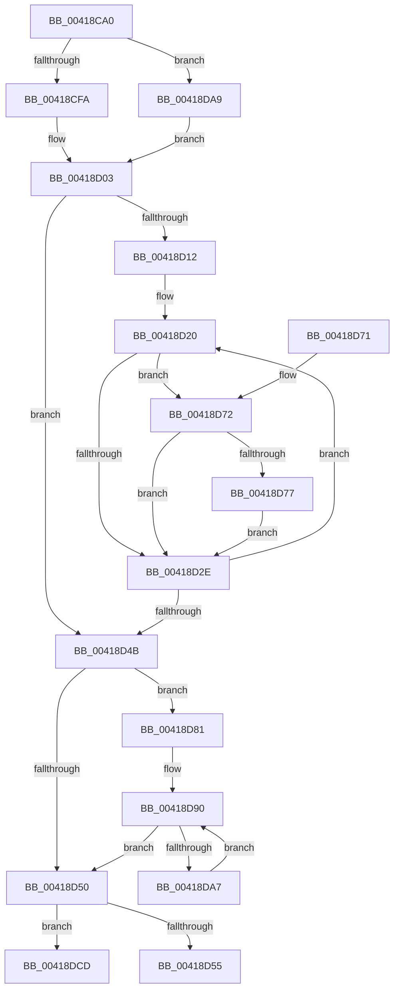

# RtlNumberOfSetBitsEx

- RVA: `0x00418CA0`–`0x00418DD8` (길이 `312` bytes)
- VA: `0x0000000140418CA0`
- 실행 섹션: `.text`
- PDB 이름 있음: `예`; PDB Function 태그: `예`
- unwind 정보 RVA: `0x0009D080`
- 디코드: `89`개 명령, `312/312` bytes 표시
- 미해석 바이트: `0` (있으면 어셈블리에 `.byte`로 보존)

> 이 문서는 커널 이미지의 기계어와 PDB 기호를 분석해 생성했습니다. 4번과 5번은 함수 원형과 자료형을 바이너리 사용 방식에서 추정한 C 해석이며 원본 소스 복구 결과는 아닙니다.

## 1. Dependencies

- 직접 호출 지점: **0**; 고유 호출 대상: **0**
- 직접 호출자로 확인된 함수: **14**
- RIP 상대 이미지 참조: **1**

### Outgoing calls
- 직접 디코드된 call 명령이 없습니다.

### Direct callers
- [IopLiveDumpWriteDumpFile](../3F/IopLiveDumpWriteDumpFile_function_003F6360.md) at `0x003F663B`
- [KeQueryNodeActiveAffinity2](KeQueryNodeActiveAffinity2_function_004189C0.md) at `0x00418A41`
- [KeCountSetBitsGroupMask](KeCountSetBitsGroupMask_function_00418AD4.md) at `0x00418AEB`
- [KeFindBiasedSetBitGroupMask](KeFindBiasedSetBitGroupMask_function_00418AFC.md) at `0x00418B6D`
- [HvlIsSingleGroupRequired](../58/HvlIsSingleGroupRequired_function_00583BA4.md) at `0x00583BFD`
- [IoWriteCrashDump](../59/IoWriteCrashDump_function_005936D8.md) at `0x00593C1D`
- [IopLiveDumpCollectPages](../59/IopLiveDumpCollectPages_function_0059B328.md) at `0x0059B539`
- [IopLiveDumpEstimateMemoryPages](../59/IopLiveDumpEstimateMemoryPages_function_0059BA80.md) at `0x0059BB06`
- [IopLiveDumpWriteDumpFileWithExtraPages](../59/IopLiveDumpWriteDumpFileWithExtraPages_function_0059F910.md) at `0x005A008E`
- [RtlNumberOfClearBitsEx](../5E/RtlNumberOfClearBitsEx_function_005E6360.md) at `0x005E6369`
- [MiMakeEntireHugePfnGood](../67/MiMakeEntireHugePfnGood_function_00676644.md) at `0x006766F0`
- [MiFinishChildPartitionHotAdd](../69/MiFinishChildPartitionHotAdd_function_00690C00.md) at `0x00690C90`
- [MiInsertPartitionPageNodes](../69/MiInsertPartitionPageNodes_function_00690F94.md) at `0x00690FD0`
- [MiInsertPartitionPages](../69/MiInsertPartitionPages_function_006911A0.md) at `0x006914A7`

### Static image references
- `0x00418D03` → RVA `0x00000000` (`image boundary/outside`; read)

## 2. Other-region calls and transfers

- 다른 실행 섹션으로 향하는 call: **0**
- call이 아닌 외부 분기/꼬리 이동: **1**
  - `0x00418DD3` → [sub_006ED4DA](../6E/Unknown_function_006ED4DA.md) (`tail-transfer`)

## 3. Assembly (complete function range)

```asm
00418CA0  48 89 5C 24 08                  mov qword ptr [rsp + 8], rbx
00418CA5  48 89 6C 24 10                  mov qword ptr [rsp + 0x10], rbp
00418CAA  48 89 74 24 18                  mov qword ptr [rsp + 0x18], rsi
00418CAF  48 89 7C 24 20                  mov qword ptr [rsp + 0x20], rdi
00418CB4  41 56                           push r14
00418CB6  41 57                           push r15
00418CB8  48 8B 29                        mov rbp, qword ptr [rcx]
00418CBB  45 33 C0                        xor r8d, r8d
00418CBE  48 8B 41 08                     mov rax, qword ptr [rcx + 8]
00418CC2  48 8B FD                        mov rdi, rbp
00418CC5  83 E7 07                        and edi, 7
00418CC8  41 8B D8                        mov ebx, r8d
00418CCB  4C 8B CD                        mov r9, rbp
00418CCE  44 8B D8                        mov r11d, eax
00418CD1  49 C1 E9 03                     shr r9, 3
00418CD5  41 BA 08 00 00 00               mov r10d, 8
00418CDB  48 85 FF                        test rdi, rdi
00418CDE  41 8B CA                        mov ecx, r10d
00418CE1  0F 95 C3                        setne bl
00418CE4  41 83 E3 07                     and r11d, 7
00418CE8  41 8B D3                        mov edx, r11d
00418CEB  49 03 D9                        add rbx, r9
00418CEE  48 2B CA                        sub rcx, rdx
00418CF1  49 3B C9                        cmp rcx, r9
00418CF4  0F 86 AF 00 00 00               jbe 0x140418da9
00418CFA  44 8B D3                        mov r10d, ebx
00418CFD  45 8B F0                        mov r14d, r8d
00418D00  41 8B F0                        mov esi, r8d
00418D03  4C 8D 3D F6 72 BE FF            lea r15, [rip - 0x418d0a]
00418D0A  45 8B C8                        mov r9d, r8d
00418D0D  45 85 D2                        test r10d, r10d
00418D10  74 39                           je 0x140418d4b
00418D12  4C 8D 5B FF                     lea r11, [rbx - 1]
00418D16  66 66 0F 1F 84 00 00 00 00 00   nop word ptr [rax + rax]
00418D20  0F B6 10                        movzx edx, byte ptr [rax]
00418D23  48 FF C0                        inc rax
00418D26  41 8B C9                        mov ecx, r9d
00418D29  49 3B CB                        cmp rcx, r11
00418D2C  74 44                           je 0x140418d72
00418D2E  0F B6 CA                        movzx ecx, dl
00418D31  41 FF C1                        inc r9d
00418D34  F7 D1                           not ecx
00418D36  0F B6 D1                        movzx edx, cl
00418D39  42 0F B6 8C 3A 40 41 03 00      movzx ecx, byte ptr [rdx + r15 + 0x34140]
00418D42  4C 03 C1                        add r8, rcx
00418D45  41 83 C2 FF                     add r10d, -1
00418D49  75 D5                           jne 0x140418d20
00418D4B  48 85 F6                        test rsi, rsi
00418D4E  75 31                           jne 0x140418d81
00418D50  45 85 F6                        test r14d, r14d
00418D53  75 78                           jne 0x140418dcd
00418D55  48 8B 5C 24 18                  mov rbx, qword ptr [rsp + 0x18]
00418D5A  49 8B C0                        mov rax, r8
00418D5D  48 8B 6C 24 20                  mov rbp, qword ptr [rsp + 0x20]
00418D62  48 8B 74 24 28                  mov rsi, qword ptr [rsp + 0x28]
00418D67  48 8B 7C 24 30                  mov rdi, qword ptr [rsp + 0x30]
00418D6C  41 5F                           pop r15
00418D6E  41 5E                           pop r14
00418D70  C3                              ret
00418D71  CC                              int3
00418D72  48 85 FF                        test rdi, rdi
00418D75  74 B7                           je 0x140418d2e
00418D77  42 22 94 3F 90 C8 02 00         and dl, byte ptr [rdi + r15 + 0x2c890]
00418D7F  EB AD                           jmp 0x140418d2e
00418D81  4C 8D 56 FF                     lea r10, [rsi - 1]
00418D85  49 C1 EA 03                     shr r10, 3
00418D89  49 FF C2                        inc r10
00418D8C  47 8D 0C D1                     lea r9d, [r9 + r10*8]
00418D90  48 8B 08                        mov rcx, qword ptr [rax]
00418D93  48 83 C0 08                     add rax, 8
00418D97  F3 48 0F B8 D1                  popcnt rdx, rcx
00418D9C  8B D2                           mov edx, edx
00418D9E  4C 03 C2                        add r8, rdx
00418DA1  49 83 EA 01                     sub r10, 1
00418DA5  74 A9                           je 0x140418d50
00418DA7  EB E7                           jmp 0x140418d90
00418DA9  45 2B D3                        sub r10d, r11d
00418DAC  48 8B F3                        mov rsi, rbx
00418DAF  45 2B CA                        sub r9d, r10d
00418DB2  41 83 E1 07                     and r9d, 7
00418DB6  48 85 FF                        test rdi, rdi
00418DB9  45 8D 71 01                     lea r14d, [r9 + 1]
00418DBD  45 0F 44 F1                     cmove r14d, r9d
00418DC1  43 8D 14 16                     lea edx, [r14 + r10]
00418DC5  48 2B F2                        sub rsi, rdx
00418DC8  E9 36 FF FF FF                  jmp 0x140418d03
00418DCD  48 FF CB                        dec rbx
00418DD0  83 E5 07                        and ebp, 7
00418DD3  E9 02 47 2D 00                  jmp 0x1406ed4da
```

## 4. C-style interpretation (structured pseudocode)

```c
__int64 __fastcall RtlNumberOfSetBitsEx(__int64 a1, __int64 a2, int a3)
{
    __int64 result;
    __int64 v_r10;
    __int64 v_r11;
    __int64 v_r14;
    __int64 v_rbp;
    __int64 v_rbx;
    __int64 v_rdi;
    __int64 v_rsi;
    unsigned __int64 v_stack_p10;
    unsigned __int64 v_stack_p18;
    unsigned __int64 v_stack_p20;
    unsigned __int64 v_stack_p8;

    v_stack_p8 = v_rbx;
    v_stack_p10 = v_rbp;
    v_stack_p18 = v_rsi;
    v_stack_p20 = v_rdi;
    a3 = 0;
    v_rdi = (unsigned int)((*(unsigned __int64 *)(a1)) & (7));
    a4 = (*(unsigned __int64 *)(a1)) >> (3);
    v_rbx = (v_rdi != 0) ? 1 : 0;
    v_r11 = (unsigned int)(((unsigned int)((unsigned int)(*(unsigned __int64 *)(a1 + 8)))) & (7));
    v_rbx = (v_rbx) + (a4);
    a1 = (8) - ((unsigned int)((unsigned int)(v_r11)));
    if (a1 <= a4) goto loc_00418DA9;
loc_00418D03:
    if ((unsigned int)((unsigned int)((unsigned int)(v_rbx))) == 0) goto loc_00418D4B;
loc_00418D20:
    result = (*(unsigned __int64 *)(a1 + 8)) + 1;
    if (0 == (v_rbx - 1)) goto loc_00418D72;
loc_00418D2E:
    a4 = (unsigned int)((0) + 1);
    a1 = (unsigned int)(~((unsigned __int8)(*(unsigned __int8 *)(*(unsigned __int64 *)(a1 + 8)))));
    a3 = (a3) + (*(unsigned __int8 *)((unsigned __int8)(a1) + v_rip - 4295946 * 1 + 213312));
    v_r10 = (unsigned int)(((unsigned int)((unsigned int)(v_rbx))) + (-1));
    if (condition_is_not_equal) goto loc_00418D20;
loc_00418D4B:
    if (0 != 0) goto loc_00418D81;
loc_00418D50:
    if (0 != 0) goto loc_00418DCD;
    return a3;
loc_00418D72:
    if (v_stack_p20 == 0) goto loc_00418D2E;
    a2 = (unsigned __int8)(((unsigned __int8)(a1)) & (*(unsigned __int8 *)(v_stack_p20 + v_rip - 4295946 * 1 + 182416)));
    goto loc_00418D2E;
loc_00418D81:
    v_r10 = (v_stack_p18 - 1) >> (3);
    v_r10 = (v_r10) + 1;
loc_00418D90:
    result = (a3) + (8);
    a3 = (a3) + ((unsigned int)((unsigned int)(a2)));
    v_r10 = (v_r10) - (1);
    if (condition_is_equal) goto loc_00418D50;
    goto loc_00418D90;
loc_00418DA9:
    v_r10 = (unsigned int)((v_r10) - ((unsigned int)(v_rbx - 1)));
    a4 = (unsigned int)((a4 + v_r10 * 8) - ((unsigned int)(v_r10)));
    a4 = (unsigned int)((a4) & (7));
    v_r14 = a4 + 1;
    if (v_stack_p20 == 0) { v_r14 = (unsigned int)(a4); }
    v_rsi = (v_stack_p8) - (v_r14 + v_r10 * 1);
    goto loc_00418D03;
loc_00418DCD:
    v_rbx = (v_stack_p8) - 1;
    v_rbp = (unsigned int)((v_stack_p10) & (7));
}
```

## 5. (Beta) C Style

```c
int64_t RtlNumberOfSetBitsEx(void *Arg1, int64_t Arg2, int32_t Arg3)
{
    uint8_t *arg1 = (uint8_t *)Arg1;

    int64_t result;
    int64_t local_r10;
    int64_t local_r11;
    int64_t local_r14;
    int64_t local_rbp;
    int64_t local_rbx;
    int64_t local_rdi;
    int64_t local_rsi;
    uint64_t v_stack_p10;
    uint64_t v_stack_p18;
    uint64_t v_stack_p20;
    uint64_t v_stack_p8;

    v_stack_p8 = local_rbx;
    v_stack_p10 = local_rbp;
    v_stack_p18 = local_rsi;
    v_stack_p20 = local_rdi;
    Arg3 = 0;
    local_rdi = (uint32_t)((*(uint64_t *)(arg1)) & (7));
    a4 = (*(uint64_t *)(arg1)) >> (3);
    local_rbx = (local_rdi != 0) ? 1 : 0;
    local_r11 = (uint32_t)(((uint32_t)((uint32_t)(*(uint64_t *)(arg1 + 0x8)))) & (7));
    local_rbx = (local_rbx) + (a4);
    Arg1 = (8) - ((uint32_t)((uint32_t)(local_r11)));
    if (Arg1 <= a4) goto loc_00418DA9;
loc_00418D03:
    if ((uint32_t)((uint32_t)((uint32_t)(local_rbx))) == 0) goto loc_00418D4B;
loc_00418D20:
    result = (*(uint64_t *)(arg1 + 0x8)) + 1;
    if (0 == (local_rbx - 1)) goto loc_00418D72;
loc_00418D2E:
    a4 = (uint32_t)((0) + 1);
    Arg1 = (uint32_t)(~((uint8_t)(*(uint8_t *)(*(uint64_t *)(arg1 + 0x8)))));
    Arg3 = (Arg3) + (*(uint8_t *)((uint8_t)(arg1) + v_rip - 0x418D0A * 1 + 0x34140));
    local_r10 = (uint32_t)(((uint32_t)((uint32_t)(local_rbx))) + (-1));
    if (condition_is_not_equal) goto loc_00418D20;
loc_00418D4B:
    if (0 != 0) goto loc_00418D81;
loc_00418D50:
    if (0 != 0) goto loc_00418DCD;
    return Arg3;
loc_00418D72:
    if (v_stack_p20 == 0) goto loc_00418D2E;
    Arg2 = (uint8_t)(((uint8_t)(Arg1)) & (*(uint8_t *)(v_stack_p20 + v_rip - 0x418D0A * 1 + 0x2C890)));
    goto loc_00418D2E;
loc_00418D81:
    local_r10 = (v_stack_p18 - 1) >> (3);
    local_r10 = (local_r10) + 1;
loc_00418D90:
    result = (Arg3) + (8);
    Arg3 = (Arg3) + ((uint32_t)((uint32_t)(Arg2)));
    local_r10 = (local_r10) - (1);
    if (condition_is_equal) goto loc_00418D50;
    goto loc_00418D90;
loc_00418DA9:
    local_r10 = (uint32_t)((local_r10) - ((uint32_t)(local_rbx - 1)));
    a4 = (uint32_t)((a4 + local_r10 * 8) - ((uint32_t)(local_r10)));
    a4 = (uint32_t)((a4) & (7));
    local_r14 = a4 + 1;
    if (v_stack_p20 == 0) { local_r14 = (uint32_t)(a4); }
    local_rsi = (v_stack_p8) - (local_r14 + local_r10 * 1);
    goto loc_00418D03;
loc_00418DCD:
    local_rbx = (v_stack_p8) - 1;
    local_rbp = (uint32_t)((v_stack_p10) & (7));
}
```

### 관측된 메모리 오프셋

구조체 형식이 확인되지 않은 접근은 인자 기준의 오프셋으로만 기록했습니다.

| 기준 인자 | 오프셋 표현 | 폭 (bit) | 접근 |
|---|---:|---:|---|
| `Arg1` | `+ 0x0` | `64` | `R` |
| `Arg1` | `+ 0x8` | `64` | `R` |

## 6. Execution-region graph

[열기: 2D/3D 그래프와 함수 탐색 컨트롤 패널](../../../control-panel.html?section=text&rva=0x00418CA0&view=graph)

- 2D 그래프는 위에서 아래로 흐르고, 3D 그래프는 빈 공간을 드래그해 회전합니다. Shift+드래그는 이동, 휠은 확대·축소, 함수 노드 선택은 대상 보고서 이동입니다.

### Static fallback


