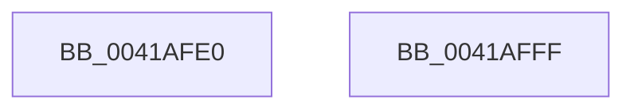

# RtlRandomEx

- RVA: `0x0041AFE0`–`0x0041B000` (길이 `32` bytes)
- VA: `0x000000014041AFE0`
- 실행 섹션: `.text`
- PDB 이름 있음: `예`; PDB Function 태그: `아니요`
- unwind 정보 RVA: `0x0005CF00`
- 디코드: `11`개 명령, `32/32` bytes 표시
- 미해석 바이트: `0` (있으면 어셈블리에 `.byte`로 보존)

> 이 문서는 커널 이미지의 기계어와 PDB 기호를 분석해 생성했습니다. 4번과 5번은 함수 원형과 자료형을 바이너리 사용 방식에서 추정한 C 해석이며 원본 소스 복구 결과는 아닙니다.

## 1. Dependencies

- 직접 호출 지점: **1**; 고유 호출 대상: **1**
- 직접 호출자로 확인된 함수: **6**
- RIP 상대 이미지 참조: **0**

### Outgoing calls
- `0x0041AFEE` → [ExGenRandom](ExGenRandom_function_0041B010.md) (function, `0x0041B010`)

### Direct callers
- [EtwpGetPrivateSessionTraceHandle](../../page/7B/EtwpGetPrivateSessionTraceHandle_function_007BC5A8.md) at `0x007BC686`
- [MiInitializePartition](../../page/7F/MiInitializePartition_function_007FD3E8.md) at `0x007FD568`
- [PopPowerRequestStatsCreateSleepstudyBlocker](../../page/A2/PopPowerRequestStatsCreateSleepstudyBlocker_function_00A2D9B0.md) at `0x00A2D9E9`
- [MmCreateProcessAddressSpace](../../page/A5/MmCreateProcessAddressSpace_function_00A5EE5C.md) at `0x00A5EF31`
- [PspSelectNodeForProcess](../../page/A8/PspSelectNodeForProcess_function_00A89BDC.md) at `0x00A89C0D`
- [VfRandomGetNumber](../../pagevrfy/B9/VfRandomGetNumber_function_00B930CC.md) at `0x00B930E1`

### Static image references
- 디코드된 RIP-relative 메모리 참조가 없습니다.

## 2. Other-region calls and transfers

- 다른 실행 섹션으로 향하는 call: **0**
- 별도 외부 분기/꼬리 이동을 확인하지 못했습니다.

## 3. Assembly (complete function range)

```asm
0041AFE0  40 53                           push rbx
0041AFE2  48 83 EC 20                     sub rsp, 0x20
0041AFE6  48 8B D9                        mov rbx, rcx
0041AFE9  B9 01 00 00 00                  mov ecx, 1
0041AFEE  E8 1D 00 00 00                  call 0x14041b010
0041AFF3  0F BA F0 1F                     btr eax, 0x1f
0041AFF7  89 03                           mov dword ptr [rbx], eax
0041AFF9  48 83 C4 20                     add rsp, 0x20
0041AFFD  5B                              pop rbx
0041AFFE  C3                              ret
0041AFFF  CC                              int3
```

## 4. C-style interpretation (structured pseudocode)

```c
__int64 __fastcall RtlRandomEx(__int64 a1)
{
    __int64 result;
    __int64 v_rsp;

    v_rsp = (v_rsp) - (32);
    result = ExGenRandom(1, a2, a3, a4);
    *(unsigned int *)(a1) = (unsigned int)(result);
    v_rsp = (v_rsp) + (32);
    return result;
}
```

## 5. (Beta) C Style

```c
int64_t RtlRandomEx(void *Arg1)
{
    uint8_t *arg1 = (uint8_t *)Arg1;

    int64_t result;
    int64_t local_rsp;

    local_rsp = (local_rsp) - (32);
    result = ExGenRandom(1, a2, a3, a4);
    *(uint32_t *)(arg1) = (uint32_t)(result);
    local_rsp = (local_rsp) + (32);
    return result;
}
```

### 관측된 메모리 오프셋

구조체 형식이 확인되지 않은 접근은 인자 기준의 오프셋으로만 기록했습니다.

| 기준 인자 | 오프셋 표현 | 폭 (bit) | 접근 |
|---|---:|---:|---|
| `Arg1` | `+ 0x0` | `32` | `W` |

## 6. Execution-region graph

[열기: 2D/3D 그래프와 함수 탐색 컨트롤 패널](../../../control-panel.html?section=text&rva=0x0041AFE0&view=graph)

- 2D 그래프는 위에서 아래로 흐르고, 3D 그래프는 빈 공간을 드래그해 회전합니다. Shift+드래그는 이동, 휠은 확대·축소, 함수 노드 선택은 대상 보고서 이동입니다.

### Static fallback


