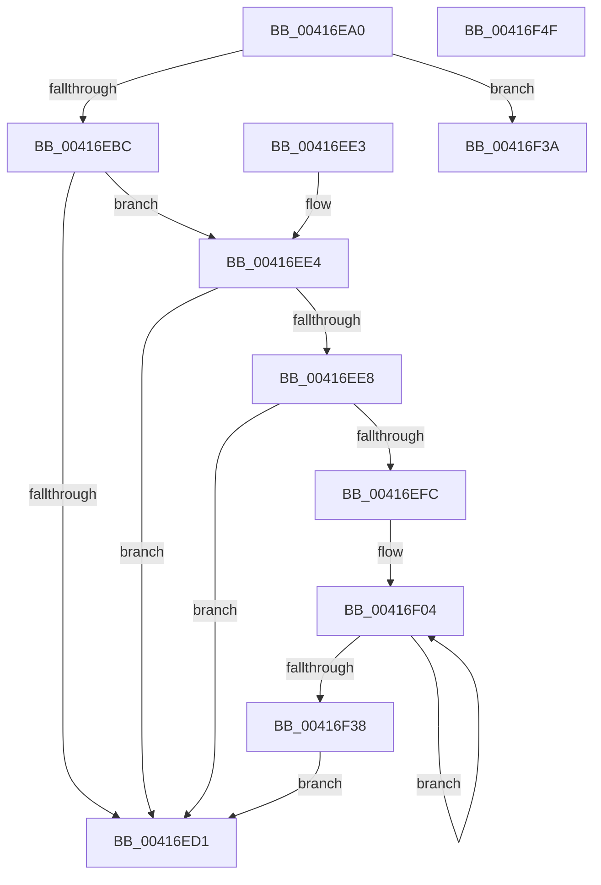

# RtlSidHashInitialize

- RVA: `0x00416EA0`–`0x00416F50` (길이 `176` bytes)
- VA: `0x0000000140416EA0`
- 실행 섹션: `.text`
- PDB 이름 있음: `예`; PDB Function 태그: `아니요`
- unwind 정보 RVA: `0x0009CC68`
- 디코드: `54`개 명령, `176/176` bytes 표시
- 미해석 바이트: `0` (있으면 어셈블리에 `.byte`로 보존)

> 이 문서는 커널 이미지의 기계어와 PDB 기호를 분석해 생성했습니다. 4번과 5번은 함수 원형과 자료형을 바이너리 사용 방식에서 추정한 C 해석이며 원본 소스 복구 결과는 아닙니다.

## 1. Dependencies

- 직접 호출 지점: **1**; 고유 호출 대상: **1**
- 직접 호출자로 확인된 함수: **9**
- RIP 상대 이미지 참조: **0**

### Outgoing calls
- `0x00416EC7` → [memset](../6C/memset_function_006C6C40.md) (function, `0x006C6C40`)

### Direct callers
- [SepCreateTokenEx](../4E/SepCreateTokenEx_function_004E9CD0.md) at `0x004EA6D1`
- [SeSetTokenTamperProtection](../60/SeSetTokenTamperProtection_function_00609644.md) at `0x00609957`
- [SepDuplicateToken](../../page/8B/SepDuplicateToken_function_008B87EC.md) at `0x008B9007`
- [SepDuplicateToken](../../page/8B/SepDuplicateToken_function_008B87EC.md) at `0x008B9020`
- [SepDuplicateToken](../../page/8B/SepDuplicateToken_function_008B87EC.md) at `0x008B903A`
- [CmpBuildAdminInformation](../../page/9A/CmpBuildAdminInformation_function_009A8884.md) at `0x009A8A82`
- [SepFilterToken](../../page/9C/SepFilterToken_function_009C6B80.md) at `0x009C76D9`
- [SepFilterToken](../../page/9C/SepFilterToken_function_009C6B80.md) at `0x009C76F2`
- [SepFilterToken](../../page/9C/SepFilterToken_function_009C6B80.md) at `0x009C77B7`
- [SepSetTokenCapabilities](../../page/9C/SepSetTokenCapabilities_function_009C9AF4.md) at `0x009C9BEC`
- [SepCopyTokenAccessInformation](../../page/9E/SepCopyTokenAccessInformation_function_009E9C0C.md) at `0x009E9DF6`
- [SepCopyTokenAccessInformation](../../page/9E/SepCopyTokenAccessInformation_function_009E9C0C.md) at `0x009E9F41`
- [SepCopyTokenAccessInformation](../../page/9E/SepCopyTokenAccessInformation_function_009E9C0C.md) at `0x009EA096`
- [sub_00B3F630](../../page/B3/Unknown_function_00B3F630.md) at `0x00B3F752`
- [sub_00B412E4](../../page/B4/Unknown_function_00B412E4.md) at `0x00B41397`

### Static image references
- 디코드된 RIP-relative 메모리 참조가 없습니다.

## 2. Other-region calls and transfers

- 다른 실행 섹션으로 향하는 call: **0**
- 별도 외부 분기/꼬리 이동을 확인하지 못했습니다.

## 3. Assembly (complete function range)

```asm
00416EA0  48 89 5C 24 08                  mov qword ptr [rsp + 8], rbx
00416EA5  48 89 74 24 10                  mov qword ptr [rsp + 0x10], rsi
00416EAA  57                              push rdi
00416EAB  48 83 EC 20                     sub rsp, 0x20
00416EAF  49 8B F8                        mov rdi, r8
00416EB2  8B F2                           mov esi, edx
00416EB4  48 8B D9                        mov rbx, rcx
00416EB7  4D 85 C0                        test r8, r8
00416EBA  74 7E                           je 0x140416f3a
00416EBC  33 D2                           xor edx, edx
00416EBE  41 B8 10 01 00 00               mov r8d, 0x110
00416EC4  48 8B CF                        mov rcx, rdi
00416EC7  E8 74 FD 2A 00                  call 0x1406c6c40
00416ECC  48 85 DB                        test rbx, rbx
00416ECF  75 13                           jne 0x140416ee4
00416ED1  33 C0                           xor eax, eax
00416ED3  48 8B 5C 24 30                  mov rbx, qword ptr [rsp + 0x30]
00416ED8  48 8B 74 24 38                  mov rsi, qword ptr [rsp + 0x38]
00416EDD  48 83 C4 20                     add rsp, 0x20
00416EE1  5F                              pop rdi
00416EE2  C3                              ret
00416EE3  CC                              int3
00416EE4  85 F6                           test esi, esi
00416EE6  74 E9                           je 0x140416ed1
00416EE8  B9 40 00 00 00                  mov ecx, 0x40
00416EED  48 89 5F 08                     mov qword ptr [rdi + 8], rbx
00416EF1  3B F1                           cmp esi, ecx
00416EF3  89 37                           mov dword ptr [rdi], esi
00416EF5  0F 46 CE                        cmovbe ecx, esi
00416EF8  85 C9                           test ecx, ecx
00416EFA  74 D5                           je 0x140416ed1
00416EFC  B8 01 00 00 00                  mov eax, 1
00416F01  44 8B C9                        mov r9d, ecx
00416F04  48 8B 13                        mov rdx, qword ptr [rbx]
00416F07  48 8D 5B 10                     lea rbx, [rbx + 0x10]
00416F0B  0F B6 4A 01                     movzx ecx, byte ptr [rdx + 1]
00416F0F  44 0F B6 44 8A 04               movzx r8d, byte ptr [rdx + rcx*4 + 4]
00416F15  49 8B C8                        mov rcx, r8
00416F18  83 E1 0F                        and ecx, 0xf
00416F1B  48 09 44 CF 10                  or qword ptr [rdi + rcx*8 + 0x10], rax
00416F20  41 8B C8                        mov ecx, r8d
00416F23  48 C1 E9 04                     shr rcx, 4
00416F27  48 09 84 CF 90 00 00 00         or qword ptr [rdi + rcx*8 + 0x90], rax
00416F2F  48 D1 C0                        rol rax, 1
00416F32  49 83 E9 01                     sub r9, 1
00416F36  75 CC                           jne 0x140416f04
00416F38  EB 97                           jmp 0x140416ed1
00416F3A  48 8B 5C 24 30                  mov rbx, qword ptr [rsp + 0x30]
00416F3F  B8 0D 00 00 C0                  mov eax, 0xc000000d
00416F44  48 8B 74 24 38                  mov rsi, qword ptr [rsp + 0x38]
00416F49  48 83 C4 20                     add rsp, 0x20
00416F4D  5F                              pop rdi
00416F4E  C3                              ret
00416F4F  CC                              int3
```

## 4. C-style interpretation (structured pseudocode)

```c
__int64 __fastcall RtlSidHashInitialize(__int64 a1, int a2, __int64 a3)
{
    __int64 result;
    __int64 v_rsp;
    unsigned __int64 v_stack_p10;
    unsigned __int64 v_stack_p30;
    unsigned __int64 v_stack_p38;
    unsigned __int64 v_stack_p8;

    v_stack_p8 = v_rbx;
    v_stack_p10 = v_rsi;
    v_rsp = (v_rsp) - (32);
    if (a3 == 0) goto loc_00416F3A;
    a2 = 0;
    result = memset(a3, a2, 272, a4);
    if (a1 != 0) goto loc_00416EE4;
loc_00416ED1:
    result = 0;
    v_rsp = (v_rsp) + (32);
    return result;
loc_00416EE4:
    if ((unsigned int)(v_stack_p10) == 0) goto loc_00416ED1;
    *(unsigned __int64 *)(a3 + 8) = v_stack_p8;
    *(unsigned int *)(a3) = (unsigned int)(v_stack_p10);
    a1 = 64;
    if (((unsigned int)(v_stack_p10)) <= 64) { a1 = (unsigned int)(v_stack_p10); }
    if ((unsigned int)(a1) == 0) goto loc_00416ED1;
loc_00416F04:
    a1 = (unsigned int)((*(unsigned __int8 *)(*(unsigned __int64 *)(v_stack_p8) + *(unsigned __int8 *)(*(unsigned __int64 *)(v_stack_p8) + 1) * 4 + 4)) & (15));
    a1 = ((unsigned int)((unsigned int)(*(unsigned __int8 *)(*(unsigned __int64 *)(v_stack_p8) + *(unsigned __int8 *)(*(unsigned __int64 *)(v_stack_p8) + 1) * 4 + 4)))) >> (4);
    a4 = ((unsigned int)((unsigned int)(a1))) - (1);
    if (condition_is_not_equal) goto loc_00416F04;
    goto loc_00416ED1;
loc_00416F3A:
    v_rsp = (v_rsp) + (32);
    return (unsigned int)(0xC000000DULL);
}
```

## 5. (Beta) C Style

```c
int64_t RtlSidHashInitialize(int64_t Arg1, int32_t Arg2, void *Arg3)
{
    uint8_t *arg3 = (uint8_t *)Arg3;

    int64_t result;
    int64_t local_rsp;
    uint64_t v_stack_p10;
    uint64_t v_stack_p30;
    uint64_t v_stack_p38;
    uint64_t v_stack_p8;

    v_stack_p8 = local_rbx;
    v_stack_p10 = local_rsi;
    local_rsp = (local_rsp) - (32);
    if (Arg3 == NULL) goto loc_00416F3A;
    Arg2 = 0;
    result = memset(Arg3, Arg2, 272, a4);
    if (Arg1 != 0) goto loc_00416EE4;
loc_00416ED1:
    result = 0;
    local_rsp = (local_rsp) + (32);
    return result;
loc_00416EE4:
    if ((uint32_t)(v_stack_p10) == 0) goto loc_00416ED1;
    *(uint64_t *)(arg3 + 0x8) = v_stack_p8;
    *(uint32_t *)(arg3) = (uint32_t)(v_stack_p10);
    Arg1 = 64;
    if (((uint32_t)(v_stack_p10)) <= 64) { Arg1 = (uint32_t)(v_stack_p10); }
    if ((uint32_t)(Arg1) == 0) goto loc_00416ED1;
loc_00416F04:
    Arg1 = (uint32_t)((*(uint8_t *)(*(uint64_t *)(v_stack_p8) + *(uint8_t *)(*(uint64_t *)(v_stack_p8) + 0x1) * 4 + 0x4)) & (15));
    Arg1 = ((uint32_t)((uint32_t)(*(uint8_t *)(*(uint64_t *)(v_stack_p8) + *(uint8_t *)(*(uint64_t *)(v_stack_p8) + 0x1) * 4 + 0x4)))) >> (4);
    a4 = ((uint32_t)((uint32_t)(Arg1))) - (1);
    if (condition_is_not_equal) goto loc_00416F04;
    goto loc_00416ED1;
loc_00416F3A:
    local_rsp = (local_rsp) + (32);
    return (uint32_t)(0xC000000DULL);
}
```

### 관측된 메모리 오프셋

구조체 형식이 확인되지 않은 접근은 인자 기준의 오프셋으로만 기록했습니다.

| 기준 인자 | 오프셋 표현 | 폭 (bit) | 접근 |
|---|---:|---:|---|
| `Arg3` | `+ 0x0` | `32` | `W` |
| `Arg3` | `+ 0x8` | `64` | `W` |
| `Arg3` | `+ 0x10 + rcx*8` | `64` | `R/W` |
| `Arg3` | `+ 0x90 + rcx*8` | `64` | `R/W` |

## 6. Execution-region graph

[열기: 2D/3D 그래프와 함수 탐색 컨트롤 패널](../../../control-panel.html?section=text&rva=0x00416EA0&view=graph)

- 2D 그래프는 위에서 아래로 흐르고, 3D 그래프는 빈 공간을 드래그해 회전합니다. Shift+드래그는 이동, 휠은 확대·축소, 함수 노드 선택은 대상 보고서 이동입니다.

### Static fallback


