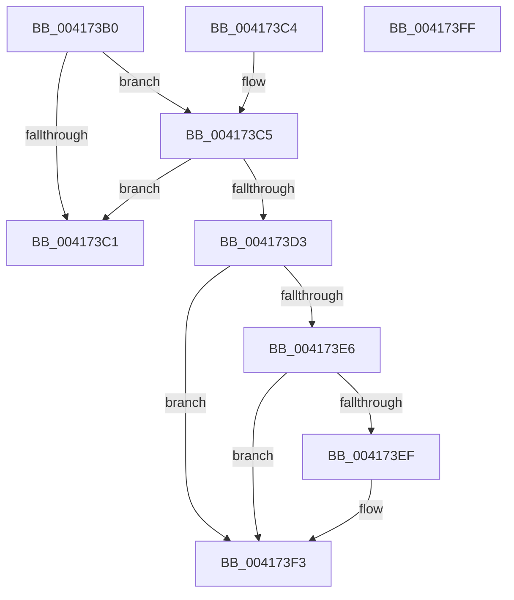

# RtlStateDurationCapture

- RVA: `0x004173B0`–`0x00417400` (길이 `80` bytes)
- VA: `0x00000001404173B0`
- 실행 섹션: `.text`
- PDB 이름 있음: `예`; PDB Function 태그: `아니요`
- unwind 정보 RVA: `0x000DB714`
- 디코드: `30`개 명령, `80/80` bytes 표시
- 미해석 바이트: `0` (있으면 어셈블리에 `.byte`로 보존)

> 이 문서는 커널 이미지의 기계어와 PDB 기호를 분석해 생성했습니다. 4번과 5번은 함수 원형과 자료형을 바이너리 사용 방식에서 추정한 C 해석이며 원본 소스 복구 결과는 아닙니다.

## 1. Dependencies

- 직접 호출 지점: **0**; 고유 호출 대상: **0**
- 직접 호출자로 확인된 함수: **2**
- RIP 상대 이미지 참조: **0**

### Outgoing calls
- 직접 디코드된 call 명령이 없습니다.

### Direct callers
- [PoEnergyContextCleanup](../../page/90/PoEnergyContextCleanup_function_00907A38.md) at `0x00907AB6`
- [PoEnergyContextCleanup](../../page/90/PoEnergyContextCleanup_function_00907A38.md) at `0x00907AFC`
- [PsQueryProcessEnergyValues](../../page/91/PsQueryProcessEnergyValues_function_0091A4E0.md) at `0x0091A5D2`
- [PsQueryProcessEnergyValues](../../page/91/PsQueryProcessEnergyValues_function_0091A4E0.md) at `0x0091A634`

### Static image references
- 디코드된 RIP-relative 메모리 참조가 없습니다.

## 2. Other-region calls and transfers

- 다른 실행 섹션으로 향하는 call: **0**
- 별도 외부 분기/꼬리 이동을 확인하지 못했습니다.

## 3. Assembly (complete function range)

```asm
004173B0  48 8B 02                        mov rax, qword ptr [rdx]
004173B3  4C 8B C9                        mov r9, rcx
004173B6  48 89 01                        mov qword ptr [rcx], rax
004173B9  48 C1 E8 20                     shr rax, 0x20
004173BD  85 C0                           test eax, eax
004173BF  78 04                           js 0x1404173c5
004173C1  33 C0                           xor eax, eax
004173C3  C3                              ret
004173C4  CC                              int3
004173C5  0F BA F0 1F                     btr eax, 0x1f
004173C9  89 41 04                        mov dword ptr [rcx + 4], eax
004173CC  8B 0A                           mov ecx, dword ptr [rdx]
004173CE  44 3B C1                        cmp r8d, ecx
004173D1  76 EE                           jbe 0x1404173c1
004173D3  45 8B D0                        mov r10d, r8d
004173D6  45 89 01                        mov dword ptr [r9], r8d
004173D9  44 2B D1                        sub r10d, ecx
004173DC  BA FF FF FF FF                  mov edx, 0xffffffff
004173E1  44 3B D2                        cmp r10d, edx
004173E4  73 0D                           jae 0x1404173f3
004173E6  41 8B CA                        mov ecx, r10d
004173E9  F7 D1                           not ecx
004173EB  3B C8                           cmp ecx, eax
004173ED  72 04                           jb 0x1404173f3
004173EF  42 8D 14 10                     lea edx, [rax + r10]
004173F3  0F BA F2 1F                     btr edx, 0x1f
004173F7  41 8B C2                        mov eax, r10d
004173FA  41 89 51 04                     mov dword ptr [r9 + 4], edx
004173FE  C3                              ret
004173FF  CC                              int3
```

## 4. C-style interpretation (structured pseudocode)

```c
__int64 __fastcall RtlStateDurationCapture(__int64 a1, __int64 a2, int a3)
{
    __int64 result;
    __int64 v_r10;

    *(unsigned __int64 *)(a1) = *(unsigned __int64 *)(a2);
    result = (*(unsigned __int64 *)(a2)) >> (32);
    if (sign_flag) goto loc_004173C5;
loc_004173C1:
    result = 0;
    return result;
loc_004173C5:
    *(unsigned int *)(a1 + 4) = 0;
    if (a3 <= ((unsigned int)((unsigned int)(*(unsigned int *)(a2))))) goto loc_004173C1;
    *(unsigned int *)(a1) = a3;
    v_r10 = (unsigned int)(((unsigned int)(a3)) - ((unsigned int)((unsigned int)(*(unsigned int *)(a2)))));
    if (((unsigned int)(v_r10)) >= ((unsigned int)((unsigned int)(0xFFFFFFFFULL)))) goto loc_004173F3;
    a1 = (unsigned int)(~((unsigned int)((unsigned int)(v_r10))));
    if (((unsigned int)(a1)) >= 0) {
        a2 = result + v_r10 * 1;
    }
    *(unsigned int *)(a1 + 4) = (unsigned int)(a2);
    return (unsigned int)((unsigned int)(v_r10));
}
```

## 5. (Beta) C Style

```c
int64_t RtlStateDurationCapture(void *Arg1, void *Arg2, int32_t Arg3)
{
    uint8_t *arg1 = (uint8_t *)Arg1;
    uint8_t *arg2 = (uint8_t *)Arg2;

    int64_t result;
    int64_t local_r10;

    *(uint64_t *)(arg1) = *(uint64_t *)(arg2);
    result = (*(uint64_t *)(arg2)) >> (32);
    if (sign_flag) goto loc_004173C5;
loc_004173C1:
    result = 0;
    return result;
loc_004173C5:
    *(uint32_t *)(arg1 + 0x4) = 0;
    if (Arg3 <= ((uint32_t)((uint32_t)(*(uint32_t *)(arg2))))) goto loc_004173C1;
    *(uint32_t *)(arg1) = Arg3;
    local_r10 = (uint32_t)(((uint32_t)(Arg3)) - ((uint32_t)((uint32_t)(*(uint32_t *)(arg2)))));
    if (((uint32_t)(local_r10)) >= ((uint32_t)((uint32_t)(0xFFFFFFFFULL)))) goto loc_004173F3;
    Arg1 = (uint32_t)(~((uint32_t)((uint32_t)(local_r10))));
    if (((uint32_t)(Arg1)) >= 0) {
        Arg2 = result + local_r10 * 1;
    }
    *(uint32_t *)(arg1 + 0x4) = (uint32_t)(Arg2);
    return (uint32_t)((uint32_t)(local_r10));
}
```

### 관측된 메모리 오프셋

구조체 형식이 확인되지 않은 접근은 인자 기준의 오프셋으로만 기록했습니다.

| 기준 인자 | 오프셋 표현 | 폭 (bit) | 접근 |
|---|---:|---:|---|
| `Arg1` | `+ 0x0` | `32` | `W` |
| `Arg1` | `+ 0x0` | `64` | `W` |
| `Arg1` | `+ 0x4` | `32` | `W` |
| `Arg2` | `+ 0x0` | `32` | `R` |
| `Arg2` | `+ 0x0` | `64` | `R` |

## 6. Execution-region graph

[열기: 2D/3D 그래프와 함수 탐색 컨트롤 패널](../../../control-panel.html?section=text&rva=0x004173B0&view=graph)

- 2D 그래프는 위에서 아래로 흐르고, 3D 그래프는 빈 공간을 드래그해 회전합니다. Shift+드래그는 이동, 휠은 확대·축소, 함수 노드 선택은 대상 보고서 이동입니다.

### Static fallback


