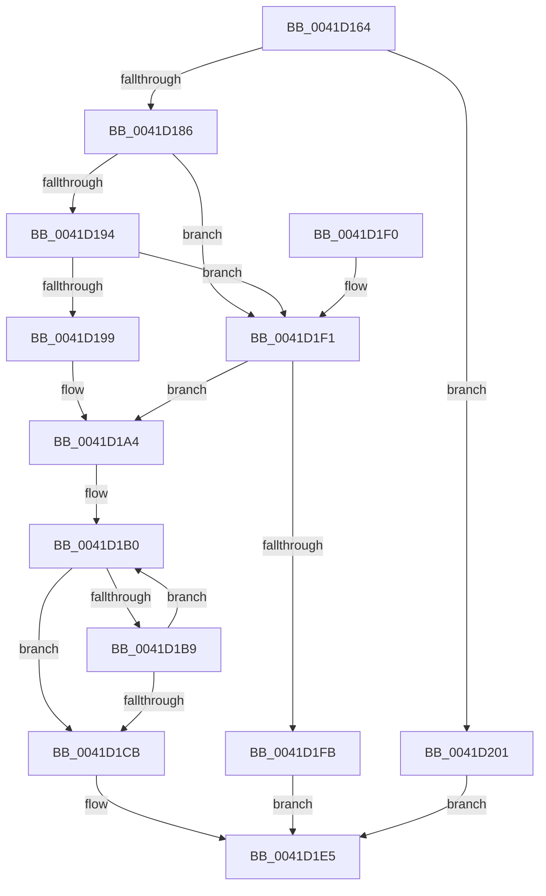

# RtlStringCbCopyUnicodeString

- RVA: `0x0041D164`–`0x0041D208` (길이 `164` bytes)
- VA: `0x000000014041D164`
- 실행 섹션: `.text`
- PDB 이름 있음: `예`; PDB Function 태그: `아니요`
- unwind 정보 RVA: `0x0007918C`
- 디코드: `53`개 명령, `164/164` bytes 표시
- 미해석 바이트: `0` (있으면 어셈블리에 `.byte`로 보존)

> 이 문서는 커널 이미지의 기계어와 PDB 기호를 분석해 생성했습니다. 4번과 5번은 함수 원형과 자료형을 바이너리 사용 방식에서 추정한 C 해석이며 원본 소스 복구 결과는 아닙니다.

## 1. Dependencies

- 직접 호출 지점: **1**; 고유 호출 대상: **1**
- 직접 호출자로 확인된 함수: **2**
- RIP 상대 이미지 참조: **0**

### Outgoing calls
- `0x0041D189` → [RtlUnicodeStringValidateWorker](RtlUnicodeStringValidateWorker_function_0041D210.md) (function, `0x0041D210`)

### Direct callers
- [PoStoreRequester](../23/PoStoreRequester_function_002304D4.md) at `0x0023066A`
- [PoStoreRequester](../23/PoStoreRequester_function_002304D4.md) at `0x002306CE`
- [PopSafeCopyUnicodeString](PopSafeCopyUnicodeString_function_0041D0AC.md) at `0x0041D0E5`

### Static image references
- 디코드된 RIP-relative 메모리 참조가 없습니다.

## 2. Other-region calls and transfers

- 다른 실행 섹션으로 향하는 call: **0**
- 별도 외부 분기/꼬리 이동을 확인하지 못했습니다.

## 3. Assembly (complete function range)

```asm
0041D164  48 89 5C 24 08                  mov qword ptr [rsp + 8], rbx
0041D169  57                              push rdi
0041D16A  48 83 EC 20                     sub rsp, 0x20
0041D16E  4C 8B D2                        mov r10, rdx
0041D171  49 8B D8                        mov rbx, r8
0041D174  49 D1 EA                        shr r10, 1
0041D177  4C 8B D9                        mov r11, rcx
0041D17A  49 8D 42 FF                     lea rax, [r10 - 1]
0041D17E  48 3D FE 7F 00 00               cmp rax, 0x7ffe
0041D184  77 7B                           ja 0x14041d201
0041D186  48 8B CB                        mov rcx, rbx
0041D189  E8 82 00 00 00                  call 0x14041d210
0041D18E  33 FF                           xor edi, edi
0041D190  85 C0                           test eax, eax
0041D192  78 5D                           js 0x14041d1f1
0041D194  48 85 DB                        test rbx, rbx
0041D197  74 58                           je 0x14041d1f1
0041D199  44 0F B7 03                     movzx r8d, word ptr [rbx]
0041D19D  4C 8B 4B 08                     mov r9, qword ptr [rbx + 8]
0041D1A1  49 D1 E8                        shr r8, 1
0041D1A4  4D 2B C2                        sub r8, r10
0041D1A7  49 8B CB                        mov rcx, r11
0041D1AA  4D 2B CB                        sub r9, r11
0041D1AD  49 8B D2                        mov rdx, r10
0041D1B0  49 8D 04 10                     lea rax, [r8 + rdx]
0041D1B4  48 85 C0                        test rax, rax
0041D1B7  74 12                           je 0x14041d1cb
0041D1B9  41 0F B7 04 09                  movzx eax, word ptr [r9 + rcx]
0041D1BE  66 89 01                        mov word ptr [rcx], ax
0041D1C1  48 83 C1 02                     add rcx, 2
0041D1C5  48 83 EA 01                     sub rdx, 1
0041D1C9  75 E5                           jne 0x14041d1b0
0041D1CB  48 85 D2                        test rdx, rdx
0041D1CE  48 8D 41 FE                     lea rax, [rcx - 2]
0041D1D2  48 0F 45 C1                     cmovne rax, rcx
0041D1D6  48 F7 DA                        neg rdx
0041D1D9  66 89 38                        mov word ptr [rax], di
0041D1DC  1B C0                           sbb eax, eax
0041D1DE  F7 D0                           not eax
0041D1E0  25 05 00 00 80                  and eax, 0x80000005
0041D1E5  48 8B 5C 24 30                  mov rbx, qword ptr [rsp + 0x30]
0041D1EA  48 83 C4 20                     add rsp, 0x20
0041D1EE  5F                              pop rdi
0041D1EF  C3                              ret
0041D1F0  CC                              int3
0041D1F1  4C 8B CF                        mov r9, rdi
0041D1F4  4C 8B C7                        mov r8, rdi
0041D1F7  85 C0                           test eax, eax
0041D1F9  79 A9                           jns 0x14041d1a4
0041D1FB  66 41 89 3B                     mov word ptr [r11], di
0041D1FF  EB E4                           jmp 0x14041d1e5
0041D201  B8 0D 00 00 C0                  mov eax, 0xc000000d
0041D206  EB DD                           jmp 0x14041d1e5
```

## 4. C-style interpretation (structured pseudocode)

```c
__int64 __fastcall RtlStringCbCopyUnicodeString(__int64 a1, __int64 a2, __int64 a3)
{
    __int64 result;
    __int64 v_r10;
    __int64 v_rdi;
    __int64 v_rsp;
    unsigned __int64 v_stack_p8;

    v_stack_p8 = v_rbx;
    v_rsp = (v_rsp) - (32);
    v_r10 = (a2) >> (1);
    if ((v_r10 - 1) > 0x7FFEULL) goto loc_0041D201;
    result = RtlUnicodeStringValidateWorker(a3, a2, a3, a4);
    v_rdi = 0;
    if (sign_flag) goto loc_0041D1F1;
    if (a3 == 0) goto loc_0041D1F1;
    a3 = (*(unsigned __int16 *)(a3)) >> (1);
loc_0041D1A4:
    a3 = (a3) - (v_r10);
    a4 = (*(unsigned __int64 *)(a3 + 8)) - (a1);
loc_0041D1B0:
    if (a3 + v_r10 * 1 == 0) goto loc_0041D1CB;
    *(unsigned __int16 *)(a1) = (unsigned __int16)(*(unsigned __int16 *)(a4 + a1 * 1));
    a1 = (a1) + (2);
    a2 = (v_r10) - (1);
    if (condition_is_not_equal) goto loc_0041D1B0;
loc_0041D1CB:
    result = a1 - 2;
    if (a2 != 0) { result = a1; }
    a2 = -(a2);
    *(unsigned __int16 *)(result) = 0;
    result = (unsigned int)(~(result));
    result = (unsigned int)((result) & (0x80000005ULL));
loc_0041D1E5:
    v_rsp = (v_rsp) + (32);
    return result;
loc_0041D1F1:
    if (!sign_flag) goto loc_0041D1A4;
    *(unsigned __int16 *)(a1) = 0;
    goto loc_0041D1E5;
loc_0041D201:
    goto loc_0041D1E5;
}
```

## 5. (Beta) C Style

```c
int64_t RtlStringCbCopyUnicodeString(int64_t Arg1, int64_t Arg2, int64_t Arg3)
{
    int64_t result;
    int64_t local_r10;
    int64_t local_rdi;
    int64_t local_rsp;
    uint64_t v_stack_p8;

    v_stack_p8 = local_rbx;
    local_rsp = (local_rsp) - (32);
    local_r10 = (Arg2) >> (1);
    if ((local_r10 - 1) > 0x7FFEULL) goto loc_0041D201;
    result = RtlUnicodeStringValidateWorker(Arg3, Arg2, Arg3, a4);
    local_rdi = 0;
    if (sign_flag) goto loc_0041D1F1;
    if (Arg3 == 0) goto loc_0041D1F1;
    Arg3 = (*(uint16_t *)(Arg3)) >> (1);
loc_0041D1A4:
    Arg3 = (Arg3) - (local_r10);
    a4 = (*(uint64_t *)(Arg3 + 0x8)) - (Arg1);
loc_0041D1B0:
    if (Arg3 + local_r10 * 1 == 0) goto loc_0041D1CB;
    *(uint16_t *)(Arg1) = (uint16_t)(*(uint16_t *)(a4 + Arg1 * 1));
    Arg1 = (Arg1) + (2);
    Arg2 = (local_r10) - (1);
    if (condition_is_not_equal) goto loc_0041D1B0;
loc_0041D1CB:
    result = Arg1 - 2;
    if (Arg2 != 0) { result = Arg1; }
    Arg2 = -(Arg2);
    *(uint16_t *)(result) = 0;
    result = (uint32_t)(~(result));
    result = (uint32_t)((result) & (0x80000005ULL));
loc_0041D1E5:
    local_rsp = (local_rsp) + (32);
    return result;
loc_0041D1F1:
    if (!sign_flag) goto loc_0041D1A4;
    *(uint16_t *)(Arg1) = 0;
    goto loc_0041D1E5;
loc_0041D201:
    goto loc_0041D1E5;
}
```

## 6. Execution-region graph

[열기: 2D/3D 그래프와 함수 탐색 컨트롤 패널](../../../control-panel.html?section=text&rva=0x0041D164&view=graph)

- 2D 그래프는 위에서 아래로 흐르고, 3D 그래프는 빈 공간을 드래그해 회전합니다. Shift+드래그는 이동, 휠은 확대·축소, 함수 노드 선택은 대상 보고서 이동입니다.

### Static fallback


