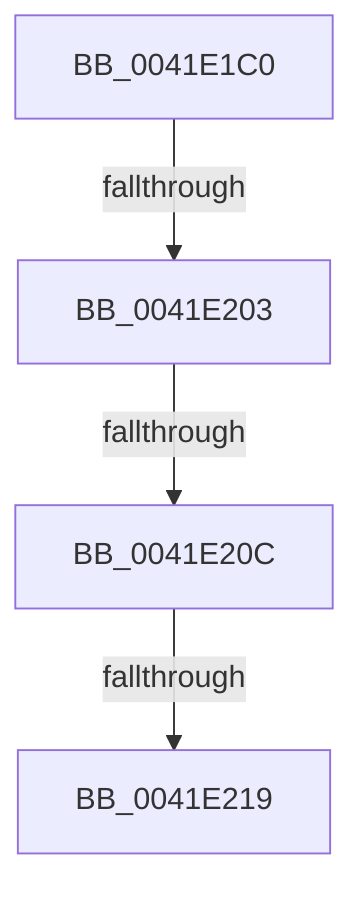

# RtlStringCchCopyExW

- RVA: `0x0041E1C0`–`0x0041E221` (길이 `97` bytes)
- VA: `0x000000014041E1C0`
- 실행 섹션: `.text`
- PDB 이름 있음: `예`; PDB Function 태그: `아니요`
- unwind 정보 RVA: `0x0009FAB0`
- 디코드: `23`개 명령, `97/97` bytes 표시
- 미해석 바이트: `0` (있으면 어셈블리에 `.byte`로 보존)

> 이 문서는 커널 이미지의 기계어와 PDB 기호를 분석해 생성했습니다. 4번과 5번은 함수 원형과 자료형을 바이너리 사용 방식에서 추정한 C 해석이며 원본 소스 복구 결과는 아닙니다.

## 1. Dependencies

- 직접 호출 지점: **0**; 고유 호출 대상: **0**
- 직접 호출자로 확인된 함수: **24**
- RIP 상대 이미지 참조: **0**

### Outgoing calls
- 직접 디코드된 call 명령이 없습니다.

### Direct callers
- [PiDevCfgQueryPolicyStringList](../../page/73/PiDevCfgQueryPolicyStringList_function_00735358.md) at `0x00735584`
- [PiCMGenerateDeviceInstance](../../page/73/PiCMGenerateDeviceInstance_function_0073B69C.md) at `0x0073B74F`
- [PiCMGenerateDeviceInstance](../../page/73/PiCMGenerateDeviceInstance_function_0073B69C.md) at `0x0073B933`
- [CmClassSubkeyCallback](../../page/82/CmClassSubkeyCallback_function_0082C830.md) at `0x0082C90A`
- [CmDeviceClassesSubkeyCallback](../../page/82/CmDeviceClassesSubkeyCallback_function_0082C940.md) at `0x0082CB9B`
- [CmDeviceClassesSubkeyCallback](../../page/82/CmDeviceClassesSubkeyCallback_function_0082C940.md) at `0x0082CC3D`
- [CmDeviceClassesSubkeyCallback](../../page/82/CmDeviceClassesSubkeyCallback_function_0082C940.md) at `0x0082CC62`
- [CmDeviceClassesSubkeyCallback](../../page/82/CmDeviceClassesSubkeyCallback_function_0082C940.md) at `0x0082CDDE`
- [CmEnumSubkeyCallback](../../page/82/CmEnumSubkeyCallback_function_0082CE50.md) at `0x0082CED7`
- [CmEnumSubkeyCallback](../../page/82/CmEnumSubkeyCallback_function_0082CE50.md) at `0x0082CF90`
- [CmEnumSubkeyCallback](../../page/82/CmEnumSubkeyCallback_function_0082CE50.md) at `0x0082D0CE`
- [CmGetMatchingDeviceListForSubkey](../../page/82/CmGetMatchingDeviceListForSubkey_function_0082D5A0.md) at `0x0082D6D6`
- [CmDevicePanelEnumSubkeyCallback](../../page/82/CmDevicePanelEnumSubkeyCallback_function_0082E9B0.md) at `0x0082EAC2`
- [CmDevicePanelEnumSubkeyCallback](../../page/82/CmDevicePanelEnumSubkeyCallback_function_0082E9B0.md) at `0x0082EB8A`
- [CmDevicePanelEnumSubkeyCallback](../../page/82/CmDevicePanelEnumSubkeyCallback_function_0082E9B0.md) at `0x0082EC7A`
- [PnpObjectListCallback](../../page/83/PnpObjectListCallback_function_008323A0.md) at `0x0083240A`
- [DrvDbDeleteObjectSubKey](../../page/83/DrvDbDeleteObjectSubKey_function_00832EEC.md) at `0x008330C3`
- [IopGetDeviceInterfaces](../../page/8F/IopGetDeviceInterfaces_function_008F0120.md) at `0x008F0955`
- [CmGetDeviceInterfaceName](../../page/8F/CmGetDeviceInterfaceName_function_008F3870.md) at `0x008F393E`
- [CmGetDeviceInterfaceName](../../page/8F/CmGetDeviceInterfaceName_function_008F3870.md) at `0x008F3967`
- [CmGetDeviceInterfaceName](../../page/8F/CmGetDeviceInterfaceName_function_008F3870.md) at `0x008F3A64`
- [CmGetDeviceInterfaceName](../../page/8F/CmGetDeviceInterfaceName_function_008F3870.md) at `0x008F3BE8`
- [CmGetDeviceInterfaceReferenceString](../../page/8F/CmGetDeviceInterfaceReferenceString_function_008F5AF8.md) at `0x008F5BC5`
- [RegRtlCreateTreeTransacted](../../page/93/RegRtlCreateTreeTransacted_function_00931D1C.md) at `0x00931ED3`
- [CmGetDeviceParent](../../page/93/CmGetDeviceParent_function_00932368.md) at `0x009325D0`
- [_RegRtlDeletePathInternal](../../page/96/_RegRtlDeletePathInternal_function_00965F04.md) at `0x00965FBF`
- [DrvDbGetDeviceIdDriverInfMatches](../../page/99/DrvDbGetDeviceIdDriverInfMatches_function_00994250.md) at `0x009943E6`
- [DrvDbBuildDeviceIdDriverInfMatch](../../page/99/DrvDbBuildDeviceIdDriverInfMatch_function_009944C0.md) at `0x009945EC`
- [PnpGetGenericStorePropertyLocales](../../page/99/PnpGetGenericStorePropertyLocales_function_00994DBC.md) at `0x00994FB0`
- [CmGetMatchingFilteredDeviceInterfaceListWorker](../../page/A0/CmGetMatchingFilteredDeviceInterfaceListWorker_function_00A097EC.md) at `0x00A09935`
- [DrvDbGetObjectSubKeyCallback](../../page/A1/DrvDbGetObjectSubKeyCallback_function_00A11300.md) at `0x00A114DF`
- [DrvDbGetObjectSubKeyCallback](../../page/A1/DrvDbGetObjectSubKeyCallback_function_00A11300.md) at `0x00A1156E`
- [PiCMCreateDevice](../../page/AC/PiCMCreateDevice_function_00ACB824.md) at `0x00ACBA00`
- [sub_00B23888](../../page/B2/Unknown_function_00B23888.md) at `0x00B240C5`
- [sub_00B33DD8](../../page/B3/Unknown_function_00B33DD8.md) at `0x00B33E9D`
- [sub_00B33DD8](../../page/B3/Unknown_function_00B33DD8.md) at `0x00B33F56`
- [sub_00B36C8C](../../page/B3/Unknown_function_00B36C8C.md) at `0x00B36D0A`

### Static image references
- 디코드된 RIP-relative 메모리 참조가 없습니다.

## 2. Other-region calls and transfers

- 다른 실행 섹션으로 향하는 call: **0**
- call이 아닌 외부 분기/꼬리 이동: **4**
  - `0x0041E1FD` → [sub_0041E34A](Unknown_function_0041E34A.md) (`tail-transfer`)
  - `0x0041E206` → [sub_0041E34A + 0xF](Unknown_function_0041E34A.md) (`tail-transfer`)
  - `0x0041E213` → [sub_0041E34A + 0x18](Unknown_function_0041E34A.md) (`tail-transfer`)
  - `0x0041E21B` → [sub_0041E3BE](Unknown_function_0041E3BE.md) (`tail-transfer`)

## 3. Assembly (complete function range)

```asm
0041E1C0  48 89 5C 24 18                  mov qword ptr [rsp + 0x18], rbx
0041E1C5  48 89 6C 24 20                  mov qword ptr [rsp + 0x20], rbp
0041E1CA  41 54                           push r12
0041E1CC  41 56                           push r14
0041E1CE  41 57                           push r15
0041E1D0  48 83 EC 40                     sub rsp, 0x40
0041E1D4  8B AC 24 88 00 00 00            mov ebp, dword ptr [rsp + 0x88]
0041E1DB  4D 8B D0                        mov r10, r8
0041E1DE  4D 8B E1                        mov r12, r9
0041E1E1  44 8B C5                        mov r8d, ebp
0041E1E4  45 33 C9                        xor r9d, r9d
0041E1E7  4C 8B F2                        mov r14, rdx
0041E1EA  4C 8B F9                        mov r15, rcx
0041E1ED  41 8B D9                        mov ebx, r9d
0041E1F0  41 BB FE FF FF 7F               mov r11d, 0x7ffffffe
0041E1F6  41 81 E0 00 01 00 00            and r8d, 0x100
0041E1FD  0F 84 47 01 00 00               je 0x14041e34a
0041E203  48 85 C9                        test rcx, rcx
0041E206  0F 84 4D 01 00 00               je 0x14041e359
0041E20C  49 81 FE FF FF FF 7F            cmp r14, 0x7fffffff
0041E213  0F 87 49 01 00 00               ja 0x14041e362
0041E219  85 DB                           test ebx, ebx
0041E21B  0F 88 9D 01 00 00               js 0x14041e3be
```

## 4. C-style interpretation (structured pseudocode)

```c
void __fastcall RtlStringCchCopyExW(__int64 a1, __int64 a2, __int64 a3, __int64 a4, __int64 a5, unsigned int a6)
{
    __int64 v_rsp;
    unsigned __int64 v_stack_p18;
    unsigned __int64 v_stack_p20;

    v_stack_p18 = v_rbx;
    v_stack_p20 = v_rbp;
    v_rsp = (v_rsp) - (64);
    a4 = 0;
    a3 = (unsigned int)(((unsigned int)((unsigned int)((unsigned int)(a6)))) & (256));
}
```

## 5. (Beta) C Style

```c
void RtlStringCchCopyExW(int64_t Arg1, int64_t Arg2, int64_t Arg3, int64_t Arg4, uint64_t Arg5, uint32_t Arg6)
{
    int64_t local_rsp;
    uint64_t v_stack_p18;
    uint64_t v_stack_p20;

    v_stack_p18 = local_rbx;
    v_stack_p20 = local_rbp;
    local_rsp = (local_rsp) - (64);
    Arg4 = 0;
    Arg3 = (uint32_t)(((uint32_t)((uint32_t)((uint32_t)(Arg6)))) & (256));
}
```

## 6. Execution-region graph

[열기: 2D/3D 그래프와 함수 탐색 컨트롤 패널](../../../control-panel.html?section=text&rva=0x0041E1C0&view=graph)

- 2D 그래프는 위에서 아래로 흐르고, 3D 그래프는 빈 공간을 드래그해 회전합니다. Shift+드래그는 이동, 휠은 확대·축소, 함수 노드 선택은 대상 보고서 이동입니다.

### Static fallback


