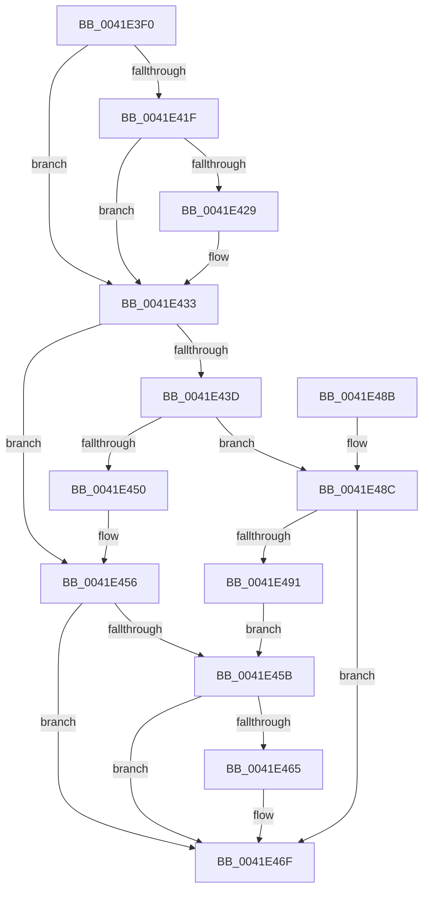

# RtlStringExHandleOtherFlagsW

- RVA: `0x0041E3F0`–`0x0041E4A9` (길이 `185` bytes)
- VA: `0x000000014041E3F0`
- 실행 섹션: `.text`
- PDB 이름 있음: `예`; PDB Function 태그: `예`
- unwind 정보 RVA: `0x0009FB58`
- 디코드: `54`개 명령, `185/185` bytes 표시
- 미해석 바이트: `0` (있으면 어셈블리에 `.byte`로 보존)

> 이 문서는 커널 이미지의 기계어와 PDB 기호를 분석해 생성했습니다. 4번과 5번은 함수 원형과 자료형을 바이너리 사용 방식에서 추정한 C 해석이며 원본 소스 복구 결과는 아닙니다.

## 1. Dependencies

- 직접 호출 지점: **1**; 고유 호출 대상: **1**
- 직접 호출자로 확인된 함수: **16**
- RIP 상대 이미지 참조: **0**

### Outgoing calls
- `0x0041E447` → [memset](../6C/memset_function_006C6C40.md) (function, `0x006C6C40`)

### Direct callers
- [sub_0041E221](Unknown_function_0041E221.md) at `0x0041E2F0`
- [sub_0042B4B3](../42/Unknown_function_0042B4B3.md) at `0x0042B4F9`
- [sub_00437E4E](../43/Unknown_function_00437E4E.md) at `0x00437E80`
- [RtlStringCbCopyExW](../45/RtlStringCbCopyExW_function_0045488C.md) at `0x00454A88`
- [RtlStringCbPrintfExW](../46/RtlStringCbPrintfExW_function_00461AD4.md) at `0x00461C6A`
- [StringCchPrintfExW](../69/StringCchPrintfExW_function_0069DE98.md) at `0x0069DF62`
- [EtwpQueryTokenPackageInfo](../../page/8A/EtwpQueryTokenPackageInfo_function_008A5878.md) at `0x008A5B91`
- [sub_008E80AE](../../page/8E/Unknown_function_008E80AE.md) at `0x008E820D`
- [CmGetDeviceInterfaceSubkeyPath](../../page/8F/CmGetDeviceInterfaceSubkeyPath_function_008F1010.md) at `0x008F1565`
- [CmGetDeviceInterfaceSubkeyPath](../../page/8F/CmGetDeviceInterfaceSubkeyPath_function_008F1010.md) at `0x008F1746`
- [CmGetDeviceInterfaceSubkeyPath](../../page/8F/CmGetDeviceInterfaceSubkeyPath_function_008F1010.md) at `0x008F176D`
- [CmValidateDeviceInterfaceName](../../page/8F/CmValidateDeviceInterfaceName_function_008F1A40.md) at `0x008F1CA3`
- [sub_008F246A](../../page/8F/Unknown_function_008F246A.md) at `0x008F25A9`
- [CmGetDeviceInterfaceName](../../page/8F/CmGetDeviceInterfaceName_function_008F3870.md) at `0x008F3C62`
- [CmGetDeviceInterfaceName](../../page/8F/CmGetDeviceInterfaceName_function_008F3870.md) at `0x008F3CB1`
- [PiPnpRtlGetFilteredDeviceList](../../page/8F/PiPnpRtlGetFilteredDeviceList_function_008FE9F8.md) at `0x008FEDE7`
- [CmGetDeviceChildren](../../page/9D/CmGetDeviceChildren_function_009D08DC.md) at `0x009D0B6A`
- [CmGetDeviceChildren](../../page/9D/CmGetDeviceChildren_function_009D08DC.md) at `0x009D0C19`
- [CmIsDeviceSafeRemovalRequired](../../page/9D/CmIsDeviceSafeRemovalRequired_function_009D1040.md) at `0x009D12E1`
- [sub_00B1E83A](../../page/B1/Unknown_function_00B1E83A.md) at `0x00B1E8D5`

### Static image references
- 디코드된 RIP-relative 메모리 참조가 없습니다.

## 2. Other-region calls and transfers

- 다른 실행 섹션으로 향하는 call: **0**
- 별도 외부 분기/꼬리 이동을 확인하지 못했습니다.

## 3. Assembly (complete function range)

```asm
0041E3F0  48 89 5C 24 08                  mov qword ptr [rsp + 8], rbx
0041E3F5  48 89 74 24 10                  mov qword ptr [rsp + 0x10], rsi
0041E3FA  48 89 7C 24 18                  mov qword ptr [rsp + 0x18], rdi
0041E3FF  41 54                           push r12
0041E401  41 56                           push r14
0041E403  41 57                           push r15
0041E405  48 83 EC 20                     sub rsp, 0x20
0041E409  4C 8B 7C 24 60                  mov r15, qword ptr [rsp + 0x60]
0041E40E  48 8B FA                        mov rdi, rdx
0041E411  45 33 E4                        xor r12d, r12d
0041E414  4D 8B F1                        mov r14, r9
0041E417  48 D1 EF                        shr rdi, 1
0041E41A  48 8B F1                        mov rsi, rcx
0041E41D  74 14                           je 0x14041e433
0041E41F  F7 44 24 68 00 10 00 00         test dword ptr [rsp + 0x68], 0x1000
0041E427  74 0A                           je 0x14041e433
0041E429  49 89 09                        mov qword ptr [r9], rcx
0041E42C  49 89 3F                        mov qword ptr [r15], rdi
0041E42F  66 44 89 21                     mov word ptr [rcx], r12w
0041E433  F7 44 24 68 00 04 00 00         test dword ptr [rsp + 0x68], 0x400
0041E43B  74 19                           je 0x14041e456
0041E43D  0F B6 5C 24 68                  movzx ebx, byte ptr [rsp + 0x68]
0041E442  4C 8B C2                        mov r8, rdx
0041E445  8B D3                           mov edx, ebx
0041E447  E8 F4 87 2A 00                  call 0x1406c6c40
0041E44C  85 DB                           test ebx, ebx
0041E44E  75 3C                           jne 0x14041e48c
0041E450  49 89 36                        mov qword ptr [r14], rsi
0041E453  49 89 3F                        mov qword ptr [r15], rdi
0041E456  48 85 FF                        test rdi, rdi
0041E459  74 14                           je 0x14041e46f
0041E45B  F7 44 24 68 00 08 00 00         test dword ptr [rsp + 0x68], 0x800
0041E463  74 0A                           je 0x14041e46f
0041E465  49 89 36                        mov qword ptr [r14], rsi
0041E468  49 89 3F                        mov qword ptr [r15], rdi
0041E46B  66 44 89 26                     mov word ptr [rsi], r12w
0041E46F  48 8B 5C 24 40                  mov rbx, qword ptr [rsp + 0x40]
0041E474  33 C0                           xor eax, eax
0041E476  48 8B 74 24 48                  mov rsi, qword ptr [rsp + 0x48]
0041E47B  48 8B 7C 24 50                  mov rdi, qword ptr [rsp + 0x50]
0041E480  48 83 C4 20                     add rsp, 0x20
0041E484  41 5F                           pop r15
0041E486  41 5E                           pop r14
0041E488  41 5C                           pop r12
0041E48A  C3                              ret
0041E48B  CC                              int3
0041E48C  48 85 FF                        test rdi, rdi
0041E48F  74 DE                           je 0x14041e46f
0041E491  48 8D 46 FE                     lea rax, [rsi - 2]
0041E495  49 C7 07 01 00 00 00            mov qword ptr [r15], 1
0041E49C  48 8D 04 78                     lea rax, [rax + rdi*2]
0041E4A0  49 89 06                        mov qword ptr [r14], rax
0041E4A3  66 44 89 20                     mov word ptr [rax], r12w
0041E4A7  EB B2                           jmp 0x14041e45b
```

## 4. C-style interpretation (structured pseudocode)

```c
__int64 __fastcall RtlStringExHandleOtherFlagsW(__int64 a1, __int64 a2, __int64 a3, __int64 a4, __int64 a5, unsigned __int8 a6)
{
    __int64 result;
    __int64 v_r12;
    __int64 v_rdi;
    __int64 v_rsp;
    unsigned __int64 v_stack_p10;
    unsigned __int64 v_stack_p18;
    unsigned __int64 v_stack_p8;

    v_stack_p8 = v_rbx;
    v_stack_p10 = v_rsi;
    v_stack_p18 = v_rdi;
    v_rsp = (v_rsp) - (32);
    v_r12 = 0;
    v_rdi = (a2) >> (1);
    if (condition_is_equal) goto loc_0041E433;
    if (((a6) & (0x1000ULL)) != 0) {
        *(unsigned __int64 *)(a4) = a1;
        *(unsigned __int64 *)(a5) = v_rdi;
        *(unsigned __int16 *)(a1) = 0;
    }
    if (((a6) & (0x400ULL)) == 0) goto loc_0041E456;
    result = memset(a1, (unsigned int)(a6), a2, a4);
    if (a6 != 0) goto loc_0041E48C;
    *(unsigned __int64 *)(a4) = a1;
    *(unsigned __int64 *)(a5) = v_rdi;
loc_0041E456:
    if (v_rdi == 0) goto loc_0041E46F;
loc_0041E45B:
    if (((a6) & (0x800ULL)) != 0) {
        *(unsigned __int64 *)(a4) = a1;
        *(unsigned __int64 *)(a5) = v_rdi;
        *(unsigned __int16 *)(a1) = 0;
    }
    result = 0;
    v_rsp = (v_rsp) + (32);
    return result;
loc_0041E48C:
    if (v_stack_p18 == 0) goto loc_0041E46F;
    *(unsigned __int64 *)(a5) = 1;
    *(unsigned __int64 *)(a4) = v_stack_p10 - 2 + v_stack_p18 * 2;
    *(unsigned __int16 *)(v_stack_p10 - 2 + v_stack_p18 * 2) = 0;
    goto loc_0041E45B;
}
```

## 5. (Beta) C Style

```c
int64_t RtlStringExHandleOtherFlagsW(void *Arg1, int64_t Arg2, int64_t Arg3, void *Arg4, void *Arg5, uint8_t Arg6)
{
    uint8_t *arg1 = (uint8_t *)Arg1;
    uint8_t *arg4 = (uint8_t *)Arg4;
    uint8_t *arg5 = (uint8_t *)Arg5;

    int64_t result;
    int64_t local_r12;
    int64_t local_rdi;
    int64_t local_rsp;
    uint64_t v_stack_p10;
    uint64_t v_stack_p18;
    uint64_t v_stack_p8;

    v_stack_p8 = local_rbx;
    v_stack_p10 = local_rsi;
    v_stack_p18 = local_rdi;
    local_rsp = (local_rsp) - (32);
    local_r12 = 0;
    local_rdi = (Arg2) >> (1);
    if (condition_is_equal) goto loc_0041E433;
    if (((Arg6) & (0x1000ULL)) != 0) {
        *(void **)(arg4) = Arg1;
        *(uint64_t *)(arg5) = local_rdi;
        *(uint16_t *)(arg1) = 0;
    }
    if (((Arg6) & (0x400ULL)) == 0) goto loc_0041E456;
    result = memset(Arg1, (uint32_t)(Arg6), Arg2, Arg4);
    if (Arg6 != 0) goto loc_0041E48C;
    *(void **)(arg4) = Arg1;
    *(uint64_t *)(arg5) = local_rdi;
loc_0041E456:
    if (local_rdi == 0) goto loc_0041E46F;
loc_0041E45B:
    if (((Arg6) & (0x800ULL)) != 0) {
        *(void **)(arg4) = Arg1;
        *(uint64_t *)(arg5) = local_rdi;
        *(uint16_t *)(arg1) = 0;
    }
    result = 0;
    local_rsp = (local_rsp) + (32);
    return result;
loc_0041E48C:
    if (v_stack_p18 == 0) goto loc_0041E46F;
    *(uint64_t *)(arg5) = 1;
    *(uint64_t *)(arg4) = v_stack_p10 - 2 + v_stack_p18 * 2;
    *(uint16_t *)(v_stack_p10 - 0x2 + v_stack_p18 * 2) = 0;
    goto loc_0041E45B;
}
```

### 관측된 메모리 오프셋

구조체 형식이 확인되지 않은 접근은 인자 기준의 오프셋으로만 기록했습니다.

| 기준 인자 | 오프셋 표현 | 폭 (bit) | 접근 |
|---|---:|---:|---|
| `Arg1` | `- 0x2` | `64` | `R` |
| `Arg1` | `+ 0x0` | `16` | `W` |
| `Arg1` | `+ 0x0 + rdi*2` | `64` | `R` |
| `Arg4` | `+ 0x0` | `64` | `W` |
| `Arg5` | `+ 0x0` | `64` | `W` |

## 6. Execution-region graph

[열기: 2D/3D 그래프와 함수 탐색 컨트롤 패널](../../../control-panel.html?section=text&rva=0x0041E3F0&view=graph)

- 2D 그래프는 위에서 아래로 흐르고, 3D 그래프는 빈 공간을 드래그해 회전합니다. Shift+드래그는 이동, 휠은 확대·축소, 함수 노드 선택은 대상 보고서 이동입니다.

### Static fallback


