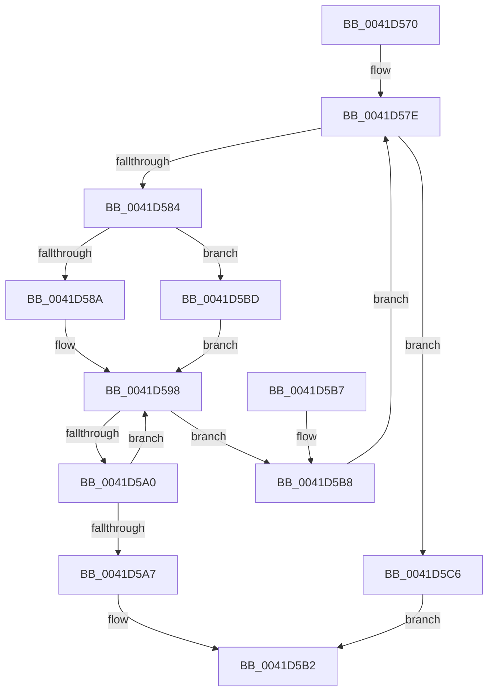

# RtlStronglyEnumerateEntryHashTable

- RVA: `0x0041D570`–`0x0041D5CA` (길이 `90` bytes)
- VA: `0x000000014041D570`
- 실행 섹션: `.text`
- PDB 이름 있음: `예`; PDB Function 태그: `아니요`
- unwind 정보 RVA: `0x0007A1AC`
- 디코드: `30`개 명령, `90/90` bytes 표시
- 미해석 바이트: `0` (있으면 어셈블리에 `.byte`로 보존)

> 이 문서는 커널 이미지의 기계어와 PDB 기호를 분석해 생성했습니다. 4번과 5번은 함수 원형과 자료형을 바이너리 사용 방식에서 추정한 C 해석이며 원본 소스 복구 결과는 아닙니다.

## 1. Dependencies

- 직접 호출 지점: **1**; 고유 호출 대상: **1**
- 직접 호출자로 확인된 함수: **0**
- RIP 상대 이미지 참조: **0**

### Outgoing calls
- `0x0041D590` → [RtlpGetChainHead](RtlpGetChainHead_function_0041D5D0.md) (function, `0x0041D5D0`)

### Direct callers
- 이 함수 시작 RVA로 연결되는 직접 call은 확인되지 않았습니다. 간접 호출은 완전히 역산할 수 없습니다.

### Static image references
- 디코드된 RIP-relative 메모리 참조가 없습니다.

## 2. Other-region calls and transfers

- 다른 실행 섹션으로 향하는 call: **0**
- 별도 외부 분기/꼬리 이동을 확인하지 못했습니다.

## 3. Assembly (complete function range)

```asm
0041D570  48 83 EC 28                     sub rsp, 0x28
0041D574  44 8B 52 20                     mov r10d, dword ptr [rdx + 0x20]
0041D578  4C 8B CA                        mov r9, rdx
0041D57B  4C 8B D9                        mov r11, rcx
0041D57E  45 3B 53 08                     cmp r10d, dword ptr [r11 + 8]
0041D582  73 42                           jae 0x14041d5c6
0041D584  45 3B 51 20                     cmp r10d, dword ptr [r9 + 0x20]
0041D588  74 33                           je 0x14041d5bd
0041D58A  41 8B D2                        mov edx, r10d
0041D58D  49 8B CB                        mov rcx, r11
0041D590  E8 3B 00 00 00                  call 0x14041d5d0
0041D595  48 8B C8                        mov rcx, rax
0041D598  48 8B 00                        mov rax, qword ptr [rax]
0041D59B  48 3B C1                        cmp rax, rcx
0041D59E  74 18                           je 0x14041d5b8
0041D5A0  48 83 78 10 00                  cmp qword ptr [rax + 0x10], 0
0041D5A5  74 F1                           je 0x14041d598
0041D5A7  45 89 51 20                     mov dword ptr [r9 + 0x20], r10d
0041D5AB  49 89 49 18                     mov qword ptr [r9 + 0x18], rcx
0041D5AF  49 89 01                        mov qword ptr [r9], rax
0041D5B2  48 83 C4 28                     add rsp, 0x28
0041D5B6  C3                              ret
0041D5B7  CC                              int3
0041D5B8  41 FF C2                        inc r10d
0041D5BB  EB C1                           jmp 0x14041d57e
0041D5BD  49 8B 01                        mov rax, qword ptr [r9]
0041D5C0  49 8B 49 18                     mov rcx, qword ptr [r9 + 0x18]
0041D5C4  EB D2                           jmp 0x14041d598
0041D5C6  33 C0                           xor eax, eax
0041D5C8  EB E8                           jmp 0x14041d5b2
```

## 4. C-style interpretation (structured pseudocode)

```c
__int64 __fastcall RtlStronglyEnumerateEntryHashTable(__int64 a1, __int64 a2)
{
    __int64 result;
    __int64 v_r10;
    __int64 v_rsp;

    v_rsp = (v_rsp) - (40);
loc_0041D57E:
    if (((unsigned int)((unsigned int)(*(unsigned int *)(a2 + 32)))) >= (*(unsigned int *)(a1 + 8))) goto loc_0041D5C6;
    if (((unsigned int)((unsigned int)(*(unsigned int *)(a2 + 32)))) == (*(unsigned int *)(a2 + 32))) goto loc_0041D5BD;
    result = RtlpGetChainHead(a1, (unsigned int)((unsigned int)((unsigned int)(*(unsigned int *)(a2 + 32)))), a3, a2);
loc_0041D598:
    if ((*(unsigned __int64 *)(result)) == result) goto loc_0041D5B8;
    if ((*(unsigned __int64 *)(*(unsigned __int64 *)(result) + 16)) == 0) goto loc_0041D598;
    *(unsigned int *)(a2 + 32) = (unsigned int)((unsigned int)(*(unsigned int *)(a2 + 32)));
    *(unsigned __int64 *)(a2 + 24) = result;
    *(unsigned __int64 *)(a2) = *(unsigned __int64 *)(result);
loc_0041D5B2:
    v_rsp = (v_rsp) + (40);
    return *(unsigned __int64 *)(result);
loc_0041D5B8:
    v_r10 = (unsigned int)(((unsigned int)(*(unsigned int *)(a2 + 32))) + 1);
    goto loc_0041D57E;
loc_0041D5BD:
    goto loc_0041D598;
loc_0041D5C6:
    result = 0;
    goto loc_0041D5B2;
}
```

## 5. (Beta) C Style

```c
int64_t RtlStronglyEnumerateEntryHashTable(int64_t Arg1, void *Arg2)
{
    uint8_t *arg2 = (uint8_t *)Arg2;

    int64_t result;
    int64_t local_r10;
    int64_t local_rsp;

    local_rsp = (local_rsp) - (40);
loc_0041D57E:
    if (((uint32_t)((uint32_t)(*(uint32_t *)(arg2 + 0x20)))) >= (*(uint32_t *)(Arg1 + 0x8))) goto loc_0041D5C6;
    if (((uint32_t)((uint32_t)(*(uint32_t *)(arg2 + 0x20)))) == (*(uint32_t *)(arg2 + 0x20))) goto loc_0041D5BD;
    result = RtlpGetChainHead(Arg1, (uint32_t)((uint32_t)((uint32_t)(*(uint32_t *)(arg2 + 0x20)))), a3, Arg2);
loc_0041D598:
    if ((*(uint64_t *)(result)) == result) goto loc_0041D5B8;
    if ((*(uint64_t *)(*(uint64_t *)(result) + 0x10)) == 0) goto loc_0041D598;
    *(uint32_t *)(arg2 + 0x20) = (uint32_t)((uint32_t)(*(uint32_t *)(arg2 + 0x20)));
    *(uint64_t *)(arg2 + 0x18) = result;
    *(uint64_t *)(arg2) = *(uint64_t *)(result);
loc_0041D5B2:
    local_rsp = (local_rsp) + (40);
    return *(uint64_t *)(result);
loc_0041D5B8:
    local_r10 = (uint32_t)(((uint32_t)(*(uint32_t *)(arg2 + 0x20))) + 1);
    goto loc_0041D57E;
loc_0041D5BD:
    goto loc_0041D598;
loc_0041D5C6:
    result = 0;
    goto loc_0041D5B2;
}
```

### 관측된 메모리 오프셋

구조체 형식이 확인되지 않은 접근은 인자 기준의 오프셋으로만 기록했습니다.

| 기준 인자 | 오프셋 표현 | 폭 (bit) | 접근 |
|---|---:|---:|---|
| `Arg2` | `+ 0x20` | `32` | `R` |

## 6. Execution-region graph

[열기: 2D/3D 그래프와 함수 탐색 컨트롤 패널](../../../control-panel.html?section=text&rva=0x0041D570&view=graph)

- 2D 그래프는 위에서 아래로 흐르고, 3D 그래프는 빈 공간을 드래그해 회전합니다. Shift+드래그는 이동, 휠은 확대·축소, 함수 노드 선택은 대상 보고서 이동입니다.

### Static fallback


