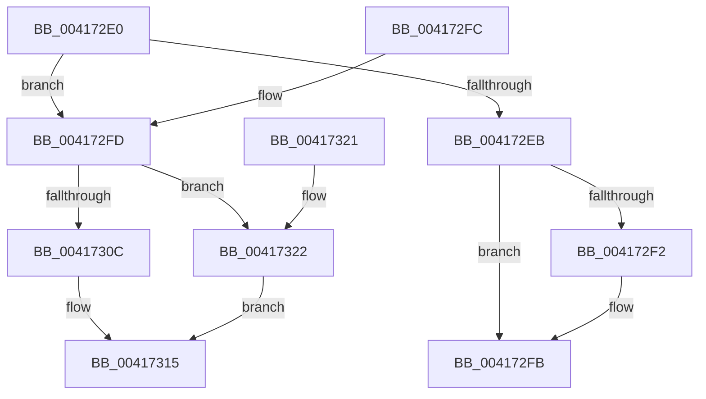

# RtlTimelineBitmapMerge

- RVA: `0x004172E0`–`0x00417326` (길이 `70` bytes)
- VA: `0x00000001404172E0`
- 실행 섹션: `.text`
- PDB 이름 있음: `예`; PDB Function 태그: `아니요`
- unwind 정보 RVA: `0x000DB714`
- 디코드: `28`개 명령, `70/70` bytes 표시
- 미해석 바이트: `0` (있으면 어셈블리에 `.byte`로 보존)

> 이 문서는 커널 이미지의 기계어와 PDB 기호를 분석해 생성했습니다. 4번과 5번은 함수 원형과 자료형을 바이너리 사용 방식에서 추정한 C 해석이며 원본 소스 복구 결과는 아닙니다.

## 1. Dependencies

- 직접 호출 지점: **0**; 고유 호출 대상: **0**
- 직접 호출자로 확인된 함수: **2**
- RIP 상대 이미지 참조: **0**

### Outgoing calls
- 직접 디코드된 call 명령이 없습니다.

### Direct callers
- [PsAddProcessEnergyValues](PsAddProcessEnergyValues_function_00416F58.md) at `0x004170E0`
- [KeFoldProcessStatisticsThread](KeFoldProcessStatisticsThread_function_004171AC.md) at `0x0041728D`

### Static image references
- 디코드된 RIP-relative 메모리 참조가 없습니다.

## 2. Other-region calls and transfers

- 다른 실행 섹션으로 향하는 call: **0**
- 별도 외부 분기/꼬리 이동을 확인하지 못했습니다.

## 3. Assembly (complete function range)

```asm
004172E0  8B 02                           mov eax, dword ptr [rdx]
004172E2  4C 8B C1                        mov r8, rcx
004172E5  8B 09                           mov ecx, dword ptr [rcx]
004172E7  3B C1                           cmp eax, ecx
004172E9  77 12                           ja 0x1404172fd
004172EB  2B C8                           sub ecx, eax
004172ED  83 F9 20                        cmp ecx, 0x20
004172F0  73 09                           jae 0x1404172fb
004172F2  8B 42 04                        mov eax, dword ptr [rdx + 4]
004172F5  D3 E0                           shl eax, cl
004172F7  41 09 40 04                     or dword ptr [r8 + 4], eax
004172FB  C3                              ret
004172FC  CC                              int3
004172FD  44 8B C8                        mov r9d, eax
00417300  41 89 00                        mov dword ptr [r8], eax
00417303  44 2B C9                        sub r9d, ecx
00417306  41 83 F9 20                     cmp r9d, 0x20
0041730A  73 16                           jae 0x140417322
0041730C  41 8B 40 04                     mov eax, dword ptr [r8 + 4]
00417310  41 8B C9                        mov ecx, r9d
00417313  D3 E0                           shl eax, cl
00417315  41 89 40 04                     mov dword ptr [r8 + 4], eax
00417319  0B 42 04                        or eax, dword ptr [rdx + 4]
0041731C  41 89 40 04                     mov dword ptr [r8 + 4], eax
00417320  C3                              ret
00417321  CC                              int3
00417322  33 C0                           xor eax, eax
00417324  EB EF                           jmp 0x140417315
```

## 4. C-style interpretation (structured pseudocode)

```c
__int64 __fastcall RtlTimelineBitmapMerge(__int64 a1, __int64 a2)
{
    __int64 result;

    if (((unsigned int)((unsigned int)(*(unsigned int *)(a2)))) > ((unsigned int)((unsigned int)(*(unsigned int *)(a1))))) goto loc_004172FD;
    a1 = (unsigned int)(((unsigned int)(*(unsigned int *)(a1))) - ((unsigned int)((unsigned int)(*(unsigned int *)(a2)))));
    result = (unsigned int)(*(unsigned int *)(a2));
    if (((unsigned int)(a1)) < 32) {
        result = *(unsigned int *)(a2 + 4);
        result = (unsigned int)((result) << ((unsigned __int8)(a1)));
    }
    return result;
loc_004172FD:
    *(unsigned int *)(a1) = (unsigned int)(result);
    a4 = (unsigned int)(((unsigned int)((unsigned int)(result))) - ((unsigned int)(a1)));
    if (((unsigned int)(a4)) >= 32) goto loc_00417322;
    result = (unsigned int)(((unsigned int)(*(unsigned int *)(a1 + 4))) << ((unsigned __int8)((unsigned int)((unsigned int)(a4)))));
loc_00417315:
    *(unsigned int *)(a1 + 4) = (unsigned int)(result);
    result = (unsigned int)((result) | (*(unsigned int *)(a2 + 4)));
    *(unsigned int *)(a1 + 4) = (unsigned int)(result);
    return result;
loc_00417322:
    result = 0;
    goto loc_00417315;
}
```

## 5. (Beta) C Style

```c
int64_t RtlTimelineBitmapMerge(void *Arg1, void *Arg2)
{
    uint8_t *arg1 = (uint8_t *)Arg1;
    uint8_t *arg2 = (uint8_t *)Arg2;

    int64_t result;

    if (((uint32_t)((uint32_t)(*(uint32_t *)(arg2)))) > ((uint32_t)((uint32_t)(*(uint32_t *)(arg1))))) goto loc_004172FD;
    Arg1 = (uint32_t)(((uint32_t)(*(uint32_t *)(arg1))) - ((uint32_t)((uint32_t)(*(uint32_t *)(arg2)))));
    result = (uint32_t)(*(uint32_t *)(arg2));
    if (((uint32_t)(Arg1)) < 32) {
        result = *(uint32_t *)(arg2 + 0x4);
        result = (uint32_t)((result) << ((uint8_t)(Arg1)));
    }
    return result;
loc_004172FD:
    *(uint32_t *)(arg1) = (uint32_t)(result);
    a4 = (uint32_t)(((uint32_t)((uint32_t)(result))) - ((uint32_t)(Arg1)));
    if (((uint32_t)(a4)) >= 32) goto loc_00417322;
    result = (uint32_t)(((uint32_t)(*(uint32_t *)(arg1 + 0x4))) << ((uint8_t)((uint32_t)((uint32_t)(a4)))));
loc_00417315:
    *(uint32_t *)(arg1 + 0x4) = (uint32_t)(result);
    result = (uint32_t)((result) | (*(uint32_t *)(arg2 + 0x4)));
    *(uint32_t *)(arg1 + 0x4) = (uint32_t)(result);
    return result;
loc_00417322:
    result = 0;
    goto loc_00417315;
}
```

### 관측된 메모리 오프셋

구조체 형식이 확인되지 않은 접근은 인자 기준의 오프셋으로만 기록했습니다.

| 기준 인자 | 오프셋 표현 | 폭 (bit) | 접근 |
|---|---:|---:|---|
| `Arg1` | `+ 0x0` | `32` | `R` |
| `Arg1` | `+ 0x0` | `32` | `W` |
| `Arg1` | `+ 0x4` | `32` | `R` |
| `Arg1` | `+ 0x4` | `32` | `R/W` |
| `Arg1` | `+ 0x4` | `32` | `W` |
| `Arg2` | `+ 0x0` | `32` | `R` |
| `Arg2` | `+ 0x4` | `32` | `R` |

## 6. Execution-region graph

[열기: 2D/3D 그래프와 함수 탐색 컨트롤 패널](../../../control-panel.html?section=text&rva=0x004172E0&view=graph)

- 2D 그래프는 위에서 아래로 흐르고, 3D 그래프는 빈 공간을 드래그해 회전합니다. Shift+드래그는 이동, 휠은 확대·축소, 함수 노드 선택은 대상 보고서 이동입니다.

### Static fallback


