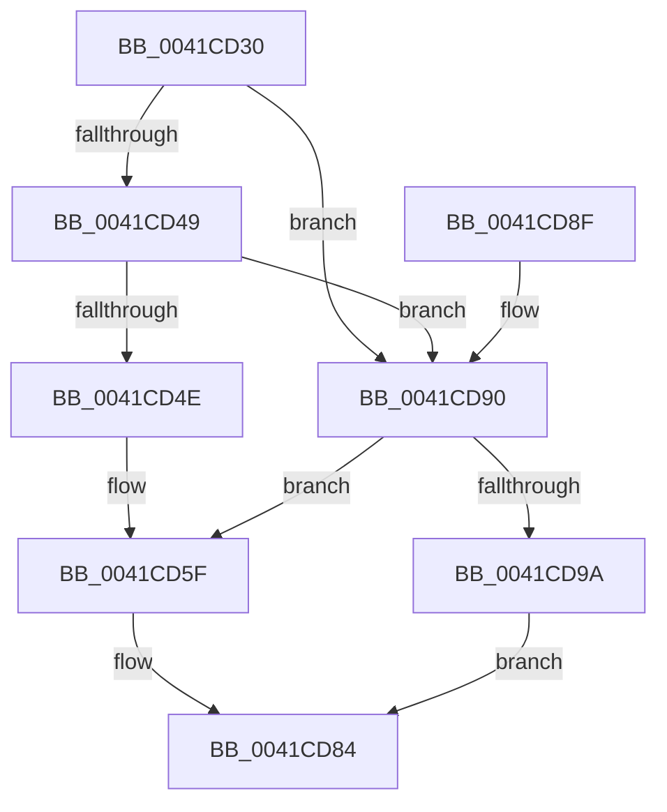

# RtlUnicodeStringCatString

- RVA: `0x0041CD30`–`0x0041CD9C` (길이 `108` bytes)
- VA: `0x000000014041CD30`
- 실행 섹션: `.text`
- PDB 이름 있음: `예`; PDB Function 태그: `아니요`
- unwind 정보 RVA: `0x0009EE40`
- 디코드: `35`개 명령, `108/108` bytes 표시
- 미해석 바이트: `0` (있으면 어셈블리에 `.byte`로 보존)

> 이 문서는 커널 이미지의 기계어와 PDB 기호를 분석해 생성했습니다. 4번과 5번은 함수 원형과 자료형을 바이너리 사용 방식에서 추정한 C 해석이며 원본 소스 복구 결과는 아닙니다.

## 1. Dependencies

- 직접 호출 지점: **2**; 고유 호출 대상: **2**
- 직접 호출자로 확인된 함수: **7**
- RIP 상대 이미지 참조: **0**

### Outgoing calls
- `0x0041CD40` → [RtlUnicodeStringValidateWorker](RtlUnicodeStringValidateWorker_function_0041D210.md) (function, `0x0041D210`)
- `0x0041CD74` → [RtlWideCharArrayCopyStringWorker](RtlWideCharArrayCopyStringWorker_function_0041CDA4.md) (function, `0x0041CDA4`)

### Direct callers
- [CmpIsFileInSystemConfig](../../page/7F/CmpIsFileInSystemConfig_function_007F1F80.md) at `0x007F20E9`
- [AslpPathWildcardAllocMatchNode](../../page/81/AslpPathWildcardAllocMatchNode_function_0081C620.md) at `0x0081C760`
- [CmpLogTransactionAbortedWithChildName](../../page/9A/CmpLogTransactionAbortedWithChildName_function_009AED70.md) at `0x009AEE41`
- [SshpGenerateDeviceFriendlyName](../../page/A2/SshpGenerateDeviceFriendlyName_function_00A2E184.md) at `0x00A2E2E2`
- [SshpGenerateDeviceFriendlyName](../../page/A2/SshpGenerateDeviceFriendlyName_function_00A2E184.md) at `0x00A2E3A3`
- [PopPowerRequestStatsIdConcat](../../page/A8/PopPowerRequestStatsIdConcat_function_00A80018.md) at `0x00A800BB`
- [PopPowerRequestStatsIdConcat](../../page/A8/PopPowerRequestStatsIdConcat_function_00A80018.md) at `0x00A800FF`
- [PopIdleWakeGenerateInterruptDescriptionString](../../page/A9/PopIdleWakeGenerateInterruptDescriptionString_function_00A98748.md) at `0x00A98917`
- [PopGenerateDeviceFriendlyName](../../page/A9/PopGenerateDeviceFriendlyName_function_00A98968.md) at `0x00A98B29`
- [PopGenerateDeviceFriendlyName](../../page/A9/PopGenerateDeviceFriendlyName_function_00A98968.md) at `0x00A98B4A`
- [PopGenerateDeviceFriendlyName](../../page/A9/PopGenerateDeviceFriendlyName_function_00A98968.md) at `0x00A98BA9`
- [PopGenerateDeviceFriendlyName](../../page/A9/PopGenerateDeviceFriendlyName_function_00A98968.md) at `0x00A98BD8`

### Static image references
- 디코드된 RIP-relative 메모리 참조가 없습니다.

## 2. Other-region calls and transfers

- 다른 실행 섹션으로 향하는 call: **0**
- 별도 외부 분기/꼬리 이동을 확인하지 못했습니다.

## 3. Assembly (complete function range)

```asm
0041CD30  48 89 5C 24 08                  mov qword ptr [rsp + 8], rbx
0041CD35  57                              push rdi
0041CD36  48 83 EC 30                     sub rsp, 0x30
0041CD3A  4C 8B D2                        mov r10, rdx
0041CD3D  48 8B D9                        mov rbx, rcx
0041CD40  E8 CB 04 00 00                  call 0x14041d210
0041CD45  85 C0                           test eax, eax
0041CD47  78 47                           js 0x14041cd90
0041CD49  48 85 C9                        test rcx, rcx
0041CD4C  74 42                           je 0x14041cd90
0041CD4E  0F B7 53 02                     movzx edx, word ptr [rbx + 2]
0041CD52  0F B7 3B                        movzx edi, word ptr [rbx]
0041CD55  48 8B 49 08                     mov rcx, qword ptr [rcx + 8]
0041CD59  48 D1 EA                        shr rdx, 1
0041CD5C  48 D1 EF                        shr rdi, 1
0041CD5F  48 83 64 24 50 00               and qword ptr [rsp + 0x50], 0
0041CD65  48 8D 0C 79                     lea rcx, [rcx + rdi*2]
0041CD69  48 2B D7                        sub rdx, rdi
0041CD6C  4C 8D 44 24 50                  lea r8, [rsp + 0x50]
0041CD71  4D 8B CA                        mov r9, r10
0041CD74  E8 2B 00 00 00                  call 0x14041cda4
0041CD79  66 03 7C 24 50                  add di, word ptr [rsp + 0x50]
0041CD7E  66 03 FF                        add di, di
0041CD81  66 89 3B                        mov word ptr [rbx], di
0041CD84  48 8B 5C 24 40                  mov rbx, qword ptr [rsp + 0x40]
0041CD89  48 83 C4 30                     add rsp, 0x30
0041CD8D  5F                              pop rdi
0041CD8E  C3                              ret
0041CD8F  CC                              int3
0041CD90  33 C9                           xor ecx, ecx
0041CD92  33 D2                           xor edx, edx
0041CD94  33 FF                           xor edi, edi
0041CD96  85 C0                           test eax, eax
0041CD98  79 C5                           jns 0x14041cd5f
0041CD9A  EB E8                           jmp 0x14041cd84
```

## 4. C-style interpretation (structured pseudocode)

```c
__int64 __fastcall RtlUnicodeStringCatString(__int64 a1, __int64 a2)
{
    __int64 result;
    __int64 v_rdi;
    __int64 v_rsp;
    unsigned __int64 v_stack_p18;
    unsigned __int64 v_stack_p8;

    v_stack_p8 = v_rbx;
    v_rsp = (v_rsp) - (48);
    result = RtlUnicodeStringValidateWorker(a1, a2, a3, a4);
    if (sign_flag) goto loc_0041CD90;
    if (a1 == 0) goto loc_0041CD90;
    a2 = (*(unsigned __int16 *)(a1 + 2)) >> (1);
    v_rdi = (*(unsigned __int16 *)(a1)) >> (1);
loc_0041CD5F:
    a2 = (a2) - (v_rdi);
    result = RtlWideCharArrayCopyStringWorker(*(unsigned __int64 *)(a1 + 8) + v_rdi * 2, a2, v_stack_p18, a2);
    v_rdi = (unsigned __int16)((v_rdi) + (v_stack_p18));
    v_rdi = (unsigned __int16)((v_rdi) + ((unsigned __int16)(v_rdi)));
    *(unsigned __int16 *)(a1) = (unsigned __int16)(v_rdi);
loc_0041CD84:
    v_rsp = (v_rsp) + (48);
    return result;
loc_0041CD90:
    a1 = 0;
    a2 = 0;
    v_rdi = 0;
    if (!sign_flag) goto loc_0041CD5F;
    goto loc_0041CD84;
}
```

## 5. (Beta) C Style

```c
int64_t RtlUnicodeStringCatString(void *Arg1, int64_t Arg2)
{
    uint8_t *arg1 = (uint8_t *)Arg1;

    int64_t result;
    int64_t local_rdi;
    int64_t local_rsp;
    uint64_t v_stack_p18;
    uint64_t v_stack_p8;

    v_stack_p8 = local_rbx;
    local_rsp = (local_rsp) - (48);
    result = RtlUnicodeStringValidateWorker(Arg1, Arg2, a3, a4);
    if (sign_flag) goto loc_0041CD90;
    if (Arg1 == NULL) goto loc_0041CD90;
    Arg2 = (*(uint16_t *)(arg1 + 0x2)) >> (1);
    local_rdi = (*(uint16_t *)(arg1)) >> (1);
loc_0041CD5F:
    Arg2 = (Arg2) - (local_rdi);
    result = RtlWideCharArrayCopyStringWorker(*(uint64_t *)(arg1 + 0x8) + local_rdi * 2, Arg2, v_stack_p18, Arg2);
    local_rdi = (uint16_t)((local_rdi) + (v_stack_p18));
    local_rdi = (uint16_t)((local_rdi) + ((uint16_t)(local_rdi)));
    *(uint16_t *)(arg1) = (uint16_t)(local_rdi);
loc_0041CD84:
    local_rsp = (local_rsp) + (48);
    return result;
loc_0041CD90:
    Arg1 = 0;
    Arg2 = 0;
    local_rdi = 0;
    if (!sign_flag) goto loc_0041CD5F;
    goto loc_0041CD84;
}
```

### 관측된 메모리 오프셋

구조체 형식이 확인되지 않은 접근은 인자 기준의 오프셋으로만 기록했습니다.

| 기준 인자 | 오프셋 표현 | 폭 (bit) | 접근 |
|---|---:|---:|---|
| `Arg1` | `+ 0x0` | `16` | `R` |
| `Arg1` | `+ 0x0` | `16` | `W` |
| `Arg1` | `+ 0x2` | `16` | `R` |

## 6. Execution-region graph

[열기: 2D/3D 그래프와 함수 탐색 컨트롤 패널](../../../control-panel.html?section=text&rva=0x0041CD30&view=graph)

- 2D 그래프는 위에서 아래로 흐르고, 3D 그래프는 빈 공간을 드래그해 회전합니다. Shift+드래그는 이동, 휠은 확대·축소, 함수 노드 선택은 대상 보고서 이동입니다.

### Static fallback


