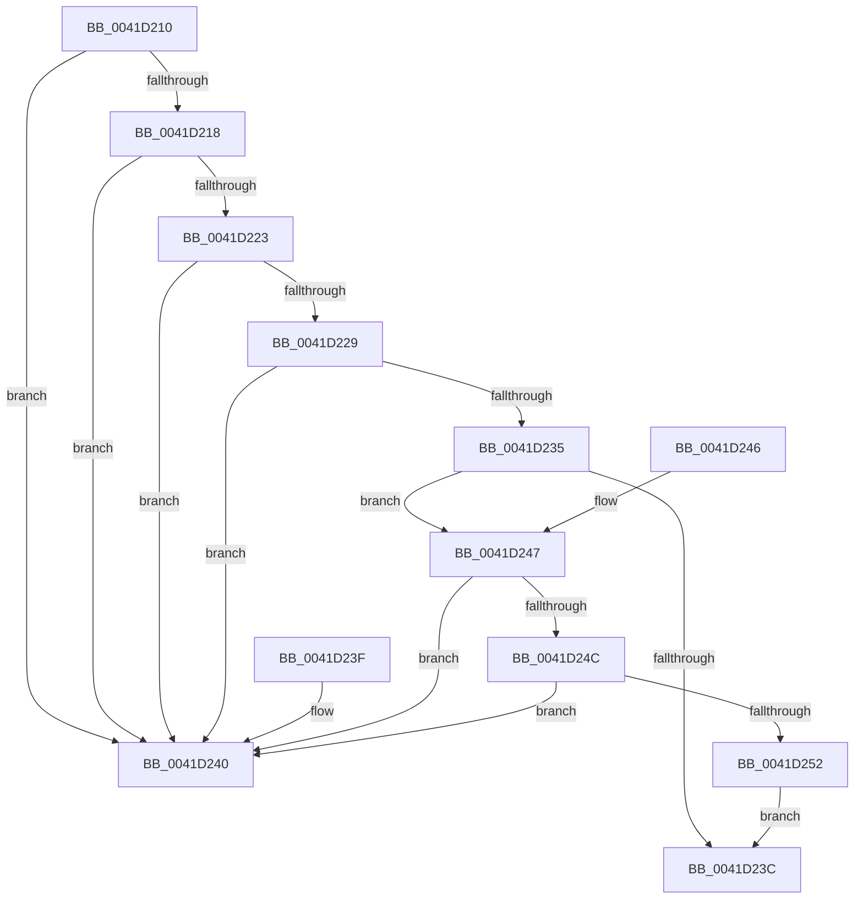

# RtlUnicodeStringValidateWorker

- RVA: `0x0041D210`–`0x0041D254` (길이 `68` bytes)
- VA: `0x000000014041D210`
- 실행 섹션: `.text`
- PDB 이름 있음: `예`; PDB Function 태그: `예`
- unwind 정보 RVA: `0x000DB714`
- 디코드: `24`개 명령, `68/68` bytes 표시
- 미해석 바이트: `0` (있으면 어셈블리에 `.byte`로 보존)

> 이 문서는 커널 이미지의 기계어와 PDB 기호를 분석해 생성했습니다. 4번과 5번은 함수 원형과 자료형을 바이너리 사용 방식에서 추정한 C 해석이며 원본 소스 복구 결과는 아닙니다.

## 1. Dependencies

- 직접 호출 지점: **0**; 고유 호출 대상: **0**
- 직접 호출자로 확인된 함수: **2**
- RIP 상대 이미지 참조: **0**

### Outgoing calls
- 직접 디코드된 call 명령이 없습니다.

### Direct callers
- [RtlUnicodeStringCatString](RtlUnicodeStringCatString_function_0041CD30.md) at `0x0041CD40`
- [RtlStringCbCopyUnicodeString](RtlStringCbCopyUnicodeString_function_0041D164.md) at `0x0041D189`

### Static image references
- 디코드된 RIP-relative 메모리 참조가 없습니다.

## 2. Other-region calls and transfers

- 다른 실행 섹션으로 향하는 call: **0**
- 별도 외부 분기/꼬리 이동을 확인하지 못했습니다.

## 3. Assembly (complete function range)

```asm
0041D210  0F B7 11                        movzx edx, word ptr [rcx]
0041D213  F6 C2 01                        test dl, 1
0041D216  75 28                           jne 0x14041d240
0041D218  44 0F B7 41 02                  movzx r8d, word ptr [rcx + 2]
0041D21D  41 F6 C0 01                     test r8b, 1
0041D221  75 1D                           jne 0x14041d240
0041D223  66 41 3B D0                     cmp dx, r8w
0041D227  77 17                           ja 0x14041d240
0041D229  41 B9 FE FF 00 00               mov r9d, 0xfffe
0041D22F  66 45 3B C1                     cmp r8w, r9w
0041D233  77 0B                           ja 0x14041d240
0041D235  48 83 79 08 00                  cmp qword ptr [rcx + 8], 0
0041D23A  74 0B                           je 0x14041d247
0041D23C  33 C0                           xor eax, eax
0041D23E  C3                              ret
0041D23F  CC                              int3
0041D240  B8 0D 00 00 C0                  mov eax, 0xc000000d
0041D245  C3                              ret
0041D246  CC                              int3
0041D247  66 85 D2                        test dx, dx
0041D24A  75 F4                           jne 0x14041d240
0041D24C  66 45 85 C0                     test r8w, r8w
0041D250  75 EE                           jne 0x14041d240
0041D252  EB E8                           jmp 0x14041d23c
```

## 4. C-style interpretation (structured pseudocode)

```c
__int64 __fastcall RtlUnicodeStringValidateWorker(__int64 a1)
{
    __int64 result;

    if ((((unsigned __int8)(*(unsigned __int16 *)(a1))) & (1)) != 0) goto loc_0041D240;
    if ((((unsigned __int8)(*(unsigned __int16 *)(a1 + 2))) & (1)) != 0) goto loc_0041D240;
    if (((unsigned __int16)(*(unsigned __int16 *)(a1))) > ((unsigned __int16)(*(unsigned __int16 *)(a1 + 2)))) goto loc_0041D240;
    if (((unsigned __int16)(*(unsigned __int16 *)(a1 + 2))) > ((unsigned __int16)((unsigned int)(0xFFFEULL)))) goto loc_0041D240;
    if ((*(unsigned __int64 *)(a1 + 8)) == 0) goto loc_0041D247;
loc_0041D23C:
    result = 0;
    return result;
loc_0041D240:
    return (unsigned int)(0xC000000DULL);
loc_0041D247:
    if ((unsigned __int16)(*(unsigned __int16 *)(a1)) != 0) goto loc_0041D240;
    if ((unsigned __int16)(*(unsigned __int16 *)(a1 + 2)) != 0) goto loc_0041D240;
    goto loc_0041D23C;
}
```

## 5. (Beta) C Style

```c
int64_t RtlUnicodeStringValidateWorker(void *Arg1)
{
    uint8_t *arg1 = (uint8_t *)Arg1;

    int64_t result;

    if ((((uint8_t)(*(uint16_t *)(arg1))) & (1)) != 0) goto loc_0041D240;
    if ((((uint8_t)(*(uint16_t *)(arg1 + 0x2))) & (1)) != 0) goto loc_0041D240;
    if (((uint16_t)(*(uint16_t *)(arg1))) > ((uint16_t)(*(uint16_t *)(arg1 + 0x2)))) goto loc_0041D240;
    if (((uint16_t)(*(uint16_t *)(arg1 + 0x2))) > ((uint16_t)((uint32_t)(0xFFFEULL)))) goto loc_0041D240;
    if ((*(uint64_t *)(arg1 + 0x8)) == 0) goto loc_0041D247;
loc_0041D23C:
    result = 0;
    return result;
loc_0041D240:
    return (uint32_t)(0xC000000DULL);
loc_0041D247:
    if ((uint16_t)(*(uint16_t *)(arg1)) != 0) goto loc_0041D240;
    if ((uint16_t)(*(uint16_t *)(arg1 + 0x2)) != 0) goto loc_0041D240;
    goto loc_0041D23C;
}
```

### 관측된 메모리 오프셋

구조체 형식이 확인되지 않은 접근은 인자 기준의 오프셋으로만 기록했습니다.

| 기준 인자 | 오프셋 표현 | 폭 (bit) | 접근 |
|---|---:|---:|---|
| `Arg1` | `+ 0x0` | `16` | `R` |
| `Arg1` | `+ 0x2` | `16` | `R` |
| `Arg1` | `+ 0x8` | `64` | `R` |

## 6. Execution-region graph

[열기: 2D/3D 그래프와 함수 탐색 컨트롤 패널](../../../control-panel.html?section=text&rva=0x0041D210&view=graph)

- 2D 그래프는 위에서 아래로 흐르고, 3D 그래프는 빈 공간을 드래그해 회전합니다. Shift+드래그는 이동, 휠은 확대·축소, 함수 노드 선택은 대상 보고서 이동입니다.

### Static fallback


