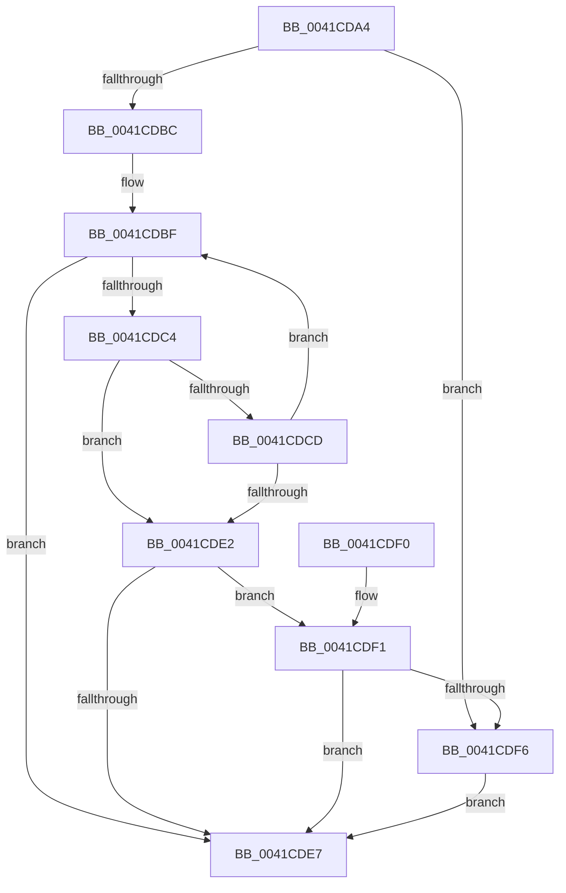

# RtlWideCharArrayCopyStringWorker

- RVA: `0x0041CDA4`–`0x0041CE04` (길이 `96` bytes)
- VA: `0x000000014041CDA4`
- 실행 섹션: `.text`
- PDB 이름 있음: `예`; PDB Function 태그: `예`
- unwind 정보 RVA: `0x0009EE50`
- 디코드: `31`개 명령, `96/96` bytes 표시
- 미해석 바이트: `0` (있으면 어셈블리에 `.byte`로 보존)

> 이 문서는 커널 이미지의 기계어와 PDB 기호를 분석해 생성했습니다. 4번과 5번은 함수 원형과 자료형을 바이너리 사용 방식에서 추정한 C 해석이며 원본 소스 복구 결과는 아닙니다.

## 1. Dependencies

- 직접 호출 지점: **0**; 고유 호출 대상: **0**
- 직접 호출자로 확인된 함수: **1**
- RIP 상대 이미지 참조: **0**

### Outgoing calls
- 직접 디코드된 call 명령이 없습니다.

### Direct callers
- [RtlUnicodeStringCatString](RtlUnicodeStringCatString_function_0041CD30.md) at `0x0041CD74`

### Static image references
- 디코드된 RIP-relative 메모리 참조가 없습니다.

## 2. Other-region calls and transfers

- 다른 실행 섹션으로 향하는 call: **0**
- 별도 외부 분기/꼬리 이동을 확인하지 못했습니다.

## 3. Assembly (complete function range)

```asm
0041CDA4  48 89 5C 24 08                  mov qword ptr [rsp + 8], rbx
0041CDA9  33 C0                           xor eax, eax
0041CDAB  48 8B D9                        mov rbx, rcx
0041CDAE  41 BA FF 7F 00 00               mov r10d, 0x7fff
0041CDB4  44 8B D8                        mov r11d, eax
0041CDB7  48 85 D2                        test rdx, rdx
0041CDBA  74 3A                           je 0x14041cdf6
0041CDBC  49 2B D9                        sub rbx, r9
0041CDBF  4D 85 D2                        test r10, r10
0041CDC2  74 23                           je 0x14041cde7
0041CDC4  41 0F B7 09                     movzx ecx, word ptr [r9]
0041CDC8  66 85 C9                        test cx, cx
0041CDCB  74 15                           je 0x14041cde2
0041CDCD  66 42 89 0C 0B                  mov word ptr [rbx + r9], cx
0041CDD2  49 FF CA                        dec r10
0041CDD5  49 83 C1 02                     add r9, 2
0041CDD9  49 FF C3                        inc r11
0041CDDC  48 83 EA 01                     sub rdx, 1
0041CDE0  75 DD                           jne 0x14041cdbf
0041CDE2  48 85 D2                        test rdx, rdx
0041CDE5  74 0A                           je 0x14041cdf1
0041CDE7  48 8B 5C 24 08                  mov rbx, qword ptr [rsp + 8]
0041CDEC  4D 89 18                        mov qword ptr [r8], r11
0041CDEF  C3                              ret
0041CDF0  CC                              int3
0041CDF1  4D 85 D2                        test r10, r10
0041CDF4  74 F1                           je 0x14041cde7
0041CDF6  66 41 39 01                     cmp word ptr [r9], ax
0041CDFA  B9 05 00 00 80                  mov ecx, 0x80000005
0041CDFF  0F 45 C1                        cmovne eax, ecx
0041CE02  EB E3                           jmp 0x14041cde7
```

## 4. C-style interpretation (structured pseudocode)

```c
__int64 __fastcall RtlWideCharArrayCopyStringWorker(__int64 a1, __int64 a2, __int64 a3, __int64 a4)
{
    __int64 result;
    __int64 v_r10;
    __int64 v_r11;
    __int64 v_rbx;
    unsigned __int64 v_stack_p8;

    v_stack_p8 = v_rbx;
    result = 0;
    if (a2 == 0) goto loc_0041CDF6;
    v_rbx = (a1) - (a4);
loc_0041CDBF:
    if ((unsigned int)(0x7FFFULL) == 0) goto loc_0041CDE7;
    if ((unsigned __int16)(*(unsigned __int16 *)(a4)) == 0) goto loc_0041CDE2;
    *(unsigned __int16 *)(v_rbx + a4 * 1) = (unsigned __int16)(*(unsigned __int16 *)(a4));
    v_r10 = ((unsigned int)(0x7FFFULL)) - 1;
    a4 = (a4) + (2);
    v_r11 = (0) + 1;
    a2 = (a2) - (1);
    if (condition_is_not_equal) goto loc_0041CDBF;
loc_0041CDE2:
    if (a2 == 0) goto loc_0041CDF1;
loc_0041CDE7:
    *(unsigned __int64 *)(a3) = v_r11;
    return result;
loc_0041CDF1:
    if (v_r10 == 0) goto loc_0041CDE7;
loc_0041CDF6:
    if ((*(unsigned __int16 *)(a4)) != 0) { result = (unsigned int)((unsigned int)(0x80000005ULL)); }
    goto loc_0041CDE7;
}
```

## 5. (Beta) C Style

```c
int64_t RtlWideCharArrayCopyStringWorker(void *Arg1, int64_t Arg2, void *Arg3, void *Arg4)
{
    uint8_t *arg1 = (uint8_t *)Arg1;
    uint8_t *arg3 = (uint8_t *)Arg3;
    uint8_t *arg4 = (uint8_t *)Arg4;

    int64_t result;
    int64_t local_r10;
    int64_t local_r11;
    int64_t local_rbx;
    uint64_t v_stack_p8;

    v_stack_p8 = local_rbx;
    result = 0;
    if (Arg2 == 0) goto loc_0041CDF6;
    local_rbx = (Arg1) - (Arg4);
loc_0041CDBF:
    if ((uint32_t)(0x7FFFULL) == 0) goto loc_0041CDE7;
    if ((uint16_t)(*(uint16_t *)(arg4)) == 0) goto loc_0041CDE2;
    *(uint16_t *)(local_rbx + arg4 * 1) = (uint16_t)(*(uint16_t *)(arg4));
    local_r10 = ((uint32_t)(0x7FFFULL)) - 1;
    Arg4 = (Arg4) + (2);
    local_r11 = (0) + 1;
    Arg2 = (Arg2) - (1);
    if (condition_is_not_equal) goto loc_0041CDBF;
loc_0041CDE2:
    if (Arg2 == 0) goto loc_0041CDF1;
loc_0041CDE7:
    *(uint64_t *)(arg3) = local_r11;
    return result;
loc_0041CDF1:
    if (local_r10 == 0) goto loc_0041CDE7;
loc_0041CDF6:
    if ((*(uint16_t *)(arg4)) != 0) { result = (uint32_t)((uint32_t)(0x80000005ULL)); }
    goto loc_0041CDE7;
}
```

### 관측된 메모리 오프셋

구조체 형식이 확인되지 않은 접근은 인자 기준의 오프셋으로만 기록했습니다.

| 기준 인자 | 오프셋 표현 | 폭 (bit) | 접근 |
|---|---:|---:|---|
| `Arg1` | `+ 0x0 + r9*1` | `16` | `W` |
| `Arg3` | `+ 0x0` | `64` | `W` |
| `Arg4` | `+ 0x0` | `16` | `R` |

## 6. Execution-region graph

[열기: 2D/3D 그래프와 함수 탐색 컨트롤 패널](../../../control-panel.html?section=text&rva=0x0041CDA4&view=graph)

- 2D 그래프는 위에서 아래로 흐르고, 3D 그래프는 빈 공간을 드래그해 회전합니다. Shift+드래그는 이동, 휠은 확대·축소, 함수 노드 선택은 대상 보고서 이동입니다.

### Static fallback


