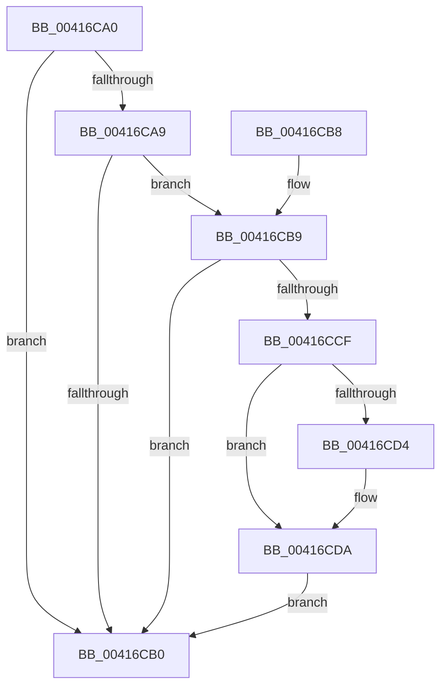

# RtlpConvertFunctionEntry

- RVA: `0x00416CA0`–`0x00416CF4` (길이 `84` bytes)
- VA: `0x0000000140416CA0`
- 실행 섹션: `.text`
- PDB 이름 있음: `예`; PDB Function 태그: `아니요`
- unwind 정보 RVA: `0x0009CC1C`
- 디코드: `26`개 명령, `84/84` bytes 표시
- 미해석 바이트: `0` (있으면 어셈블리에 `.byte`로 보존)

> 이 문서는 커널 이미지의 기계어와 PDB 기호를 분석해 생성했습니다. 4번과 5번은 함수 원형과 자료형을 바이너리 사용 방식에서 추정한 C 해석이며 원본 소스 복구 결과는 아닙니다.

## 1. Dependencies

- 직접 호출 지점: **1**; 고유 호출 대상: **1**
- 직접 호출자로 확인된 함수: **6**
- RIP 상대 이미지 참조: **0**

### Outgoing calls
- `0x00416CD4` → [ExRaiseDatatypeMisalignment](../../page/89/ExRaiseDatatypeMisalignment_function_00899FD0.md) (function, `0x00899FD0`)

### Direct callers
- [KiLockExtendedServiceTable](../50/KiLockExtendedServiceTable_function_00509F48.md) at `0x0050A043`
- [RtlIsSpecialUnwind](../5E/RtlIsSpecialUnwind_function_005EECF4.md) at `0x005EED01`
- [KiLockServiceTable](../69/KiLockServiceTable_function_0069BC98.md) at `0x0069BDD1`
- [RtlMarkExceptionHandlingPages](../../page/A2/RtlMarkExceptionHandlingPages_function_00A26D60.md) at `0x00A26EFD`
- [CcInitializeBcbProfiler](../../init/BE/CcInitializeBcbProfiler_function_00BEF294.md) at `0x00BEF7D5`
- [sub_00BF16D0](../../init/BF/Unknown_function_00BF16D0.md) at `0x00BF27D1`
- [sub_00BF16D0](../../init/BF/Unknown_function_00BF16D0.md) at `0x00BF3A6B`
- [sub_00BF16D0](../../init/BF/Unknown_function_00BF16D0.md) at `0x00BF617D`
- [sub_00BF16D0](../../init/BF/Unknown_function_00BF16D0.md) at `0x00BF83B7`
- [sub_00BF16D0](../../init/BF/Unknown_function_00BF16D0.md) at `0x00C13F00`

### Static image references
- 디코드된 RIP-relative 메모리 참조가 없습니다.

## 2. Other-region calls and transfers

- 다른 실행 섹션으로 향하는 call: **1**
  - `0x00416CD4` → [ExRaiseDatatypeMisalignment](../../page/89/ExRaiseDatatypeMisalignment_function_00899FD0.md) (`.text` → `PAGE`)
- 별도 외부 분기/꼬리 이동을 확인하지 못했습니다.

## 3. Assembly (complete function range)

```asm
00416CA0  48 83 EC 28                     sub rsp, 0x28
00416CA4  48 85 C9                        test rcx, rcx
00416CA7  74 07                           je 0x140416cb0
00416CA9  8B 41 08                        mov eax, dword ptr [rcx + 8]
00416CAC  A8 01                           test al, 1
00416CAE  75 09                           jne 0x140416cb9
00416CB0  48 8B C1                        mov rax, rcx
00416CB3  48 83 C4 28                     add rsp, 0x28
00416CB7  C3                              ret
00416CB8  CC                              int3
00416CB9  48 8D 48 FF                     lea rcx, [rax - 1]
00416CBD  48 B8 FF FF FE FF FF 7F 00 00   movabs rax, 0x7ffffffeffff
00416CC7  48 03 CA                        add rcx, rdx
00416CCA  48 3B D0                        cmp rdx, rax
00416CCD  77 E1                           ja 0x140416cb0
00416CCF  F6 C1 03                        test cl, 3
00416CD2  74 06                           je 0x140416cda
00416CD4  E8 F7 32 48 00                  call 0x140899fd0
00416CD9  CC                              int3
00416CDA  48 BA 00 00 FF FF FF 7F 00 00   movabs rdx, 0x7fffffff0000
00416CE4  48 8B C1                        mov rax, rcx
00416CE7  48 3B CA                        cmp rcx, rdx
00416CEA  90                              nop
00416CEB  48 0F 43 C2                     cmovae rax, rdx
00416CEF  0F B6 00                        movzx eax, byte ptr [rax]
00416CF2  EB BC                           jmp 0x140416cb0
```

## 4. C-style interpretation (structured pseudocode)

```c
__int64 __fastcall RtlpConvertFunctionEntry(__int64 a1, __int64 a2)
{
    __int64 result;
    __int64 v_rsp;

    v_rsp = (v_rsp) - (40);
    if (a1 == 0) goto loc_00416CB0;
    if ((((unsigned __int8)((unsigned int)(*(unsigned int *)(a1 + 8)))) & (1)) != 0) goto loc_00416CB9;
loc_00416CB0:
    v_rsp = (v_rsp) + (40);
    return a1;
loc_00416CB9:
    a1 = (a1 - 1) + (a2);
    if (a2 > a1) goto loc_00416CB0;
    result = a1;
    if ((((unsigned __int8)(a1)) & (3)) != 0) {
        result = ExRaiseDatatypeMisalignment(a1, a2, a3, a4);
    }
    if (a1 >= a2) { a1 = a2; }
    goto loc_00416CB0;
}
```

## 5. (Beta) C Style

```c
int64_t RtlpConvertFunctionEntry(int64_t Arg1, int64_t Arg2)
{
    int64_t result;
    int64_t local_rsp;

    local_rsp = (local_rsp) - (40);
    if (Arg1 == 0) goto loc_00416CB0;
    if ((((uint8_t)((uint32_t)(*(uint32_t *)(Arg1 + 0x8)))) & (1)) != 0) goto loc_00416CB9;
loc_00416CB0:
    local_rsp = (local_rsp) + (40);
    return Arg1;
loc_00416CB9:
    Arg1 = (Arg1 - 1) + (Arg2);
    if (Arg2 > Arg1) goto loc_00416CB0;
    result = Arg1;
    if ((((uint8_t)(Arg1)) & (3)) != 0) {
        result = ExRaiseDatatypeMisalignment(Arg1, Arg2, a3, a4);
    }
    if (Arg1 >= Arg2) { Arg1 = Arg2; }
    goto loc_00416CB0;
}
```

## 6. Execution-region graph

[열기: 2D/3D 그래프와 함수 탐색 컨트롤 패널](../../../control-panel.html?section=text&rva=0x00416CA0&view=graph)

- 2D 그래프는 위에서 아래로 흐르고, 3D 그래프는 빈 공간을 드래그해 회전합니다. Shift+드래그는 이동, 휠은 확대·축소, 함수 노드 선택은 대상 보고서 이동입니다.

### Static fallback


