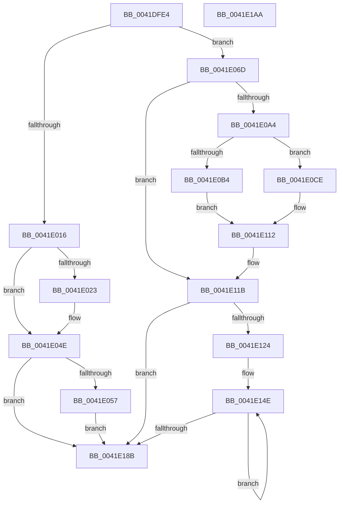

# RtlpCopyBitMapTailToHeadEx

- RVA: `0x0041DFE4`–`0x0041E1AB` (길이 `455` bytes)
- VA: `0x000000014041DFE4`
- 실행 섹션: `.text`
- PDB 이름 있음: `예`; PDB Function 태그: `아니요`
- unwind 정보 RVA: `0x0005FEF8`
- 디코드: `144`개 명령, `455/455` bytes 표시
- 미해석 바이트: `0` (있으면 어셈블리에 `.byte`로 보존)

> 이 문서는 커널 이미지의 기계어와 PDB 기호를 분석해 생성했습니다. 4번과 5번은 함수 원형과 자료형을 바이너리 사용 방식에서 추정한 C 해석이며 원본 소스 복구 결과는 아닙니다.

## 1. Dependencies

- 직접 호출 지점: **1**; 고유 호출 대상: **1**
- 직접 호출자로 확인된 함수: **1**
- RIP 상대 이미지 참조: **0**

### Outgoing calls
- `0x0041E063` → [memcpy](../6C/memcpy_function_006C6840.md) (function, `0x006C6840`)

### Direct callers
- [sub_0041DFBD](Unknown_function_0041DFBD.md) at `0x0041DFCF`

### Static image references
- 디코드된 RIP-relative 메모리 참조가 없습니다.

## 2. Other-region calls and transfers

- 다른 실행 섹션으로 향하는 call: **0**
- 별도 외부 분기/꼬리 이동을 확인하지 못했습니다.

## 3. Assembly (complete function range)

```asm
0041DFE4  48 8B C4                        mov rax, rsp
0041DFE7  48 89 58 08                     mov qword ptr [rax + 8], rbx
0041DFEB  48 89 68 10                     mov qword ptr [rax + 0x10], rbp
0041DFEF  48 89 70 18                     mov qword ptr [rax + 0x18], rsi
0041DFF3  48 89 78 20                     mov qword ptr [rax + 0x20], rdi
0041DFF7  41 54                           push r12
0041DFF9  41 56                           push r14
0041DFFB  41 57                           push r15
0041DFFD  48 83 EC 20                     sub rsp, 0x20
0041E001  49 8B F0                        mov rsi, r8
0041E004  48 8D 59 08                     lea rbx, [rcx + 8]
0041E008  48 C1 EE 03                     shr rsi, 3
0041E00C  48 8D 7A 08                     lea rdi, [rdx + 8]
0041E010  41 F6 C0 07                     test r8b, 7
0041E014  75 57                           jne 0x14041e06d
0041E016  4D 8B D1                        mov r10, r9
0041E019  49 C1 EA 03                     shr r10, 3
0041E01D  41 83 E1 07                     and r9d, 7
0041E021  76 2B                           jbe 0x14041e04e
0041E023  48 8B 03                        mov rax, qword ptr [rbx]
0041E026  4E 8D 04 16                     lea r8, [rsi + r10]
0041E02A  4C 03 07                        add r8, qword ptr [rdi]
0041E02D  41 BB 01 00 00 00               mov r11d, 1
0041E033  41 8B C9                        mov ecx, r9d
0041E036  41 8B D3                        mov edx, r11d
0041E039  D2 E2                           shl dl, cl
0041E03B  41 8A 0C 02                     mov cl, byte ptr [r10 + rax]
0041E03F  41 2A D3                        sub dl, r11b
0041E042  22 CA                           and cl, dl
0041E044  F6 D2                           not dl
0041E046  41 22 10                        and dl, byte ptr [r8]
0041E049  0A D1                           or dl, cl
0041E04B  41 88 10                        mov byte ptr [r8], dl
0041E04E  4D 85 D2                        test r10, r10
0041E051  0F 84 34 01 00 00               je 0x14041e18b
0041E057  48 8B 0F                        mov rcx, qword ptr [rdi]
0041E05A  4D 8B C2                        mov r8, r10
0041E05D  48 8B 13                        mov rdx, qword ptr [rbx]
0041E060  48 03 CE                        add rcx, rsi
0041E063  E8 D8 87 2A 00                  call 0x1406c6840
0041E068  E9 1E 01 00 00                  jmp 0x14041e18b
0041E06D  48 8B 07                        mov rax, qword ptr [rdi]
0041E070  4D 8B D0                        mov r10, r8
0041E073  49 8B C9                        mov rcx, r9
0041E076  49 C1 E8 06                     shr r8, 6
0041E07A  49 C1 E9 06                     shr r9, 6
0041E07E  BF 40 00 00 00                  mov edi, 0x40
0041E083  4D 03 C1                        add r8, r9
0041E086  41 83 E2 3F                     and r10d, 0x3f
0041E08A  83 E1 3F                        and ecx, 0x3f
0041E08D  44 8D 5F C1                     lea r11d, [rdi - 0x3f]
0041E091  4E 8D 3C C0                     lea r15, [rax + r8*8]
0041E095  48 8B 03                        mov rax, qword ptr [rbx]
0041E098  49 8B F7                        mov rsi, r15
0041E09B  4E 8D 04 C8                     lea r8, [rax + r9*8]
0041E09F  48 85 C9                        test rcx, rcx
0041E0A2  74 77                           je 0x14041e11b
0041E0A4  49 8B 28                        mov rbp, qword ptr [r8]
0041E0A7  8B DF                           mov ebx, edi
0041E0A9  49 2B DA                        sub rbx, r10
0041E0AC  41 8B D3                        mov edx, r11d
0041E0AF  48 3B CB                        cmp rcx, rbx
0041E0B2  77 1A                           ja 0x14041e0ce
0041E0B4  48 D3 E2                        shl rdx, cl
0041E0B7  41 8B CA                        mov ecx, r10d
0041E0BA  48 FF CA                        dec rdx
0041E0BD  48 8B C2                        mov rax, rdx
0041E0C0  48 23 D5                        and rdx, rbp
0041E0C3  48 D3 E0                        shl rax, cl
0041E0C6  48 F7 D0                        not rax
0041E0C9  48 D3 E2                        shl rdx, cl
0041E0CC  EB 44                           jmp 0x14041e112
0041E0CE  80 C1 C0                        add cl, 0xc0
0041E0D1  41 02 CA                        add cl, r10b
0041E0D4  48 D3 E2                        shl rdx, cl
0041E0D7  48 8B CB                        mov rcx, rbx
0041E0DA  48 FF CA                        dec rdx
0041E0DD  48 8B C2                        mov rax, rdx
0041E0E0  48 F7 D2                        not rdx
0041E0E3  49 23 57 08                     and rdx, qword ptr [r15 + 8]
0041E0E7  48 D3 E0                        shl rax, cl
0041E0EA  48 23 C5                        and rax, rbp
0041E0ED  48 D3 E8                        shr rax, cl
0041E0F0  48 0B C2                        or rax, rdx
0041E0F3  49 8B D3                        mov rdx, r11
0041E0F6  48 D3 E2                        shl rdx, cl
0041E0F9  49 8B CA                        mov rcx, r10
0041E0FC  49 89 47 08                     mov qword ptr [r15 + 8], rax
0041E100  49 2B D3                        sub rdx, r11
0041E103  49 23 10                        and rdx, qword ptr [r8]
0041E106  49 8B C3                        mov rax, r11
0041E109  48 D3 E2                        shl rdx, cl
0041E10C  48 D3 E0                        shl rax, cl
0041E10F  49 2B C3                        sub rax, r11
0041E112  49 23 07                        and rax, qword ptr [r15]
0041E115  48 0B C2                        or rax, rdx
0041E118  49 89 07                        mov qword ptr [r15], rax
0041E11B  49 83 E8 08                     sub r8, 8
0041E11F  4D 85 C9                        test r9, r9
0041E122  74 67                           je 0x14041e18b
0041E124  49 8B 1F                        mov rbx, qword ptr [r15]
0041E127  49 2B FA                        sub rdi, r10
0041E12A  48 8B CF                        mov rcx, rdi
0041E12D  4D 8B FB                        mov r15, r11
0041E130  49 D3 E7                        shl r15, cl
0041E133  4D 8B E3                        mov r12, r11
0041E136  49 FF CF                        dec r15
0041E139  49 8B CA                        mov rcx, r10
0041E13C  49 D3 E4                        shl r12, cl
0041E13F  49 8B EF                        mov rbp, r15
0041E142  49 FF CC                        dec r12
0041E145  48 F7 D5                        not rbp
0041E148  4D 8B F4                        mov r14, r12
0041E14B  49 F7 D6                        not r14
0041E14E  49 8B 10                        mov rdx, qword ptr [r8]
0041E151  48 8B CF                        mov rcx, rdi
0041E154  48 23 D5                        and rdx, rbp
0041E157  49 8B C6                        mov rax, r14
0041E15A  48 23 C3                        and rax, rbx
0041E15D  48 D3 EA                        shr rdx, cl
0041E160  48 0B C2                        or rax, rdx
0041E163  49 8B CA                        mov rcx, r10
0041E166  48 89 06                        mov qword ptr [rsi], rax
0041E169  48 8D 76 F8                     lea rsi, [rsi - 8]
0041E16D  49 8B 00                        mov rax, qword ptr [r8]
0041E170  4D 8D 40 F8                     lea r8, [r8 - 8]
0041E174  48 8B 1E                        mov rbx, qword ptr [rsi]
0041E177  49 23 C7                        and rax, r15
0041E17A  48 D3 E0                        shl rax, cl
0041E17D  49 23 DC                        and rbx, r12
0041E180  48 0B D8                        or rbx, rax
0041E183  48 89 1E                        mov qword ptr [rsi], rbx
0041E186  4D 2B CB                        sub r9, r11
0041E189  75 C3                           jne 0x14041e14e
0041E18B  48 8B 5C 24 40                  mov rbx, qword ptr [rsp + 0x40]
0041E190  48 8B 6C 24 48                  mov rbp, qword ptr [rsp + 0x48]
0041E195  48 8B 74 24 50                  mov rsi, qword ptr [rsp + 0x50]
0041E19A  48 8B 7C 24 58                  mov rdi, qword ptr [rsp + 0x58]
0041E19F  48 83 C4 20                     add rsp, 0x20
0041E1A3  41 5F                           pop r15
0041E1A5  41 5E                           pop r14
0041E1A7  41 5C                           pop r12
0041E1A9  C3                              ret
0041E1AA  CC                              int3
```

## 4. C-style interpretation (structured pseudocode)

```c
__int64 __fastcall RtlpCopyBitMapTailToHeadEx(__int64 a1, __int64 a2, __int64 a3, __int64 a4)
{
    __int64 result;
    __int64 v_r10;
    __int64 v_r11;
    __int64 v_r12;
    __int64 v_r14;
    __int64 v_r15;
    __int64 v_rbp;
    __int64 v_rbx;
    __int64 v_rdi;
    __int64 v_rsi;
    __int64 v_rsp;
    unsigned __int64 v_stack_p10;
    unsigned __int64 v_stack_p18;
    unsigned __int64 v_stack_p20;
    unsigned __int64 v_stack_p8;

    *(unsigned __int64 *)(v_rsp + 8) = v_rbx;
    *(unsigned __int64 *)(v_rsp + 16) = v_rbp;
    *(unsigned __int64 *)(v_rsp + 24) = v_rsi;
    *(unsigned __int64 *)(v_rsp + 32) = v_rdi;
    v_rsp = (v_rsp) - (32);
    v_rsi = (a3) >> (3);
    if ((((unsigned __int8)(a3)) & (7)) != 0) goto loc_0041E06D;
    v_r10 = (a4) >> (3);
    a4 = (unsigned int)((a4) & (7));
    result = v_rsp;
    if (!(condition_is_below_or_equal)) {
        result = *(unsigned __int64 *)(a1 + 8);
        a3 = v_rsi + v_r10 * 1;
        a3 = (a3) + (*(unsigned __int64 *)(a2 + 8));
        v_r11 = 1;
        a1 = (unsigned int)(a4);
        a2 = (unsigned int)(v_r11);
        a2 = (unsigned __int8)((a2) << ((unsigned __int8)(a1)));
        a1 = *(unsigned __int8 *)(v_r10 + result * 1);
        a2 = (unsigned __int8)((a2) - ((unsigned __int8)(v_r11)));
        a1 = (unsigned __int8)((a1) & ((unsigned __int8)(a2)));
        a2 = (unsigned __int8)(~(a2));
        a2 = (unsigned __int8)((a2) & (*(unsigned __int8 *)(a3)));
        a2 = (unsigned __int8)((a2) | ((unsigned __int8)(a1)));
        *(unsigned __int8 *)(a3) = (unsigned __int8)(a2);
    }
    if (v_r10 == 0) goto loc_0041E18B;
    a1 = (*(unsigned __int64 *)(a2 + 8)) + (v_rsi);
    result = memcpy(a1, *(unsigned __int64 *)(a1 + 8), v_r10, a4);
    goto loc_0041E18B;
loc_0041E06D:
    a3 = (v_r10) >> (6);
    a4 = (a4) >> (6);
    a3 = (a3) + (a4);
    v_r10 = (unsigned int)((v_r10) & (63));
    a1 = (unsigned int)((a4) & (63));
    if (a1 == 0) goto loc_0041E11B;
    v_rbx = (64) - (v_r10);
    if (a1 > v_rbx) goto loc_0041E0CE;
    a2 = ((unsigned int)((unsigned int)(64 - 63))) << ((unsigned __int8)(a1));
    a2 = (a2) - 1;
    a2 = (a2) & (*(unsigned __int64 *)(*(unsigned __int64 *)(a1 + 8) + a4 * 8));
    result = (a2) << ((unsigned __int8)((unsigned int)((unsigned int)(v_r10))));
    result = ~(result);
    a2 = (a2) << ((unsigned __int8)((unsigned int)((unsigned int)(v_r10))));
    goto loc_0041E112;
loc_0041E0CE:
    a1 = (unsigned __int8)(((unsigned int)((unsigned int)(v_r10))) + (192));
    a1 = (unsigned __int8)((a1) + ((unsigned __int8)(v_r10)));
    a2 = (a2) << ((unsigned __int8)(a1));
    a2 = (a2) - 1;
    a2 = ~(a2);
    a2 = (a2) & (*(unsigned __int64 *)(*(unsigned __int64 *)(a2 + 8) + a3 * 8 + 8));
    result = (a2) << ((unsigned __int8)(v_rbx));
    result = (result) & (*(unsigned __int64 *)(*(unsigned __int64 *)(a1 + 8) + a4 * 8));
    result = (result) >> ((unsigned __int8)(v_rbx));
    result = (result) | (a2);
    a2 = (64 - 63) << ((unsigned __int8)(v_rbx));
    *(unsigned __int64 *)(*(unsigned __int64 *)(a2 + 8) + a3 * 8 + 8) = result;
    a2 = (a2) - (64 - 63);
    a2 = (a2) & (*(unsigned __int64 *)(*(unsigned __int64 *)(a1 + 8) + a4 * 8));
    a2 = (a2) << ((unsigned __int8)(v_r10));
    result = (64 - 63) << ((unsigned __int8)(v_r10));
    result = (result) - (64 - 63);
loc_0041E112:
    result = (result) & (*(unsigned __int64 *)(*(unsigned __int64 *)(a2 + 8) + a3 * 8));
    result = (result) | (a2);
    *(unsigned __int64 *)(*(unsigned __int64 *)(a2 + 8) + a3 * 8) = result;
loc_0041E11B:
    a3 = (*(unsigned __int64 *)(a1 + 8) + a4 * 8) - (8);
    if (a4 == 0) goto loc_0041E18B;
    v_rdi = (64) - (v_r10);
    v_r15 = (64 - 63) << ((unsigned __int8)(v_rdi));
    v_r15 = (v_r15) - 1;
    v_r12 = (64 - 63) << ((unsigned __int8)(v_r10));
    v_r12 = (v_r12) - 1;
    v_rbp = ~(v_r15);
    v_r14 = ~(v_r12);
loc_0041E14E:
    a2 = (*(unsigned __int64 *)(a3)) & (v_rbp);
    result = (v_r14) & (*(unsigned __int64 *)(*(unsigned __int64 *)(a2 + 8) + a3 * 8));
    a2 = (a2) >> ((unsigned __int8)(v_rdi));
    result = (result) | (a2);
    *(unsigned __int64 *)(*(unsigned __int64 *)(a2 + 8) + a3 * 8) = result;
    result = (*(unsigned __int64 *)(a3)) & (v_r15);
    result = (result) << ((unsigned __int8)(v_r10));
    v_rbx = (*(unsigned __int64 *)(*(unsigned __int64 *)(a2 + 8) + a3 * 8 - 8)) & (v_r12);
    v_rbx = (v_rbx) | (result);
    *(unsigned __int64 *)(*(unsigned __int64 *)(a2 + 8) + a3 * 8 - 8) = v_rbx;
    a4 = (a4) - (64 - 63);
    if (condition_is_not_equal) goto loc_0041E14E;
loc_0041E18B:
    v_rsp = (v_rsp) + (32);
    return result;
}
```

## 5. (Beta) C Style

```c
int64_t RtlpCopyBitMapTailToHeadEx(void *Arg1, void *Arg2, int64_t Arg3, int64_t Arg4)
{
    uint8_t *arg1 = (uint8_t *)Arg1;
    uint8_t *arg2 = (uint8_t *)Arg2;

    int64_t result;
    int64_t local_r10;
    int64_t local_r11;
    int64_t local_r12;
    int64_t local_r14;
    int64_t local_r15;
    int64_t local_rbp;
    int64_t local_rbx;
    int64_t local_rdi;
    int64_t local_rsi;
    int64_t local_rsp;
    uint64_t v_stack_p10;
    uint64_t v_stack_p18;
    uint64_t v_stack_p20;
    uint64_t v_stack_p8;

    *(uint64_t *)(local_rsp + 0x8) = local_rbx;
    *(uint64_t *)(local_rsp + 0x10) = local_rbp;
    *(uint64_t *)(local_rsp + 0x18) = local_rsi;
    *(uint64_t *)(local_rsp + 0x20) = local_rdi;
    local_rsp = (local_rsp) - (32);
    local_rsi = (Arg3) >> (3);
    if ((((uint8_t)(Arg3)) & (7)) != 0) goto loc_0041E06D;
    local_r10 = (Arg4) >> (3);
    Arg4 = (uint32_t)((Arg4) & (7));
    result = local_rsp;
    if (!(condition_is_below_or_equal)) {
        result = *(uint64_t *)(arg1 + 0x8);
        Arg3 = local_rsi + local_r10 * 1;
        Arg3 = (Arg3) + (*(uint64_t *)(arg2 + 0x8));
        local_r11 = 1;
        Arg1 = (uint32_t)(Arg4);
        Arg2 = (uint32_t)(local_r11);
        Arg2 = (uint8_t)((Arg2) << ((uint8_t)(Arg1)));
        Arg1 = *(uint8_t *)(local_r10 + result * 1);
        Arg2 = (uint8_t)((Arg2) - ((uint8_t)(local_r11)));
        Arg1 = (uint8_t)((Arg1) & ((uint8_t)(Arg2)));
        Arg2 = (uint8_t)(~(Arg2));
        Arg2 = (uint8_t)((Arg2) & (*(uint8_t *)(Arg3)));
        Arg2 = (uint8_t)((Arg2) | ((uint8_t)(Arg1)));
        *(uint8_t *)(Arg3) = (uint8_t)(Arg2);
    }
    if (local_r10 == 0) goto loc_0041E18B;
    Arg1 = (*(uint64_t *)(arg2 + 0x8)) + (local_rsi);
    result = memcpy(Arg1, *(uint64_t *)(arg1 + 0x8), local_r10, Arg4);
    goto loc_0041E18B;
loc_0041E06D:
    Arg3 = (local_r10) >> (6);
    Arg4 = (Arg4) >> (6);
    Arg3 = (Arg3) + (Arg4);
    local_r10 = (uint32_t)((local_r10) & (63));
    Arg1 = (uint32_t)((Arg4) & (63));
    if (Arg1 == NULL) goto loc_0041E11B;
    local_rbx = (64) - (local_r10);
    if (Arg1 > local_rbx) goto loc_0041E0CE;
    Arg2 = ((uint32_t)((uint32_t)(64 - 63))) << ((uint8_t)(Arg1));
    Arg2 = (Arg2) - 1;
    Arg2 = (Arg2) & (*(uint64_t *)(*(uint64_t *)(arg1 + 0x8) + Arg4 * 8));
    result = (Arg2) << ((uint8_t)((uint32_t)((uint32_t)(local_r10))));
    result = ~(result);
    Arg2 = (Arg2) << ((uint8_t)((uint32_t)((uint32_t)(local_r10))));
    goto loc_0041E112;
loc_0041E0CE:
    Arg1 = (uint8_t)(((uint32_t)((uint32_t)(local_r10))) + (192));
    Arg1 = (uint8_t)((Arg1) + ((uint8_t)(local_r10)));
    Arg2 = (Arg2) << ((uint8_t)(Arg1));
    Arg2 = (Arg2) - 1;
    Arg2 = ~(Arg2);
    Arg2 = (Arg2) & (*(uint64_t *)(*(uint64_t *)(arg2 + 0x8) + Arg3 * 8 + 0x8));
    result = (Arg2) << ((uint8_t)(local_rbx));
    result = (result) & (*(uint64_t *)(*(uint64_t *)(arg1 + 0x8) + Arg4 * 8));
    result = (result) >> ((uint8_t)(local_rbx));
    result = (result) | (Arg2);
    Arg2 = (64 - 63) << ((uint8_t)(local_rbx));
    *(uint64_t *)(*(uint64_t *)(arg2 + 0x8) + Arg3 * 8 + 0x8) = result;
    Arg2 = (Arg2) - (64 - 63);
    Arg2 = (Arg2) & (*(uint64_t *)(*(uint64_t *)(arg1 + 0x8) + Arg4 * 8));
    Arg2 = (Arg2) << ((uint8_t)(local_r10));
    result = (64 - 63) << ((uint8_t)(local_r10));
    result = (result) - (64 - 63);
loc_0041E112:
    result = (result) & (*(uint64_t *)(*(uint64_t *)(arg2 + 0x8) + Arg3 * 8));
    result = (result) | (Arg2);
    *(uint64_t *)(*(uint64_t *)(arg2 + 0x8) + Arg3 * 8) = result;
loc_0041E11B:
    Arg3 = (*(uint64_t *)(arg1 + 0x8) + Arg4 * 8) - (8);
    if (Arg4 == 0) goto loc_0041E18B;
    local_rdi = (64) - (local_r10);
    local_r15 = (64 - 63) << ((uint8_t)(local_rdi));
    local_r15 = (local_r15) - 1;
    local_r12 = (64 - 63) << ((uint8_t)(local_r10));
    local_r12 = (local_r12) - 1;
    local_rbp = ~(local_r15);
    local_r14 = ~(local_r12);
loc_0041E14E:
    Arg2 = (*(uint64_t *)(Arg3)) & (local_rbp);
    result = (local_r14) & (*(uint64_t *)(*(uint64_t *)(arg2 + 0x8) + Arg3 * 8));
    Arg2 = (Arg2) >> ((uint8_t)(local_rdi));
    result = (result) | (Arg2);
    *(uint64_t *)(*(uint64_t *)(arg2 + 0x8) + Arg3 * 8) = result;
    result = (*(uint64_t *)(Arg3)) & (local_r15);
    result = (result) << ((uint8_t)(local_r10));
    local_rbx = (*(uint64_t *)(*(uint64_t *)(arg2 + 0x8) + Arg3 * 8 - 0x8)) & (local_r12);
    local_rbx = (local_rbx) | (result);
    *(uint64_t *)(*(uint64_t *)(arg2 + 0x8) + Arg3 * 8 - 0x8) = local_rbx;
    Arg4 = (Arg4) - (64 - 63);
    if (condition_is_not_equal) goto loc_0041E14E;
loc_0041E18B:
    local_rsp = (local_rsp) + (32);
    return result;
}
```

### 관측된 메모리 오프셋

구조체 형식이 확인되지 않은 접근은 인자 기준의 오프셋으로만 기록했습니다.

| 기준 인자 | 오프셋 표현 | 폭 (bit) | 접근 |
|---|---:|---:|---|
| `Arg1` | `+ 0x0` | `64` | `R` |
| `Arg1` | `+ 0x8` | `64` | `R` |
| `Arg2` | `+ 0x0` | `64` | `R` |
| `Arg2` | `+ 0x8` | `64` | `R` |

## 6. Execution-region graph

[열기: 2D/3D 그래프와 함수 탐색 컨트롤 패널](../../../control-panel.html?section=text&rva=0x0041DFE4&view=graph)

- 2D 그래프는 위에서 아래로 흐르고, 3D 그래프는 빈 공간을 드래그해 회전합니다. Shift+드래그는 이동, 휠은 확대·축소, 함수 노드 선택은 대상 보고서 이동입니다.

### Static fallback


