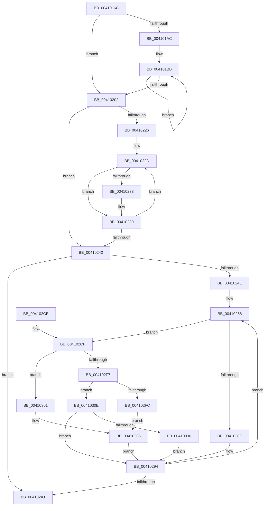

# RtlpDynamicLookasideRebalance

- RVA: `0x0041016C`–`0x0041033E` (길이 `466` bytes)
- VA: `0x000000014041016C`
- 실행 섹션: `.text`
- PDB 이름 있음: `예`; PDB Function 태그: `아니요`
- unwind 정보 RVA: `0x0009BC2C`
- 디코드: `137`개 명령, `466/466` bytes 표시
- 미해석 바이트: `0` (있으면 어셈블리에 `.byte`로 보존)

> 이 문서는 커널 이미지의 기계어와 PDB 기호를 분석해 생성했습니다. 4번과 5번은 함수 원형과 자료형을 바이너리 사용 방식에서 추정한 C 해석이며 원본 소스 복구 결과는 아닙니다.

## 1. Dependencies

- 직접 호출 지점: **2**; 고유 호출 대상: **2**
- 직접 호출자로 확인된 함수: **1**
- RIP 상대 이미지 참조: **2**

### Outgoing calls
- `0x00410217` → [qsort](../50/qsort_function_005009F0.md) (function, `0x005009F0`)
- `0x004102AC` → [_security_check_cookie](../6A/_security_check_cookie_function_006AC640.md) (function, `0x006AC640`)

### Direct callers
- [ExHeapLookasideRebalance](ExHeapLookasideRebalance_function_00410104.md) at `0x00410138`

### Static image references
- `0x00410187` → RVA `0x00E0A740` (`.data`; read)
- `0x0041020A` → RVA `0x004572C0` (`RtlpDynamicLookasideBucketCompare`; read)

## 2. Other-region calls and transfers

- 다른 실행 섹션으로 향하는 call: **0**
- 별도 외부 분기/꼬리 이동을 확인하지 못했습니다.

## 3. Assembly (complete function range)

```asm
0041016C  48 89 5C 24 10                  mov qword ptr [rsp + 0x10], rbx
00410171  48 89 6C 24 18                  mov qword ptr [rsp + 0x18], rbp
00410176  48 89 74 24 20                  mov qword ptr [rsp + 0x20], rsi
0041017B  57                              push rdi
0041017C  41 56                           push r14
0041017E  41 57                           push r15
00410180  48 81 EC 30 02 00 00            sub rsp, 0x230
00410187  48 8B 05 B2 A5 9F 00            mov rax, qword ptr [rip + 0x9fa5b2]
0041018E  48 33 C4                        xor rax, rsp
00410191  48 89 84 24 20 02 00 00         mov qword ptr [rsp + 0x220], rax
00410199  44 8B 49 08                     mov r9d, dword ptr [rcx + 8]
0041019D  45 33 DB                        xor r11d, r11d
004101A0  48 8B D9                        mov rbx, rcx
004101A3  45 8D 73 01                     lea r14d, [r11 + 1]
004101A7  45 85 C9                        test r9d, r9d
004101AA  74 56                           je 0x140410202
004101AC  48 8B 31                        mov rsi, qword ptr [rcx]
004101AF  48 8D 7C 24 24                  lea rdi, [rsp + 0x24]
004101B4  4C 8D 51 54                     lea r10, [rcx + 0x54]
004101B8  83 CD FF                        or ebp, 0xffffffff
004101BB  33 D2                           xor edx, edx
004101BD  41 8B C3                        mov eax, r11d
004101C0  48 0F A3 C6                     bt rsi, rax
004101C4  44 89 5F FC                     mov dword ptr [rdi - 4], r11d
004101C8  41 8B 02                        mov eax, dword ptr [r10]
004101CB  44 8B C5                        mov r8d, ebp
004101CE  0F 92 C2                        setb dl
004101D1  41 2B 42 10                     sub eax, dword ptr [r10 + 0x10]
004101D5  03 C2                           add eax, edx
004101D7  4D 8D 52 40                     lea r10, [r10 + 0x40]
004101DB  3B C2                           cmp eax, edx
004101DD  8B CD                           mov ecx, ebp
004101DF  44 0F 43 C0                     cmovae r8d, eax
004101E3  41 8B 42 C8                     mov eax, dword ptr [r10 - 0x38]
004101E7  41 2B 42 D8                     sub eax, dword ptr [r10 - 0x28]
004101EB  41 03 C0                        add eax, r8d
004101EE  41 3B C0                        cmp eax, r8d
004101F1  0F 43 C8                        cmovae ecx, eax
004101F4  45 03 DE                        add r11d, r14d
004101F7  89 0F                           mov dword ptr [rdi], ecx
004101F9  48 8D 7F 08                     lea rdi, [rdi + 8]
004101FD  45 3B D9                        cmp r11d, r9d
00410200  72 B9                           jb 0x1404101bb
00410202  49 8B D1                        mov rdx, r9
00410205  48 8D 4C 24 20                  lea rcx, [rsp + 0x20]
0041020A  4C 8D 0D AF 70 04 00            lea r9, [rip + 0x470af]
00410211  41 B8 08 00 00 00               mov r8d, 8
00410217  E8 D4 07 0F 00                  call 0x1405009f0
0041021C  8B 43 0C                        mov eax, dword ptr [rbx + 0xc]
0041021F  45 33 D2                        xor r10d, r10d
00410222  85 C0                           test eax, eax
00410224  74 1C                           je 0x140410242
00410226  48 8D 4C 24 20                  lea rcx, [rsp + 0x20]
0041022B  8B D0                           mov edx, eax
0041022D  83 79 04 19                     cmp dword ptr [rcx + 4], 0x19
00410231  72 06                           jb 0x140410239
00410233  8B 01                           mov eax, dword ptr [rcx]
00410235  49 0F AB C2                     bts r10, rax
00410239  48 83 C1 08                     add rcx, 8
0041023D  49 2B D6                        sub rdx, r14
00410240  75 EB                           jne 0x14041022d
00410242  45 33 DB                        xor r11d, r11d
00410245  4C 89 13                        mov qword ptr [rbx], r10
00410248  44 39 5B 08                     cmp dword ptr [rbx + 8], r11d
0041024C  76 53                           jbe 0x1404102a1
0041024E  41 8D 6B 04                     lea ebp, [r11 + 4]
00410252  45 8D 7B 1E                     lea r15d, [r11 + 0x1e]
00410256  41 8B CB                        mov ecx, r11d
00410259  4C 8D 4B 50                     lea r9, [rbx + 0x50]
0041025D  48 C1 E1 06                     shl rcx, 6
00410261  8B 44 19 54                     mov eax, dword ptr [rcx + rbx + 0x54]
00410265  8B F8                           mov edi, eax
00410267  2B 7C 19 64                     sub edi, dword ptr [rcx + rbx + 0x64]
0041026B  89 44 19 64                     mov dword ptr [rcx + rbx + 0x64], eax
0041026F  8B 44 19 58                     mov eax, dword ptr [rcx + rbx + 0x58]
00410273  8B D0                           mov edx, eax
00410275  2B 54 19 68                     sub edx, dword ptr [rcx + rbx + 0x68]
00410279  89 44 19 68                     mov dword ptr [rcx + rbx + 0x68], eax
0041027D  8B 44 19 5C                     mov eax, dword ptr [rcx + rbx + 0x5c]
00410281  89 44 19 6C                     mov dword ptr [rcx + rbx + 0x6c], eax
00410285  41 8B C3                        mov eax, r11d
00410288  49 0F A3 C2                     bt r10, rax
0041028C  72 41                           jb 0x1404102cf
0041028E  45 33 C0                        xor r8d, r8d
00410291  4C 03 C9                        add r9, rcx
00410294  45 03 DE                        add r11d, r14d
00410297  66 45 89 01                     mov word ptr [r9], r8w
0041029B  44 3B 5B 08                     cmp r11d, dword ptr [rbx + 8]
0041029F  72 B5                           jb 0x140410256
004102A1  48 8B 8C 24 20 02 00 00         mov rcx, qword ptr [rsp + 0x220]
004102A9  48 33 CC                        xor rcx, rsp
004102AC  E8 8F C3 29 00                  call 0x1406ac640
004102B1  4C 8D 9C 24 30 02 00 00         lea r11, [rsp + 0x230]
004102B9  49 8B 5B 28                     mov rbx, qword ptr [r11 + 0x28]
004102BD  49 8B 6B 30                     mov rbp, qword ptr [r11 + 0x30]
004102C1  49 8B 73 38                     mov rsi, qword ptr [r11 + 0x38]
004102C5  49 8B E3                        mov rsp, r11
004102C8  41 5F                           pop r15
004102CA  41 5E                           pop r14
004102CC  5F                              pop rdi
004102CD  C3                              ret
004102CE  CC                              int3
004102CF  0F B7 74 19 52                  movzx esi, word ptr [rcx + rbx + 0x52]
004102D4  3B D7                           cmp edx, edi
004102D6  8B C7                           mov eax, edi
004102D8  0F 46 C2                        cmovbe eax, edx
004102DB  85 FF                           test edi, edi
004102DD  41 0F 44 FE                     cmove edi, r14d
004102E1  69 C0 E8 03 00 00               imul eax, eax, 0x3e8
004102E7  33 D2                           xor edx, edx
004102E9  4C 03 C9                        add r9, rcx
004102EC  45 0F B7 01                     movzx r8d, word ptr [r9]
004102F0  F7 F7                           div edi
004102F2  83 FF 19                        cmp edi, 0x19
004102F5  72 0A                           jb 0x140410301
004102F7  83 F8 05                        cmp eax, 5
004102FA  73 12                           jae 0x14041030e
004102FC  45 2B C6                        sub r8d, r14d
004102FF  EB 04                           jmp 0x140410305
00410301  41 83 E8 0A                     sub r8d, 0xa
00410305  44 3B C5                        cmp r8d, ebp
00410308  44 0F 4E C5                     cmovle r8d, ebp
0041030C  EB 86                           jmp 0x140410294
0041030E  8B CE                           mov ecx, esi
00410310  41 2B C8                        sub ecx, r8d
00410313  0F AF C8                        imul ecx, eax
00410316  B8 D3 4D 62 10                  mov eax, 0x10624dd3
0041031B  F7 E1                           mul ecx
0041031D  C1 EA 07                        shr edx, 7
00410320  83 C2 05                        add edx, 5
00410323  41 3B D7                        cmp edx, r15d
00410326  41 0F 43 D7                     cmovae edx, r15d
0041032A  44 03 C2                        add r8d, edx
0041032D  44 3B C6                        cmp r8d, esi
00410330  0F 8C 5E FF FF FF               jl 0x140410294
00410336  44 8B C6                        mov r8d, esi
00410339  E9 56 FF FF FF                  jmp 0x140410294
```

## 4. C-style interpretation (structured pseudocode)

```c
__int64 __fastcall RtlpDynamicLookasideRebalance(__int64 a1, int a2)
{
    __int64 result;
    __int64 v_r10;
    __int64 v_r11;
    __int64 v_rbp;
    __int64 v_rdi;
    __int64 v_rsp;
    unsigned __int64 v_stack_m18;
    unsigned __int64 v_stack_m224;
    unsigned __int64 v_stack_m228;
    unsigned __int64 v_stack_m28;
    unsigned __int64 v_stack_p10;
    unsigned __int64 v_stack_p18;
    unsigned __int64 v_stack_p20;

    v_stack_p10 = v_rbx;
    v_stack_p18 = v_rbp;
    v_stack_p20 = v_rsi;
    v_rsp = (v_rsp) - (560);
    result = (*(unsigned __int64 *)(v_rip + 10462642)) ^ (v_rsp);
    v_stack_m28 = result;
    v_r11 = 0;
    if ((unsigned int)((unsigned int)(*(unsigned int *)(a1 + 8))) == 0) goto loc_00410202;
    v_rbp = (unsigned int)((v_rbp) | (0xFFFFFFFFULL));
loc_004101BB:
    a2 = 0;
    *(unsigned int *)(v_stack_m224 - 4) = 0;
    a2 = (condition_is_below) ? 1 : 0;
    result = (unsigned int)(((unsigned int)(*(unsigned int *)(a1 + 84))) - (*(unsigned int *)(a1 + 84 + 16)));
    result = (unsigned int)((result) + (a2));
    a3 = (unsigned int)((unsigned int)(v_rbp));
    if (((unsigned int)(result)) >= a2) { a3 = (unsigned int)(result); }
    result = (unsigned int)(((unsigned int)(*(unsigned int *)(a1 + 84 + 64 - 56))) - (*(unsigned int *)(a1 + 84 + 64 - 40)));
    result = (unsigned int)((result) + ((unsigned int)(a3)));
    a1 = (unsigned int)((unsigned int)(v_rbp));
    if (((unsigned int)(result)) >= ((unsigned int)(a3))) { a1 = (unsigned int)(result); }
    v_r11 = (unsigned int)((v_r11) + ((unsigned int)(v_r11 + 1)));
    *(unsigned int *)(v_stack_m224) = (unsigned int)(a1);
    if (((unsigned int)(v_r11)) < ((unsigned int)((unsigned int)(*(unsigned int *)(a1 + 8))))) goto loc_004101BB;
loc_00410202:
    result = qsort(v_stack_m228, (unsigned int)(*(unsigned int *)(a1 + 8)), 8, v_rip + 290991);
    v_r10 = 0;
    if ((unsigned int)((unsigned int)(*(unsigned int *)(a1 + 12))) == 0) goto loc_00410242;
loc_0041022D:
    result = (unsigned int)(*(unsigned int *)(a1 + 12));
    if ((*(unsigned int *)(v_stack_m228 + 4)) >= 25) {
        result = *(unsigned int *)(v_stack_m228);
    }
    a1 = (v_stack_m228) + (8);
    a2 = ((unsigned int)((unsigned int)((unsigned int)(*(unsigned int *)(a1 + 12))))) - (v_r11 + 1);
    if (condition_is_not_equal) goto loc_0041022D;
loc_00410242:
    v_r11 = 0;
    *(unsigned __int64 *)(a1) = 0;
    if ((*(unsigned int *)(a1 + 8)) <= 0) goto loc_004102A1;
loc_00410256:
    a1 = (0) << (6);
    v_rdi = (unsigned int)(((unsigned int)((unsigned int)((unsigned int)(*(unsigned int *)(a1 + a1 * 1 + 84))))) - (*(unsigned int *)(a1 + a1 * 1 + 100)));
    *(unsigned int *)(a1 + a1 * 1 + 100) = (unsigned int)((unsigned int)(*(unsigned int *)(a1 + a1 * 1 + 84)));
    a2 = (unsigned int)(((unsigned int)((unsigned int)((unsigned int)(*(unsigned int *)(a1 + a1 * 1 + 88))))) - (*(unsigned int *)(a1 + a1 * 1 + 104)));
    *(unsigned int *)(a1 + a1 * 1 + 104) = (unsigned int)((unsigned int)(*(unsigned int *)(a1 + a1 * 1 + 88)));
    *(unsigned int *)(a1 + a1 * 1 + 108) = (unsigned int)((unsigned int)(*(unsigned int *)(a1 + a1 * 1 + 92)));
    if (condition_is_below) goto loc_004102CF;
    a3 = 0;
    a4 = (a1 + 80) + (a1);
loc_00410294:
    v_r11 = (unsigned int)((v_r11) + ((unsigned int)(v_r11 + 1)));
    *(unsigned __int16 *)(a4) = 0;
    if (((unsigned int)(v_r11)) < (*(unsigned int *)(a1 + 8))) goto loc_00410256;
loc_004102A1:
    a1 = (v_stack_m28) ^ (v_rsp);
    result = _security_check_cookie(a1, a2, a3, a4);
    return result;
loc_004102CF:
    result = (unsigned int)((unsigned int)(v_rdi));
    if (a2 <= ((unsigned int)(v_rdi))) { result = a2; }
    if ((unsigned int)(v_rdi) == 0) { v_rdi = (unsigned int)(v_r11 + 1); }
    result = (unsigned int)((result) * ((unsigned int)(result)));
    a2 = 0;
    a4 = (a4) + (a1);
    if (((unsigned int)(v_rdi)) < 25) goto loc_00410301;
    if (((unsigned int)(result)) >= 5) goto loc_0041030E;
    a3 = (unsigned int)((*(unsigned __int16 *)(a4)) - ((unsigned int)(v_r11 + 1)));
    goto loc_00410305;
loc_00410301:
    a3 = (unsigned int)((a3) - (10));
loc_00410305:
    if (((unsigned int)(a3)) <= ((unsigned int)(*(unsigned __int64 *)(v_stack_m18 + 48)))) { a3 = (unsigned int)(*(unsigned __int64 *)(v_stack_m18 + 48)); }
    goto loc_00410294;
loc_0041030E:
    a1 = (unsigned int)(((unsigned int)((unsigned int)(*(unsigned __int16 *)(a1 + *(unsigned __int64 *)(v_stack_m18 + 40) * 1 + 82)))) - ((unsigned int)(a3)));
    a1 = (unsigned int)((a1) * ((unsigned int)(result)));
    a2 = (unsigned int)((a2) >> (7));
    a2 = (unsigned int)((a2) + (5));
    if (a2 >= ((unsigned int)(v_r11 + 30))) { a2 = (unsigned int)(v_r11 + 30); }
    a3 = (unsigned int)((a3) + (a2));
    if (((unsigned int)(a3)) < ((unsigned int)(*(unsigned __int16 *)(a1 + *(unsigned __int64 *)(v_stack_m18 + 40) * 1 + 82)))) goto loc_00410294;
    goto loc_00410294;
}
```

## 5. (Beta) C Style

```c
int64_t RtlpDynamicLookasideRebalance(void *Arg1, int32_t Arg2)
{
    uint8_t *arg1 = (uint8_t *)Arg1;

    int64_t result;
    int64_t local_r10;
    int64_t local_r11;
    int64_t local_rbp;
    int64_t local_rdi;
    int64_t local_rsp;
    uint64_t v_stack_m18;
    uint64_t v_stack_m224;
    uint64_t v_stack_m228;
    uint64_t v_stack_m28;
    uint64_t v_stack_p10;
    uint64_t v_stack_p18;
    uint64_t v_stack_p20;

    v_stack_p10 = local_rbx;
    v_stack_p18 = local_rbp;
    v_stack_p20 = local_rsi;
    local_rsp = (local_rsp) - (560);
    result = (*(uint64_t *)(v_rip + 0x9FA5B2)) ^ (local_rsp);
    v_stack_m28 = result;
    local_r11 = 0;
    if ((uint32_t)((uint32_t)(*(uint32_t *)(arg1 + 0x8))) == 0) goto loc_00410202;
    local_rbp = (uint32_t)((local_rbp) | (0xFFFFFFFFULL));
loc_004101BB:
    Arg2 = 0;
    *(uint32_t *)(v_stack_m224 - 0x4) = 0;
    Arg2 = (condition_is_below) ? 1 : 0;
    result = (uint32_t)(((uint32_t)(*(uint32_t *)(arg1 + 0x54))) - (*(uint32_t *)(arg1 + 0x54 + 0x10)));
    result = (uint32_t)((result) + (Arg2));
    a3 = (uint32_t)((uint32_t)(local_rbp));
    if (((uint32_t)(result)) >= Arg2) { a3 = (uint32_t)(result); }
    result = (uint32_t)(((uint32_t)(*(uint32_t *)(arg1 + 0x54 + 0x40 - 0x38))) - (*(uint32_t *)(arg1 + 0x54 + 0x40 - 0x28)));
    result = (uint32_t)((result) + ((uint32_t)(a3)));
    Arg1 = (uint32_t)((uint32_t)(local_rbp));
    if (((uint32_t)(result)) >= ((uint32_t)(a3))) { Arg1 = (uint32_t)(result); }
    local_r11 = (uint32_t)((local_r11) + ((uint32_t)(local_r11 + 1)));
    *(uint32_t *)(v_stack_m224) = (uint32_t)(Arg1);
    if (((uint32_t)(local_r11)) < ((uint32_t)((uint32_t)(*(uint32_t *)(arg1 + 0x8))))) goto loc_004101BB;
loc_00410202:
    result = qsort(v_stack_m228, (uint32_t)(*(uint32_t *)(arg1 + 0x8)), 8, v_rip + 290991);
    local_r10 = 0;
    if ((uint32_t)((uint32_t)(*(uint32_t *)(arg1 + 0xC))) == 0) goto loc_00410242;
loc_0041022D:
    result = (uint32_t)(*(uint32_t *)(arg1 + 0xC));
    if ((*(uint32_t *)(v_stack_m228 + 0x4)) >= 25) {
        result = *(uint32_t *)(v_stack_m228);
    }
    Arg1 = (v_stack_m228) + (8);
    Arg2 = ((uint32_t)((uint32_t)((uint32_t)(*(uint32_t *)(arg1 + 0xC))))) - (local_r11 + 1);
    if (condition_is_not_equal) goto loc_0041022D;
loc_00410242:
    local_r11 = 0;
    *(uint64_t *)(arg1) = 0;
    if ((*(uint32_t *)(arg1 + 0x8)) <= 0) goto loc_004102A1;
loc_00410256:
    Arg1 = (0) << (6);
    local_rdi = (uint32_t)(((uint32_t)((uint32_t)((uint32_t)(*(uint32_t *)(arg1 + arg1 * 1 + 0x54))))) - (*(uint32_t *)(arg1 + arg1 * 1 + 0x64)));
    *(uint32_t *)(arg1 + arg1 * 1 + 0x64) = (uint32_t)((uint32_t)(*(uint32_t *)(arg1 + arg1 * 1 + 0x54)));
    Arg2 = (uint32_t)(((uint32_t)((uint32_t)((uint32_t)(*(uint32_t *)(arg1 + arg1 * 1 + 0x58))))) - (*(uint32_t *)(arg1 + arg1 * 1 + 0x68)));
    *(uint32_t *)(arg1 + arg1 * 1 + 0x68) = (uint32_t)((uint32_t)(*(uint32_t *)(arg1 + arg1 * 1 + 0x58)));
    *(uint32_t *)(arg1 + arg1 * 1 + 0x6C) = (uint32_t)((uint32_t)(*(uint32_t *)(arg1 + arg1 * 1 + 0x5C)));
    if (condition_is_below) goto loc_004102CF;
    a3 = 0;
    a4 = (Arg1 + 80) + (Arg1);
loc_00410294:
    local_r11 = (uint32_t)((local_r11) + ((uint32_t)(local_r11 + 1)));
    *(uint16_t *)(a4) = 0;
    if (((uint32_t)(local_r11)) < (*(uint32_t *)(arg1 + 0x8))) goto loc_00410256;
loc_004102A1:
    Arg1 = (v_stack_m28) ^ (local_rsp);
    result = _security_check_cookie(Arg1, Arg2, a3, a4);
    return result;
loc_004102CF:
    result = (uint32_t)((uint32_t)(local_rdi));
    if (Arg2 <= ((uint32_t)(local_rdi))) { result = Arg2; }
    if ((uint32_t)(local_rdi) == 0) { local_rdi = (uint32_t)(local_r11 + 1); }
    result = (uint32_t)((result) * ((uint32_t)(result)));
    Arg2 = 0;
    a4 = (a4) + (Arg1);
    if (((uint32_t)(local_rdi)) < 25) goto loc_00410301;
    if (((uint32_t)(result)) >= 5) goto loc_0041030E;
    a3 = (uint32_t)((*(uint16_t *)(a4)) - ((uint32_t)(local_r11 + 1)));
    goto loc_00410305;
loc_00410301:
    a3 = (uint32_t)((a3) - (10));
loc_00410305:
    if (((uint32_t)(a3)) <= ((uint32_t)(*(uint64_t *)(v_stack_m18 + 0x30)))) { a3 = (uint32_t)(*(uint64_t *)(v_stack_m18 + 0x30)); }
    goto loc_00410294;
loc_0041030E:
    Arg1 = (uint32_t)(((uint32_t)((uint32_t)(*(uint16_t *)(arg1 + *(uint64_t *)(v_stack_m18 + 0x28) * 1 + 0x52)))) - ((uint32_t)(a3)));
    Arg1 = (uint32_t)((Arg1) * ((uint32_t)(result)));
    Arg2 = (uint32_t)((Arg2) >> (7));
    Arg2 = (uint32_t)((Arg2) + (5));
    if (Arg2 >= ((uint32_t)(local_r11 + 30))) { Arg2 = (uint32_t)(local_r11 + 30); }
    a3 = (uint32_t)((a3) + (Arg2));
    if (((uint32_t)(a3)) < ((uint32_t)(*(uint16_t *)(arg1 + *(uint64_t *)(v_stack_m18 + 0x28) * 1 + 0x52)))) goto loc_00410294;
    goto loc_00410294;
}
```

### 관측된 메모리 오프셋

구조체 형식이 확인되지 않은 접근은 인자 기준의 오프셋으로만 기록했습니다.

| 기준 인자 | 오프셋 표현 | 폭 (bit) | 접근 |
|---|---:|---:|---|
| `Arg1` | `- 0x38` | `32` | `R` |
| `Arg1` | `- 0x28` | `32` | `R` |
| `Arg1` | `+ 0x0` | `16` | `R` |
| `Arg1` | `+ 0x0` | `16` | `W` |
| `Arg1` | `+ 0x0` | `32` | `R` |
| `Arg1` | `+ 0x0` | `64` | `R` |
| `Arg1` | `+ 0x0` | `64` | `W` |
| `Arg1` | `+ 0x8` | `32` | `R` |
| `Arg1` | `+ 0xC` | `32` | `R` |
| `Arg1` | `+ 0x10` | `32` | `R` |
| `Arg1` | `+ 0x40` | `64` | `R` |
| `Arg1` | `+ 0x50` | `64` | `R` |
| `Arg1` | `+ 0x54` | `64` | `R` |

## 6. Execution-region graph

[열기: 2D/3D 그래프와 함수 탐색 컨트롤 패널](../../../control-panel.html?section=text&rva=0x0041016C&view=graph)

- 2D 그래프는 위에서 아래로 흐르고, 3D 그래프는 빈 공간을 드래그해 회전합니다. Shift+드래그는 이동, 휠은 확대·축소, 함수 노드 선택은 대상 보고서 이동입니다.

### Static fallback


