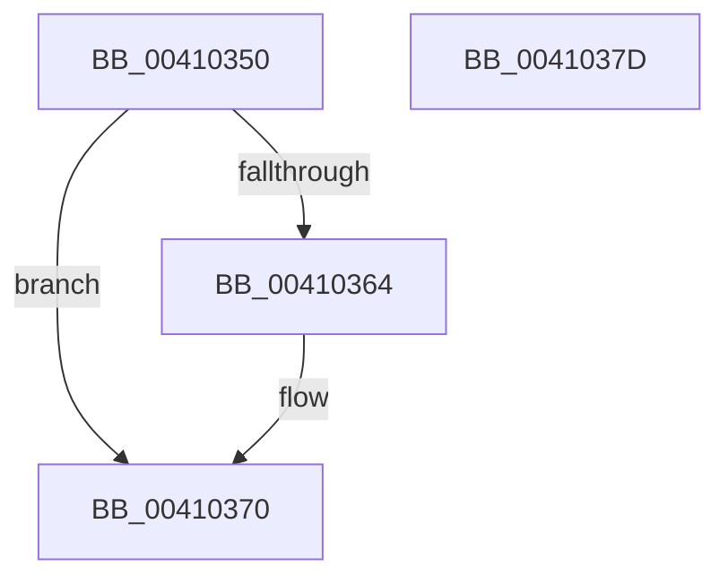

# RtlpHpCalculateAllocSize

- RVA: `0x00410350`–`0x0041037E` (길이 `46` bytes)
- VA: `0x0000000140410350`
- 실행 섹션: `.text`
- PDB 이름 있음: `예`; PDB Function 태그: `아니요`
- unwind 정보 RVA: `0x000DB714`
- 디코드: `13`개 명령, `46/46` bytes 표시
- 미해석 바이트: `0` (있으면 어셈블리에 `.byte`로 보존)

> 이 문서는 커널 이미지의 기계어와 PDB 기호를 분석해 생성했습니다. 4번과 5번은 함수 원형과 자료형을 바이너리 사용 방식에서 추정한 C 해석이며 원본 소스 복구 결과는 아닙니다.

## 1. Dependencies

- 직접 호출 지점: **0**; 고유 호출 대상: **0**
- 직접 호출자로 확인된 함수: **1**
- RIP 상대 이미지 참조: **0**

### Outgoing calls
- 직접 디코드된 call 명령이 없습니다.

### Direct callers
- [RtlpHpAllocateHeapSlow](../2E/RtlpHpAllocateHeapSlow_function_002E9DEC.md) at `0x002E9E7C`

### Static image references
- 디코드된 RIP-relative 메모리 참조가 없습니다.

## 2. Other-region calls and transfers

- 다른 실행 섹션으로 향하는 call: **0**
- 별도 외부 분기/꼬리 이동을 확인하지 못했습니다.

## 3. Assembly (complete function range)

```asm
00410350  0F BA E2 0D                     bt edx, 0xd
00410354  4C 8D 41 10                     lea r8, [rcx + 0x10]
00410358  4C 0F 43 C1                     cmovae r8, rcx
0041035C  F7 C2 08 0F 00 20               test edx, 0x20000f08
00410362  74 0C                           je 0x140410370
00410364  49 83 C0 0F                     add r8, 0xf
00410368  49 83 E0 F0                     and r8, 0xfffffffffffffff0
0041036C  49 83 C0 10                     add r8, 0x10
00410370  4D 85 C0                        test r8, r8
00410373  B8 01 00 00 00                  mov eax, 1
00410378  49 0F 45 C0                     cmovne rax, r8
0041037C  C3                              ret
0041037D  CC                              int3
```

## 4. C-style interpretation (structured pseudocode)

```c
__int64 __fastcall RtlpHpCalculateAllocSize(__int64 a1, int a2)
{
    __int64 result;

    a3 = a1 + 16;
    if (condition_is_above_or_equal) { a3 = a1; }
    if (((a2) & (0x20000F08ULL)) != 0) {
        a3 = (a3) + (15);
        a3 = (a3) & (-16);
        a3 = (a3) + (16);
    }
    result = 1;
    if (a3 != 0) { result = a3; }
    return result;
}
```

## 5. (Beta) C Style

```c
int64_t RtlpHpCalculateAllocSize(void *Arg1, int32_t Arg2)
{
    uint8_t *arg1 = (uint8_t *)Arg1;

    int64_t result;

    a3 = Arg1 + 16;
    if (condition_is_above_or_equal) { a3 = Arg1; }
    if (((Arg2) & (0x20000F08ULL)) != 0) {
        a3 = (a3) + (15);
        a3 = (a3) & (-16);
        a3 = (a3) + (16);
    }
    result = 1;
    if (a3 != 0) { result = a3; }
    return result;
}
```

### 관측된 메모리 오프셋

구조체 형식이 확인되지 않은 접근은 인자 기준의 오프셋으로만 기록했습니다.

| 기준 인자 | 오프셋 표현 | 폭 (bit) | 접근 |
|---|---:|---:|---|
| `Arg1` | `+ 0x10` | `64` | `R` |

## 6. Execution-region graph

[열기: 2D/3D 그래프와 함수 탐색 컨트롤 패널](../../../control-panel.html?section=text&rva=0x00410350&view=graph)

- 2D 그래프는 위에서 아래로 흐르고, 3D 그래프는 빈 공간을 드래그해 회전합니다. Shift+드래그는 이동, 휠은 확대·축소, 함수 노드 선택은 대상 보고서 이동입니다.

### Static fallback


