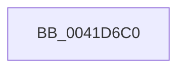

# RtlpHpSegPageRangeComputeLargePageCost

- RVA: `0x0041D6C0`–`0x0041D703` (길이 `67` bytes)
- VA: `0x000000014041D6C0`
- 실행 섹션: `.text`
- PDB 이름 있음: `예`; PDB Function 태그: `아니요`
- unwind 정보 RVA: `0x0009EEEC`
- 디코드: `22`개 명령, `67/67` bytes 표시
- 미해석 바이트: `0` (있으면 어셈블리에 `.byte`로 보존)

> 이 문서는 커널 이미지의 기계어와 PDB 기호를 분석해 생성했습니다. 4번과 5번은 함수 원형과 자료형을 바이너리 사용 방식에서 추정한 C 해석이며 원본 소스 복구 결과는 아닙니다.

## 1. Dependencies

- 직접 호출 지점: **0**; 고유 호출 대상: **0**
- 직접 호출자로 확인된 함수: **2**
- RIP 상대 이미지 참조: **0**

### Outgoing calls
- 직접 디코드된 call 명령이 없습니다.

### Direct callers
- [RtlpHpSegSubAllocate](../2E/RtlpHpSegSubAllocate_function_002EB344.md) at `0x002EB3E9`
- [RtlpHpSegAlloc](../32/RtlpHpSegAlloc_function_003265BC.md) at `0x00326759`

### Static image references
- 디코드된 RIP-relative 메모리 참조가 없습니다.

## 2. Other-region calls and transfers

- 다른 실행 섹션으로 향하는 call: **0**
- call이 아닌 외부 분기/꼬리 이동: **1**
  - `0x0041D701` → [sub_0041D72A](Unknown_function_0041D72A.md) (`tail-transfer`)

## 3. Assembly (complete function range)

```asm
0041D6C0  40 53                           push rbx
0041D6C2  48 8B 01                        mov rax, qword ptr [rcx]
0041D6C5  48 23 C2                        and rax, rdx
0041D6C8  45 8B D8                        mov r11d, r8d
0041D6CB  2B D0                           sub edx, eax
0041D6CD  4C 8B 48 18                     mov r9, qword ptr [rax + 0x18]
0041D6D1  41 8D 4B FF                     lea ecx, [r11 - 1]
0041D6D5  03 CA                           add ecx, edx
0041D6D7  8B C2                           mov eax, edx
0041D6D9  48 C1 E9 15                     shr rcx, 0x15
0041D6DD  48 C1 E8 15                     shr rax, 0x15
0041D6E1  4D 8D 14 49                     lea r10, [r9 + rcx*2]
0041D6E5  49 8D 04 41                     lea rax, [r9 + rax*2]
0041D6E9  4D 8B C2                        mov r8, r10
0041D6EC  4C 2B C0                        sub r8, rax
0041D6EF  45 33 C9                        xor r9d, r9d
0041D6F2  49 D1 F8                        sar r8, 1
0041D6F5  41 8B C9                        mov ecx, r9d
0041D6F8  41 FF C0                        inc r8d
0041D6FB  41 8B D9                        mov ebx, r9d
0041D6FE  49 3B C2                        cmp rax, r10
0041D701  77 27                           ja 0x14041d72a
```

## 4. C-style interpretation (structured pseudocode)

```c
__int64 __fastcall RtlpHpSegPageRangeComputeLargePageCost(__int64 a1, __int64 a2, int a3)
{
    __int64 result;

    result = (*(unsigned __int64 *)(a1)) & (a2);
    a2 = (unsigned int)((a2) - ((unsigned int)(result)));
    a1 = (unsigned int)(((unsigned int)(a3) - 1) + ((unsigned int)(a2)));
    a1 = (a1) >> (21);
    result = ((unsigned int)((unsigned int)(a2))) >> (21);
    a3 = (*(unsigned __int64 *)(result + 24) + a1 * 2) - (*(unsigned __int64 *)(result + 24) + result * 2);
    a4 = 0;
    a3 = (a3) >> (1);
    a3 = (unsigned int)((a3) + 1);
}
```

## 5. (Beta) C Style

```c
int64_t RtlpHpSegPageRangeComputeLargePageCost(void *Arg1, int64_t Arg2, void *Arg3)
{
    uint8_t *arg1 = (uint8_t *)Arg1;
    uint8_t *arg3 = (uint8_t *)Arg3;

    int64_t result;

    result = (*(uint64_t *)(arg1)) & (Arg2);
    Arg2 = (uint32_t)((Arg2) - ((uint32_t)(result)));
    Arg1 = (uint32_t)(((uint32_t)(Arg3) - 1) + ((uint32_t)(Arg2)));
    Arg1 = (Arg1) >> (21);
    result = ((uint32_t)((uint32_t)(Arg2))) >> (21);
    Arg3 = (*(uint64_t *)(result + 0x18) + Arg1 * 2) - (*(uint64_t *)(result + 0x18) + result * 2);
    a4 = 0;
    Arg3 = (Arg3) >> (1);
    Arg3 = (uint32_t)((Arg3) + 1);
}
```

### 관측된 메모리 오프셋

구조체 형식이 확인되지 않은 접근은 인자 기준의 오프셋으로만 기록했습니다.

| 기준 인자 | 오프셋 표현 | 폭 (bit) | 접근 |
|---|---:|---:|---|
| `Arg1` | `+ 0x0` | `64` | `R` |
| `Arg3` | `- 0x1` | `32` | `R` |

## 6. Execution-region graph

[열기: 2D/3D 그래프와 함수 탐색 컨트롤 패널](../../../control-panel.html?section=text&rva=0x0041D6C0&view=graph)

- 2D 그래프는 위에서 아래로 흐르고, 3D 그래프는 빈 공간을 드래그해 회전합니다. Shift+드래그는 이동, 휠은 확대·축소, 함수 노드 선택은 대상 보고서 이동입니다.

### Static fallback


