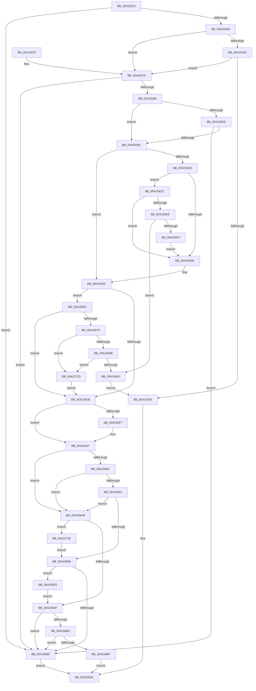

# RtlpIsFrameInBoundsEx

- RVA: `0x00415510`–`0x0041572F` (길이 `543` bytes)
- VA: `0x0000000140415510`
- 실행 섹션: `.text`
- PDB 이름 있음: `예`; PDB Function 태그: `아니요`
- unwind 정보 RVA: `0x0009C298`
- 디코드: `140`개 명령, `543/543` bytes 표시
- 미해석 바이트: `0` (있으면 어셈블리에 `.byte`로 보존)

> 이 문서는 커널 이미지의 기계어와 PDB 기호를 분석해 생성했습니다. 4번과 5번은 함수 원형과 자료형을 바이너리 사용 방식에서 추정한 C 해석이며 원본 소스 복구 결과는 아닙니다.

## 1. Dependencies

- 직접 호출 지점: **3**; 고유 호출 대상: **3**
- 직접 호출자로 확인된 함수: **1**
- RIP 상대 이미지 참조: **2**

### Outgoing calls
- `0x00415589` → [KeGetCurrentStackPointer](../6B/KeGetCurrentStackPointer_function_006B1070.md) (function, `0x006B1070`)
- `0x004155A0` → [KeQueryCurrentStackInformationEx](../2F/KeQueryCurrentStackInformationEx_function_002F7CD0.md) (function, `0x002F7CD0`)
- `0x0041566C` → [KeGetEffectiveIrql](../2F/KeGetEffectiveIrql_function_002F8030.md) (function, `0x002F8030`)

### Direct callers
- [sub_009A623D](../../page/9A/Unknown_function_009A623D.md) at `0x009A63E3`

### Static image references
- `0x00415682` → RVA `0x00FC507C` (`ALMOSTRO`; read)
- `0x004156D5` → RVA `0x00FC51D4` (`ALMOSTRO`; read)

## 2. Other-region calls and transfers

- 다른 실행 섹션으로 향하는 call: **0**
- 별도 외부 분기/꼬리 이동을 확인하지 못했습니다.

## 3. Assembly (complete function range)

```asm
00415510  48 89 5C 24 08                  mov qword ptr [rsp + 8], rbx
00415515  48 89 6C 24 18                  mov qword ptr [rsp + 0x18], rbp
0041551A  48 89 74 24 20                  mov qword ptr [rsp + 0x20], rsi
0041551F  57                              push rdi
00415520  41 56                           push r14
00415522  41 57                           push r15
00415524  48 83 EC 30                     sub rsp, 0x30
00415528  33 C0                           xor eax, eax
0041552A  4D 8B F1                        mov r14, r9
0041552D  48 89 44 24 20                  mov qword ptr [rsp + 0x20], rax
00415532  49 8B F8                        mov rdi, r8
00415535  48 89 44 24 28                  mov qword ptr [rsp + 0x28], rax
0041553A  48 8B DA                        mov rbx, rdx
0041553D  89 44 24 58                     mov dword ptr [rsp + 0x58], eax
00415541  48 8B F1                        mov rsi, rcx
00415544  F6 C2 07                        test dl, 7
00415547  0F 85 18 01 00 00               jne 0x140415665
0041554D  48 8B 01                        mov rax, qword ptr [rcx]
00415550  48 3B D0                        cmp rdx, rax
00415553  72 21                           jb 0x140415576
00415555  49 3B 10                        cmp rdx, qword ptr [r8]
00415558  73 1C                           jae 0x140415576
0041555A  B0 01                           mov al, 1
0041555C  48 8B 5C 24 50                  mov rbx, qword ptr [rsp + 0x50]
00415561  48 8B 6C 24 60                  mov rbp, qword ptr [rsp + 0x60]
00415566  48 8B 74 24 68                  mov rsi, qword ptr [rsp + 0x68]
0041556B  48 83 C4 30                     add rsp, 0x30
0041556F  41 5F                           pop r15
00415571  41 5E                           pop r14
00415573  5F                              pop rdi
00415574  C3                              ret
00415575  CC                              int3
00415576  48 B9 00 00 00 00 00 80 FF FF   movabs rcx, 0xffff800000000000
00415580  48 3B C1                        cmp rax, rcx
00415583  0F 82 DC 00 00 00               jb 0x140415665
00415589  E8 E2 BA 29 00                  call 0x1406b1070
0041558E  48 8B C8                        mov rcx, rax
00415591  4C 8D 4C 24 20                  lea r9, [rsp + 0x20]
00415596  4C 8D 44 24 28                  lea r8, [rsp + 0x28]
0041559B  48 8D 54 24 58                  lea rdx, [rsp + 0x58]
004155A0  E8 2B 27 EE FF                  call 0x1402f7cd0
004155A5  8B 44 24 58                     mov eax, dword ptr [rsp + 0x58]
004155A9  83 F8 09                        cmp eax, 9
004155AC  77 0E                           ja 0x1404155bc
004155AE  B9 A1 03 00 00                  mov ecx, 0x3a1
004155B3  0F A3 C1                        bt ecx, eax
004155B6  0F 82 A9 00 00 00               jb 0x140415665
004155BC  65 4C 8B 3C 25 88 01 00 00      mov r15, qword ptr gs:[0x188]
004155C5  8B 6C 24 58                     mov ebp, dword ptr [rsp + 0x58]
004155C9  83 FD 01                        cmp ebp, 1
004155CC  74 14                           je 0x1404155e2
004155CE  65 8A 04 25 3C 3A 00 00         mov al, byte ptr gs:[0x3a3c]
004155D6  A8 01                           test al, 1
004155D8  0F 85 EE 00 00 00               jne 0x1404156cc
004155DE  8B 6C 24 58                     mov ebp, dword ptr [rsp + 0x58]
004155E2  83 FD 0A                        cmp ebp, 0xa
004155E5  0F 85 81 00 00 00               jne 0x14041566c
004155EB  32 C0                           xor al, al
004155ED  49 8D 4E 08                     lea rcx, [r14 + 8]
004155F1  49 83 3E 00                     cmp qword ptr [r14], 0
004155F5  75 50                           jne 0x140415647
004155F7  49 8B 47 38                     mov rax, qword ptr [r15 + 0x38]
004155FB  49 89 06                        mov qword ptr [r14], rax
004155FE  49 8B 47 30                     mov rax, qword ptr [r15 + 0x30]
00415602  8B 6C 24 58                     mov ebp, dword ptr [rsp + 0x58]
00415606  48 89 01                        mov qword ptr [rcx], rax
00415609  49 8B 47 58                     mov rax, qword ptr [r15 + 0x58]
0041560D  49 89 46 10                     mov qword ptr [r14 + 0x10], rax
00415611  49 8B 47 28                     mov rax, qword ptr [r15 + 0x28]
00415615  49 89 46 18                     mov qword ptr [r14 + 0x18], rax
00415619  49 8B 87 18 04 00 00            mov rax, qword ptr [r15 + 0x418]
00415620  49 89 46 20                     mov qword ptr [r14 + 0x20], rax
00415624  49 8B 87 20 04 00 00            mov rax, qword ptr [r15 + 0x420]
0041562B  49 89 46 28                     mov qword ptr [r14 + 0x28], rax
0041562F  49 8B 87 08 04 00 00            mov rax, qword ptr [r15 + 0x408]
00415636  49 89 46 30                     mov qword ptr [r14 + 0x30], rax
0041563A  49 8B 87 10 04 00 00            mov rax, qword ptr [r15 + 0x410]
00415641  49 89 46 38                     mov qword ptr [r14 + 0x38], rax
00415645  B0 01                           mov al, 1
00415647  83 FD 01                        cmp ebp, 1
0041564A  74 5F                           je 0x1404156ab
0041564C  83 FD 06                        cmp ebp, 6
0041564F  74 5A                           je 0x1404156ab
00415651  83 FD 0A                        cmp ebp, 0xa
00415654  74 55                           je 0x1404156ab
00415656  49 8B 46 18                     mov rax, qword ptr [r14 + 0x18]
0041565A  48 83 78 10 00                  cmp qword ptr [rax + 0x10], 0
0041565F  0F 85 93 00 00 00               jne 0x1404156f8
00415665  32 C0                           xor al, al
00415667  E9 F0 FE FF FF                  jmp 0x14041555c
0041566C  E8 BF 29 EE FF                  call 0x1402f8030
00415671  3C 02                           cmp al, 2
00415673  0F 82 72 FF FF FF               jb 0x1404155eb
00415679  65 48 8B 0C 25 E8 88 00 00      mov rcx, qword ptr gs:[0x88e8]
00415682  8B 05 F4 F9 BA 00               mov eax, dword ptr [rip + 0xbaf9f4]
00415688  48 83 C1 50                     add rcx, 0x50
0041568C  48 8B D1                        mov rdx, rcx
0041568F  48 2B D0                        sub rdx, rax
00415692  48 3B D9                        cmp rbx, rcx
00415695  0F 83 82 00 00 00               jae 0x14041571d
0041569B  48 3B D3                        cmp rdx, rbx
0041569E  77 7D                           ja 0x14041571d
004156A0  48 89 0F                        mov qword ptr [rdi], rcx
004156A3  48 89 16                        mov qword ptr [rsi], rdx
004156A6  E9 AF FE FF FF                  jmp 0x14041555a
004156AB  84 C0                           test al, al
004156AD  74 77                           je 0x140415726
004156AF  48 8B 11                        mov rdx, qword ptr [rcx]
004156B2  49 8B 06                        mov rax, qword ptr [r14]
004156B5  48 3B DA                        cmp rbx, rdx
004156B8  72 AB                           jb 0x140415665
004156BA  48 3B D8                        cmp rbx, rax
004156BD  73 A6                           jae 0x140415665
004156BF  48 89 16                        mov qword ptr [rsi], rdx
004156C2  48 89 07                        mov qword ptr [rdi], rax
004156C5  B0 01                           mov al, 1
004156C7  E9 90 FE FF FF                  jmp 0x14041555c
004156CC  65 48 8B 0C 25 20 3A 00 00      mov rcx, qword ptr gs:[0x3a20]
004156D5  8B 05 F9 FA BA 00               mov eax, dword ptr [rip + 0xbafaf9]
004156DB  48 83 C1 50                     add rcx, 0x50
004156DF  48 8B D1                        mov rdx, rcx
004156E2  48 2B D0                        sub rdx, rax
004156E5  48 3B D3                        cmp rdx, rbx
004156E8  0F 87 F0 FE FF FF               ja 0x1404155de
004156EE  48 3B D9                        cmp rbx, rcx
004156F1  72 AD                           jb 0x1404156a0
004156F3  E9 E6 FE FF FF                  jmp 0x1404155de
004156F8  0F 10 40 10                     movups xmm0, xmmword ptr [rax + 0x10]
004156FC  41 0F 11 06                     movups xmmword ptr [r14], xmm0
00415700  0F 10 48 20                     movups xmm1, xmmword ptr [rax + 0x20]
00415704  41 0F 11 4E 10                  movups xmmword ptr [r14 + 0x10], xmm1
00415709  0F 10 40 30                     movups xmm0, xmmword ptr [rax + 0x30]
0041570D  41 0F 11 46 20                  movups xmmword ptr [r14 + 0x20], xmm0
00415712  0F 10 48 40                     movups xmm1, xmmword ptr [rax + 0x40]
00415716  41 0F 11 4E 30                  movups xmmword ptr [r14 + 0x30], xmm1
0041571B  EB 92                           jmp 0x1404156af
0041571D  8B 6C 24 58                     mov ebp, dword ptr [rsp + 0x58]
00415721  E9 C5 FE FF FF                  jmp 0x1404155eb
00415726  49 8D 4E 08                     lea rcx, [r14 + 8]
0041572A  E9 27 FF FF FF                  jmp 0x140415656
```

## 4. C-style interpretation (structured pseudocode)

```c
__int64 __fastcall RtlpIsFrameInBoundsEx(__int64 a1, __int64 a2, __int64 a3, __int64 a4)
{
    __int64 result;
    __int64 v_rbp;
    __int64 v_rsp;
    unsigned __int64 v_stack_m20;
    unsigned __int64 v_stack_m28;
    unsigned int v_stack_p10;
    unsigned __int64 v_stack_p18;
    unsigned __int64 v_stack_p20;
    unsigned __int64 v_stack_p28;
    unsigned __int64 v_stack_p58;
    unsigned __int64 v_stack_p8;

    v_stack_p8 = v_rbx;
    v_stack_p18 = v_rbp;
    v_stack_p20 = v_rsi;
    v_rsp = (v_rsp) - (48);
    result = 0;
    v_stack_m28 = 0;
    v_stack_m20 = 0;
    v_stack_p10 = 0;
    if ((((unsigned __int8)(a2)) & (7)) != 0) goto loc_00415665;
    if (a2 < (*(unsigned __int64 *)(a1))) goto loc_00415576;
    if (a2 >= (*(unsigned __int64 *)(a3))) goto loc_00415576;
loc_0041555A:
loc_0041555C:
    v_rsp = (v_rsp) + (48);
    return 1;
loc_00415576:
    if (1 < a1) goto loc_00415665;
    result = KeGetCurrentStackPointer(a1, a2, a3, a4);
    result = KeQueryCurrentStackInformationEx(result, v_stack_p58, v_stack_p28, v_stack_p20);
    if (((unsigned int)((unsigned int)(v_stack_p58))) > 9) goto loc_004155BC;
    if (((unsigned int)((unsigned int)(v_stack_p58))) < 9) goto loc_00415665;
loc_004155BC:
    if (((unsigned int)((unsigned int)(v_stack_p58))) == 1) goto loc_004155E2;
    if ((((unsigned __int8)(*(unsigned __int8 *)(gs_base + (0 + 14908)))) & (1)) != 0) goto loc_004156CC;
loc_004155DE:
loc_004155E2:
    if (((unsigned int)((unsigned int)(v_stack_p58))) != 10) goto loc_0041566C;
loc_004155EB:
    result = 0;
    v_rbp = (unsigned int)(v_stack_p58);
    if ((*(unsigned __int64 *)(a4)) == 0) {
        result = *(unsigned __int64 *)(*(unsigned __int64 *)(gs_base + (0 + 392)) + 56);
        *(unsigned __int64 *)(a4) = result;
        result = *(unsigned __int64 *)(*(unsigned __int64 *)(gs_base + (0 + 392)) + 48);
        v_rbp = v_stack_p58;
        *(unsigned __int64 *)(a4 + 8) = result;
        result = *(unsigned __int64 *)(*(unsigned __int64 *)(gs_base + (0 + 392)) + 88);
        *(unsigned __int64 *)(a4 + 16) = result;
        result = *(unsigned __int64 *)(*(unsigned __int64 *)(gs_base + (0 + 392)) + 40);
        *(unsigned __int64 *)(a4 + 24) = result;
        result = *(unsigned __int64 *)(*(unsigned __int64 *)(gs_base + (0 + 392)) + 1048);
        *(unsigned __int64 *)(a4 + 32) = result;
        result = *(unsigned __int64 *)(*(unsigned __int64 *)(gs_base + (0 + 392)) + 1056);
        *(unsigned __int64 *)(a4 + 40) = result;
        result = *(unsigned __int64 *)(*(unsigned __int64 *)(gs_base + (0 + 392)) + 1032);
        *(unsigned __int64 *)(a4 + 48) = result;
        result = *(unsigned __int64 *)(*(unsigned __int64 *)(gs_base + (0 + 392)) + 1040);
        *(unsigned __int64 *)(a4 + 56) = result;
        result = 1;
    }
    if (((unsigned int)(v_rbp)) == 1) goto loc_004156AB;
    if (((unsigned int)(v_rbp)) == 6) goto loc_004156AB;
    if (((unsigned int)(v_rbp)) == 10) goto loc_004156AB;
loc_00415656:
    if ((*(unsigned __int64 *)(*(unsigned __int64 *)(a4 + 24) + 16)) != 0) goto loc_004156F8;
loc_00415665:
    result = 0;
    goto loc_0041555C;
loc_0041566C:
    result = KeGetEffectiveIrql(a4 + 8, v_stack_p58, v_stack_p28, v_stack_p20);
    if (((unsigned __int8)(result)) < 2) goto loc_004155EB;
    a1 = (*(unsigned __int64 *)(gs_base + (0 + 35048))) + (80);
    a2 = (a1) - ((unsigned int)(*(unsigned int *)(v_rip + 12253684)));
    if (v_stack_p8 >= a1) goto loc_0041571D;
    if (a2 > v_stack_p8) goto loc_0041571D;
loc_004156A0:
    *(unsigned __int64 *)(a3) = a1;
    *(unsigned __int64 *)(v_stack_p20) = a2;
    goto loc_0041555A;
loc_004156AB:
    if ((unsigned __int8)((unsigned int)(*(unsigned int *)(v_rip + 12253684))) == 0) goto loc_00415726;
loc_004156AF:
    if (v_stack_p8 < (*(unsigned __int64 *)(a1))) goto loc_00415665;
    if (v_stack_p8 >= (*(unsigned __int64 *)(a4))) goto loc_00415665;
    *(unsigned __int64 *)(v_stack_p20) = *(unsigned __int64 *)(a1);
    *(unsigned __int64 *)(a3) = *(unsigned __int64 *)(a4);
    goto loc_0041555C;
loc_004156CC:
    a1 = (*(unsigned __int64 *)(gs_base + (0 + 14880))) + (80);
    a2 = (a1) - ((unsigned int)(*(unsigned int *)(v_rip + 12253945)));
    if (a2 > v_stack_p8) goto loc_004155DE;
    if (v_stack_p8 < a1) goto loc_004156A0;
    goto loc_004155DE;
loc_004156F8:
    *(unsigned __int64 *)(a4) = v_xmm0;
    *(unsigned __int64 *)(a4 + 16) = v_xmm1;
    *(unsigned __int64 *)(a4 + 32) = v_xmm0;
    *(unsigned __int64 *)(a4 + 48) = v_xmm1;
    goto loc_004156AF;
loc_0041571D:
    goto loc_004155EB;
loc_00415726:
    goto loc_00415656;
}
```

## 5. (Beta) C Style

```c
int64_t RtlpIsFrameInBoundsEx(void *Arg1, int64_t Arg2, void *Arg3, void *Arg4)
{
    uint8_t *arg1 = (uint8_t *)Arg1;
    uint8_t *arg3 = (uint8_t *)Arg3;
    uint8_t *arg4 = (uint8_t *)Arg4;

    int64_t result;
    int64_t local_rbp;
    int64_t local_rsp;
    uint64_t v_stack_m20;
    uint64_t v_stack_m28;
    uint32_t v_stack_p10;
    uint64_t v_stack_p18;
    uint64_t v_stack_p20;
    uint64_t v_stack_p28;
    uint64_t v_stack_p58;
    uint64_t v_stack_p8;

    v_stack_p8 = local_rbx;
    v_stack_p18 = local_rbp;
    v_stack_p20 = local_rsi;
    local_rsp = (local_rsp) - (48);
    result = 0;
    v_stack_m28 = 0;
    v_stack_m20 = 0;
    v_stack_p10 = 0;
    if ((((uint8_t)(Arg2)) & (7)) != 0) goto loc_00415665;
    if (Arg2 < (*(uint64_t *)(arg1))) goto loc_00415576;
    if (Arg2 >= (*(uint64_t *)(arg3))) goto loc_00415576;
loc_0041555A:
loc_0041555C:
    local_rsp = (local_rsp) + (48);
    return 1;
loc_00415576:
    if (1 < Arg1) goto loc_00415665;
    result = KeGetCurrentStackPointer(Arg1, Arg2, Arg3, Arg4);
    result = KeQueryCurrentStackInformationEx(result, v_stack_p58, v_stack_p28, v_stack_p20);
    if (((uint32_t)((uint32_t)(v_stack_p58))) > 9) goto loc_004155BC;
    if (((uint32_t)((uint32_t)(v_stack_p58))) < 9) goto loc_00415665;
loc_004155BC:
    if (((uint32_t)((uint32_t)(v_stack_p58))) == 1) goto loc_004155E2;
    if ((((uint8_t)(*(uint8_t *)(gs_base + (0 + 0x3A3C)))) & (1)) != 0) goto loc_004156CC;
loc_004155DE:
loc_004155E2:
    if (((uint32_t)((uint32_t)(v_stack_p58))) != 10) goto loc_0041566C;
loc_004155EB:
    result = 0;
    local_rbp = (uint32_t)(v_stack_p58);
    if ((*(uint64_t *)(arg4)) == 0) {
        result = *(uint64_t *)(*(uint64_t *)(gs_base + (0 + 0x188)) + 0x38);
        *(uint64_t *)(arg4) = result;
        result = *(uint64_t *)(*(uint64_t *)(gs_base + (0 + 0x188)) + 0x30);
        local_rbp = v_stack_p58;
        *(uint64_t *)(arg4 + 0x8) = result;
        result = *(uint64_t *)(*(uint64_t *)(gs_base + (0 + 0x188)) + 0x58);
        *(uint64_t *)(arg4 + 0x10) = result;
        result = *(uint64_t *)(*(uint64_t *)(gs_base + (0 + 0x188)) + 0x28);
        *(uint64_t *)(arg4 + 0x18) = result;
        result = *(uint64_t *)(*(uint64_t *)(gs_base + (0 + 0x188)) + 0x418);
        *(uint64_t *)(arg4 + 0x20) = result;
        result = *(uint64_t *)(*(uint64_t *)(gs_base + (0 + 0x188)) + 0x420);
        *(uint64_t *)(arg4 + 0x28) = result;
        result = *(uint64_t *)(*(uint64_t *)(gs_base + (0 + 0x188)) + 0x408);
        *(uint64_t *)(arg4 + 0x30) = result;
        result = *(uint64_t *)(*(uint64_t *)(gs_base + (0 + 0x188)) + 0x410);
        *(uint64_t *)(arg4 + 0x38) = result;
        result = 1;
    }
    if (((uint32_t)(local_rbp)) == 1) goto loc_004156AB;
    if (((uint32_t)(local_rbp)) == 6) goto loc_004156AB;
    if (((uint32_t)(local_rbp)) == 10) goto loc_004156AB;
loc_00415656:
    if ((*(uint64_t *)(*(uint64_t *)(arg4 + 0x18) + 0x10)) != 0) goto loc_004156F8;
loc_00415665:
    result = 0;
    goto loc_0041555C;
loc_0041566C:
    result = KeGetEffectiveIrql(Arg4 + 8, v_stack_p58, v_stack_p28, v_stack_p20);
    if (((uint8_t)(result)) < 2) goto loc_004155EB;
    Arg1 = (*(uint64_t *)(gs_base + (0 + 0x88E8))) + (80);
    Arg2 = (Arg1) - ((uint32_t)(*(uint32_t *)(v_rip + 0xBAF9F4)));
    if (v_stack_p8 >= Arg1) goto loc_0041571D;
    if (Arg2 > v_stack_p8) goto loc_0041571D;
loc_004156A0:
    *(void **)(arg3) = Arg1;
    *(uint64_t *)(v_stack_p20) = Arg2;
    goto loc_0041555A;
loc_004156AB:
    if ((uint8_t)((uint32_t)(*(uint32_t *)(v_rip + 0xBAF9F4))) == 0) goto loc_00415726;
loc_004156AF:
    if (v_stack_p8 < (*(uint64_t *)(arg1))) goto loc_00415665;
    if (v_stack_p8 >= (*(uint64_t *)(arg4))) goto loc_00415665;
    *(uint64_t *)(v_stack_p20) = *(uint64_t *)(arg1);
    *(uint64_t *)(arg3) = *(uint64_t *)(arg4);
    goto loc_0041555C;
loc_004156CC:
    Arg1 = (*(uint64_t *)(gs_base + (0 + 0x3A20))) + (80);
    Arg2 = (Arg1) - ((uint32_t)(*(uint32_t *)(v_rip + 0xBAFAF9)));
    if (Arg2 > v_stack_p8) goto loc_004155DE;
    if (v_stack_p8 < Arg1) goto loc_004156A0;
    goto loc_004155DE;
loc_004156F8:
    *(uint64_t *)(arg4) = v_xmm0;
    *(uint64_t *)(arg4 + 0x10) = v_xmm1;
    *(uint64_t *)(arg4 + 0x20) = v_xmm0;
    *(uint64_t *)(arg4 + 0x30) = v_xmm1;
    goto loc_004156AF;
loc_0041571D:
    goto loc_004155EB;
loc_00415726:
    goto loc_00415656;
}
```

### 관측된 메모리 오프셋

구조체 형식이 확인되지 않은 접근은 인자 기준의 오프셋으로만 기록했습니다.

| 기준 인자 | 오프셋 표현 | 폭 (bit) | 접근 |
|---|---:|---:|---|
| `Arg1` | `+ 0x0` | `64` | `R` |
| `Arg1` | `+ 0x0` | `64` | `W` |
| `Arg3` | `+ 0x0` | `64` | `R` |
| `Arg3` | `+ 0x0` | `64` | `W` |
| `Arg4` | `+ 0x0` | `64` | `R` |
| `Arg4` | `+ 0x0` | `64` | `W` |
| `Arg4` | `+ 0x0` | `128` | `R` |
| `Arg4` | `+ 0x8` | `64` | `R` |
| `Arg4` | `+ 0x10` | `64` | `W` |
| `Arg4` | `+ 0x10` | `128` | `R` |
| `Arg4` | `+ 0x18` | `64` | `R` |
| `Arg4` | `+ 0x18` | `64` | `W` |
| `Arg4` | `+ 0x20` | `64` | `W` |
| `Arg4` | `+ 0x20` | `128` | `R` |
| `Arg4` | `+ 0x28` | `64` | `W` |
| `Arg4` | `+ 0x30` | `64` | `W` |
| `Arg4` | `+ 0x30` | `128` | `R` |
| `Arg4` | `+ 0x38` | `64` | `W` |

## 6. Execution-region graph

[열기: 2D/3D 그래프와 함수 탐색 컨트롤 패널](../../../control-panel.html?section=text&rva=0x00415510&view=graph)

- 2D 그래프는 위에서 아래로 흐르고, 3D 그래프는 빈 공간을 드래그해 회전합니다. Shift+드래그는 이동, 휠은 확대·축소, 함수 노드 선택은 대상 보고서 이동입니다.

### Static fallback


