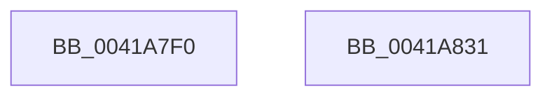

# RtlpMakeXpressCallback

- RVA: `0x0041A7F0`–`0x0041A832` (길이 `66` bytes)
- VA: `0x000000014041A7F0`
- 실행 섹션: `.text`
- PDB 이름 있음: `예`; PDB Function 태그: `아니요`
- unwind 정보 RVA: `0x00060BC4`
- 디코드: `20`개 명령, `66/66` bytes 표시
- 미해석 바이트: `0` (있으면 어셈블리에 `.byte`로 보존)

> 이 문서는 커널 이미지의 기계어와 PDB 기호를 분석해 생성했습니다. 4번과 5번은 함수 원형과 자료형을 바이너리 사용 방식에서 추정한 C 해석이며 원본 소스 복구 결과는 아닙니다.

## 1. Dependencies

- 직접 호출 지점: **1**; 고유 호출 대상: **1**
- 직접 호출자로 확인된 함수: **7**
- RIP 상대 이미지 참조: **0**

### Outgoing calls
- `0x0041A80F` → [guard_dispatch_icall](../6B/guard_dispatch_icall_function_006BAAD0.md) (function, `0x006BAAD0`)

### Direct callers
- [RtlCompressBufferXpressHuffStandard](../26/RtlCompressBufferXpressHuffStandard_function_0026BA60.md) at `0x0026C27F`
- [RtlCompressBufferXpressHuffStandard](../26/RtlCompressBufferXpressHuffStandard_function_0026BA60.md) at `0x0026C29C`
- [RtlCompressBufferXpressHuffMax](../26/RtlCompressBufferXpressHuffMax_function_0026CA10.md) at `0x0026CF39`
- [sub_0041A1D1](Unknown_function_0041A1D1.md) at `0x0041A707`
- [sub_0041A7B1](Unknown_function_0041A7B1.md) at `0x0041A7BC`
- [sub_0041A8A9](Unknown_function_0041A8A9.md) at `0x0041AA19`
- [sub_005EF68C](../5E/Unknown_function_005EF68C.md) at `0x005EF801`
- [sub_005EF68C](../5E/Unknown_function_005EF68C.md) at `0x005EF9E7`
- [RtlDecompressBufferXpressLzProgress](../5E/RtlDecompressBufferXpressLzProgress_function_005EFC90.md) at `0x005EFD56`
- [RtlDecompressBufferXpressLzProgress](../5E/RtlDecompressBufferXpressLzProgress_function_005EFC90.md) at `0x005EFEFD`
- [RtlDecompressBufferXpressLzProgress](../5E/RtlDecompressBufferXpressLzProgress_function_005EFC90.md) at `0x005EFF6D`
- [RtlDecompressBufferXpressLzProgress](../5E/RtlDecompressBufferXpressLzProgress_function_005EFC90.md) at `0x005F00F9`

### Static image references
- 디코드된 RIP-relative 메모리 참조가 없습니다.

## 2. Other-region calls and transfers

- 다른 실행 섹션으로 향하는 call: **0**
- 별도 외부 분기/꼬리 이동을 확인하지 못했습니다.

## 3. Assembly (complete function range)

```asm
0041A7F0  48 89 5C 24 08                  mov qword ptr [rsp + 8], rbx
0041A7F5  48 89 74 24 10                  mov qword ptr [rsp + 0x10], rsi
0041A7FA  57                              push rdi
0041A7FB  48 83 EC 20                     sub rsp, 0x20
0041A7FF  48 8B 01                        mov rax, qword ptr [rcx]
0041A802  48 8B D9                        mov rbx, rcx
0041A805  48 8B 49 08                     mov rcx, qword ptr [rcx + 8]
0041A809  49 8B F8                        mov rdi, r8
0041A80C  48 8B F2                        mov rsi, rdx
0041A80F  E8 BC 02 2A 00                  call 0x1406baad0
0041A814  8B 43 10                        mov eax, dword ptr [rbx + 0x10]
0041A817  48 8B 5C 24 30                  mov rbx, qword ptr [rsp + 0x30]
0041A81C  48 03 C7                        add rax, rdi
0041A81F  48 3B F0                        cmp rsi, rax
0041A822  48 0F 42 C6                     cmovb rax, rsi
0041A826  48 8B 74 24 38                  mov rsi, qword ptr [rsp + 0x38]
0041A82B  48 83 C4 20                     add rsp, 0x20
0041A82F  5F                              pop rdi
0041A830  C3                              ret
0041A831  CC                              int3
```

## 4. C-style interpretation (structured pseudocode)

```c
__int64 __fastcall RtlpMakeXpressCallback(__int64 a1, __int64 a2, __int64 a3)
{
    __int64 result;
    __int64 v_rsp;
    unsigned __int64 v_stack_p10;
    unsigned __int64 v_stack_p8;

    v_stack_p8 = v_rbx;
    v_stack_p10 = v_rsi;
    v_rsp = (v_rsp) - (32);
    result = guard_dispatch_icall(*(unsigned __int64 *)(a1 + 8), a2, a3, a4);
    result = ((unsigned int)(*(unsigned int *)(a1 + 16))) + (a3);
    if (a2 < result) { result = a2; }
    v_rsp = (v_rsp) + (32);
    return result;
}
```

## 5. (Beta) C Style

```c
int64_t RtlpMakeXpressCallback(void *Arg1, int64_t Arg2, int64_t Arg3)
{
    uint8_t *arg1 = (uint8_t *)Arg1;

    int64_t result;
    int64_t local_rsp;
    uint64_t v_stack_p10;
    uint64_t v_stack_p8;

    v_stack_p8 = local_rbx;
    v_stack_p10 = local_rsi;
    local_rsp = (local_rsp) - (32);
    result = guard_dispatch_icall(*(uint64_t *)(arg1 + 0x8), Arg2, Arg3, a4);
    result = ((uint32_t)(*(uint32_t *)(arg1 + 0x10))) + (Arg3);
    if (Arg2 < result) { result = Arg2; }
    local_rsp = (local_rsp) + (32);
    return result;
}
```

### 관측된 메모리 오프셋

구조체 형식이 확인되지 않은 접근은 인자 기준의 오프셋으로만 기록했습니다.

| 기준 인자 | 오프셋 표현 | 폭 (bit) | 접근 |
|---|---:|---:|---|
| `Arg1` | `+ 0x0` | `64` | `R` |
| `Arg1` | `+ 0x8` | `64` | `R` |
| `Arg1` | `+ 0x10` | `32` | `R` |

## 6. Execution-region graph

[열기: 2D/3D 그래프와 함수 탐색 컨트롤 패널](../../../control-panel.html?section=text&rva=0x0041A7F0&view=graph)

- 2D 그래프는 위에서 아래로 흐르고, 3D 그래프는 빈 공간을 드래그해 회전합니다. Shift+드래그는 이동, 휠은 확대·축소, 함수 노드 선택은 대상 보고서 이동입니다.

### Static fallback


