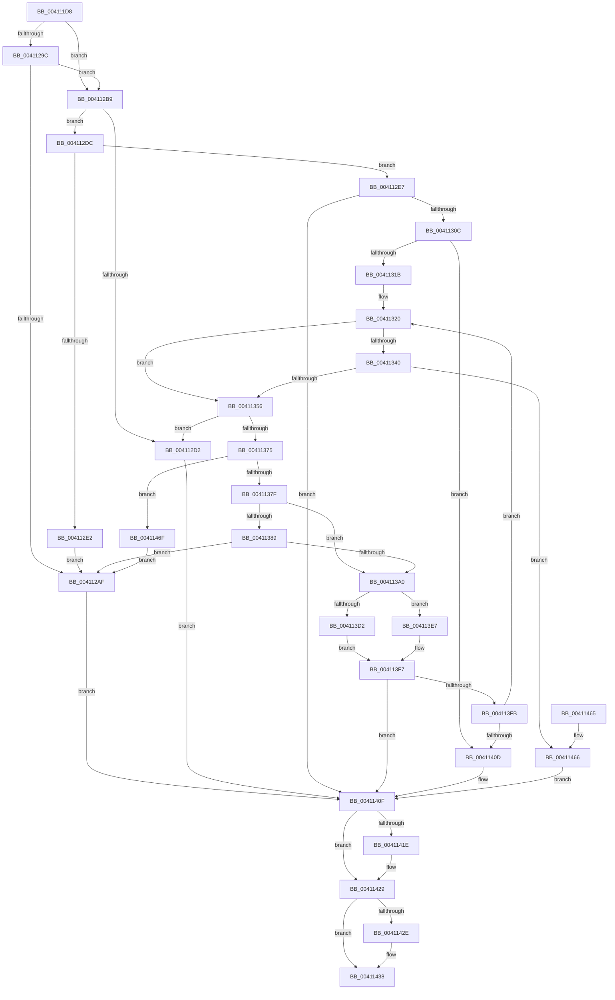

# ST_STORE&lt;SM_TRAITS&gt;::StCompactionPerformInMem

- RVA: `0x004111D8`–`0x00411476` (길이 `670` bytes)
- VA: `0x00000001404111D8`
- 실행 섹션: `.text`
- PDB 이름 있음: `예`; PDB Function 태그: `아니요`
- unwind 정보 RVA: `0x0009BDF8`
- 디코드: `177`개 명령, `670/670` bytes 표시
- 미해석 바이트: `0` (있으면 어셈블리에 `.byte`로 보존)

> 이 문서는 커널 이미지의 기계어와 PDB 기호를 분석해 생성했습니다. 4번과 5번은 함수 원형과 자료형을 바이너리 사용 방식에서 추정한 C 해석이며 원본 소스 복구 결과는 아닙니다.

## 1. Dependencies

- 직접 호출 지점: **17**; 고유 호출 대상: **10**
- 직접 호출자로 확인된 함수: **2**
- RIP 상대 이미지 참조: **1**

### Outgoing calls
- `0x0041121B` → [memset](../6C/memset_function_006C6C40.md) (function, `0x006C6C40`)
- `0x00411258` → [ST_STORE<SM_TRAITS>::StCompactionFindEmptiest](../48/ST_STORE_SM_TRAITS_StCompactionFindEmptiest_function_00483988.md) (function, `0x00483988`)
- `0x0041126D` → [ST_STORE<SM_TRAITS>::StCompactionPickPriority](../45/ST_STORE_SM_TRAITS_StCompactionPickPriority_function_004591A0.md) (function, `0x004591A0`)
- `0x0041128B` → [ST_STORE<SM_TRAITS>::StSetDataMovementInProgress](../60/ST_STORE_SM_TRAITS_StSetDataMovementInProgress_function_0060E9BC.md) (function, `0x0060E9BC`)
- `0x004112A6` → [SMKM_STORE<SM_TRAITS>::SmStIsRegionBusy](../43/SMKM_STORE_SM_TRAITS_SmStIsRegionBusy_function_0043DB80.md) (function, `0x0043DB80`)
- `0x004112C5` → [ST_STORE<SM_TRAITS>::StMapAndLockRegion](../4E/ST_STORE_SM_TRAITS_StMapAndLockRegion_function_004EC090.md) (function, `0x004EC090`)
- `0x004112FD` → [ST_STORE<SM_TRAITS>::StCompactRegions](../4A/ST_STORE_SM_TRAITS_StCompactRegions_function_004A48E0.md) (function, `0x004A48E0`)
- `0x00411349` → [SMKM_STORE<SM_TRAITS>::SmStIsRegionBusy](../43/SMKM_STORE_SM_TRAITS_SmStIsRegionBusy_function_0043DB80.md) (function, `0x0043DB80`)
- `0x00411364` → [ST_STORE<SM_TRAITS>::StMapAndLockRegion](../4E/ST_STORE_SM_TRAITS_StMapAndLockRegion_function_004EC090.md) (function, `0x004EC090`)
- `0x00411393` → [SMKM_STORE<SM_TRAITS>::SmStIsRegionBusy](../43/SMKM_STORE_SM_TRAITS_SmStIsRegionBusy_function_0043DB80.md) (function, `0x0043DB80`)
- `0x004113B9` → [ST_STORE<SM_TRAITS>::StCompactRegions](../4A/ST_STORE_SM_TRAITS_StCompactRegions_function_004A48E0.md) (function, `0x004A48E0`)
- `0x004113D4` → [ST_STORE<SM_TRAITS>::StUnlockAndUnmapRegion](../34/ST_STORE_SM_TRAITS_StUnlockAndUnmapRegion_function_0034C7F0.md) (function, `0x0034C7F0`)
- `0x004113E0` → [ST_STORE<SM_TRAITS>::StReleaseRegion](../3A/ST_STORE_SM_TRAITS_StReleaseRegion_function_003AF138.md) (function, `0x003AF138`)
- `0x004113EA` → [ST_STORE<SM_TRAITS>::StUnlockAndUnmapRegion](../34/ST_STORE_SM_TRAITS_StUnlockAndUnmapRegion_function_0034C7F0.md) (function, `0x0034C7F0`)
- `0x00411424` → [ST_STORE<SM_TRAITS>::StUnlockAndUnmapRegion](../34/ST_STORE_SM_TRAITS_StUnlockAndUnmapRegion_function_0034C7F0.md) (function, `0x0034C7F0`)
- `0x00411433` → [ST_STORE<SM_TRAITS>::StUnlockAndUnmapRegion](../34/ST_STORE_SM_TRAITS_StUnlockAndUnmapRegion_function_0034C7F0.md) (function, `0x0034C7F0`)
- `0x00411445` → [_security_check_cookie](../6A/_security_check_cookie_function_006AC640.md) (function, `0x006AC640`)

### Direct callers
- [sub_002061A0](../20/Unknown_function_002061A0.md) at `0x0020621B`
- [ST_STORE&lt;SM_TRAITS&gt;::StCompactionWorker](ST_STORE_SM_TRAITS_StCompactionWorker_function_00411118.md) at `0x0041116C`

### Static image references
- `0x004111EF` → RVA `0x00E0A740` (`.data`; read)

## 2. Other-region calls and transfers

- 다른 실행 섹션으로 향하는 call: **0**
- 별도 외부 분기/꼬리 이동을 확인하지 못했습니다.

## 3. Assembly (complete function range)

```asm
004111D8  48 89 5C 24 10                  mov qword ptr [rsp + 0x10], rbx
004111DD  55                              push rbp
004111DE  56                              push rsi
004111DF  57                              push rdi
004111E0  41 54                           push r12
004111E2  41 55                           push r13
004111E4  41 56                           push r14
004111E6  41 57                           push r15
004111E8  48 81 EC 70 01 00 00            sub rsp, 0x170
004111EF  48 8B 05 4A 95 9F 00            mov rax, qword ptr [rip + 0x9f954a]
004111F6  48 33 C4                        xor rax, rsp
004111F9  48 89 84 24 60 01 00 00         mov qword ptr [rsp + 0x160], rax
00411201  41 8B D8                        mov ebx, r8d
00411204  89 54 24 30                     mov dword ptr [rsp + 0x30], edx
00411208  44 8B EA                        mov r13d, edx
0041120B  48 8B F9                        mov rdi, rcx
0041120E  33 D2                           xor edx, edx
00411210  48 8D 4C 24 60                  lea rcx, [rsp + 0x60]
00411215  41 B8 00 01 00 00               mov r8d, 0x100
0041121B  E8 20 5A 2B 00                  call 0x1406c6c40
00411220  44 8B 8F 30 03 00 00            mov r9d, dword ptr [rdi + 0x330]
00411227  48 8D 54 24 60                  lea rdx, [rsp + 0x60]
0041122C  44 2B 8F 34 03 00 00            sub r9d, dword ptr [rdi + 0x334]
00411233  0F 57 C0                        xorps xmm0, xmm0
00411236  33 ED                           xor ebp, ebp
00411238  89 5C 24 20                     mov dword ptr [rsp + 0x20], ebx
0041123C  41 FF C1                        inc r9d
0041123F  48 8B CF                        mov rcx, rdi
00411242  0F 11 44 24 40                  movups xmmword ptr [rsp + 0x40], xmm0
00411247  45 33 F6                        xor r14d, r14d
0041124A  83 CE FF                        or esi, 0xffffffff
0041124D  8D 5D 20                        lea ebx, [rbp + 0x20]
00411250  44 8B C3                        mov r8d, ebx
00411253  0F 11 44 24 50                  movups xmmword ptr [rsp + 0x50], xmm0
00411258  E8 2B 27 07 00                  call 0x140483988
0041125D  4C 8D 4C 24 40                  lea r9, [rsp + 0x40]
00411262  44 8B C0                        mov r8d, eax
00411265  48 8D 54 24 60                  lea rdx, [rsp + 0x60]
0041126A  48 8B CF                        mov rcx, rdi
0041126D  E8 2E 7F 04 00                  call 0x1404591a0
00411272  4C 8B 7C 24 40                  mov r15, qword ptr [rsp + 0x40]
00411277  48 8B CF                        mov rcx, rdi
0041127A  4C 2B BF 78 05 00 00            sub r15, qword ptr [rdi + 0x578]
00411281  44 8B E0                        mov r12d, eax
00411284  49 D1 FF                        sar r15, 1
00411287  89 44 24 34                     mov dword ptr [rsp + 0x34], eax
0041128B  E8 2C D7 1F 00                  call 0x14060e9bc
00411290  F7 87 08 03 00 00 00 00 02 00   test dword ptr [rdi + 0x308], 0x20000
0041129A  74 1D                           je 0x1404112b9
0041129C  48 8B 8F 20 03 00 00            mov rcx, qword ptr [rdi + 0x320]
004112A3  41 8B D7                        mov edx, r15d
004112A6  E8 D5 C8 02 00                  call 0x14043db80
004112AB  85 C0                           test eax, eax
004112AD  74 0A                           je 0x1404112b9
004112AF  BB 08 07 00 C0                  mov ebx, 0xc0000708
004112B4  E9 56 01 00 00                  jmp 0x14041140f
004112B9  44 8B CB                        mov r9d, ebx
004112BC  45 33 C0                        xor r8d, r8d
004112BF  41 8B D7                        mov edx, r15d
004112C2  48 8B CF                        mov rcx, rdi
004112C5  E8 C6 AD 0D 00                  call 0x1404ec090
004112CA  4C 8B F0                        mov r14, rax
004112CD  48 85 C0                        test rax, rax
004112D0  75 0A                           jne 0x1404112dc
004112D2  BB 55 00 00 C0                  mov ebx, 0xc0000055
004112D7  E9 33 01 00 00                  jmp 0x14041140f
004112DC  48 83 F8 FF                     cmp rax, -1
004112E0  75 05                           jne 0x1404112e7
004112E2  45 33 F6                        xor r14d, r14d
004112E5  EB C8                           jmp 0x1404112af
004112E7  44 89 6C 24 28                  mov dword ptr [rsp + 0x28], r13d
004112EC  4C 8B C8                        mov r9, rax
004112EF  45 8B C7                        mov r8d, r15d
004112F2  44 89 7C 24 20                  mov dword ptr [rsp + 0x20], r15d
004112F7  48 8B D0                        mov rdx, rax
004112FA  48 8B CF                        mov rcx, rdi
004112FD  E8 DE 35 09 00                  call 0x1404a48e0
00411302  8B D8                           mov ebx, eax
00411304  85 C0                           test eax, eax
00411306  0F 88 03 01 00 00               js 0x14041140f
0041130C  41 BD 01 00 00 00               mov r13d, 1
00411312  45 3B E5                        cmp r12d, r13d
00411315  0F 86 F2 00 00 00               jbe 0x14041140d
0041131B  4C 8D 64 24 48                  lea r12, [rsp + 0x48]
00411320  49 8B 04 24                     mov rax, qword ptr [r12]
00411324  48 8B F0                        mov rsi, rax
00411327  48 89 44 24 38                  mov qword ptr [rsp + 0x38], rax
0041132C  48 2B B7 78 05 00 00            sub rsi, qword ptr [rdi + 0x578]
00411333  48 D1 FE                        sar rsi, 1
00411336  0F BA A7 08 03 00 00 11         bt dword ptr [rdi + 0x308], 0x11
0041133E  73 16                           jae 0x140411356
00411340  48 8B 8F 20 03 00 00            mov rcx, qword ptr [rdi + 0x320]
00411347  8B D6                           mov edx, esi
00411349  E8 32 C8 02 00                  call 0x14043db80
0041134E  85 C0                           test eax, eax
00411350  0F 85 10 01 00 00               jne 0x140411466
00411356  41 B9 20 00 00 00               mov r9d, 0x20
0041135C  45 33 C0                        xor r8d, r8d
0041135F  8B D6                           mov edx, esi
00411361  48 8B CF                        mov rcx, rdi
00411364  E8 27 AD 0D 00                  call 0x1404ec090
00411369  48 8B E8                        mov rbp, rax
0041136C  48 85 C0                        test rax, rax
0041136F  0F 84 5D FF FF FF               je 0x1404112d2
00411375  48 83 F8 FF                     cmp rax, -1
00411379  0F 84 F0 00 00 00               je 0x14041146f
0041137F  0F BA A7 08 03 00 00 11         bt dword ptr [rdi + 0x308], 0x11
00411387  73 17                           jae 0x1404113a0
00411389  48 8B 8F 20 03 00 00            mov rcx, qword ptr [rdi + 0x320]
00411390  41 8B D7                        mov edx, r15d
00411393  E8 E8 C7 02 00                  call 0x14043db80
00411398  85 C0                           test eax, eax
0041139A  0F 85 0F FF FF FF               jne 0x1404112af
004113A0  8B 44 24 30                     mov eax, dword ptr [rsp + 0x30]
004113A4  4D 8B CE                        mov r9, r14
004113A7  89 44 24 28                     mov dword ptr [rsp + 0x28], eax
004113AB  44 8B C6                        mov r8d, esi
004113AE  48 8B D5                        mov rdx, rbp
004113B1  44 89 7C 24 20                  mov dword ptr [rsp + 0x20], r15d
004113B6  48 8B CF                        mov rcx, rdi
004113B9  E8 22 35 09 00                  call 0x1404a48e0
004113BE  B9 FF 1F 00 00                  mov ecx, 0x1fff
004113C3  8B D8                           mov ebx, eax
004113C5  48 8B 44 24 38                  mov rax, qword ptr [rsp + 0x38]
004113CA  66 85 08                        test word ptr [rax], cx
004113CD  48 8B CF                        mov rcx, rdi
004113D0  75 15                           jne 0x1404113e7
004113D2  8B D6                           mov edx, esi
004113D4  E8 17 B4 F3 FF                  call 0x14034c7f0
004113D9  8B D6                           mov edx, esi
004113DB  48 8B CF                        mov rcx, rdi
004113DE  33 ED                           xor ebp, ebp
004113E0  E8 53 DD F9 FF                  call 0x1403af138
004113E5  EB 10                           jmp 0x1404113f7
004113E7  41 8B D7                        mov edx, r15d
004113EA  E8 01 B4 F3 FF                  call 0x14034c7f0
004113EF  4C 8B F5                        mov r14, rbp
004113F2  44 8B FE                        mov r15d, esi
004113F5  33 ED                           xor ebp, ebp
004113F7  85 DB                           test ebx, ebx
004113F9  78 14                           js 0x14041140f
004113FB  41 FF C5                        inc r13d
004113FE  49 83 C4 08                     add r12, 8
00411402  44 3B 6C 24 34                  cmp r13d, dword ptr [rsp + 0x34]
00411407  0F 82 13 FF FF FF               jb 0x140411320
0041140D  33 DB                           xor ebx, ebx
0041140F  C7 87 C0 05 00 00 00 00 00 00   mov dword ptr [rdi + 0x5c0], 0
00411419  4D 85 F6                        test r14, r14
0041141C  74 0B                           je 0x140411429
0041141E  41 8B D7                        mov edx, r15d
00411421  48 8B CF                        mov rcx, rdi
00411424  E8 C7 B3 F3 FF                  call 0x14034c7f0
00411429  48 85 ED                        test rbp, rbp
0041142C  74 0A                           je 0x140411438
0041142E  8B D6                           mov edx, esi
00411430  48 8B CF                        mov rcx, rdi
00411433  E8 B8 B3 F3 FF                  call 0x14034c7f0
00411438  8B C3                           mov eax, ebx
0041143A  48 8B 8C 24 60 01 00 00         mov rcx, qword ptr [rsp + 0x160]
00411442  48 33 CC                        xor rcx, rsp
00411445  E8 F6 B1 29 00                  call 0x1406ac640
0041144A  48 8B 9C 24 B8 01 00 00         mov rbx, qword ptr [rsp + 0x1b8]
00411452  48 81 C4 70 01 00 00            add rsp, 0x170
00411459  41 5F                           pop r15
0041145B  41 5E                           pop r14
0041145D  41 5D                           pop r13
0041145F  41 5C                           pop r12
00411461  5F                              pop rdi
00411462  5E                              pop rsi
00411463  5D                              pop rbp
00411464  C3                              ret
00411465  CC                              int3
00411466  BB 08 07 00 C0                  mov ebx, 0xc0000708
0041146B  33 ED                           xor ebp, ebp
0041146D  EB A0                           jmp 0x14041140f
0041146F  33 ED                           xor ebp, ebp
00411471  E9 39 FE FF FF                  jmp 0x1404112af
```

## 4. C-style interpretation (structured pseudocode)

```c
__int64 __fastcall ST_STORE_SM_TRAITS___StCompactionPerformInMem(__int64 a1, int a2, int a3)
{
    __int64 result;
    __int64 v_r12;
    __int64 v_r13;
    __int64 v_r14;
    __int64 v_r15;
    __int64 v_rbp;
    __int64 v_rbx;
    __int64 v_rsi;
    __int64 v_rsp;
    unsigned __int64 v_stack_m148;
    unsigned __int64 v_stack_m158;
    unsigned __int64 v_stack_m160;
    unsigned __int64 v_stack_m168;
    unsigned __int64 v_stack_m170;
    unsigned int v_stack_m174;
    unsigned int v_stack_m178;
    unsigned int v_stack_m180;
    unsigned int v_stack_m188;
    unsigned __int64 v_stack_m48;
    unsigned __int64 v_stack_p10;

    v_stack_p10 = v_rbx;
    v_rsp = (v_rsp) - (368);
    result = (*(unsigned __int64 *)(v_rip + 10458442)) ^ (v_rsp);
    v_stack_m48 = result;
    v_stack_m178 = a2;
    a2 = 0;
    result = memset(v_stack_m148, a2, 256, a4);
    a4 = (unsigned int)(((unsigned int)(*(unsigned int *)(a1 + 816))) - (*(unsigned int *)(a1 + 820)));
    v_rbp = 0;
    v_stack_m188 = (unsigned int)((unsigned int)(a3));
    a4 = (unsigned int)((a4) + 1);
    v_stack_m168 = v_xmm0;
    v_r14 = 0;
    v_rsi = (unsigned int)((v_rsi) | (0xFFFFFFFFULL));
    v_stack_m158 = v_xmm0;
    result = ST_STORE_SM_TRAITS___StCompactionFindEmptiest(a1, v_stack_m148, (unsigned int)((unsigned int)(v_rbp + 32)), a4);
    result = ST_STORE_SM_TRAITS___StCompactionPickPriority(a1, v_stack_m148, (unsigned int)((unsigned int)(result)), v_stack_m168);
    v_r15 = (v_stack_m168) - (*(unsigned __int64 *)(a1 + 1400));
    v_r15 = (v_r15) >> (1);
    v_stack_m174 = (unsigned int)(result);
    result = ST_STORE_SM_TRAITS___StSetDataMovementInProgress(a1, v_stack_m148, (unsigned int)((unsigned int)(result)), v_stack_m168);
    if (((*(unsigned int *)(a1 + 776)) & (0x20000ULL)) == 0) goto loc_004112B9;
    result = SMKM_STORE_SM_TRAITS___SmStIsRegionBusy(*(unsigned __int64 *)(a1 + 800), (unsigned int)((unsigned int)(v_r15)), (unsigned int)((unsigned int)(result)), v_stack_m168);
    if ((unsigned int)(result) == 0) goto loc_004112B9;
loc_004112AF:
    goto loc_0041140F;
loc_004112B9:
    a3 = 0;
    result = ST_STORE_SM_TRAITS___StMapAndLockRegion(a1, (unsigned int)((unsigned int)(v_r15)), a3, (unsigned int)((unsigned int)((unsigned int)(0xC0000708ULL))));
    if (result != 0) goto loc_004112DC;
loc_004112D2:
    goto loc_0041140F;
loc_004112DC:
    if (result != -1) goto loc_004112E7;
    v_r14 = 0;
    goto loc_004112AF;
loc_004112E7:
    v_stack_m180 = (unsigned int)((unsigned int)(a2));
    v_stack_m188 = (unsigned int)(v_r15);
    result = ST_STORE_SM_TRAITS___StCompactRegions(a1, result, (unsigned int)((unsigned int)(v_r15)), result);
    if (sign_flag) goto loc_0041140F;
    if (((unsigned int)((unsigned int)((unsigned int)(result)))) <= 1) goto loc_0041140D;
loc_00411320:
    v_stack_m170 = *(unsigned __int64 *)(v_stack_m160);
    v_rsi = (*(unsigned __int64 *)(v_stack_m160)) - (*(unsigned __int64 *)(a1 + 1400));
    v_rsi = (v_rsi) >> (1);
    if (condition_is_above_or_equal) goto loc_00411356;
    result = SMKM_STORE_SM_TRAITS___SmStIsRegionBusy(*(unsigned __int64 *)(a1 + 800), (unsigned int)((unsigned int)(v_rsi)), (unsigned int)((unsigned int)(v_r15)), result);
    if ((unsigned int)(result) != 0) goto loc_00411466;
loc_00411356:
    a3 = 0;
    result = ST_STORE_SM_TRAITS___StMapAndLockRegion(a1, (unsigned int)((unsigned int)(v_rsi)), a3, 32);
    if (result == 0) goto loc_004112D2;
    if (result == -1) goto loc_0041146F;
    if (result >= -1) goto loc_004113A0;
    result = SMKM_STORE_SM_TRAITS___SmStIsRegionBusy(*(unsigned __int64 *)(a1 + 800), (unsigned int)((unsigned int)(v_r15)), a3, 32);
    if ((unsigned int)(result) != 0) goto loc_004112AF;
loc_004113A0:
    v_stack_m180 = (unsigned int)((unsigned int)(v_stack_m178));
    v_stack_m188 = (unsigned int)(v_r15);
    result = ST_STORE_SM_TRAITS___StCompactRegions(a1, result, (unsigned int)((unsigned int)(v_rsi)), 0);
    if (((*(unsigned __int16 *)(v_stack_m170)) & ((unsigned __int16)((unsigned int)(0x1FFFULL)))) != 0) goto loc_004113E7;
    result = ST_STORE_SM_TRAITS___StUnlockAndUnmapRegion(a1, (unsigned int)((unsigned int)(v_rsi)), (unsigned int)((unsigned int)(v_rsi)), 0);
    v_rbp = 0;
    result = ST_STORE_SM_TRAITS___StReleaseRegion(a1, (unsigned int)((unsigned int)(v_rsi)), (unsigned int)((unsigned int)(v_rsi)), 0);
    goto loc_004113F7;
loc_004113E7:
    result = ST_STORE_SM_TRAITS___StUnlockAndUnmapRegion(a1, (unsigned int)((unsigned int)(v_r15)), (unsigned int)((unsigned int)(v_rsi)), 0);
    v_rbp = 0;
loc_004113F7:
    if (sign_flag) goto loc_0041140F;
    v_r13 = (unsigned int)((1) + 1);
    v_r12 = (v_stack_m160) + (8);
    if (((unsigned int)(v_r13)) < v_stack_m174) goto loc_00411320;
loc_0041140D:
    v_rbx = 0;
loc_0041140F:
    *(unsigned int *)(a1 + 1472) = 0;
    if (0 != 0) {
        a2 = (unsigned int)((unsigned int)((unsigned int)(v_rsi)));
        a1 = a1;
        result = ST_STORE_SM_TRAITS___StUnlockAndUnmapRegion(a1, a2, (unsigned int)((unsigned int)(v_rsi)), 0);
    }
    if (0 != 0) {
        a2 = (unsigned int)(v_rsi);
        a1 = a1;
        result = ST_STORE_SM_TRAITS___StUnlockAndUnmapRegion(a1, a2, (unsigned int)((unsigned int)(v_rsi)), 0);
    }
    a1 = (v_stack_m48) ^ (v_rsp);
    result = _security_check_cookie(a1, a2, (unsigned int)((unsigned int)(v_rsi)), 0);
    v_rsp = (v_rsp) + (368);
    return result;
loc_00411466:
    v_rbp = 0;
    goto loc_0041140F;
loc_0041146F:
    v_rbp = 0;
    goto loc_004112AF;
}
```

## 5. (Beta) C Style

```c
int64_t ST_STORE_SM_TRAITS___StCompactionPerformInMem(void *Arg1, int32_t Arg2, int32_t Arg3)
{
    uint8_t *arg1 = (uint8_t *)Arg1;

    int64_t result;
    int64_t local_r12;
    int64_t local_r13;
    int64_t local_r14;
    int64_t local_r15;
    int64_t local_rbp;
    int64_t local_rbx;
    int64_t local_rsi;
    int64_t local_rsp;
    uint64_t v_stack_m148;
    uint64_t v_stack_m158;
    uint64_t v_stack_m160;
    uint64_t v_stack_m168;
    uint64_t v_stack_m170;
    uint32_t v_stack_m174;
    uint32_t v_stack_m178;
    uint32_t v_stack_m180;
    uint32_t v_stack_m188;
    uint64_t v_stack_m48;
    uint64_t v_stack_p10;

    v_stack_p10 = local_rbx;
    local_rsp = (local_rsp) - (368);
    result = (*(uint64_t *)(v_rip + 0x9F954A)) ^ (local_rsp);
    v_stack_m48 = result;
    v_stack_m178 = Arg2;
    Arg2 = 0;
    result = memset(v_stack_m148, Arg2, 256, a4);
    a4 = (uint32_t)(((uint32_t)(*(uint32_t *)(arg1 + 0x330))) - (*(uint32_t *)(arg1 + 0x334)));
    local_rbp = 0;
    v_stack_m188 = (uint32_t)((uint32_t)(Arg3));
    a4 = (uint32_t)((a4) + 1);
    v_stack_m168 = v_xmm0;
    local_r14 = 0;
    local_rsi = (uint32_t)((local_rsi) | (0xFFFFFFFFULL));
    v_stack_m158 = v_xmm0;
    result = ST_STORE_SM_TRAITS___StCompactionFindEmptiest(Arg1, v_stack_m148, (uint32_t)((uint32_t)(local_rbp + 32)), a4);
    result = ST_STORE_SM_TRAITS___StCompactionPickPriority(Arg1, v_stack_m148, (uint32_t)((uint32_t)(result)), v_stack_m168);
    local_r15 = (v_stack_m168) - (*(uint64_t *)(arg1 + 0x578));
    local_r15 = (local_r15) >> (1);
    v_stack_m174 = (uint32_t)(result);
    result = ST_STORE_SM_TRAITS___StSetDataMovementInProgress(Arg1, v_stack_m148, (uint32_t)((uint32_t)(result)), v_stack_m168);
    if (((*(uint32_t *)(arg1 + 0x308)) & (0x20000ULL)) == 0) goto loc_004112B9;
    result = SMKM_STORE_SM_TRAITS___SmStIsRegionBusy(*(uint64_t *)(arg1 + 0x320), (uint32_t)((uint32_t)(local_r15)), (uint32_t)((uint32_t)(result)), v_stack_m168);
    if ((uint32_t)(result) == 0) goto loc_004112B9;
loc_004112AF:
    goto loc_0041140F;
loc_004112B9:
    Arg3 = 0;
    result = ST_STORE_SM_TRAITS___StMapAndLockRegion(Arg1, (uint32_t)((uint32_t)(local_r15)), Arg3, (uint32_t)((uint32_t)((uint32_t)(0xC0000708ULL))));
    if (result != 0) goto loc_004112DC;
loc_004112D2:
    goto loc_0041140F;
loc_004112DC:
    if (result != -1) goto loc_004112E7;
    local_r14 = 0;
    goto loc_004112AF;
loc_004112E7:
    v_stack_m180 = (uint32_t)((uint32_t)(Arg2));
    v_stack_m188 = (uint32_t)(local_r15);
    result = ST_STORE_SM_TRAITS___StCompactRegions(Arg1, result, (uint32_t)((uint32_t)(local_r15)), result);
    if (sign_flag) goto loc_0041140F;
    if (((uint32_t)((uint32_t)((uint32_t)(result)))) <= 1) goto loc_0041140D;
loc_00411320:
    v_stack_m170 = *(uint64_t *)(v_stack_m160);
    local_rsi = (*(uint64_t *)(v_stack_m160)) - (*(uint64_t *)(arg1 + 0x578));
    local_rsi = (local_rsi) >> (1);
    if (condition_is_above_or_equal) goto loc_00411356;
    result = SMKM_STORE_SM_TRAITS___SmStIsRegionBusy(*(uint64_t *)(arg1 + 0x320), (uint32_t)((uint32_t)(local_rsi)), (uint32_t)((uint32_t)(local_r15)), result);
    if ((uint32_t)(result) != 0) goto loc_00411466;
loc_00411356:
    Arg3 = 0;
    result = ST_STORE_SM_TRAITS___StMapAndLockRegion(Arg1, (uint32_t)((uint32_t)(local_rsi)), Arg3, 32);
    if (result == 0) goto loc_004112D2;
    if (result == -1) goto loc_0041146F;
    if (result >= -1) goto loc_004113A0;
    result = SMKM_STORE_SM_TRAITS___SmStIsRegionBusy(*(uint64_t *)(arg1 + 0x320), (uint32_t)((uint32_t)(local_r15)), Arg3, 32);
    if ((uint32_t)(result) != 0) goto loc_004112AF;
loc_004113A0:
    v_stack_m180 = (uint32_t)((uint32_t)(v_stack_m178));
    v_stack_m188 = (uint32_t)(local_r15);
    result = ST_STORE_SM_TRAITS___StCompactRegions(Arg1, result, (uint32_t)((uint32_t)(local_rsi)), 0);
    if (((*(uint16_t *)(v_stack_m170)) & ((uint16_t)((uint32_t)(0x1FFFULL)))) != 0) goto loc_004113E7;
    result = ST_STORE_SM_TRAITS___StUnlockAndUnmapRegion(Arg1, (uint32_t)((uint32_t)(local_rsi)), (uint32_t)((uint32_t)(local_rsi)), 0);
    local_rbp = 0;
    result = ST_STORE_SM_TRAITS___StReleaseRegion(Arg1, (uint32_t)((uint32_t)(local_rsi)), (uint32_t)((uint32_t)(local_rsi)), 0);
    goto loc_004113F7;
loc_004113E7:
    result = ST_STORE_SM_TRAITS___StUnlockAndUnmapRegion(Arg1, (uint32_t)((uint32_t)(local_r15)), (uint32_t)((uint32_t)(local_rsi)), 0);
    local_rbp = 0;
loc_004113F7:
    if (sign_flag) goto loc_0041140F;
    local_r13 = (uint32_t)((1) + 1);
    local_r12 = (v_stack_m160) + (8);
    if (((uint32_t)(local_r13)) < v_stack_m174) goto loc_00411320;
loc_0041140D:
    local_rbx = 0;
loc_0041140F:
    *(uint32_t *)(arg1 + 0x5C0) = 0;
    if (0 != 0) {
        Arg2 = (uint32_t)((uint32_t)((uint32_t)(local_rsi)));
        Arg1 = Arg1;
        result = ST_STORE_SM_TRAITS___StUnlockAndUnmapRegion(Arg1, Arg2, (uint32_t)((uint32_t)(local_rsi)), 0);
    }
    if (0 != 0) {
        Arg2 = (uint32_t)(local_rsi);
        Arg1 = Arg1;
        result = ST_STORE_SM_TRAITS___StUnlockAndUnmapRegion(Arg1, Arg2, (uint32_t)((uint32_t)(local_rsi)), 0);
    }
    Arg1 = (v_stack_m48) ^ (local_rsp);
    result = _security_check_cookie(Arg1, Arg2, (uint32_t)((uint32_t)(local_rsi)), 0);
    local_rsp = (local_rsp) + (368);
    return result;
loc_00411466:
    local_rbp = 0;
    goto loc_0041140F;
loc_0041146F:
    local_rbp = 0;
    goto loc_004112AF;
}
```

### 관측된 메모리 오프셋

구조체 형식이 확인되지 않은 접근은 인자 기준의 오프셋으로만 기록했습니다.

| 기준 인자 | 오프셋 표현 | 폭 (bit) | 접근 |
|---|---:|---:|---|
| `Arg1` | `+ 0x308` | `32` | `R` |
| `Arg1` | `+ 0x320` | `64` | `R` |
| `Arg1` | `+ 0x330` | `32` | `R` |
| `Arg1` | `+ 0x334` | `32` | `R` |
| `Arg1` | `+ 0x578` | `64` | `R` |
| `Arg1` | `+ 0x5C0` | `32` | `W` |

## 6. Execution-region graph

[열기: 2D/3D 그래프와 함수 탐색 컨트롤 패널](../../../control-panel.html?section=text&rva=0x004111D8&view=graph)

- 2D 그래프는 위에서 아래로 흐르고, 3D 그래프는 빈 공간을 드래그해 회전합니다. Shift+드래그는 이동, 휠은 확대·축소, 함수 노드 선택은 대상 보고서 이동입니다.

### Static fallback


