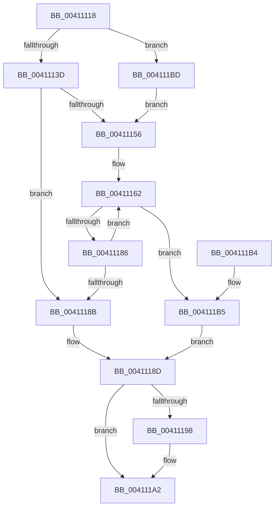

# ST_STORE&lt;SM_TRAITS&gt;::StCompactionWorker

- RVA: `0x00411118`–`0x004111CF` (길이 `183` bytes)
- VA: `0x0000000140411118`
- 실행 섹션: `.text`
- PDB 이름 있음: `예`; PDB Function 태그: `아니요`
- unwind 정보 RVA: `0x0009BDE4`
- 디코드: `52`개 명령, `183/183` bytes 표시
- 미해석 바이트: `0` (있으면 어셈블리에 `.byte`로 보존)

> 이 문서는 커널 이미지의 기계어와 PDB 기호를 분석해 생성했습니다. 4번과 5번은 함수 원형과 자료형을 바이너리 사용 방식에서 추정한 C 해석이며 원본 소스 복구 결과는 아닙니다.

## 1. Dependencies

- 직접 호출 지점: **4**; 고유 호출 대상: **3**
- 직접 호출자로 확인된 함수: **1**
- RIP 상대 이미지 참조: **0**

### Outgoing calls
- `0x0041114C` → [ST_STORE<SM_TRAITS>::StDmCheckForCompaction](ST_STORE_SM_TRAITS_StDmCheckForCompaction_function_0041147C.md) (function, `0x0041147C`)
- `0x0041116C` → [ST_STORE<SM_TRAITS>::StCompactionPerformInMem](ST_STORE_SM_TRAITS_StCompactionPerformInMem_function_004111D8.md) (function, `0x004111D8`)
- `0x0041117D` → [ST_STORE<SM_TRAITS>::StDmCheckForCompaction](ST_STORE_SM_TRAITS_StDmCheckForCompaction_function_0041147C.md) (function, `0x0041147C`)
- `0x0041119D` → [ST_STORE<SM_TRAITS>::StQueueCompaction](ST_STORE_SM_TRAITS_StQueueCompaction_function_00411790.md) (function, `0x00411790`)

### Direct callers
- [sub_0020634E](../20/Unknown_function_0020634E.md) at `0x002063E2`

### Static image references
- 디코드된 RIP-relative 메모리 참조가 없습니다.

## 2. Other-region calls and transfers

- 다른 실행 섹션으로 향하는 call: **0**
- 별도 외부 분기/꼬리 이동을 확인하지 못했습니다.

## 3. Assembly (complete function range)

```asm
00411118  48 89 5C 24 10                  mov qword ptr [rsp + 0x10], rbx
0041111D  48 89 74 24 18                  mov qword ptr [rsp + 0x18], rsi
00411122  57                              push rdi
00411123  48 83 EC 20                     sub rsp, 0x20
00411127  83 64 24 30 00                  and dword ptr [rsp + 0x30], 0
0041112C  48 8B D9                        mov rbx, rcx
0041112F  8A 81 E8 08 00 00               mov al, byte ptr [rcx + 0x8e8]
00411135  A8 04                           test al, 4
00411137  0F 85 80 00 00 00               jne 0x1404111bd
0041113D  24 FC                           and al, 0xfc
0041113F  4C 8D 44 24 30                  lea r8, [rsp + 0x30]
00411144  33 D2                           xor edx, edx
00411146  88 81 E8 08 00 00               mov byte ptr [rcx + 0x8e8], al
0041114C  E8 2B 03 00 00                  call 0x14041147c
00411151  83 F8 02                        cmp eax, 2
00411154  75 35                           jne 0x14041118b
00411156  80 8B E8 08 00 00 03            or byte ptr [rbx + 0x8e8], 3
0041115D  BE 01 00 00 00                  mov esi, 1
00411162  44 8B 44 24 30                  mov r8d, dword ptr [rsp + 0x30]
00411167  8B D6                           mov edx, esi
00411169  48 8B CB                        mov rcx, rbx
0041116C  E8 67 00 00 00                  call 0x1404111d8
00411171  4C 8D 44 24 30                  lea r8, [rsp + 0x30]
00411176  33 D2                           xor edx, edx
00411178  48 8B CB                        mov rcx, rbx
0041117B  8B F8                           mov edi, eax
0041117D  E8 FA 02 00 00                  call 0x14041147c
00411182  85 FF                           test edi, edi
00411184  78 2F                           js 0x1404111b5
00411186  83 F8 02                        cmp eax, 2
00411189  74 D7                           je 0x140411162
0041118B  33 FF                           xor edi, edi
0041118D  80 A3 E8 08 00 00 FC            and byte ptr [rbx + 0x8e8], 0xfc
00411194  85 C0                           test eax, eax
00411196  74 0A                           je 0x1404111a2
00411198  8B D0                           mov edx, eax
0041119A  48 8B CB                        mov rcx, rbx
0041119D  E8 EE 05 00 00                  call 0x140411790
004111A2  48 8B 5C 24 38                  mov rbx, qword ptr [rsp + 0x38]
004111A7  8B C7                           mov eax, edi
004111A9  48 8B 74 24 40                  mov rsi, qword ptr [rsp + 0x40]
004111AE  48 83 C4 20                     add rsp, 0x20
004111B2  5F                              pop rdi
004111B3  C3                              ret
004111B4  CC                              int3
004111B5  83 F8 02                        cmp eax, 2
004111B8  0F 44 C6                        cmove eax, esi
004111BB  EB D0                           jmp 0x14041118d
004111BD  24 FB                           and al, 0xfb
004111BF  C7 44 24 30 FF 00 00 00         mov dword ptr [rsp + 0x30], 0xff
004111C7  88 81 E8 08 00 00               mov byte ptr [rcx + 0x8e8], al
004111CD  EB 87                           jmp 0x140411156
```

## 4. C-style interpretation (structured pseudocode)

```c
__int64 __fastcall ST_STORE_SM_TRAITS___StCompactionWorker(__int64 a1, int a2)
{
    __int64 result;
    __int64 v_rdi;
    __int64 v_rsp;
    unsigned __int64 v_stack_p10;
    unsigned __int64 v_stack_p18;
    unsigned int v_stack_p30;
    unsigned int v_stack_p8;

    v_stack_p10 = v_rbx;
    v_stack_p18 = v_rsi;
    v_rsp = (v_rsp) - (32);
    if ((((unsigned __int8)(*(unsigned __int8 *)(a1 + 2280))) & (4)) != 0) goto loc_004111BD;
    result = (unsigned __int8)((*(unsigned __int8 *)(a1 + 2280)) & (252));
    a2 = 0;
    *(unsigned __int8 *)(a1 + 2280) = (unsigned __int8)(result);
    result = ST_STORE_SM_TRAITS___StDmCheckForCompaction(a1, a2, v_stack_p8, a4);
    if (((unsigned int)(result)) != 2) goto loc_0041118B;
loc_00411156:
loc_00411162:
    result = ST_STORE_SM_TRAITS___StCompactionPerformInMem(a1, 1, (unsigned int)(v_stack_p8), a4);
    a2 = 0;
    result = ST_STORE_SM_TRAITS___StDmCheckForCompaction(a1, a2, v_stack_p8, a4);
    if (sign_flag) goto loc_004111B5;
    if (((unsigned int)(result)) == 2) goto loc_00411162;
loc_0041118B:
    v_rdi = 0;
loc_0041118D:
    if ((unsigned int)(result) != 0) {
        a2 = (unsigned int)(result);
        a1 = a1;
        result = ST_STORE_SM_TRAITS___StQueueCompaction(a1, a2, v_stack_p8, a4);
    }
    v_rsp = (v_rsp) + (32);
    return 0;
loc_004111B5:
    result = 0;
    if (0 == 2) { result = (unsigned int)(v_stack_p18); }
    goto loc_0041118D;
loc_004111BD:
    result = (unsigned __int8)((result) & (251));
    v_stack_p30 = 255;
    *(unsigned __int8 *)(a1 + 2280) = (unsigned __int8)(result);
    goto loc_00411156;
}
```

## 5. (Beta) C Style

```c
int64_t ST_STORE_SM_TRAITS___StCompactionWorker(void *Arg1, int32_t Arg2)
{
    uint8_t *arg1 = (uint8_t *)Arg1;

    int64_t result;
    int64_t local_rdi;
    int64_t local_rsp;
    uint64_t v_stack_p10;
    uint64_t v_stack_p18;
    uint32_t v_stack_p30;
    uint32_t v_stack_p8;

    v_stack_p10 = local_rbx;
    v_stack_p18 = local_rsi;
    local_rsp = (local_rsp) - (32);
    if ((((uint8_t)(*(uint8_t *)(arg1 + 0x8E8))) & (4)) != 0) goto loc_004111BD;
    result = (uint8_t)((*(uint8_t *)(arg1 + 0x8E8)) & (252));
    Arg2 = 0;
    *(uint8_t *)(arg1 + 0x8E8) = (uint8_t)(result);
    result = ST_STORE_SM_TRAITS___StDmCheckForCompaction(Arg1, Arg2, v_stack_p8, a4);
    if (((uint32_t)(result)) != 2) goto loc_0041118B;
loc_00411156:
loc_00411162:
    result = ST_STORE_SM_TRAITS___StCompactionPerformInMem(Arg1, 1, (uint32_t)(v_stack_p8), a4);
    Arg2 = 0;
    result = ST_STORE_SM_TRAITS___StDmCheckForCompaction(Arg1, Arg2, v_stack_p8, a4);
    if (sign_flag) goto loc_004111B5;
    if (((uint32_t)(result)) == 2) goto loc_00411162;
loc_0041118B:
    local_rdi = 0;
loc_0041118D:
    if ((uint32_t)(result) != 0) {
        Arg2 = (uint32_t)(result);
        Arg1 = Arg1;
        result = ST_STORE_SM_TRAITS___StQueueCompaction(Arg1, Arg2, v_stack_p8, a4);
    }
    local_rsp = (local_rsp) + (32);
    return 0;
loc_004111B5:
    result = 0;
    if (0 == 2) { result = (uint32_t)(v_stack_p18); }
    goto loc_0041118D;
loc_004111BD:
    result = (uint8_t)((result) & (251));
    v_stack_p30 = 255;
    *(uint8_t *)(arg1 + 0x8E8) = (uint8_t)(result);
    goto loc_00411156;
}
```

### 관측된 메모리 오프셋

구조체 형식이 확인되지 않은 접근은 인자 기준의 오프셋으로만 기록했습니다.

| 기준 인자 | 오프셋 표현 | 폭 (bit) | 접근 |
|---|---:|---:|---|
| `Arg1` | `+ 0x8E8` | `8` | `R` |
| `Arg1` | `+ 0x8E8` | `8` | `R/W` |
| `Arg1` | `+ 0x8E8` | `8` | `W` |

## 6. Execution-region graph

[열기: 2D/3D 그래프와 함수 탐색 컨트롤 패널](../../../control-panel.html?section=text&rva=0x00411118&view=graph)

- 2D 그래프는 위에서 아래로 흐르고, 3D 그래프는 빈 공간을 드래그해 회전합니다. Shift+드래그는 이동, 휠은 확대·축소, 함수 노드 선택은 대상 보고서 이동입니다.

### Static fallback


