# ST_STORE&lt;SM_TRAITS&gt;::StDmCheckForCompaction

- RVA: `0x0041147C`–`0x00411788` (길이 `780` bytes)
- VA: `0x000000014041147C`
- 실행 섹션: `.text`
- PDB 이름 있음: `예`; PDB Function 태그: `예`
- unwind 정보 RVA: `0x0009BE20`
- 디코드: `203`개 명령, `780/780` bytes 표시
- 미해석 바이트: `0` (있으면 어셈블리에 `.byte`로 보존)

> 이 문서는 커널 이미지의 기계어와 PDB 기호를 분석해 생성했습니다. 4번과 5번은 함수 원형과 자료형을 바이너리 사용 방식에서 추정한 C 해석이며 원본 소스 복구 결과는 아닙니다.

## 1. Dependencies

- 직접 호출 지점: **0**; 고유 호출 대상: **0**
- 직접 호출자로 확인된 함수: **6**
- RIP 상대 이미지 참조: **1**

### Outgoing calls
- 직접 디코드된 call 명령이 없습니다.

### Direct callers
- [ST_STORE&lt;SM_TRAITS&gt;::StDmPageRemove](../20/ST_STORE_SM_TRAITS_StDmPageRemove_function_002049A0.md) at `0x00204EC2`
- [sub_002061A0](../20/Unknown_function_002061A0.md) at `0x002061F1`
- [sub_002061A0](../20/Unknown_function_002061A0.md) at `0x002062E8`
- [sub_0020634E](../20/Unknown_function_0020634E.md) at `0x0020646B`
- [ST_STORE&lt;SM_TRAITS&gt;::StCompactionWorker](ST_STORE_SM_TRAITS_StCompactionWorker_function_00411118.md) at `0x0041114C`
- [ST_STORE&lt;SM_TRAITS&gt;::StCompactionWorker](ST_STORE_SM_TRAITS_StCompactionWorker_function_00411118.md) at `0x0041117D`
- [ST_STORE&lt;SM_TRAITS&gt;::StCompactRegions](../4A/ST_STORE_SM_TRAITS_StCompactRegions_function_004A48E0.md) at `0x004A4E3B`
- [ST_STORE&lt;SM_TRAITS&gt;::StCompactionPerformEmergency](../4E/ST_STORE_SM_TRAITS_StCompactionPerformEmergency_function_004EB170.md) at `0x004EB2DD`

### Static image references
- `0x004114D8` → RVA `0x00E0E91C` (`.data`; read)

## 2. Other-region calls and transfers

- 다른 실행 섹션으로 향하는 call: **0**
- call이 아닌 외부 분기/꼬리 이동: **4**
  - `0x004116FE` → [sub_006ED160 + 0x35](../6E/Unknown_function_006ED160.md) (`tail-transfer`)
  - `0x00411708` → [sub_006ED160 + 0x35](../6E/Unknown_function_006ED160.md) (`tail-transfer`)
  - `0x0041173E` → [sub_006ED160](../6E/Unknown_function_006ED160.md) (`tail-transfer`)
  - `0x00411756` → [sub_006ED160 + 0x16](../6E/Unknown_function_006ED160.md) (`tail-transfer`)

## 3. Assembly (complete function range)

```asm
0041147C  4C 89 44 24 18                  mov qword ptr [rsp + 0x18], r8
00411481  89 54 24 10                     mov dword ptr [rsp + 0x10], edx
00411485  53                              push rbx
00411486  55                              push rbp
00411487  56                              push rsi
00411488  57                              push rdi
00411489  41 54                           push r12
0041148B  41 55                           push r13
0041148D  41 56                           push r14
0041148F  41 57                           push r15
00411491  48 83 EC 38                     sub rsp, 0x38
00411495  44 0F B6 99 E8 08 00 00         movzx r11d, byte ptr [rcx + 0x8e8]
0041149D  4C 8B D1                        mov r10, rcx
004114A0  B9 03 00 00 00                  mov ecx, 3
004114A5  44 23 D9                        and r11d, ecx
004114A8  44 89 5C 24 10                  mov dword ptr [rsp + 0x10], r11d
004114AD  44 8D 49 FF                     lea r9d, [rcx - 1]
004114B1  84 D1                           test cl, dl
004114B3  0F 84 FC 01 00 00               je 0x1404116b5
004114B9  41 8B 82 08 03 00 00            mov eax, dword ptr [r10 + 0x308]
004114C0  41 BD 01 00 00 00               mov r13d, 1
004114C6  25 FF 00 00 00                  and eax, 0xff
004114CB  89 44 24 04                     mov dword ptr [rsp + 4], eax
004114CF  0F 85 5F 02 00 00               jne 0x140411734
004114D5  89 0C 24                        mov dword ptr [rsp], ecx
004114D8  4C 8D 35 3D D4 9F 00            lea r14, [rip + 0x9fd43d]
004114DF  C7 84 24 98 00 00 00 08 00 00 00  mov dword ptr [rsp + 0x98], 8
004114EA  41 8B 8A 30 03 00 00            mov ecx, dword ptr [r10 + 0x330]
004114F1  4D 8D 8A 58 06 00 00            lea r9, [r10 + 0x658]
004114F8  41 8B 92 34 03 00 00            mov edx, dword ptr [r10 + 0x334]
004114FF  8B C1                           mov eax, ecx
00411501  44 8B 5C 24 04                  mov r11d, dword ptr [rsp + 4]
00411506  2B C2                           sub eax, edx
00411508  44 8B 84 24 98 00 00 00         mov r8d, dword ptr [rsp + 0x98]
00411510  33 DB                           xor ebx, ebx
00411512  33 ED                           xor ebp, ebp
00411514  4C 89 74 24 20                  mov qword ptr [rsp + 0x20], r14
00411519  33 F6                           xor esi, esi
0041151B  89 8C 24 80 00 00 00            mov dword ptr [rsp + 0x80], ecx
00411522  45 33 E4                        xor r12d, r12d
00411525  45 33 FF                        xor r15d, r15d
00411528  FF C0                           inc eax
0041152A  44 8B F2                        mov r14d, edx
0041152D  89 44 24 0C                     mov dword ptr [rsp + 0xc], eax
00411531  49 8D 82 9C 08 00 00            lea rax, [r10 + 0x89c]
00411538  48 89 44 24 18                  mov qword ptr [rsp + 0x18], rax
0041153D  8B 78 FC                        mov edi, dword ptr [rax - 4]
00411540  8B 10                           mov edx, dword ptr [rax]
00411542  89 BC 24 98 00 00 00            mov dword ptr [rsp + 0x98], edi
00411549  45 85 DB                        test r11d, r11d
0041154C  0F 85 C9 01 00 00               jne 0x14041171b
00411552  44 8B EA                        mov r13d, edx
00411555  8B 44 24 0C                     mov eax, dword ptr [rsp + 0xc]
00411559  0F AF C7                        imul eax, edi
0041155C  8B F8                           mov edi, eax
0041155E  2B FA                           sub edi, edx
00411560  3B F9                           cmp edi, ecx
00411562  72 33                           jb 0x140411597
00411564  3B C2                           cmp eax, edx
00411566  72 2F                           jb 0x140411597
00411568  41 8B 01                        mov eax, dword ptr [r9]
0041156B  83 F8 FF                        cmp eax, -1
0041156E  74 29                           je 0x140411599
00411570  8B C8                           mov ecx, eax
00411572  FF CF                           dec edi
00411574  49 8B 82 78 05 00 00            mov rax, qword ptr [r10 + 0x578]
0041157B  0F B7 14 48                     movzx edx, word ptr [rax + rcx*2]
0041157F  8B 8C 24 80 00 00 00            mov ecx, dword ptr [rsp + 0x80]
00411586  81 E2 FF 1F 00 00               and edx, 0x1fff
0041158C  2B D1                           sub edx, ecx
0041158E  41 03 D6                        add edx, r14d
00411591  03 FA                           add edi, edx
00411593  3B F9                           cmp edi, ecx
00411595  73 02                           jae 0x140411599
00411597  33 FF                           xor edi, edi
00411599  03 B4 24 98 00 00 00            add esi, dword ptr [rsp + 0x98]
004115A0  41 03 DD                        add ebx, r13d
004115A3  41 BD 01 00 00 00               mov r13d, 1
004115A9  85 FF                           test edi, edi
004115AB  74 14                           je 0x1404115c1
004115AD  41 8B CF                        mov ecx, r15d
004115B0  41 8B C5                        mov eax, r13d
004115B3  D3 E0                           shl eax, cl
004115B5  03 EF                           add ebp, edi
004115B7  8B 8C 24 80 00 00 00            mov ecx, dword ptr [rsp + 0x80]
004115BE  44 0B E0                        or r12d, eax
004115C1  48 8B 44 24 18                  mov rax, qword ptr [rsp + 0x18]
004115C6  45 03 FD                        add r15d, r13d
004115C9  48 83 C0 08                     add rax, 8
004115CD  49 83 C1 10                     add r9, 0x10
004115D1  48 89 44 24 18                  mov qword ptr [rsp + 0x18], rax
004115D6  45 3B F8                        cmp r15d, r8d
004115D9  0F 82 5E FF FF FF               jb 0x14041153d
004115DF  48 8B 84 24 90 00 00 00         mov rax, qword ptr [rsp + 0x90]
004115E7  41 B9 02 00 00 00               mov r9d, 2
004115ED  44 8B 04 24                     mov r8d, dword ptr [rsp]
004115F1  44 8B 5C 24 10                  mov r11d, dword ptr [rsp + 0x10]
004115F6  4C 8B 74 24 20                  mov r14, qword ptr [rsp + 0x20]
004115FB  48 85 C0                        test rax, rax
004115FE  0F 85 0F 01 00 00               jne 0x140411713
00411604  8B 8C 24 88 00 00 00            mov ecx, dword ptr [rsp + 0x88]
0041160B  49 8B 82 20 03 00 00            mov rax, qword ptr [r10 + 0x320]
00411612  41 84 C9                        test r9b, cl
00411615  0F 85 40 01 00 00               jne 0x14041175b
0041161B  48 8B 80 F0 1C 00 00            mov rax, qword ptr [rax + 0x1cf0]
00411622  48 85 C0                        test rax, rax
00411625  74 14                           je 0x14041163b
00411627  33 C0                           xor eax, eax
00411629  48 83 C4 38                     add rsp, 0x38
0041162D  41 5F                           pop r15
0041162F  41 5E                           pop r14
00411631  41 5D                           pop r13
00411633  41 5C                           pop r12
00411635  5F                              pop rdi
00411636  5E                              pop rsi
00411637  5D                              pop rbp
00411638  5B                              pop rbx
00411639  C3                              ret
0041163A  CC                              int3
0041163B  41 3B F0                        cmp esi, r8d
0041163E  72 E7                           jb 0x140411627
00411640  41 84 CD                        test r13b, cl
00411643  75 29                           jne 0x14041166e
00411645  45 3B DD                        cmp r11d, r13d
00411648  0F 84 82 00 00 00               je 0x1404116d0
0041164E  49 8B 82 20 03 00 00            mov rax, qword ptr [r10 + 0x320]
00411655  8B 88 00 1B 00 00               mov ecx, dword ptr [rax + 0x1b00]
0041165B  03 88 08 1D 00 00               add ecx, dword ptr [rax + 0x1d08]
00411661  8B 80 04 1B 00 00               mov eax, dword ptr [rax + 0x1b04]
00411667  C1 E8 08                        shr eax, 8
0041166A  03 C8                           add ecx, eax
0041166C  75 62                           jne 0x1404116d0
0041166E  33 C0                           xor eax, eax
00411670  44 8B C0                        mov r8d, eax
00411673  8B D3                           mov edx, ebx
00411675  43 8A 0C 46                     mov cl, byte ptr [r14 + r8*2]
00411679  D3 EA                           shr edx, cl
0041167B  41 83 FB 03                     cmp r11d, 3
0041167F  74 42                           je 0x1404116c3
00411681  3B EA                           cmp ebp, edx
00411683  77 1E                           ja 0x1404116a3
00411685  45 3B DD                        cmp r11d, r13d
00411688  0F 84 80 00 00 00               je 0x14041170e
0041168E  45 85 C0                        test r8d, r8d
00411691  74 7B                           je 0x14041170e
00411693  41 8A 0E                        mov cl, byte ptr [r14]
00411696  45 33 C9                        xor r9d, r9d
00411699  D3 EB                           shr ebx, cl
0041169B  3B EB                           cmp ebp, ebx
0041169D  41 0F 97 C1                     seta r9b
004116A1  EB 0A                           jmp 0x1404116ad
004116A3  41 80 BA 08 03 00 00 00         cmp byte ptr [r10 + 0x308], 0
004116AB  74 28                           je 0x1404116d5
004116AD  41 8B C1                        mov eax, r9d
004116B0  E9 74 FF FF FF                  jmp 0x140411629
004116B5  45 3B D9                        cmp r11d, r9d
004116B8  0F 85 FB FD FF FF               jne 0x1404114b9
004116BE  E9 64 FF FF FF                  jmp 0x140411627
004116C3  43 8A 4C 46 01                  mov cl, byte ptr [r14 + r8*2 + 1]
004116C8  8B C3                           mov eax, ebx
004116CA  D3 E8                           shr eax, cl
004116CC  2B D0                           sub edx, eax
004116CE  EB B1                           jmp 0x140411681
004116D0  41 8B C5                        mov eax, r13d
004116D3  EB 9B                           jmp 0x140411670
004116D5  49 8B 82 20 03 00 00            mov rax, qword ptr [r10 + 0x320]
004116DC  80 B8 96 1A 00 00 00            cmp byte ptr [rax + 0x1a96], 0
004116E3  77 C8                           ja 0x1404116ad
004116E5  8B 88 00 1B 00 00               mov ecx, dword ptr [rax + 0x1b00]
004116EB  03 88 08 1D 00 00               add ecx, dword ptr [rax + 0x1d08]
004116F1  8B 80 04 1B 00 00               mov eax, dword ptr [rax + 0x1b04]
004116F7  03 C8                           add ecx, eax
004116F9  74 B2                           je 0x1404116ad
004116FB  45 85 DB                        test r11d, r11d
004116FE  0F 84 91 BA 2D 00               je 0x1406ed195
00411704  41 83 FB 03                     cmp r11d, 3
00411708  0F 84 87 BA 2D 00               je 0x1406ed195
0041170E  45 33 C9                        xor r9d, r9d
00411711  EB 9A                           jmp 0x1404116ad
00411713  44 89 20                        mov dword ptr [rax], r12d
00411716  E9 E9 FE FF FF                  jmp 0x140411604
0041171B  41 8B 8A 2C 03 00 00            mov ecx, dword ptr [r10 + 0x32c]
00411722  44 8B EF                        mov r13d, edi
00411725  41 D3 E5                        shl r13d, cl
00411728  8B 8C 24 80 00 00 00            mov ecx, dword ptr [rsp + 0x80]
0041172F  E9 21 FE FF FF                  jmp 0x140411555
00411734  45 8B 82 58 03 00 00            mov r8d, dword ptr [r10 + 0x358]
0041173B  44 3B D9                        cmp r11d, ecx
0041173E  0F 85 1C BA 2D 00               jne 0x1406ed160
00411744  41 8D 80 00 FF FF FF            lea eax, [r8 - 0x100]
0041174B  41 C1 E8 02                     shr r8d, 2
0041174F  44 3B C0                        cmp r8d, eax
00411752  44 0F 43 C0                     cmovae r8d, eax
00411756  E9 1B BA 2D 00                  jmp 0x1406ed176
0041175B  80 B8 96 1A 00 00 00            cmp byte ptr [rax + 0x1a96], 0
00411762  0F 87 BF FE FF FF               ja 0x140411627
00411768  41 8B 8A 10 03 00 00            mov ecx, dword ptr [r10 + 0x310]
0041176F  48 C1 E9 0C                     shr rcx, 0xc
00411773  8B C6                           mov eax, esi
00411775  48 0F AF C8                     imul rcx, rax
00411779  49 3B 4A 08                     cmp rcx, qword ptr [r10 + 8]
0041177D  0F 86 A4 FE FF FF               jbe 0x140411627
00411783  E9 25 FF FF FF                  jmp 0x1404116ad
```

## 4. C-style interpretation (structured pseudocode)

```c
__int64 __fastcall ST_STORE_SM_TRAITS___StDmCheckForCompaction(__int64 a1, int a2, __int64 a3)
{
    __int64 result;
    __int64 v_r11;
    __int64 v_r12;
    __int64 v_r13;
    __int64 v_r15;
    __int64 v_rbp;
    __int64 v_rbx;
    __int64 v_rdi;
    __int64 v_rsi;
    __int64 v_rsp;
    unsigned __int64 v_stack_m58;
    unsigned __int64 v_stack_m60;
    unsigned int v_stack_m68;
    unsigned int v_stack_m6C;
    unsigned int v_stack_m74;
    unsigned int v_stack_m78;
    unsigned int v_stack_p10;
    unsigned __int64 v_stack_p18;
    unsigned int v_stack_p20;
    unsigned int v_stack_p8;
    unsigned int v_stack_p80;

    v_stack_p18 = a3;
    v_stack_p10 = a2;
    v_rsp = (v_rsp) - (56);
    v_r11 = (unsigned int)((*(unsigned __int8 *)(a1 + 2280)) & (3));
    v_stack_m68 = (unsigned int)(v_r11);
    if (((3) & ((unsigned __int8)(a2))) == 0) goto loc_004116B5;
loc_004114B9:
    result = (unsigned int)(((unsigned int)(*(unsigned int *)(a1 + 776))) & (255));
    v_stack_m74 = (unsigned int)(result);
    if (condition_is_not_equal) goto loc_00411734;
    v_stack_m78 = 3;
    v_stack_p20 = 8;
    result = (unsigned int)(((unsigned int)((unsigned int)((unsigned int)(*(unsigned int *)(a1 + 816))))) - ((unsigned int)((unsigned int)(*(unsigned int *)(a1 + 820)))));
    v_rbx = 0;
    v_rbp = 0;
    v_stack_m58 = v_rip + 10474557;
    v_rsi = 0;
    v_stack_p8 = (unsigned int)((unsigned int)(*(unsigned int *)(a1 + 816)));
    v_r12 = 0;
    v_r15 = 0;
    result = (unsigned int)((result) + 1);
    v_stack_m6C = (unsigned int)(result);
    v_stack_m60 = a1 + 2204;
loc_0041153D:
    v_stack_p20 = (unsigned int)((unsigned int)(*(unsigned int *)(a1 + 2204 - 4)));
    if ((unsigned int)((unsigned int)(v_stack_m74)) != 0) goto loc_0041171B;
loc_00411555:
    result = (unsigned int)(((unsigned int)(v_stack_m6C)) * ((unsigned int)((unsigned int)(*(unsigned int *)(a1 + 2204 - 4)))));
    v_rdi = (unsigned int)(((unsigned int)((unsigned int)(result))) - ((unsigned int)((unsigned int)(*(unsigned int *)(a1 + 2204)))));
    if (((unsigned int)(v_rdi)) < ((unsigned int)((unsigned int)(*(unsigned int *)(a1 + 816))))) goto loc_00411597;
    if (((unsigned int)(result)) < ((unsigned int)((unsigned int)(*(unsigned int *)(a1 + 2204))))) goto loc_00411597;
    if (((unsigned int)((unsigned int)(*(unsigned int *)(a1 + 1624)))) == -1) goto loc_00411599;
    v_rdi = (unsigned int)((v_rdi) - 1);
    a2 = (unsigned int)((*(unsigned __int16 *)(*(unsigned __int64 *)(a1 + 1400) + (unsigned int)((unsigned int)((unsigned int)(*(unsigned int *)(a1 + 1624)))) * 2)) & (0x1FFFULL));
    a2 = (unsigned int)((a2) - ((unsigned int)((unsigned int)(v_stack_p8))));
    a2 = (unsigned int)((a2) + ((unsigned int)((unsigned int)((unsigned int)((unsigned int)(*(unsigned int *)(a1 + 820)))))));
    v_rdi = (unsigned int)((v_rdi) + (a2));
    if (((unsigned int)(v_rdi)) < ((unsigned int)((unsigned int)(v_stack_p8)))) {
        v_rdi = 0;
    }
    v_rsi = (unsigned int)((v_rsi) + (v_stack_p20));
    v_rbx = (unsigned int)((v_rbx) + ((unsigned int)((unsigned int)((unsigned int)((unsigned int)(*(unsigned int *)(a1 + 2204)))))));
    result = *(unsigned __int64 *)(a1 + 1400);
    if (0 != 0) {
        a1 = 0;
        result = 1;
        result = (unsigned int)((result) << ((unsigned __int8)(a1)));
        v_rbp = (unsigned int)((v_rbp) + (0));
        a1 = v_stack_p8;
        v_r12 = (unsigned int)((v_r12) | ((unsigned int)(result)));
    }
    v_r15 = (unsigned int)((v_r15) + (1));
    result = (v_stack_m60) + (8);
    a4 = (a1 + 1624) + (16);
    v_stack_m60 = result;
    if (((unsigned int)(v_r15)) < ((unsigned int)((unsigned int)(v_stack_p20)))) goto loc_0041153D;
    if (v_stack_p18 != 0) goto loc_00411713;
loc_00411604:
    if (((2) & ((unsigned __int8)((unsigned int)(v_stack_p10)))) != 0) goto loc_0041175B;
    if (*(unsigned __int64 *)(*(unsigned __int64 *)(a1 + 800) + 7408) == 0) goto loc_0041163B;
loc_00411627:
    result = 0;
loc_00411629:
    v_rsp = (v_rsp) + (56);
    return result;
loc_0041163B:
    if (((unsigned int)(v_rsi)) < ((unsigned int)((unsigned int)(v_stack_m78)))) goto loc_00411627;
    if (((1) & ((unsigned __int8)((unsigned int)(v_stack_p10)))) != 0) goto loc_0041166E;
    if (((unsigned int)((unsigned int)(v_stack_m68))) == 1) goto loc_004116D0;
    a1 = (unsigned int)(((unsigned int)(*(unsigned int *)(*(unsigned __int64 *)(a1 + 800) + 6912))) + (*(unsigned int *)(*(unsigned __int64 *)(a1 + 800) + 7432)));
    result = (unsigned int)(((unsigned int)(*(unsigned int *)(*(unsigned __int64 *)(a1 + 800) + 6916))) >> (8));
    a1 = (unsigned int)((a1) + ((unsigned int)(result)));
    if (condition_is_not_equal) goto loc_004116D0;
loc_0041166E:
    result = 0;
loc_00411670:
    a2 = (unsigned int)(((unsigned int)((unsigned int)(v_rbx))) >> ((unsigned __int8)(*(unsigned __int8 *)(v_stack_m58 + 0 * 2))));
    if (((unsigned int)((unsigned int)(v_stack_m68))) == 3) goto loc_004116C3;
loc_00411681:
    if (((unsigned int)(v_rbp)) > a2) goto loc_004116A3;
    if (((unsigned int)((unsigned int)(v_stack_m68))) == 1) goto loc_0041170E;
    if (0 == 0) goto loc_0041170E;
    a4 = 0;
    v_rbx = (unsigned int)((v_rbx) >> ((unsigned __int8)(*(unsigned __int8 *)(v_stack_m58))));
    a4 = (((unsigned int)(v_rbp)) > ((unsigned int)(v_rbx))) ? 1 : 0;
    goto loc_004116AD;
loc_004116A3:
    if ((*(unsigned __int8 *)(a1 + 776)) == 0) goto loc_004116D5;
loc_004116AD:
    goto loc_00411629;
loc_004116B5:
    if (((unsigned int)((unsigned int)(v_stack_m68))) != ((unsigned int)(a4))) goto loc_004114B9;
    goto loc_00411627;
loc_004116C3:
    result = (unsigned int)(((unsigned int)((unsigned int)(v_rbx))) >> ((unsigned __int8)(*(unsigned __int8 *)(v_stack_m58 + 0 * 2 + 1))));
    a2 = (unsigned int)((a2) - ((unsigned int)(result)));
    goto loc_00411681;
loc_004116D0:
    goto loc_00411670;
loc_004116D5:
    if ((*(unsigned __int8 *)(*(unsigned __int64 *)(a1 + 800) + 6806)) > 0) goto loc_004116AD;
    a1 = (unsigned int)(((unsigned int)(*(unsigned int *)(*(unsigned __int64 *)(a1 + 800) + 6912))) + (*(unsigned int *)(*(unsigned __int64 *)(a1 + 800) + 7432)));
    a1 = (unsigned int)((a1) + ((unsigned int)((unsigned int)(*(unsigned int *)(*(unsigned __int64 *)(a1 + 800) + 6916)))));
    if (condition_is_equal) goto loc_004116AD;
loc_0041170E:
    a4 = 0;
    goto loc_004116AD;
loc_00411713:
    *(unsigned int *)((unsigned int)(*(unsigned int *)(*(unsigned __int64 *)(a1 + 800) + 6916))) = (unsigned int)(v_r12);
    goto loc_00411604;
loc_0041171B:
    v_r13 = (unsigned int)((0) << ((unsigned __int8)((unsigned int)(*(unsigned int *)(a1 + 812)))));
    goto loc_00411555;
loc_00411734:
    a3 = (unsigned int)(((unsigned int)(*(unsigned int *)(a1 + 856))) >> (2));
    if (((unsigned int)(a3)) >= ((unsigned int)((unsigned int)(*(unsigned int *)(a1 + 856)) - 256))) { a3 = (unsigned int)((unsigned int)(*(unsigned int *)(a1 + 856)) - 256); }
loc_0041175B:
    if ((*(unsigned __int8 *)((unsigned int)(*(unsigned int *)(a1 + 856)) - 256 + 6806)) > 0) goto loc_00411627;
    a1 = ((unsigned int)(*(unsigned int *)(a1 + 784))) >> (12);
    a1 = (a1) * ((unsigned int)((unsigned int)(v_rsi)));
    if (a1 <= (*(unsigned __int64 *)(a1 + 8))) goto loc_00411627;
    goto loc_004116AD;
}
```

## 5. (Beta) C Style

```c
int64_t ST_STORE_SM_TRAITS___StDmCheckForCompaction(void *Arg1, int32_t Arg2, int64_t Arg3)
{
    uint8_t *arg1 = (uint8_t *)Arg1;

    int64_t result;
    int64_t local_r11;
    int64_t local_r12;
    int64_t local_r13;
    int64_t local_r15;
    int64_t local_rbp;
    int64_t local_rbx;
    int64_t local_rdi;
    int64_t local_rsi;
    int64_t local_rsp;
    uint64_t v_stack_m58;
    uint64_t v_stack_m60;
    uint32_t v_stack_m68;
    uint32_t v_stack_m6C;
    uint32_t v_stack_m74;
    uint32_t v_stack_m78;
    uint32_t v_stack_p10;
    uint64_t v_stack_p18;
    uint32_t v_stack_p20;
    uint32_t v_stack_p8;
    uint32_t v_stack_p80;

    v_stack_p18 = Arg3;
    v_stack_p10 = Arg2;
    local_rsp = (local_rsp) - (56);
    local_r11 = (uint32_t)((*(uint8_t *)(arg1 + 0x8E8)) & (3));
    v_stack_m68 = (uint32_t)(local_r11);
    if (((3) & ((uint8_t)(Arg2))) == 0) goto loc_004116B5;
loc_004114B9:
    result = (uint32_t)(((uint32_t)(*(uint32_t *)(arg1 + 0x308))) & (255));
    v_stack_m74 = (uint32_t)(result);
    if (condition_is_not_equal) goto loc_00411734;
    v_stack_m78 = 3;
    v_stack_p20 = 8;
    result = (uint32_t)(((uint32_t)((uint32_t)((uint32_t)(*(uint32_t *)(arg1 + 0x330))))) - ((uint32_t)((uint32_t)(*(uint32_t *)(arg1 + 0x334)))));
    local_rbx = 0;
    local_rbp = 0;
    v_stack_m58 = v_rip + 10474557;
    local_rsi = 0;
    v_stack_p8 = (uint32_t)((uint32_t)(*(uint32_t *)(arg1 + 0x330)));
    local_r12 = 0;
    local_r15 = 0;
    result = (uint32_t)((result) + 1);
    v_stack_m6C = (uint32_t)(result);
    v_stack_m60 = Arg1 + 2204;
loc_0041153D:
    v_stack_p20 = (uint32_t)((uint32_t)(*(uint32_t *)(arg1 + 0x89C - 0x4)));
    if ((uint32_t)((uint32_t)(v_stack_m74)) != 0) goto loc_0041171B;
loc_00411555:
    result = (uint32_t)(((uint32_t)(v_stack_m6C)) * ((uint32_t)((uint32_t)(*(uint32_t *)(arg1 + 0x89C - 0x4)))));
    local_rdi = (uint32_t)(((uint32_t)((uint32_t)(result))) - ((uint32_t)((uint32_t)(*(uint32_t *)(arg1 + 0x89C)))));
    if (((uint32_t)(local_rdi)) < ((uint32_t)((uint32_t)(*(uint32_t *)(arg1 + 0x330))))) goto loc_00411597;
    if (((uint32_t)(result)) < ((uint32_t)((uint32_t)(*(uint32_t *)(arg1 + 0x89C))))) goto loc_00411597;
    if (((uint32_t)((uint32_t)(*(uint32_t *)(arg1 + 0x658)))) == -1) goto loc_00411599;
    local_rdi = (uint32_t)((local_rdi) - 1);
    Arg2 = (uint32_t)((*(uint16_t *)(*(uint64_t *)(arg1 + 0x578) + (uint32_t)((uint32_t)((uint32_t)(*(uint32_t *)(arg1 + 0x658)))) * 2)) & (0x1FFFULL));
    Arg2 = (uint32_t)((Arg2) - ((uint32_t)((uint32_t)(v_stack_p8))));
    Arg2 = (uint32_t)((Arg2) + ((uint32_t)((uint32_t)((uint32_t)((uint32_t)(*(uint32_t *)(arg1 + 0x334)))))));
    local_rdi = (uint32_t)((local_rdi) + (Arg2));
    if (((uint32_t)(local_rdi)) < ((uint32_t)((uint32_t)(v_stack_p8)))) {
        local_rdi = 0;
    }
    local_rsi = (uint32_t)((local_rsi) + (v_stack_p20));
    local_rbx = (uint32_t)((local_rbx) + ((uint32_t)((uint32_t)((uint32_t)((uint32_t)(*(uint32_t *)(arg1 + 0x89C)))))));
    result = *(uint64_t *)(arg1 + 0x578);
    if (0 != 0) {
        Arg1 = 0;
        result = 1;
        result = (uint32_t)((result) << ((uint8_t)(Arg1)));
        local_rbp = (uint32_t)((local_rbp) + (0));
        Arg1 = v_stack_p8;
        local_r12 = (uint32_t)((local_r12) | ((uint32_t)(result)));
    }
    local_r15 = (uint32_t)((local_r15) + (1));
    result = (v_stack_m60) + (8);
    a4 = (Arg1 + 1624) + (16);
    v_stack_m60 = result;
    if (((uint32_t)(local_r15)) < ((uint32_t)((uint32_t)(v_stack_p20)))) goto loc_0041153D;
    if (v_stack_p18 != 0) goto loc_00411713;
loc_00411604:
    if (((2) & ((uint8_t)((uint32_t)(v_stack_p10)))) != 0) goto loc_0041175B;
    if (*(uint64_t *)(*(uint64_t *)(arg1 + 0x320) + 0x1CF0) == 0) goto loc_0041163B;
loc_00411627:
    result = 0;
loc_00411629:
    local_rsp = (local_rsp) + (56);
    return result;
loc_0041163B:
    if (((uint32_t)(local_rsi)) < ((uint32_t)((uint32_t)(v_stack_m78)))) goto loc_00411627;
    if (((1) & ((uint8_t)((uint32_t)(v_stack_p10)))) != 0) goto loc_0041166E;
    if (((uint32_t)((uint32_t)(v_stack_m68))) == 1) goto loc_004116D0;
    Arg1 = (uint32_t)(((uint32_t)(*(uint32_t *)(*(uint64_t *)(arg1 + 0x320) + 0x1B00))) + (*(uint32_t *)(*(uint64_t *)(arg1 + 0x320) + 0x1D08)));
    result = (uint32_t)(((uint32_t)(*(uint32_t *)(*(uint64_t *)(arg1 + 0x320) + 0x1B04))) >> (8));
    Arg1 = (uint32_t)((Arg1) + ((uint32_t)(result)));
    if (condition_is_not_equal) goto loc_004116D0;
loc_0041166E:
    result = 0;
loc_00411670:
    Arg2 = (uint32_t)(((uint32_t)((uint32_t)(local_rbx))) >> ((uint8_t)(*(uint8_t *)(v_stack_m58 + 0x0 * 2))));
    if (((uint32_t)((uint32_t)(v_stack_m68))) == 3) goto loc_004116C3;
loc_00411681:
    if (((uint32_t)(local_rbp)) > Arg2) goto loc_004116A3;
    if (((uint32_t)((uint32_t)(v_stack_m68))) == 1) goto loc_0041170E;
    if (0 == 0) goto loc_0041170E;
    a4 = 0;
    local_rbx = (uint32_t)((local_rbx) >> ((uint8_t)(*(uint8_t *)(v_stack_m58))));
    a4 = (((uint32_t)(local_rbp)) > ((uint32_t)(local_rbx))) ? 1 : 0;
    goto loc_004116AD;
loc_004116A3:
    if ((*(uint8_t *)(arg1 + 0x308)) == 0) goto loc_004116D5;
loc_004116AD:
    goto loc_00411629;
loc_004116B5:
    if (((uint32_t)((uint32_t)(v_stack_m68))) != ((uint32_t)(a4))) goto loc_004114B9;
    goto loc_00411627;
loc_004116C3:
    result = (uint32_t)(((uint32_t)((uint32_t)(local_rbx))) >> ((uint8_t)(*(uint8_t *)(v_stack_m58 + 0x0 * 2 + 0x1))));
    Arg2 = (uint32_t)((Arg2) - ((uint32_t)(result)));
    goto loc_00411681;
loc_004116D0:
    goto loc_00411670;
loc_004116D5:
    if ((*(uint8_t *)(*(uint64_t *)(arg1 + 0x320) + 0x1A96)) > 0) goto loc_004116AD;
    Arg1 = (uint32_t)(((uint32_t)(*(uint32_t *)(*(uint64_t *)(arg1 + 0x320) + 0x1B00))) + (*(uint32_t *)(*(uint64_t *)(arg1 + 0x320) + 0x1D08)));
    Arg1 = (uint32_t)((Arg1) + ((uint32_t)((uint32_t)(*(uint32_t *)(*(uint64_t *)(arg1 + 0x320) + 0x1B04)))));
    if (condition_is_equal) goto loc_004116AD;
loc_0041170E:
    a4 = 0;
    goto loc_004116AD;
loc_00411713:
    *(uint32_t *)((uint32_t)(*(uint32_t *)(*(uint64_t *)(arg1 + 0x320) + 0x1B04))) = (uint32_t)(local_r12);
    goto loc_00411604;
loc_0041171B:
    local_r13 = (uint32_t)((0) << ((uint8_t)((uint32_t)(*(uint32_t *)(arg1 + 0x32C)))));
    goto loc_00411555;
loc_00411734:
    Arg3 = (uint32_t)(((uint32_t)(*(uint32_t *)(arg1 + 0x358))) >> (2));
    if (((uint32_t)(Arg3)) >= ((uint32_t)((uint32_t)(*(uint32_t *)(arg1 + 0x358)) - 256))) { Arg3 = (uint32_t)((uint32_t)(*(uint32_t *)(arg1 + 0x358)) - 256); }
loc_0041175B:
    if ((*(uint8_t *)((uint32_t)(*(uint32_t *)(arg1 + 0x358)) - 0x100 + 0x1A96)) > 0) goto loc_00411627;
    Arg1 = ((uint32_t)(*(uint32_t *)(arg1 + 0x310))) >> (12);
    Arg1 = (Arg1) * ((uint32_t)((uint32_t)(local_rsi)));
    if (Arg1 <= (*(uint64_t *)(arg1 + 0x8))) goto loc_00411627;
    goto loc_004116AD;
}
```

### 관측된 메모리 오프셋

구조체 형식이 확인되지 않은 접근은 인자 기준의 오프셋으로만 기록했습니다.

| 기준 인자 | 오프셋 표현 | 폭 (bit) | 접근 |
|---|---:|---:|---|
| `Arg1` | `+ 0x0` | `32` | `R` |
| `Arg1` | `+ 0x8` | `64` | `R` |
| `Arg1` | `+ 0x308` | `8` | `R` |
| `Arg1` | `+ 0x308` | `32` | `R` |
| `Arg1` | `+ 0x310` | `32` | `R` |
| `Arg1` | `+ 0x320` | `64` | `R` |
| `Arg1` | `+ 0x32C` | `32` | `R` |
| `Arg1` | `+ 0x330` | `32` | `R` |
| `Arg1` | `+ 0x334` | `32` | `R` |
| `Arg1` | `+ 0x358` | `32` | `R` |
| `Arg1` | `+ 0x578` | `64` | `R` |
| `Arg1` | `+ 0x658` | `64` | `R` |
| `Arg1` | `+ 0x89C` | `64` | `R` |
| `Arg1` | `+ 0x8E8` | `8` | `R` |

## 6. Execution-region graph

[열기: 2D/3D 그래프와 함수 탐색 컨트롤 패널](../../../control-panel.html?section=text&rva=0x0041147C&view=graph)

- 2D 그래프는 위에서 아래로 흐르고, 3D 그래프는 빈 공간을 드래그해 회전합니다. Shift+드래그는 이동, 휠은 확대·축소, 함수 노드 선택은 대상 보고서 이동입니다.

### Static fallback

```mermaid
flowchart TD
  bb_0041147C[BB_0041147C]
  bb_004114B9[BB_004114B9]
  bb_004114D5[BB_004114D5]
  bb_0041153D[BB_0041153D]
  bb_00411552[BB_00411552]
  bb_00411555[BB_00411555]
  bb_00411564[BB_00411564]
  bb_00411568[BB_00411568]
  bb_00411570[BB_00411570]
  bb_00411597[BB_00411597]
  bb_00411599[BB_00411599]
  bb_004115AD[BB_004115AD]
  bb_004115C1[BB_004115C1]
  bb_004115DF[BB_004115DF]
  bb_00411604[BB_00411604]
  bb_0041161B[BB_0041161B]
  bb_00411627[BB_00411627]
  bb_00411629[BB_00411629]
  bb_0041163A[BB_0041163A]
  bb_0041163B[BB_0041163B]
  bb_00411640[BB_00411640]
  bb_00411645[BB_00411645]
  bb_0041164E[BB_0041164E]
  bb_0041166E[BB_0041166E]
  bb_00411670[BB_00411670]
  bb_00411681[BB_00411681]
  bb_00411685[BB_00411685]
  bb_0041168E[BB_0041168E]
  bb_00411693[BB_00411693]
  bb_004116A3[BB_004116A3]
  bb_004116AD[BB_004116AD]
  bb_004116B5[BB_004116B5]
  bb_004116BE[BB_004116BE]
  bb_004116C3[BB_004116C3]
  bb_004116D0[BB_004116D0]
  bb_004116D5[BB_004116D5]
  bb_004116E5[BB_004116E5]
  bb_004116FB[BB_004116FB]
  bb_00411704[BB_00411704]
  bb_0041170E[BB_0041170E]
  bb_00411713[BB_00411713]
  bb_0041171B[BB_0041171B]
  bb_00411734[BB_00411734]
  bb_00411744[BB_00411744]
  bb_0041175B[BB_0041175B]
  bb_00411768[BB_00411768]
  bb_00411783[BB_00411783]
  bb_0041147C -->|branch| bb_004116B5
  bb_0041147C -->|fallthrough| bb_004114B9
  bb_004114B9 -->|branch| bb_00411734
  bb_004114B9 -->|fallthrough| bb_004114D5
  bb_004114D5 -->|flow| bb_0041153D
  bb_0041153D -->|branch| bb_0041171B
  bb_0041153D -->|fallthrough| bb_00411552
  bb_00411552 -->|flow| bb_00411555
  bb_00411555 -->|branch| bb_00411597
  bb_00411555 -->|fallthrough| bb_00411564
  bb_00411564 -->|branch| bb_00411597
  bb_00411564 -->|fallthrough| bb_00411568
  bb_00411568 -->|branch| bb_00411599
  bb_00411568 -->|fallthrough| bb_00411570
  bb_00411570 -->|branch| bb_00411599
  bb_00411570 -->|fallthrough| bb_00411597
  bb_00411597 -->|flow| bb_00411599
  bb_00411599 -->|branch| bb_004115C1
  bb_00411599 -->|fallthrough| bb_004115AD
  bb_004115AD -->|flow| bb_004115C1
  bb_004115C1 -->|branch| bb_0041153D
  bb_004115C1 -->|fallthrough| bb_004115DF
  bb_004115DF -->|branch| bb_00411713
  bb_004115DF -->|fallthrough| bb_00411604
  bb_00411604 -->|branch| bb_0041175B
  bb_00411604 -->|fallthrough| bb_0041161B
  bb_0041161B -->|branch| bb_0041163B
  bb_0041161B -->|fallthrough| bb_00411627
  bb_00411627 -->|flow| bb_00411629
  bb_0041163A -->|flow| bb_0041163B
  bb_0041163B -->|branch| bb_00411627
  bb_0041163B -->|fallthrough| bb_00411640
  bb_00411640 -->|branch| bb_0041166E
  bb_00411640 -->|fallthrough| bb_00411645
  bb_00411645 -->|branch| bb_004116D0
  bb_00411645 -->|fallthrough| bb_0041164E
  bb_0041164E -->|branch| bb_004116D0
  bb_0041164E -->|fallthrough| bb_0041166E
  bb_0041166E -->|flow| bb_00411670
  bb_00411670 -->|branch| bb_004116C3
  bb_00411670 -->|fallthrough| bb_00411681
  bb_00411681 -->|branch| bb_004116A3
  bb_00411681 -->|fallthrough| bb_00411685
  bb_00411685 -->|branch| bb_0041170E
  bb_00411685 -->|fallthrough| bb_0041168E
  bb_0041168E -->|branch| bb_0041170E
  bb_0041168E -->|fallthrough| bb_00411693
  bb_00411693 -->|branch| bb_004116AD
  bb_004116A3 -->|branch| bb_004116D5
  bb_004116A3 -->|fallthrough| bb_004116AD
  bb_004116AD -->|branch| bb_00411629
  bb_004116B5 -->|branch| bb_004114B9
  bb_004116B5 -->|fallthrough| bb_004116BE
  bb_004116BE -->|branch| bb_00411627
  bb_004116C3 -->|branch| bb_00411681
  bb_004116D0 -->|branch| bb_00411670
  bb_004116D5 -->|branch| bb_004116AD
  bb_004116D5 -->|fallthrough| bb_004116E5
  bb_004116E5 -->|branch| bb_004116AD
  bb_004116E5 -->|fallthrough| bb_004116FB
  bb_004116FB -->|fallthrough| bb_00411704
  bb_00411704 -->|fallthrough| bb_0041170E
  bb_0041170E -->|branch| bb_004116AD
  bb_00411713 -->|branch| bb_00411604
  bb_0041171B -->|branch| bb_00411555
  bb_00411734 -->|fallthrough| bb_00411744
  bb_0041175B -->|branch| bb_00411627
  bb_0041175B -->|fallthrough| bb_00411768
  bb_00411768 -->|branch| bb_00411627
  bb_00411768 -->|fallthrough| bb_00411783
  bb_00411783 -->|branch| bb_004116AD
```


